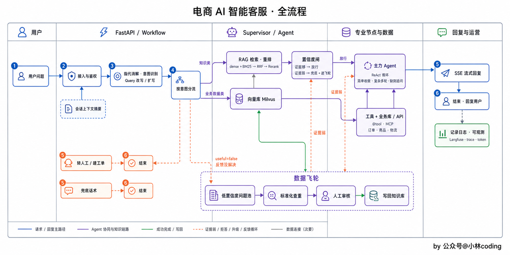
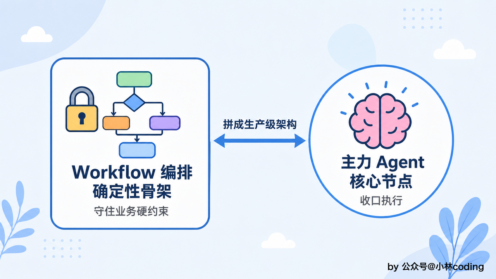
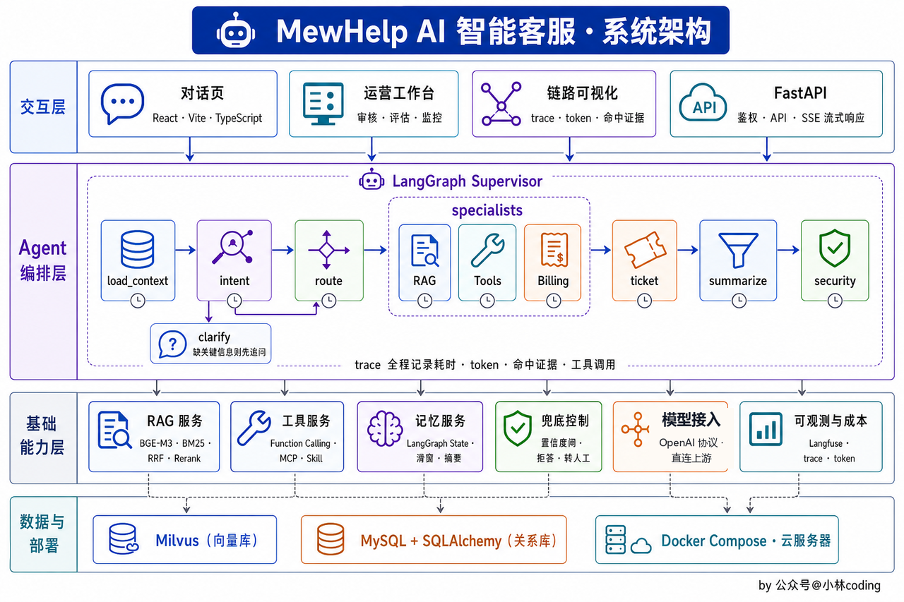
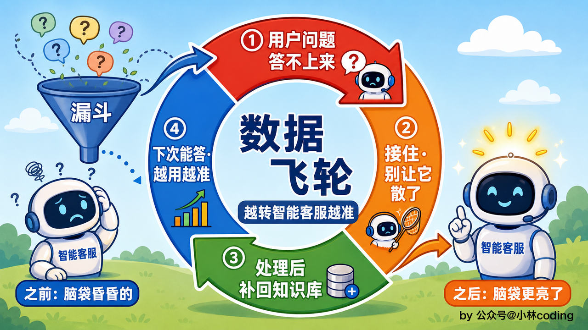

这一篇拆 MewHelp 的骨架：一条用户消息进来，中间经过哪些站、每一站为什么存在，以及这套结构为什么长成这样。想先看它跑起来的样子，配套的[「功能展示」](https://icnaxnmh86kx.feishu.cn/wiki/VdP9wQSVziV0CLknRY6cj7ttnve)一篇里有真实对话截图。

***

## 全景：一条消息的旅程

先看全景图，一条消息从进来到回答，走的是这条线：

逐站拆开说，跟着图上的编号走。①用户问题进来。②是接入与鉴权，项目为了更聚焦 Agent 开发，这一块省略了，前端把 user\_id 带上来就算接入。有想法的同学可以自行补充，或者找我来完成后续开发哈。③是 AI 第一次上场：指代消解加意图识别，把「那它能退吗」这种依赖上下文的半截话，结合最近几轮对话补成一句独立能看懂的完整问题，再判断它属于九类意图里的哪一类。④按意图分流，九类意图收进五个出口，这是全流程最重要的一道岔口。

五个出口各有各的确定性保障。问政策、问 FAQ 的知识类，强制先检索再答，检索回来还要过一道置信度闸门，证据撑不起回答就直接兜底，不进生成。退款退货走一条写死的子流程：先取订单，缺订单号就弹选择器等用户点选，再强制检索退货政策，最后才把「这一单能不能退」交给模型判断。查订单物流的交给主力 Agent 拿工具去翻。闲聊给固定话术，不再让模型生成回复。投诉先安抚，给出转人工或建工单的选项。

不管分流分了几条路，最后都汇合到主力 Agent 这一个节点对外输出，答复口径和留痕都统一。⑤回答用 SSE 流式逐字推给用户，第一个字很快就冒出来，答不上的走兜底话术或转人工，⑥结束并回复用户。答不上的问题不会白白溜走，攒进问题池等人工审核补库，这就是图下方那条数据飞轮。

***

## 为什么是 Workflow 加 Agent 的混合

先想一个问题：为什么不把一切都交给一个 Agent 自己决定？因为客服里有几处硬约束是不能赌模型自觉的：知识类不检索就答会编，退款不查政策就承诺会赔，投诉硬接会火上浇油。模型再强也没法保证每次都守规矩，而这些场景一次出错就是事故。还有就是对于智能客服来说，大量用户只会问几句问题，我们必须正确地对用户的首句问题或前几句问题迅速准确回答，所以不能依赖于 Agent 自己去探索和使用 RAG，时间不可控，稳定性也是。

所以架构定成混合：业务铁律用 LangGraph 写死在图上，是为确定性 Workflow 的骨架；模型只在真正需要开放推理的环节发挥，也就是主力 Agent 的 ReAct 循环，想一步、调个工具、看结果、再想下一步，直到信息够了收敛作答。一句话概括这套分工：能靠代码守住的可靠性，绝不交给模型的临场判断。

选 LangGraph 而没用线性的 Chain，原因也在这张图上：这条流程有分叉、有汇合、还有 ReAct 那个环，状态一路被各节点读写，图模型天生适合，而且它能把会话状态持久化，多轮续接、中断等用户回填都靠它。

***

## 分层看这套系统

| 层    | 技术                             | 负责什么                                   |
| ---- | ------------------------------ | -------------------------------------- |
| 交互层  | 原生 HTML + SSE 流式               | 对话页、运营工作台，界面故意从简                       |
| 服务层  | FastAPI + SQLAlchemy           | 接口、订单归属校验、流式响应                         |
| 编排层  | LangGraph                      | 整张状态图：分流、子流程、主力 Agent，会话状态持久化撑起多轮和中断恢复 |
| 检索层  | Milvus + bge-m3 + bge-reranker | 一个库扛稠密向量和 BM25 两路召回，融合后精排              |
| 存储层  | MySQL                          | 业务数据、知识块、审计日志、问题池                      |
| 支撑系统 | Langfuse + 数据飞轮 + RoBERTa 分类器  | 全链路可观测，答不上的问题闭环回知识库，旁路做主题归类统计          |

***

## 支撑系统：看得见，还越用越聪明

可观测这层是线上排障的地基。一条请求经过消解、意图、检索、Agent、工具好几站，接上 Langfuse 之后能把每次请求还原成一棵调用树，每个节点的输入输出、检索回了什么、耗掉多少 token 都看得见。挂载是零侵入的，流程编译时挂一次回调，节点业务代码一行不动。

数据飞轮管的是「答不好之后怎么办」。三个入口：检索证据弱被拒答的、生成前自评没过的、用户点踩的，全部落进问题池，连同当时的检索快照。人工按被问频次审核，判断是真缺知识还是没检索到，补上答案点通过，这条问答就按入库流程写回知识库、向量化，用户下次再问就能答上。系统就这么越用越全。

***

每一层为什么选它、跟备选怎么权衡，各章理论篇里详细拆。选型总表见「必读」攻略的技术栈一节。
