上一章数据飞轮转了一阵，把 bot 没答好的问题一条条接住，攒进低置信度问题池，几千上万条堆在那里。问题攒够了，你其实很想知道一件事：用户到底最常卡在哪一类上？是物流迟迟不到、要退换货、拿不准尺码，还是发票开不出来？搞清楚这个，才好排出先补哪块知识的优先级，把人工审核的力气用在最缺的那块。

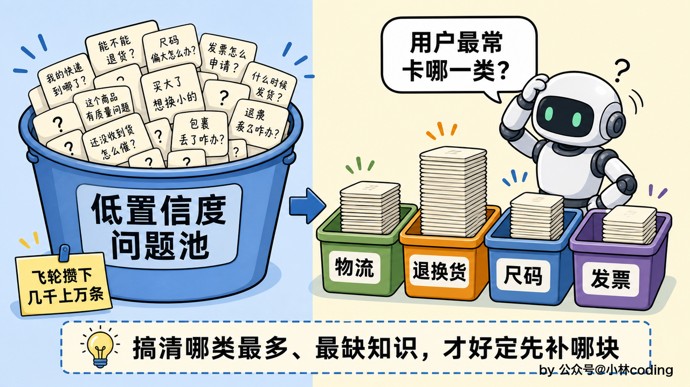

要回答它，得把这几万条问题按固定的主题类目归个类，数一数哪个类目下堆的问题最多。量小的时候，把问题一条条喂给大模型、让它逐条打个主题标签，也能对付。可几万条一条条调大模型，又贵又慢；主流问法它还认得，碰上方言、错别字、一句话里夹着好几个诉求，逐条打标也容易不正确。这种量大、类目固定、还要便宜要快的归类任务，需要分类器出马，这正是该请微调出场的时候。这一章，我们就来把那台小分类器亲手训练出来。

## 模型都这么强了，为什么还得微调

动手之前，先想个问题：什么是微调？现在的大模型这么能打，一段提示词就能让它干好多事，为什么还要费劲去微调？

提示词是「引导」，你在输入里把规则讲清楚、摆几个例子，它顺着你的话去答，模型本身一个参数都没动。微调是「改造」，拿一批标好的数据去再训它一轮，动的是模型的参数，相当于改了它的脑回路，让它对某一类任务变得格外敏感。引导是临时的，这一轮给了它就听、下一轮不给就忘；改造是长在模型身上的，它会一直有这个思维。

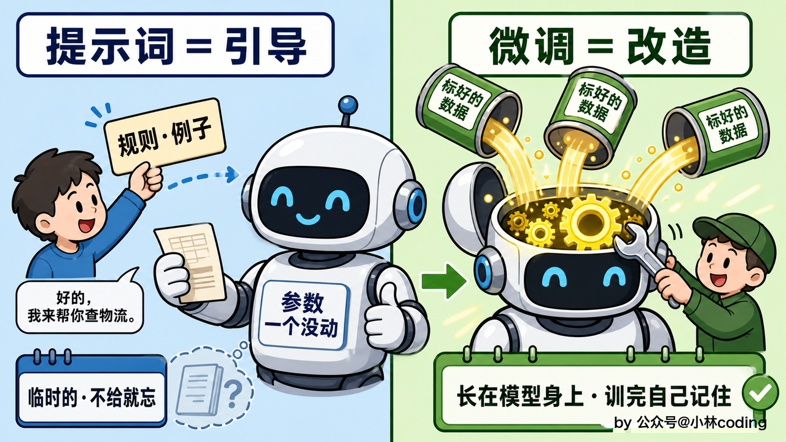

基座模型越强，提示词能覆盖的东西就越多，需要动用微调的地方反而越少。早两年模型弱，好多任务提示词怎么调都不稳，只能靠微调；现在换个强基座，同样的任务一段提示词就搞定了。所以微调的第一原则，是能用提示词就别微调，把它省下来，只留给提示词怎么调都搞不定但是又必须要做到的那点残余。

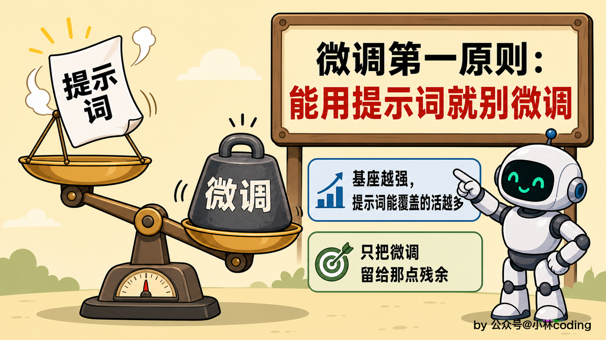

## 什么时候才轮到微调

那怎么算该上微调了？就拿这一章要做的主题归类来说，先看看会有哪些点我们会遇到的。

头一道坎，例子举不完。假设我们用提示词做归类，就是把类目连着例句写进提示词里教它：「退货」「退款」「想退了」都算退换货，一个类目一个类目放例子。类目本身不算多，电商客服的主题归类，十几二十个顶天了，光把类目名单写进去绰绰有余。

但是每个类目底下，其实还需要一些例句，也就是 few-shot 来指导模型，可问题是：每个类目底下，用户的说法无穷无尽，比如退换货这一类，教完「退货」「退款」「想退了」，后面还有「退钱」「不想要了」「买错了想退」「七天无理由还能退不」。few-shot 教来教去，教到的永远只是零头，而且还得注意上下文窗口的限制和 Lost in the Middle，所以模型仍然不能保证归类正确。

还有就是方言、口语、错别字一上来就有点麻烦，「俺买的那玩意儿咋还没到俺这疙瘩」问的是物流，可字面上「快递」「物流」的字眼一个没蹦出来；有人还把「退货」打成「退活」，模型得先绕过这个错字才认得出；「催下快递，对了这个有色差还能换不」，物流、退换货两个主题都提到了，它有时只认其中一个，有时两次认的还不一样。同一种说法甚至可能今天归这类、明天归那类，答案飘忽。

最后是成本。每天堆积的问题一条条喂大模型，又贵又慢，量还天天在涨，这么跑挺浪费的。

所以其实可以专门训一个小模型来接这个任务。小模型跑得快、成本低，不过可能没见过你这套类目，直接拉来用还认不全。微调干的正是这件事：拿标好的数据把这套固定的分类体系训练进去，让它面对见过没见过的说法都可以往对的类目上靠。

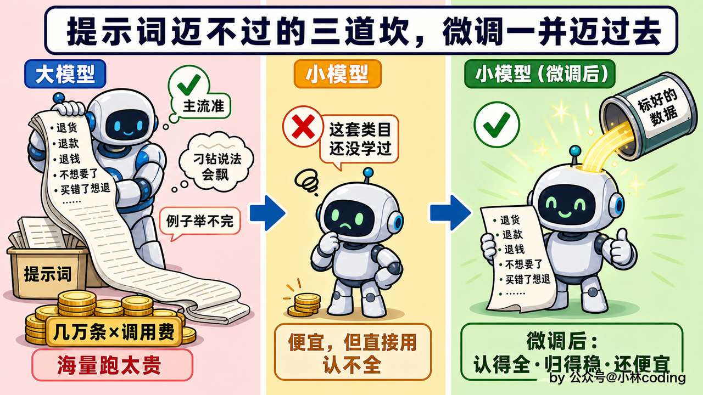

## 微调是个笨办法，得先算这笔账

话说回来，真决定上微调之前，还得先算笔账。微调是个笨办法，前期投入大、见效慢，标数据、训模型、调参数，一套下来不轻松。它划算的前提，是你面对的是大量、重复的处理量。

主题归类正好对上这种量。飞轮里的问题成千上万地往里堆，每天还在涨。到了万级的处理量，分类哪怕只错百分之一，算下来也是上百条问题被归错、上百个补知识的判断跟着错。量堆到这个级别，微调那点前期投入才值得做。

还有一层容易被忽略：问题量天天在涨，可归类靠的那套类目却相当稳。电商客服的主题大类，物流、退换货、尺码、发票，一年到头也难得改一回。类目稳，分类器训练一遍就能顶很久，不用三天两头推倒重新开始。要是类目隔三差五翻新，训好的模型没几天就跟不上，这前期投入可就打了水漂。

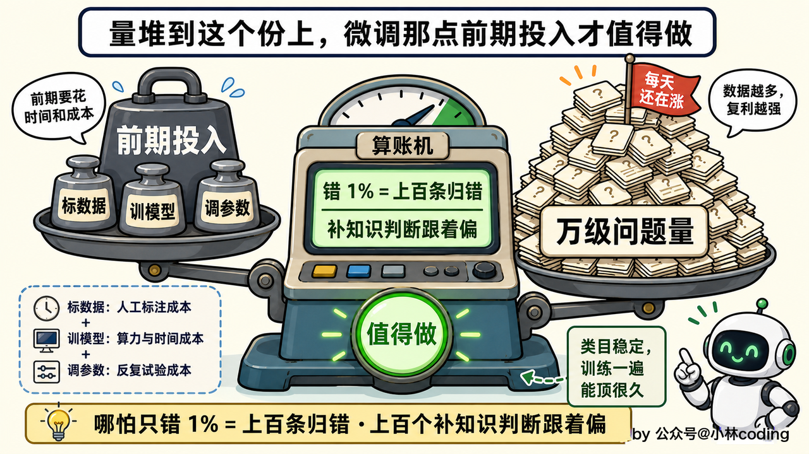

反过来，有些输入微调也救不了。问题本身含糊到家、你自己都拿不准该归哪类；类目定义彼此重叠、标的时候两个类都说得通；用户一句话前后自相矛盾。这几种情况，症结都在数据本身没治理干净，跟模型强不强没关系。这种情况该回头去修数据和类目定义，不是加练几轮模型能解决的。

## 动手之前，先想清楚微调的到底是什么

该不该微调想清楚了，接着得想微调什么。

前面也说过，具体到咱们这个系统，是要主题分类器，给飞轮的数据做分类统计，让我们更方便分析。对于多变、模糊的用户问题，归到一个或几个固定的主题类目，比如物流、退换货、尺码、发票。多数问题落一个类目；碰上「买大了想换小一号」这种一句话两个诉求的，尺码、退换货两个标签都打上，业内管这种任务叫「多标签分类」。

然后哪个类目下堆得最多、最缺知识，一目了然，数据飞轮可以根据这个排补知识优先级。

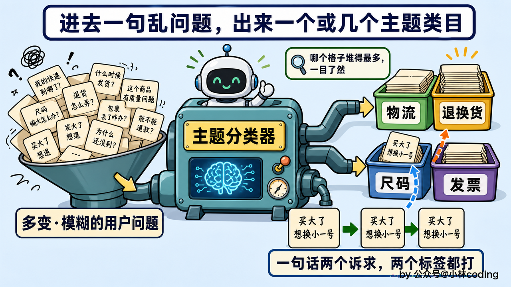

可能有人问意图识别是不是也能微调？同样是给用户的话分类，意图识别里判物流、订单、退款退货那九类意图，走的是大模型加提示词，没去微调小模型；这一章的主题归类却要微调。这是为啥？

意图识别难在多轮。用户从问物流聊到要退款，说两句又绕回物流，判断当前这一句该归哪类，得读懂整段对话怎么一步步走到这里的，业内管这叫对话状态追踪。而小模型做单句分类又快又准，可它不好处理这种跳来跳去的上下文，除非把整段历史都塞进去重新设计输入，工作量早超出微调能兜的范围。当然意图识别那章也说过一条降级路：可以让微调小模型先初筛、只在它拿不准的时候再升大模型。所以意图识别不是说不能微调，但是就是要做一个权衡。

主题归类难道就不一样吗？你可能会想：对话里的问题一样离不开上下文，「这个还能退吗」单拎出来，谁知道退的是什么？其实这层依赖，在问题进池子之前就被上游处理掉了：意图识别那章讲过，请求一进系统就先做指代消解，「这个」早被还原成具体商品；放进飞轮之后，上一章的问题标准化又把原话去噪，改写成一句 FAQ 式的标准问法：「我上周买的那双鞋跑了两次就开胶了这也太坑了吧能不能给我退了啊」，标准化之后就成了「商品出现质量问题（如开胶）能否退货」。

所以轮到分类器接手，一条问题就是一条语义完整的独立文本，不用管它出在哪轮对话里、前后聊了什么，只按这句话本身归类，是跟这个会话没关系的，没有多轮状态要追溯，正好落在小模型分类的舒适区里。你也可以理解成，意图识别是会话维度的任务，判的虽然是当前这一句，依据却是整个会话一轮轮积累下来的语境；主题归类是单句维度的任务，只看手上这一条问题，归进哪个主题类目就完事。

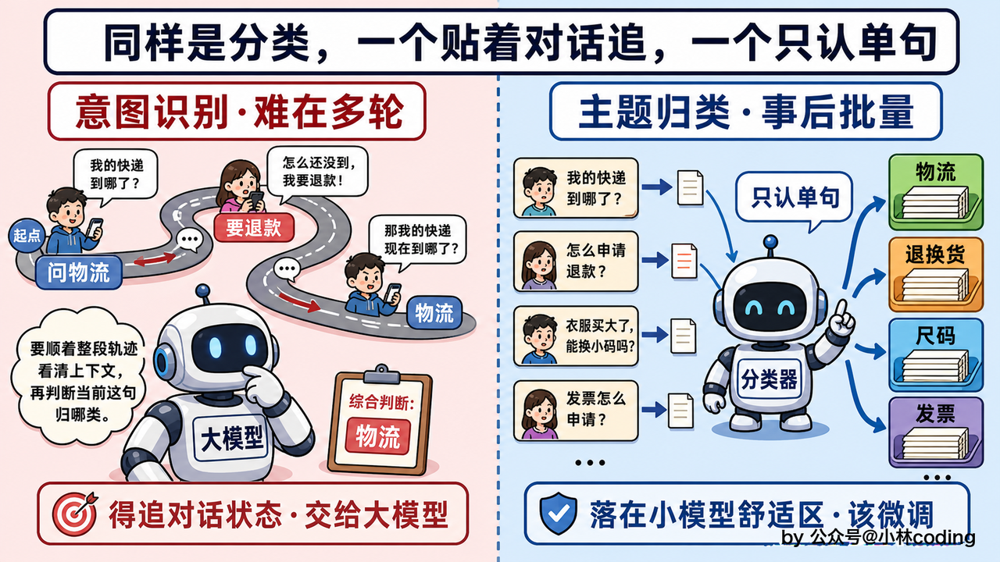

## 分类为什么不挑最大的模型

要微调一个分类器，第一反应可能是挑个最能打的大模型来训。但事实上分类任务上，最大的模型往往不是最优解。

分类和生成，是两种任务。像 BERT、RoBERTa 这类「编码器模型」，天生就是为分类长的，它把整句话读进去、压成一个向量，再拿这个向量对每个类目各打一个分，哪个类目过了线就挂上哪个标签，一句话同时中了几个就一起拿出来，我们要的正是这种每个类目独立出分的本事。生成式的大模型呢，它本行是一个字一个字往外蹦，让它做分类，其实是拿生成那套架构去「模拟」分类。

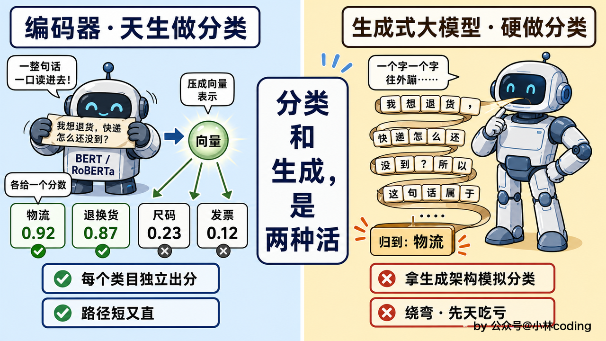

就算不看效果，光算成本这笔账，编码器也占便宜。BERT 类模型个头小，训起来、跑起来都比动辄几十上百亿参数的大模型快得多，训练和部署下来省的资源能差好几个数量级。

中文场景，这一档里 RoBERTa-wwm-ext 是个稳妥选择，哈工大讯飞联合实验室出的、基于 BERT 的中文模型，参数量一亿出头，跑咱们这种十几二十个类目的主题归类也够用了。同时也顺便提下，百度的 ERNIE 3.0、同出哈工大讯飞的 MacBERT 也都是同类里的常见选择，接口用法都接近，随时能换上。

## 用什么微调方式

模型选定了，接着看具体怎么训。微调的方式无非两大类，差别就在训练时动多少参数：要么把参数全动一遍，要么只动一小撮。

一类是「全参微调」，模型里所有参数跟着训练数据更新一遍。它是微调最原始、最正统的形态，效果也最好。微调常被念叨的坏处是吃显存、模型越大越训练不动，可咱们这台 RoBERTa 上根本不存在：一亿出头的参数量，全参训一遍几个 G 显存就够，一张消费级显卡随便跑。分类器这个体量，全参微调就是默认选择，省心，效果也稳。

如果说我们需要的模型几十亿、上百亿参数，显存扛不住。那么可以用「参数高效微调」，缩写 PEFT：原模型不碰，只在旁边另挂一小撮新的可训练参数，训练只更新这一小撮，靠它逼近全参的效果，显存却降下来一大截。「LoRA」是 PEFT 里最常用的一种，「QLoRA」再狠一点，把冻住的原模型压成低精度存着，好让更大的模型在单张消费级显卡上也训得动。

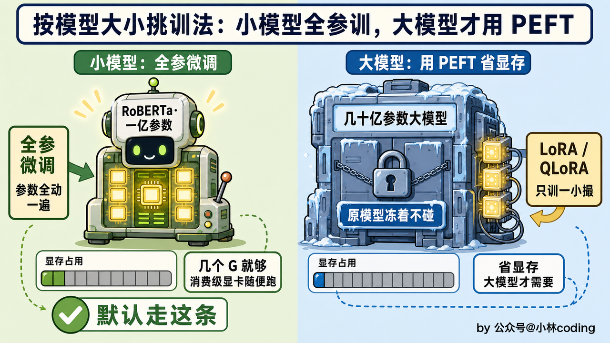

总结来说，小分类器，全参微调训出来就够用。真到哪天想换个几十亿参数的大模型来做，再把 PEFT 请出来不迟。

## 微调的成败，全押在数据这一步

虽然前面说了这么多，但是其实微调真正的成败最重要的还是数据。这一步做扎实，前面选什么模型、怎么训练都得建立在好的数据基础上。

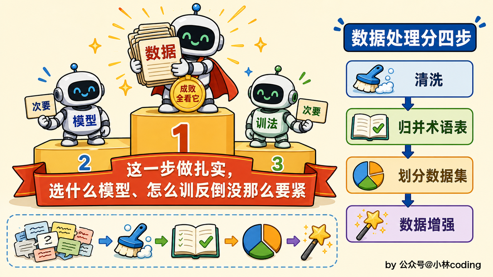

数据处理大致分四步走。

第一步清洗。原始问题从飞轮里捞出来，带着用户的手机号、订单号这些敏感信息，先脱敏抹掉；错别字、乱七八糟的格式、标注里的手误，也一并处理掉。这步没什么技术含量，就是耐着性子的体力活，可漏不得。

第二步「归并术语表」。电商客服里，同一个意思用户能有一百种说法，「退货」「退款」「退钱」「想退了」，指的是一回事。归并术语表干的，就是把这些散落的说法收拢到同一个标准类目底下，全系统上上下下只认这一套术语，绝不能这块表叫「退货」、那块表叫「退换」，各说各话。这张表一旦定死，后面还会沉淀成一份结构化的知识库，全流程都靠它对齐，所以务必保证它对得上、只有一份。

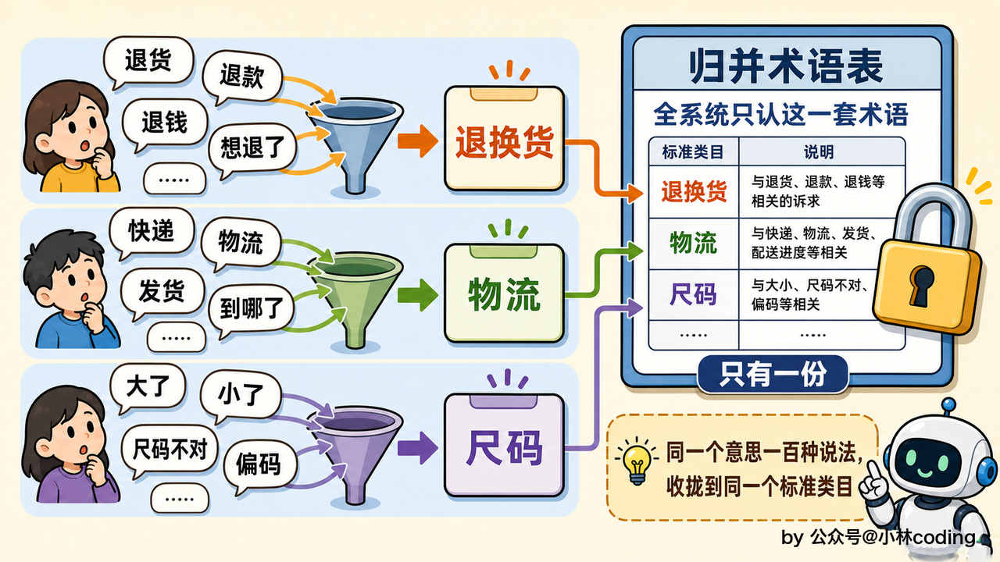

咱们这套系统的归并术语表长这样。每个类目都配一句边界说明，什么算、什么不算写清楚，划清界线，标注的时候就对照这张表：

| 主题类目 | 什么算这一类                   | 用户的说法示例                |
| ---- | ------------------------ | ---------------------- |
| 退换货  | 退货、换货、退款怎么办              | 退货、退款、退钱、想退了、七天无理由还能退不 |
| 物流   | 货走到哪了、什么时候送到             | 快递、发货、到哪了、怎么还不动        |
| 尺码   | 大小、码数合不合适                | 大了、小了、尺码不对、偏码          |
| 发票   | 开票、抬头、报销凭证               | 开发票、发票抬头开错了、能开增值税发票吗   |
| 质量问题 | 商品本身的毛病                  | 开胶、断底、破了个洞、有瑕疵         |
| 运费   | 运费谁出、运费险理赔；管的是钱，货走到哪了归物流 | 包邮吗、退货运费谁承担、运费险怎么赔     |
| 优惠活动 | 券和活动怎么用、能不能叠             | 优惠券、满减、活动价、能叠加用吗       |
| 价保   | 买完降价了补不补差价               | 刚买就降价了、能补差价吗、保价期多久     |
| 支付   | 付款环节出的问题                 | 付不了款、花呗分期、扣了两次钱        |
| 订单修改 | 下单之后改信息、取消订单             | 改地址、改电话号码、订单还能取消吗      |
| 库存补货 | 有没有货、什么时候补               | 有货吗、断码了、什么时候补货         |
| 商品信息 | 材质、功能、用法                 | 什么材质、怎么洗、会不会缩水         |
| 保修维修 | 保修期限、维修换新；修归这里，退归退换货     | 保修多久、坏了能修吗、能换新吗        |
| 账号   | 登录、绑定、账号安全               | 登录不上、忘了密码、换绑手机号        |
| 会员积分 | 会员权益、积分怎么用               | 积分怎么用、会员几级、积分能抵钱吗      |
| 评价   | 评价、晒单的规则                 | 评价怎么改、追评在哪写、晒单有奖励吗     |
| 其他   | 上面都对不上的，先兜底              | ——                     |

可见每个类目底下全是收不完的长尾——头一道坎说的「例子举不完」。

第三步划分数据集。把清洗归并好的数据切成三份，「训练集」、「验证集」、「测试集」，常见的分法是八比一比一。

训练集是模型平时做的练习题，参数全靠它更新；验证集不参与训练，训练途中拿出来进行摸底考试；测试集则是相当于正式考试，训练完后去进行测试。数据分到这几个数据集的时候，得按类别「分层抽样」，保证每个主题类目都按比例出现在三份里，别让某个类目全挤在训练集、验证和测试里一条都没有，那样评出来的分数可能会被模型投机取巧。

第四步「数据增强」。手头标好的样本往往不够，可以让 AI 帮着扩充一批：同一句话换几个同义词、把陈述句改成「我想问一下……」这样的口气，在不改原意的前提下，一条变出好几条。样本多了、说法杂了，模型见的世面广，遇到没见过的问法也更加有底气。但只能扩训练集那一份，验证集、测试集得保持原样：这两份是拿来考试的，考题要是照着练习题变出来的，等于考前漏了题，考出来的分数就不对了了。

这四步里要注意一个点：字面提到几个主题，就标几个。「催一下我的快递，另外这东西要是有问题还能退吧」，物流、退换货都明明白白写在字面上，两个标签都打；可要是只说「这鞋买大了一码」，那就只标尺码，别因为觉得可能要退换，就顺手把退换货也标上。类目之间的关联留给业务去理清，标注不应该来揽这个活。

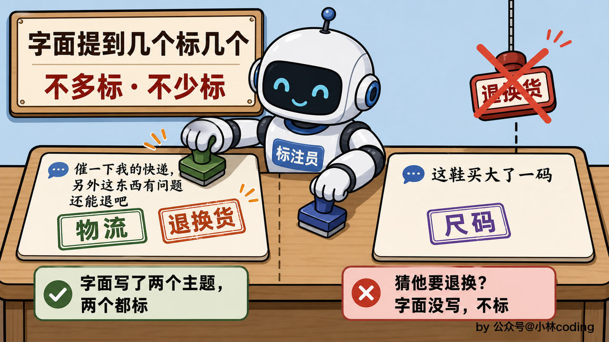

说到标注，这几千上万条的标签从哪来？方式无非三种：全靠人工一条条标，准是准，但是很慢，还很耗费精力；全让大模型生成，快是快，质量却参差不齐；眼下最常用的是折中，让大模型照着术语表先预标一遍，人工再抽样把关。咱们从飞轮里捞出来的是真实问题，也是这样的一条路线。

标好的一条训练样本，大概就是以下的样子：

就是一句用户原话配上一组主题标签。`labels` 就是打上的类目。成千上万条这样的样本喂进去，模型慢慢就学会了这套归类的门道。标签取的正是术语表的标准类目，前面归并术语表如果没做好，这里的标签就也会乱套。

## 欠拟合与过拟合：效果不行，先搞数据

训练跑起来之后，会碰上两个绕不开的词，「欠拟合」和「过拟合」。

欠拟合，可以理解为是学生压根没好好复习，书翻了两页就上考场，结果平时的练习题不会做、考试的新题也不会做，知识本身就没学进去。模型欠拟合，多半是模型太弱、或者喂的数据特征太少，撑不起这个任务。

过拟合反过来，是学生把练习册连题带答案死记硬背了下来。如果出的都是原题，那么模型表现出来就是非常厉害的样子，但是题目稍微变个说法，立马傻眼，因为他记的是题、没学会解题的方法。模型过拟合，多半是数据量不够、或者数据里噪音太多，模型没能从里头摸到真正的规律，只好硬背，一换说法就露馅，「泛化能力」也就无从谈起。

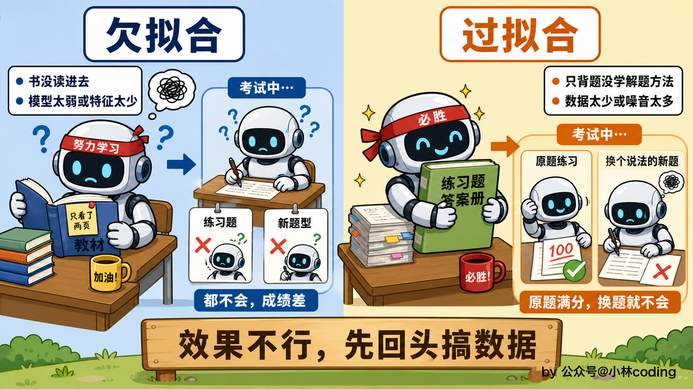

两种情况看下来，结论意外地一致：效果不行，先回头搞数据。数据量够不够、干不干净、类别合理不？这才是根本。

## 第一版为什么总翻车：数据质量排第一

头一版分类器训出来，效果多半不理想，这几乎是常态，不必意外。

最常见的两种毛病：一是某些类目的样本太少、类别之间数量悬殊，模型见得少的那类自然学不好；二是标签本身就标乱了。同样是「买大了想退」，这批标了尺码加退换货，那批只标退换货，还有的只标尺码，同一种说法标出三种组合，模型收到的信号自相矛盾，这在业内叫「标签噪声」（label noise）。

解决手段也是从数据下手：把稀缺类目的样本补足、把数量拉平，再回头按「字面提到几个标几个」约束，把标乱的样本重新对齐；模型这边配合着调调参数，加上「正则化」防它死记硬背，再用「早停」盯着验证集的分数、一见不再涨就及时收手，效果才一点点稳下来。

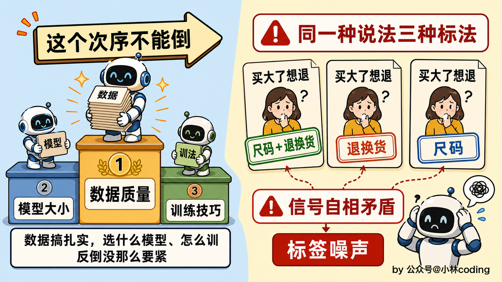

## 延伸一步：Embedding 也能微调

到这里，微调分类器就完成了。顺着微调这个话题往外延一步：能微调的不只有分类模型，前面 RAG 那两章反复出现的 Embedding 模型，一样能微调。

通用的 Embedding 模型在「满减」「花呗分期」这类电商黑话上召回偏弱，它没怎么见过这些词，在向量空间里摆的位置就不准。拿自家语料微调一下 Embedding，能把这些词的位置校准回来，从源头把 RAG 的召回质量往上提升一点。

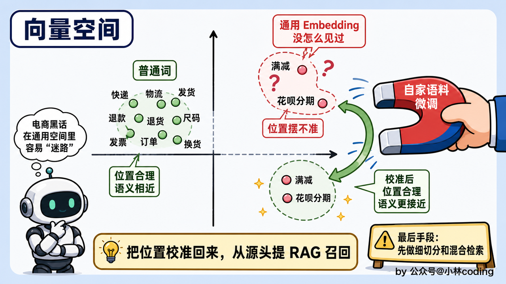

但这条路是留到最后再走的。召回上不去，先别急着动 Embedding，回头把切分做细、把混合检索和重排配齐，这几步又快又省，多数时候召回就补回来了。这些都做到位、召回还是差那一口气，才轮到微调 Embedding 这步，毕竟微调不是什么舒服的事情。

## 训出来的模型，得验证

模型训练出来，好不好用不能靠感觉，得验证。

拿出测试集：按类目一个个算，「精确率」看打上的标签里多少是真该打的，「召回率」看该打的标签漏了多少，综合两者是「F1」；每个类目再配一张「混淆矩阵」，该打的没打、不该打的打了，矩阵一出来就能看清楚。光看分数还不够，得配上误判的容忍度，有些类目归错了无伤大雅，有些归错了后果严重，容错的红线还得定义下。

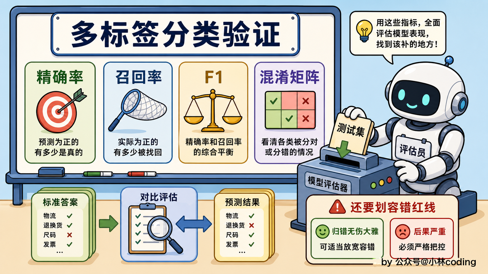

具体到咱们这台分类器，拿划分数据时留出的那份测试集喂进去跑一遍，把预测结果和标准答案比较。当然机器算出来的分数会被表面糊弄过去，得从判错的样本里抽一批出来自己看，弄明白它到底错在哪一类、是不是标注本身就有毛病。

还有一条得记牢：评测集务必扎在自己的电商场景里造。公开的通用榜单，像 MMLU、C-Eval 那些，测的是模型的通用知识，替代不了这套主题归类的真实表现，必须只有拿贴着自家业务造的评测集去测。

## 训好了怎么用：挂在旁路批量跑

最后一步，训好的分类器怎么接进系统。它挂在旁路上，按批量跑：飞轮里的低置信度问题攒够一批，就整批喂给分类器归一次类，我们分析的时候就可以根据统计这些每个类别的情况，去排补知识的优先级。

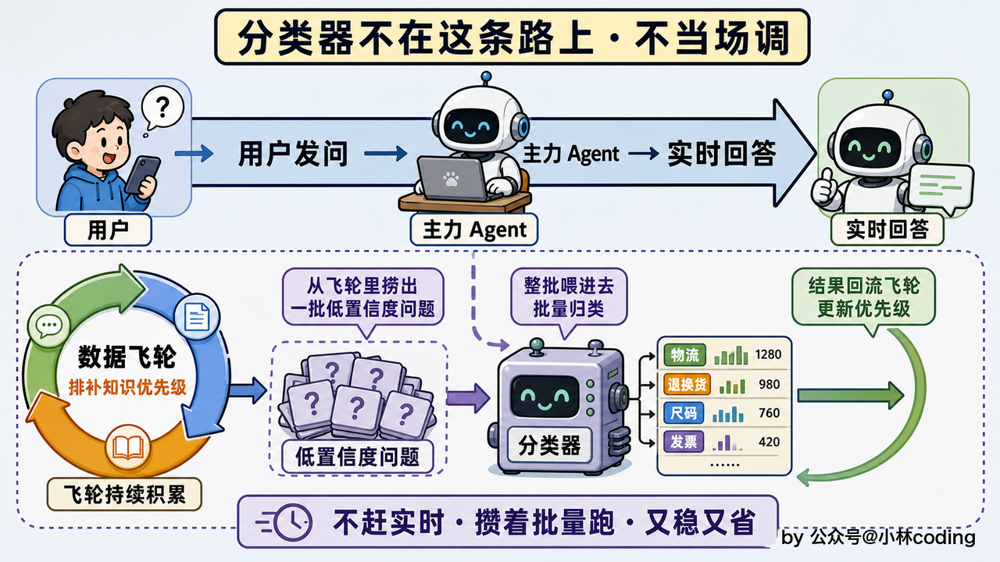

## 本章小结

这一章从飞轮那堆问题讲起，一路想清楚了该不该微调、微调什么、怎么微调。

先是看提示词迈不过去的三道坎：说法无穷无尽，few-shot 举不完、刁钻的容易出错、海量逐条跑又太贵；再算笔账，量够大、类目又稳，微调这个笨办法才回得了本。

然后看微调什么，针对多标签文本分类，把多变的用户问题归进固定主题，字面提到几个标几个

对于怎么微调，分类任务挑编码器模型 RoBERTa-wwm-ext，这个体量全参微调就够，可真正的胜负手全在数据那四步，尤其归并术语表和老实标注。效果不行先搞数据，数据质量比模型大小、训练技巧都更重要。往

外延一步是微调 Embedding 提召回，那是最后手段。最后拿对的指标验证微调模型、把它挂旁路批量跑，接回飞轮。
