到这里，可以回头看了一眼来时的路：从第 1 章接上第一个 LLM，到 RAG 把知识外挂进来、工具让它够得着数据、架构给它搭了条确定性骨架，再到意图识别、上下文管理、可观测、数据飞轮，上一站还亲手训练出一台分类器。

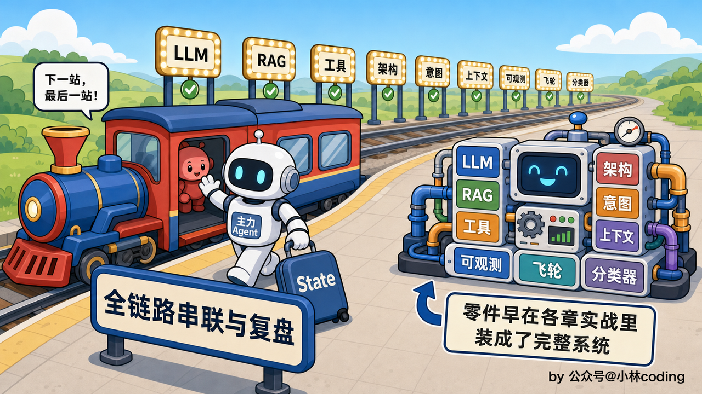

到这一章，你手上其实已经有一套能跑的完整系统了，前面一章章走下来，每一块都亲手搭过、接进了系统。所以这一章不再回头拆任何一个零件，前面都讲透了，这里只点名它是谁、回指是哪一章。重心换个视角：把这套已经搭起来的系统当成一个整体，看一条真实请求怎么从头到尾贯穿它、各个零件之间怎么交接协作，再回过头，把整条路上的选型和踩过的坑一起复个盘。

## 把整条线贯穿着看：一条请求的六站接力

先在脑子里把这条地铁线摆出来。一句用户消息从最左边进站，要依次经过指代消解、意图识别、按意图分流、置信度检查、主力 Agent 收敛、记录日志这六站，才从最右边出站，变成回给用户的一句话。置信度检查这一站只有知识类的车停靠：检索完先验证据，验不过当场折返走兜底，不再往 Agent 开。这张图第 5 章画过，当时管它叫请求流转的骨架，图上好几个站点还挂着「后面章节细讲」的路牌；一路走下来，那些路牌一块块都换成了正式站牌。现在正好把整张图重新铺开，每一站挂上它归属的那一章。

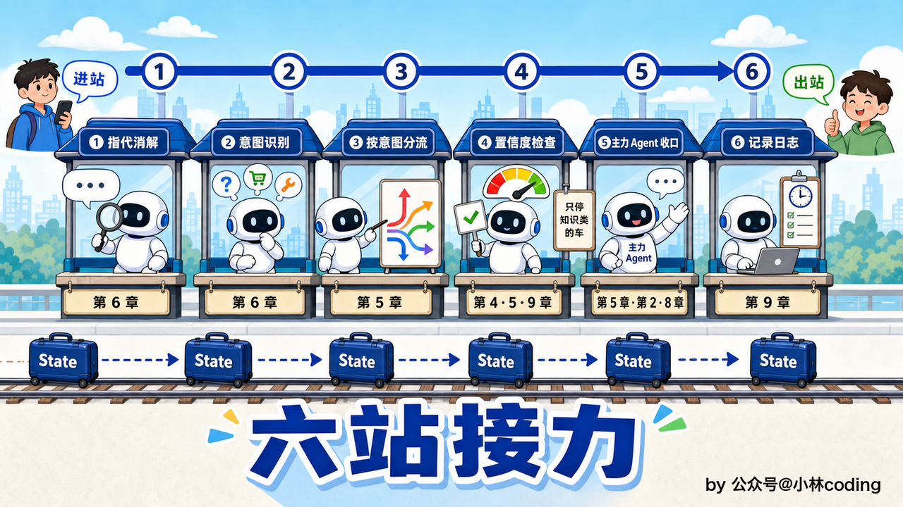

第一站，指代消解。用户发进来的往往是半截话，「这个还能退吗」「它什么时候到」，光看这一句系统处理不了。这一站拿最近几轮对话把「这个」「它」补全成一句脱离上下文也读得懂的完整问题，这是第 6 章开头讲的东西。补全好的这句话往后带着走，不管拿去检索还是判意图，用的都是它。

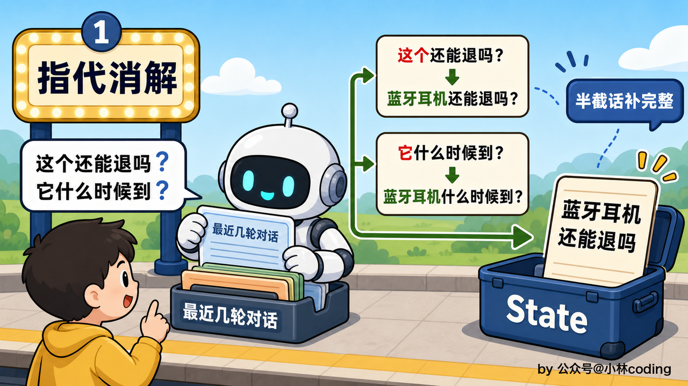

第二站紧接着是意图识别，同样是第 6 章的正题。它负责判断用户这句话到底想干嘛，判出来的是一小段结构化的 JSON，装着两样东西，意图类别 `intent` 和一个把握程度 `confidence`。这一站不解决怎么答，只负责把这句话准确地送上正确的轨道。

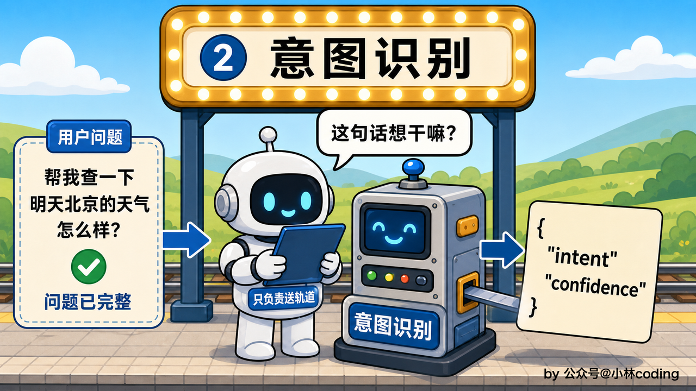

第三站按意图分流，这是第 5 章定的确定性节点，也是整条骨架最重要的一道岔口。分流规则写死在代码里：判成知识类的，比如问政策、问商品 FAQ，强制先走一趟 RAG 检索、把资料捞出来当上下文，这套检索是第 3、4 两章的东西；判成物流、订单这类业务数据问题的，不预先检索，直接送进主力 Agent；判成退款退货、售后的，走第 6 章拆出来的 refund\_flow 确定性子流程，先取订单再检索政策；闲聊和拿不准的「其他」，既不检索也不进 Agent，直接回一句写死的话术；碰上投诉的，先安抚一句，把「转人工」「建工单」两个选项交给用户自己点，不后端自动执行。


为什么知识类非得强制检索、投诉非得写死转人工，第 5 章讲过，这是几条业务高可靠性要求的场景，得靠代码守住。退款退货这条稍微特殊：判成它的时候，走的是第 6 章那条确定性子流程，先拿订单、再强制检索政策，最后只把「这一单能不能退」交给 Agent 定，取证和编排都写死，不让模型凭记忆瞎答。

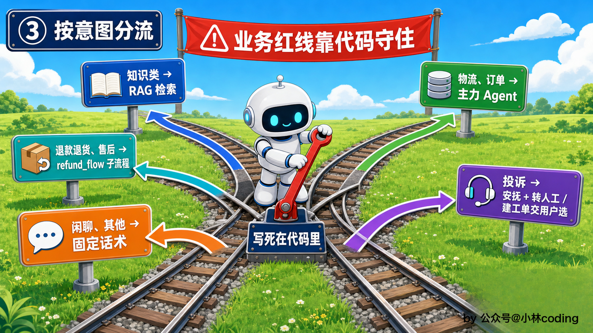

第四站，置信度检查。这一站开在知识线上，卡在检索之后、进主力 Agent 之前：检索回来的这批资料到底贴不贴用户的问题，这个分从检索链路里算出来，精排的分数、命中几条有效证据都算在内，过线才放行进 Agent；过不了线就当场折返走兜底话术，同时把这个问题记下来送进数据飞轮。Agent 的答复是逐字流式发给用户的，等答完再判证据就晚了，这道闸必须开在生成之前，也顺手省下了一次注定要作废的 Agent 调用。阈值定多少可以拿评估集校准。证据之外还有一道 useful 自评，开在下一站的生成阶段，模型边答边判这些资料撑不撑得起最终回答，撑不起同样拒答进飞轮；这两道再加上用户反馈没解决那一条，就是第 9 章定的飞轮三个入口。

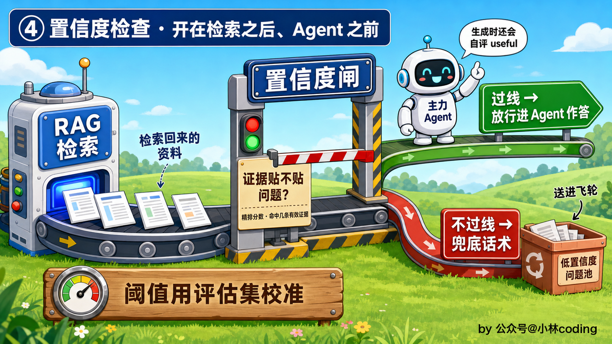

第五站是主力 Agent，前面几条分支到这里汇合收敛。它的脑子是 ReAct 循环，想一句该干嘛、调个工具、看结果、再想下一步，走到信息够了才收敛。不管意图多复杂，对外都收敛在主力 Agent 这一个节点上。

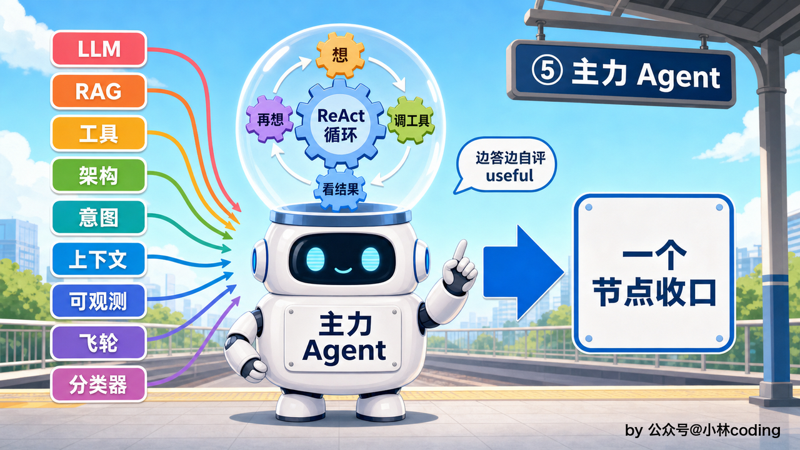

这里得补一条贯穿全程的暗线，会话上下文。从第一站起，每个节点都往里读、往里写。指代消解翻它才知道「这个」指哪件商品，意图识别读它才判得出用户从物流聊到了退款，主力 Agent 的 ReAct 循环每走一步又把新的思考和工具结果塞回去。怎么装装满了怎么裁怎么压，是第 7 章会话上下文管理专门解决的，落到代码里就是 LangGraph 那份共享的 State。

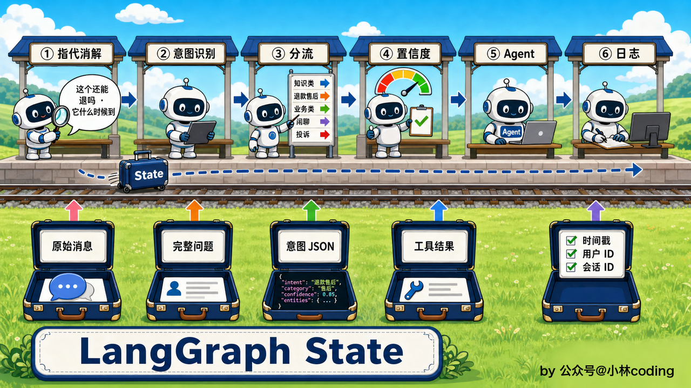

最后一站，记录日志。这一路上模型想了什么、调了哪些工具、检索回了什么、花了多少 token，全部留痕。这一站是第 9 章可观测性的地基，靠 Langfuse 把每次请求还原成一棵调用树，线上出了岔子能顺着树一步步查到是哪一步的锅。

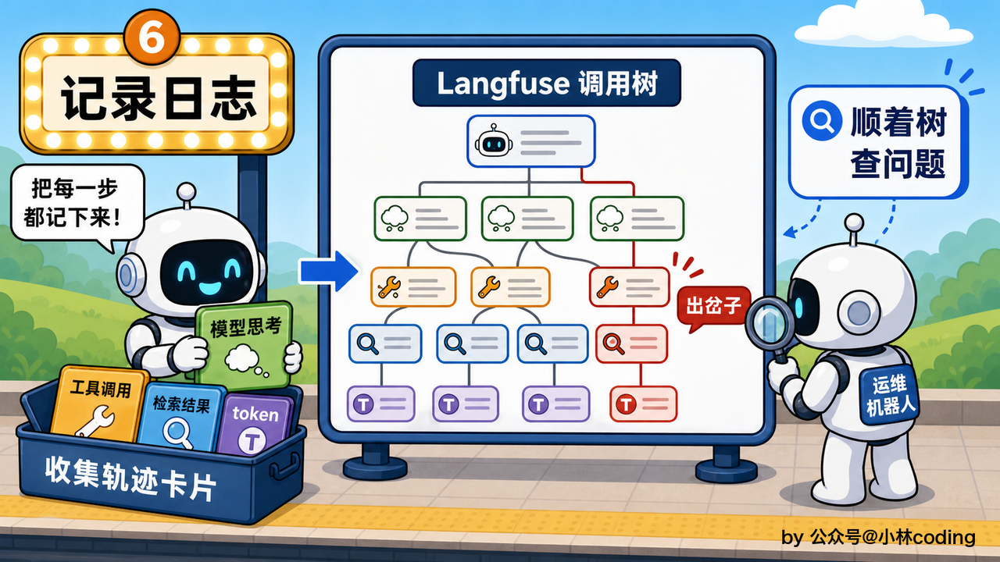

六站接力走完，一句用户消息就从进站的半截话，变成了出站时那句带着把握程度、留了全程痕迹的答复。

## 用 LangGraph 把六站接成一张图

上面这条线在代码里是怎么连起来的？靠的是第 5 章选定的 LangGraph。它把每一站做成图上的一个命名节点，节点之间用边接起来， State 顺着边走完全程。这张图的核心串联就几行：

```python
graph = StateGraph(ConversationState)
graph.add_node("resolve_reference", resolve_reference_node)    # 指代消解
graph.add_node("classify_intent", classify_intent_node)        # 意图识别
graph.add_node("retrieve_knowledge", retrieve_knowledge_node)  # 知识类走 RAG
graph.add_node("confidence_check", confidence_check_node)      # 置信度检查
graph.add_node("main_agent", main_agent_node)                  # 主力 Agent 收敛

graph.add_conditional_edges("classify_intent", route_by_intent, {
    "knowledge": "retrieve_knowledge",   # 知识类走检索
    "refund_flow": "fetch_order",        # 退款退货 / 售后进子流程
    "business": "main_agent",            # 物流、订单直接进 Agent
    "fallback_script": "fallback_node",  # 闲聊、其他走固定话术
    "escalate": "escalate_node",         # 投诉：安抚 + 交用户选转人工/建工单
})
graph.add_edge("retrieve_knowledge", "confidence_check")       # 检索完先过证据闸
graph.add_conditional_edges("confidence_check", confidence_gate, {
    "strong": "main_agent",              # 证据够，放行进 Agent
    "weak": "fallback_node",             # 证据弱，兜底 + 记入问题池
})

```

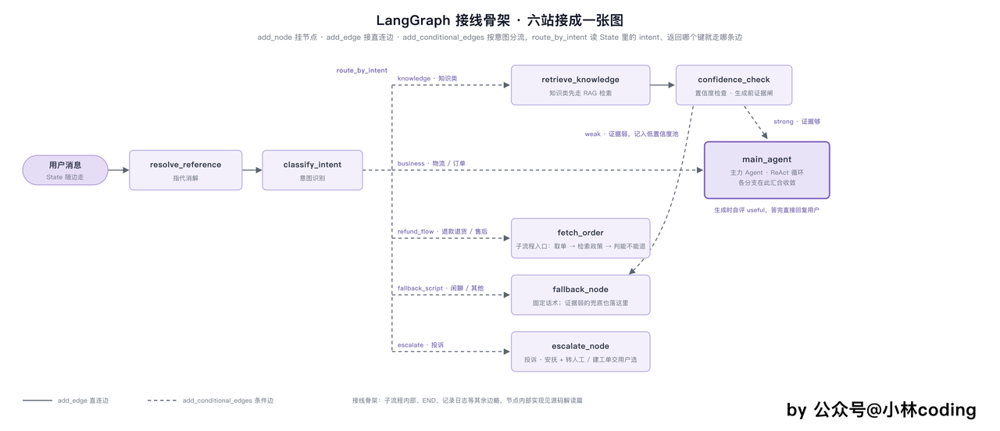

## 走一条完整请求：早上买的蓝牙耳机还能退吗

再跟着一条真实请求实地走一遍最直观。假设用户前一句刚问过蓝牙耳机的到货时间，这一句甩过来：「我早上买的这个还能退吗」。


进第一站指代消解，系统拿最近这两轮一看，「这个」指的是刚聊过的蓝牙耳机，把这句补全成「我早上买的蓝牙耳机还能申请退货吗」。补全后的问题写进 State 的行李箱，往下带。


进第二站意图识别，模型读这句话，判成退款退货类，把握也高，产出的 JSON 大致是 `{"intent": "退款退货", "confidence": 0.9}`，一并塞进行李箱。


到第三站分流，判成退款退货，走 refund\_flow 那条边，进确定性子流程。


进了子流程，就按写死的步子往下走。第一步查订单，这是个确定性节点，拿补全里的线索直接查这笔蓝牙耳机的订单，看到是三小时前下的、还没发货；万一发现没传订单号，就照第 6 章说的弹个订单选择器让用户点选回填。第二步取政策，流程里写死一趟强制检索，把退款政策捞出来当依据，这一步还能借上刚拿到的订单状态做 Query 扩写，比光凭一句「能不能退」扩得准得多。


订单和政策都齐了，到第五站，轮到主力 Agent 做这判断：这一单到底能不能退。它拿着「三小时前下单、还没发货」这个状态，对上「未发货可全额退」这条政策，判定能退，组织出一句「这笔订单还没发货，支持全额退款，是否帮您提交」。

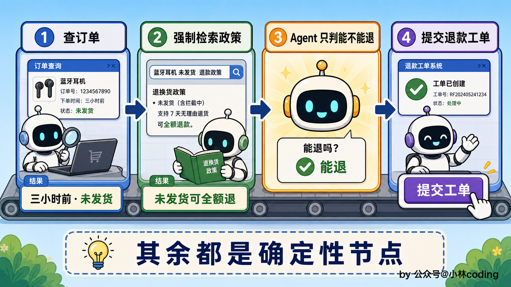

置信度闸开在知识线上，这趟子流程的车不停那一站；Agent 生成时那道 useful 自评，有订单数据和明确规则撑着，判为真，正常回复用户。


最后记录日志这一站，把子流程每一步都记进调用树：查了哪笔订单、强制检索捞回哪条政策、Agent 最后怎么判断能不能退、花了多少 token，每一步都记录在内。

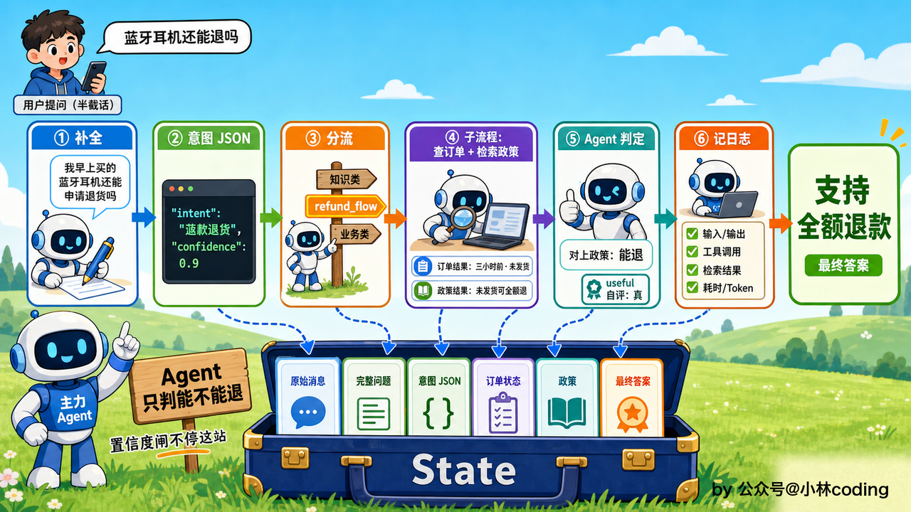

## 再走一条兜底进飞轮的请求

再挑一条会翻车的走走，翻车本身也是流程的一部分。用户问：「你们双十一的跨店满减，能跟会员积分券叠加用吗？」


前两站照常。指代消解没什么可补的，意图识别判成商品咨询这类知识问题，把握也正常。


到第三站分流，知识类触发那条强制走 RAG 的硬规矩，先去检索知识库。可这条跨店满减叠加规则是刚出的活动细则，知识库里还没来得及补，检索回来的几条文档都沾一点边、又都答不到点子上。


到第四站置信度检查，这道闸正好把它拦住了：检索回来的几条证据都不贴问题，证据置信度过不了线，不达标，当场折返。主力 Agent 压根没出场，也就没有机会硬凑一个听起来像那么回事的答案。系统走兜底话术，老实回一句「这个活动细则我还没查到准信，请您转人工确认」，同时把「跨店满减能否叠加会员积分券」这条问题记下来，送进低置信度问题池。

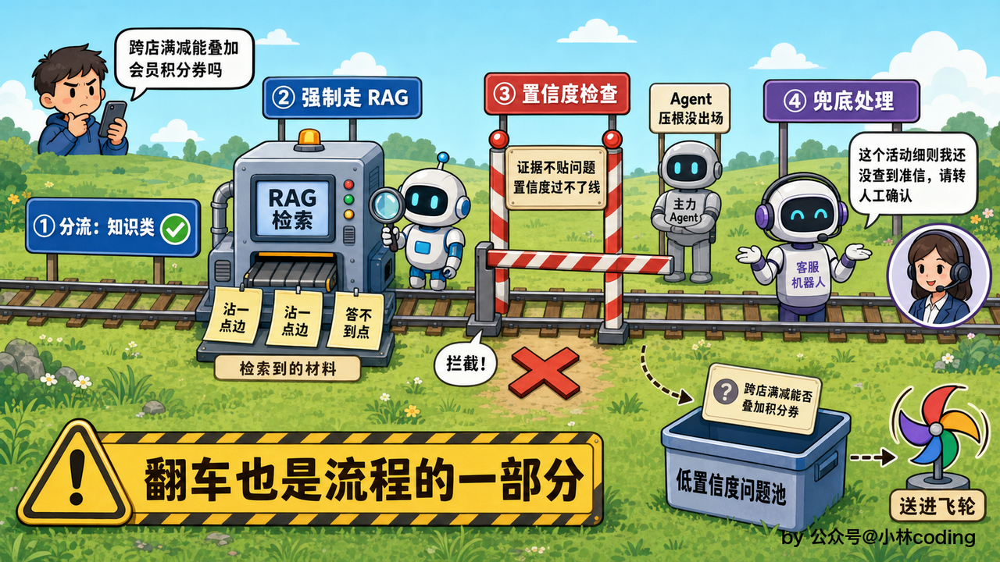

请求到这里对用户就结束了，可飞轮那边的事才刚开始，这是第 9 章的闭环：这条问题先被标准化去噪、改写成一句 FAQ 式的标准问法，再拿去查重看池子里有没有人问过同样的事、有就累加频次，然后进待审队列等人工补上准确答案、写回知识库。等这条知识补进去，下次再有人问同样的事，检索直接命中，就答得上了。这些问题还会被上一章那台分类器按主题批量归堆，看哪类最缺知识、先补哪块。

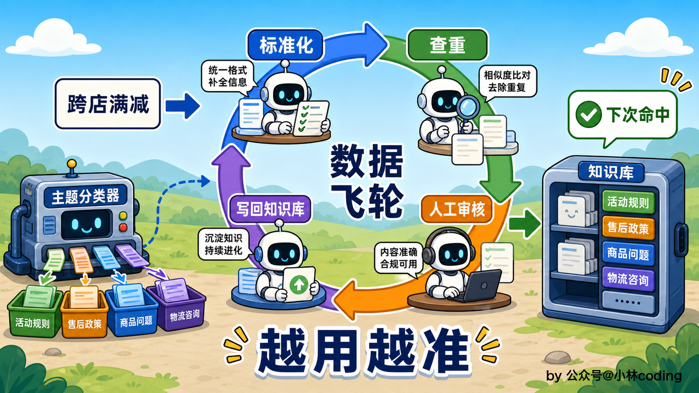

## 踩过的坑：一张收拢各章教训的清单

这一路每章都埋了坑、也都填了。把它们收拢成一张清单，每条回指是哪一章的教训。

* 关键词查表必漏召回。第 2 章的 `query_faq` 用 SQL LIKE 查表，用户问「邮费是多少」、库里写的是「运费怎么算」，字面对不上，就什么也查不出来。第 3 章上 RAG、换成语义检索才解决。

* 向量单路也有短板。第 3 章向量这一路碰上 SKU、型号、优惠券代码这类要靠字面对齐的词就漏，第 4 章补一条 BM25 关键词路径、两路 RRF 融合再 Rerank 精排，才既找得全又排得准。

* 切分切歪一寸，上层再强也救不回。第 3 章那条退货条款要是从中间被切成两半，检索只命中前半句，模型就敢答「可以退」。靠结构感知切分加关键条款标记才能增加保障。

* 扩召回别在入库侧做。第 4 章讲过，入库时把一条知识拆成多个问法分别存，会让同一知识占满检索的 Top-K 名额、把真正更相关的挤出去。扩召回要放在检索侧做 Query 扩写，库里每条知识只存一份。

* Agent 有时守不住硬约束。第 5 章反复强调，全交给 Agent 自己，它可能跳过 RAG 凭记忆乱答、该拒答时乱编答案。得用 Workflow 骨架把知识类强制检索、退款退货执行时强制取证、投诉强制转人工写死在流程里。

* 意图边界定义不清，准确率就上不去。第 6 章讲，prompt 里把每类意图的边界划清楚，是和模型能力并重的第一杠杆，边界含糊，再大的模型也判不稳。

* 光靠滑窗会漏早期上下文。第 1 章那版纯滑动窗口，用户聊回二十轮前的订单就丢了。第 7 章补上分层结构，近处留原文、中间按规则截短、最远的压成一段段摘要，各层额度从模型窗口倒推，订单号这类关键信息留在梗概里，用户回头翻旧话题也捞得回来。

* 数据质量决定微调成败。第 10 章那台分类器头一版准确率上不去，根子在标注，像「买大了想退」这种话有的标两个类、有的只标一个，同一种说法几种标法、模型学歪了。数据质量排在模型大小和训练技巧前面。

其实也能看出有条规律其实贯穿整个系统：越是出在数据和流程上的坑，越致命；模型再强，也补不回切分得不对的一刀、标乱的一个标签，更救不回出现幻觉时的流程。

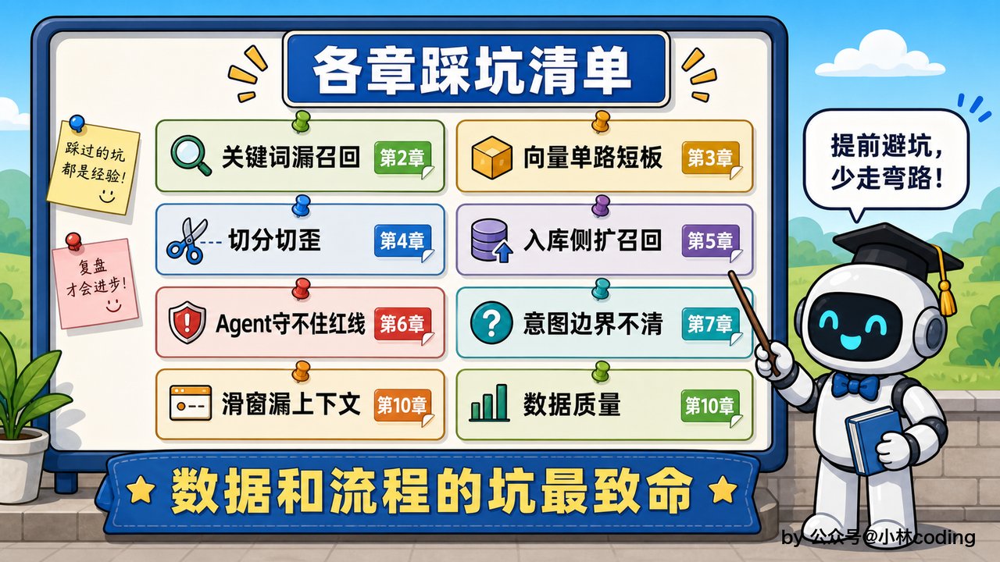

## 技术选型指南：什么场景该选什么

复盘完坑，再把全书的选型收成一份指南。沿着技术栈那条贯穿线走一遍，每一项只说两件事：为什么选它、什么场景才真用得上。凡是涉及具体的准确率、召回率、延迟这类数字，本项目都要等开发后拿自己的评估集实测，这里只给定性理由。

* 接 LLM 和写 Prompt，用 LangChain。它把 `ChatOpenAI`、`PromptTemplate`、结构化输出这些原语都封装好了，接模型、做 Prompt 工程绕不开它，这是第 1 章的地基。要在多个模型间切换，把上游地址、模型名、密钥收进 `.env` 就够，代码不用动。

* 编排整条流程，用 LangGraph。流程一旦要分流、要汇合、还得循环，状态也得一路贯穿，链式结构就拼不出来了，这时候才需要图模型。它把每一步做成节点、用边连起来，主力 Agent 也只是其中一个节点。

* 嵌入模型，默认 BGE-M3。要私有化部署、数据不出境，还想接着做领域微调、中英文都得顶，这三条直接把闭源 API 筛掉，这是第 3 章定的。不过这只是企业级实际落地时的情况，我们学习和课程演示用云端的就行，避免本地部署太重。也可换 Qwen3-Embedding，同样开源可微调。到底选哪个，得在自己的电商评估集上实测定夺。

* 向量库和检索，用 Milvus 一库扛两条路径。它扛得住大规模 dense 召回，2.5 起还内置 BM25 全文检索，dense 和关键词两路同库共存、原生 RRF 融合，一套库把两条路径都解决，这是第 3、4 两章的结论。如果只是搞个demo，规模没那么大、嫌它重，先用 ChromaDB 轻量起步也行。

* 精排，用 bge-reranker 这类 Cross-Encoder。召回负责找得全、精排负责排得准，当召回够全但前排结果不够相关时，才需要它把 query 和候选逐一拼起来重算一遍，这是第 4 章的东西。它准但慢，只在召回缩到 Top-50 的小候选集上跑。

* 意图识别，用 LLM 加 prompt。复杂多轮客服的意图判断本质是对话状态追踪，用户跳来跳去，得读懂整段脉络，单句分类的小模型处理不了，第 6 章就站在了 LLM 这边，零样本加几个 few-shot 边界样例。要是意图边界清晰、就是单句分类，规则或微调小模型又快又省，那种场景才轮得到它们。所以也可以微调小模型初筛，置信度低才切换到大模型。

* 会话上下文，靠 LangGraph State。上下文随图的 State 一路流转，每个节点读写同一份。

* 工具生态，内置 `@tool` 加外部 MCP。写死在代码里的内置工具够跑课程，可真实客服要接一大堆外部系统、还想新工具注册一下就能用、不动核心代码，就得靠 MCP 这套标准协议。

* 可观测，用 Langfuse。它开源、能自部署，链路数据留在自家墙内，设环境变量、编译时挂一次回调就零侵入把每次调用还原成调用树，这是第 9 章接的。不介意上云的可换 LangChain 同源的 LangSmith。

* 微调，用 RoBERTa-wwm-ext 全参微调。分类任务首选编码器模型，相对大模型训练推理都省几个量级；这个体量全参微调就够，几个 G 显存就能训练，LoRA、QLoRA 那套省显存的功夫是大模型才用得上的，这是第 10 章的选型。只有词表固定、用户口语又特别丰富、准确率和成本还都卡得死的场景，才轮到微调，能用提示词、能用 RAG 解决的都别先动它。

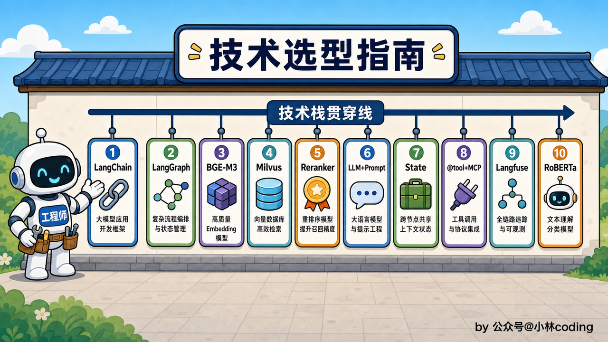

## 本章小结

到这一站，这趟车真的到终点了。回头看这条从第 1 章铺到现在的地铁线：你从接上第一个 LLM 起步，一路把 RAG、工具、架构、意图、上下文、可观测、飞轮、微调一样样搭了起来，还全程用 Claude Code 加 Superpowers 的纪律零手写代码交付。走完这一趟，你手里攥着的不只是一堆知识点，是一个能上线跑通、能写进简历、能扛住面试追问、覆盖了当下最高频考点的完整 AI Agent 项目。


弹药已经装满，链路你也真跑通过。剩下的，就是把它认认真真做一遍，然后走进面试间，把这条你亲手跑通的线，自信地讲出来。祝你拿到那个心仪的 offer。
