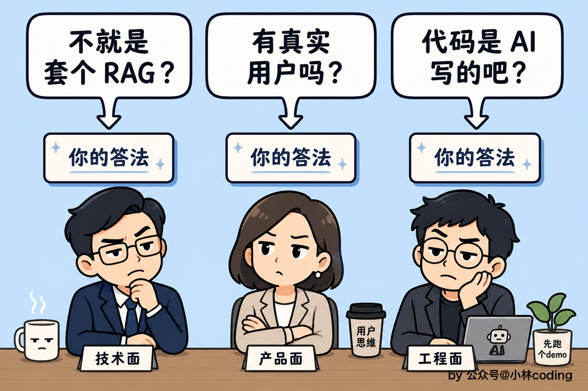
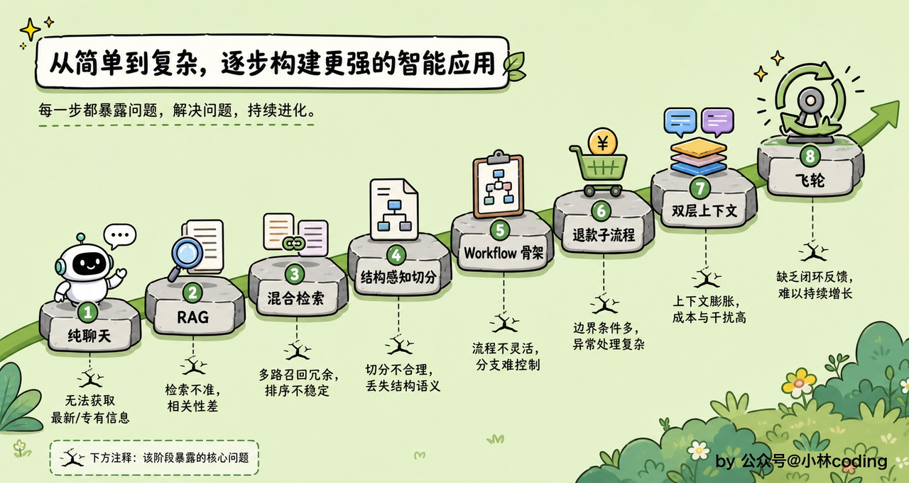
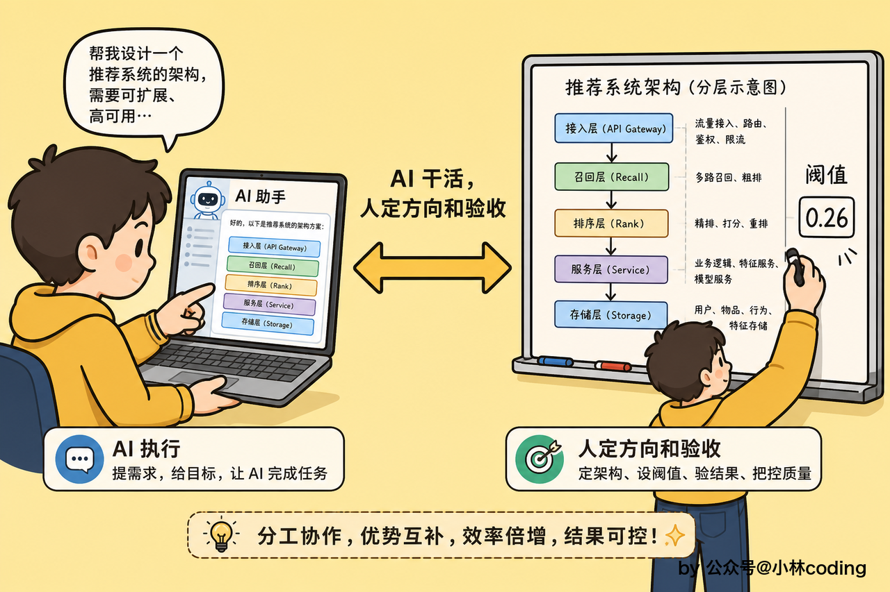
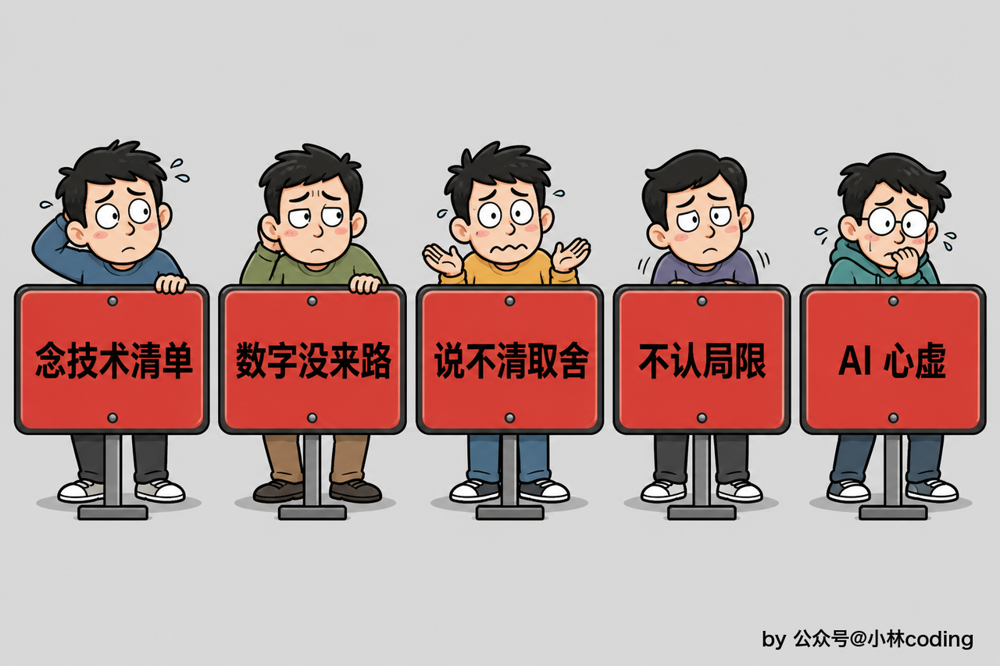

# 三十秒介绍

面试官翻到你简历上 MewHelp 这一行，抬头看你一眼：「聊聊这个项目吧。」你有大概三十秒，决定他后面是认真往下问，还是敷衍两句翻页。这三十秒说什么，比后面半小时的技术细节都重要。

先给你一版可以直接用的，措辞按自己的情况调。

「MewHelp 是我自己做的一个电商售后智能客服系统。用户在对话框里问退换货政策、催物流、要退款，系统判断这句话是什么意图，该查知识库的查知识库，该调订单接口的调接口，判不了的稳妥转人工。架构上我用的是确定性 Workflow 加 Agent 的混合，业务铁律用代码定死，开放推理才交给模型。做它的出发点是，客服这个场景对可靠性的要求特别苛刻，模型乱承诺一句「能退」，那就是一起真实的纠纷，我想弄明白怎么让大模型在强约束的业务里可靠地干活。」

这段话不到一分钟，但每句都有用意。

开头先给画面。「电商售后客服」加上「问政策、催物流、要退款」，面试官脑子里立刻能想象出这东西长什么样、谁在用它。上来就报「Python 加 FastAPI 加 LangGraph 加 Milvus」，他画不出画面，注意力当场就散了。

中间那句「确定性 Workflow 加 Agent 混合」是全场最重要的钩子。客服系统满大街都是，能把这句话说出口的人不多，面试官听到多半会接一句「这两样怎么混」。你在这里不展开，留着让他问。

结尾说动机。「模型乱承诺一句能退就是一起纠纷」这句话的分量在于，它替面试官回答了那个没问出口的问题：你为什么做这个。如果动机是「想练一下 RAG」，项目的档次立刻掉一层。可靠性这条立意撑得起后面整套架构，所有设计都能从它长出来。

几个容易犯的错误。

不要以「我跟了一门课，课程项目是……」开头，面试官不关心你怎么接触到这个项目的。

不要上来就报技术栈，一串框架名堆在一起不构成项目介绍。

也不要自己先把它说小了。「就是个 RAG 问答机器人」这种话千万别说，你把它降成一个 demo，面试官就真按 demo 的标准来问了。

***

# 面试官听到这个项目的第一反应

说完电梯演讲，面试官的反应通常就那么几种。提前想好怎么答，比临场发挥强十倍。

最常见的一种：「这不就是套个 RAG 吗？」

这个问题几乎躲不掉，答得含糊，他就会顺手给你贴一个「调 API 的」标签，后面再讲什么都难翻盘。

你可以这样说：「检索确实是里面的一块。但客服真正难的地方在于不能乱答，答得出来只是及格线。举个具体的，知识类问题我在模型开口之前先判一次证据，检索一回来就算证据置信度，撑不起就当场兜底转人工，模型根本不出场。为什么必须卡在生成之前？因为回答是流式一个字一个字推给用户的，吐出去就收不回来。这道检查的阈值定在 0.26，拿评估集上 60 条可答、20 条应拒逐点扫出来的，那一版误放率是 0，该拒答的一条没漏，代价是 15% 本来能答的被误拦、走了转人工。」

这段话的核心逻辑是，先把「不能乱答」立起来，再用一个具体设计和两个数字砸实。检索谁都会接，能把拒答那条线量化到小数点后两位的人不多。

第二种常见反应：「这个项目有真实用户吗？在线上跑过吗？」

不要心虚，也不要编。面试官问这个，多半是想看你有没有工程上的分寸感。

「它是我自己做的项目，没有线上流量，所以我给自己搭了一套评估的地基。300 题的评估集分五个桶，政策流程、商品型号、口语化问法、跨文档这四桶是可答的，另外 60 题是库外题、正确答法是拒答，知识库 51 块内容。这个体量我心里有数，撑得起四路检索策略谁强谁弱的结论，撑不起线上效果的结论，所以我报数只报相对高低。」

主动划出自己数据的边界，这件事本身就加分。号称什么都有、一追问全是空的，那才真扣分。

第三种：「代码是你自己写的吗？」

坦然说，架构和技术决策是你做的，编码调试大量借助 Claude Code。这个话题后面有一节专门讲怎么把它讲成优势。

***

# 项目介绍的叙事结构

电梯演讲之后，面试官通常会说「展开讲讲」。这时候你需要一段三分钟左右的叙事，既让他看到全貌，又能顺势把他引到你最想被追问的地方。

很多人在这一步会犯一个错误，把架构像目录一样报一遍：意图识别层、检索层、Agent 层、可观测层。面试官听完只觉得你在背书，也不知道从哪里接话。

更好的讲法是把它讲成一步步被问题逼出来的。MewHelp 不是一次就设计成这样的，每加一层，都是上一层暴露了新的窟窿。

你可以这样讲。

「最开始就是接上模型让它能聊天。但一问自家的退换货政策它就开始编，这些东西根本不在模型的记忆里。」

「所以我把知识挪到外部，做了 RAG。第一版用关键词查库，用户问『邮费』、库里写的是『运费』，字面对不上就什么都查不到，换成语义检索才通。可语义这一路又漏字面词，饮水机 W20 和 W40 在向量空间里几乎贴着，型号、单号这种差一个字就是另一款的东西，它分不开。于是补上关键词那一路做混合，两路按名次融合。」

「有意思的是混合完反而掉点。纯向量的 Recall@5 是 0.973，混合不重排只有 0.942，两路召回混进来的噪声没人筛，把原本靠前的挤了下去。加上 Cross-Encoder 精排才拉到 0.983。这个坑让我记住一件事，召回负责全、精排负责准，少一环就会互相拖累。」

「检索通了之后，翻车的地方跑到切分上。一条退货条款从中间被切成两半，检索只命中前半句『支持七天无理由退货』，后半句『拆封后不支持』落到别的片段里去了，模型就敢答可以退。所以切分不看长度，顺着标题层级切，每块带着自己的标题路径，表格按行切、每块重贴表头。」

「再往后是架构本身出问题。我一开始想把整条链路都交给一个 Agent，结果它会图省事跳过检索凭记忆答，该拒答的时候还敢编一个像模像样的答案。客服场景这种事一次就是事故。所以架构改成确定性 Workflow 加 Agent。意图识别分九类，处理上归成五条路，好几类的走法本来就一样。知识类必须先检索再答，退款单独走一条写死的流程，投诉这种压根不该让模型接手，先安抚再转人工。Agent 只在这个骨架的约束里做它擅长的开放推理。」

「退款那条子流程最能说明这套分工。判成退款之后先取订单，用户没给订单号，流程就暂停，前端弹一个订单选择器让他点选，点完回填再往下走，不让模型瞎猜。然后强制检索退款政策，这一步写死。订单和政策都齐了，才把『这一单到底能不能退』这一个判断交给模型。」

「聊长了又有新问题，滑动窗口一滑，用户翻回二十轮前那个订单，早期信息就丢了。所以上下文做成分层，越近越完整、越远压得越狠：最近几轮原文一字不动，再往前一段只截掉客服自己说过的话，最早的那批压成一段只留事实和诉求的摘要。摘要在后台异步做，不挡当轮回复。」

「最后一块是线上看不见。我把 Langfuse 零侵入挂了上去，编译流程的时候挂一次回调，整条链路的节点就都在 trace 树上了。顺着这条线又长出数据飞轮：证据不足拒答、生成前自评没过、用户点踩，这三个入口的问题全落进一个池子，人工按被问频次排队审核，补完写回知识库、向量化成功了才算通过，下次同样的问题就能命中。旁路我还微调了一个 17 类的主题分类器，给飞轮统计哪类知识缺得最多。」

讲完主动收一句，把菜单递过去。

「大概就是这么长出来的。哪一块都能往下聊，我自己觉得最有意思的是模型开口前那道证据校验、混合检索里重排的价值，还有退款子流程的暂停回填。」

这个讲法好在因果跟得上，每一层为什么存在都有来路。面试官随手挑一个追问，你都有准备。

***

# 钩子背后要准备什么

上面那段叙事里，每一句你没展开的话都是一个钩子。完整答法在本章《面试题》那篇里都有对应的一道，这里只说被追问时必须张口就来的部分。

混合检索加重排这一句，追得最多的是「为什么用 RRF，不把两路分数加权相加」。你要能说清两路分数的量纲根本不可比，RRF 只认名次，再报四路对照的 Recall@5：纯关键词 0.89，纯向量 0.973，混合不重排 0.942，混合加重排 0.983。

模型开口前那道证据校验，追问基本落在阈值上。0.26 是拿 60 条可答加 20 条应拒逐点扫出来的，应拒那批最高分 0.251，可答的中位数 0.715。代价也要主动说：误放率压到 0，换来的是 15% 的误拦率，阈值往左挪到 0.2，误放率就从 0 变成 10%。

九类意图五个出口，他会问为什么合并、不做九条分支。识别要细，是因为日志和成本统计都靠这个标签。处理要合，是因为好几类的处理方式完全一样。还有一句能加分：意图到出口的映射表全项目只有一份，分流和日志都读它，不会两处对不上。

退款那条子流程，追问一般是「用户没给订单号怎么办」。流程直接暂停，前端弹选择器让用户点选，回填之后再强制检索政策，只把最后那个判断交给模型。

分层上下文，他会问参数怎么定的。这几个数是从模型窗口倒推出来的：扣掉系统提示、检索证据、要注入的摘要、输出预留和本轮跑起来的瞬时占用，剩下的才归历史，再按七三分给原文层和半压层。换模型只改一个窗口配置，整张表跟着重算。

数据飞轮和那个分类器常被一起问。飞轮三个入口都是「系统没答好」的信号，每条落池还存一份当时的检索快照，审核的人靠它分辨「真缺这块知识」还是「库里有、只是没检到」。审核队列按被问频次排，同一个缺口被问得越多越先补。分类器是旁路批处理、不进实时链路，留出测试集 161 条，micro-F1 0.964，macro 0.962。

这里有条纪律要守住：只挂你答得上的钩子。挂出去答不上来，比不挂伤害大得多，面试官会顺手怀疑前面那些也是背的。

***

# 把 AI 辅助开发讲成优势

面试官问「这些代码是不是 AI 写的」，不用紧张。AI 辅助开发早就是行业标配，支支吾吾反而显得你不适应这个趋势。

坦然说就行：「架构设计和技术决策是我做的，编码和调试大量借助 Claude Code。」

更值钱的是后半句，你得说清 AI 替代不了的那部分。九类意图为什么收成五个出口、置信度那条线画在哪、标注口径怎么统一，这些都没有现成答案可抄，得拿评估数据一轮轮扫出来。

还有一点很多人想不到，你驱动 AI 的那套流程本身就是能讲的工程能力。需求先澄清成 spec，spec 拆成能独立验收的计划，每块代码走 TDD 的红绿重构，写完再派一个全新的评审代理按模板审 diff。面试官要是问「你怎么保证 AI 写出来的东西能要」，这套流程就是答案：人定方向和验收标准，AI 干活，每一关都有人卡着。

真被追到「那到底哪些是你写的」，可以这样收：「具体到每一行，AI 生成的比例很高。但系统怎么分层、哪些环节不许模型自由发挥、阈值凭什么定在这里，这些判断 AI 给不了我。」

***

# 简历上怎么写才能引出好问题

面试其实从他打开你简历那一刻就开始了。简历上每一行都是一个信号，它决定了面试官会问你什么。好的条目是面试诱饵，每一条都引向一个你有深度准备的话题。

先看一个反面例子：「基于大模型开发了一个智能客服系统，支持知识问答和工具调用」。他看完能问的只有「你用了什么框架」，聊不出深度，你准备的那些东西一个都用不上。

再看一个好的写法：「知识问答在模型开口前先判断证据够不够，阈值经评估集校准，该拒答的一条不漏、该回答的放行 85%」。这一行里至少埋了三个追问点，这道校验为什么卡在生成前、阈值怎么校的、85% 背后的代价你认不认，每一个你都能展开三分钟。

`简历模板.md` 里那两版的技术亮点就是按这个思路写的，直接拿去改就行。填数字守住一条：写上去的每个数，你都得说得出是怎么测的、口径是什么，说不出来的宁可空着。

还有个措辞上的小事，简历上写「个人项目」，别写「课程项目」。课程是你学习的途径，不是这个项目的属性。

***

# 常见翻车场景

最后说几个最常见的翻车场景，帮你提前避坑。

第一种是技术清单模式。有的同学介绍项目就像在念购物清单：Python、FastAPI、LangGraph、Milvus、BGE-M3、Langfuse。面试官听完不知道你在这些东西上做过什么判断。每提到一个技术，都应该连接到一个决策。别只说用了 Milvus，说清楚为什么让一个向量库同时扛稠密和关键词两路，省掉再引一套搜索引擎的运维。

第二种是数字报得出、来路说不出。简历上写着 Recall@5 达 98%，他问一句「这怎么测的」，你答不上，这个数就从加分变成扣分。你得张口就来：评估集 300 题，召回在其中 240 道可作答题上算，另外 60 道库外题单独评拒答率。截断位取前五条，看的是这道题需要的证据在前五条里凑齐了几成，报的是混合加重排那一路。

第三种是只讲做了什么，不讲为什么不那样做。你说「我用了 LangGraph」，他问「LangChain 的 Chain 不行吗」，你愣住了。每个设计决策都要准备好替代方案和取舍：九类为什么收成五个出口，RoBERTa 为什么全参而不上 LoRA，意图识别为什么不微调一个小模型。说不清取舍，面试官会怀疑这个设计根本不是你做的。

第四种是否认项目局限。被问「有什么想改的」，回一句「挺好的，没什么问题」，这在面试官眼里是危险信号。主动说局限反而加分：MRR 总体 0.894，可跨文档那一桶只有 0.657，一问要好几块不同小节的知识才答得全，排序很难同时把它们都顶到前面，这是我下一步要优化的。分类器的测试集 161 条摊到 17 类，每类才九到十四条，单类指标抖动很大，所以我不拿单类的漂亮数说事。

第五种是对 AI 辅助开发心虚。前面那一节讲过怎么答，这里只补一句，重点永远放在你做过的判断上，架构选型、阈值校准、标注口径统一，这些没有现成答案可抄。

这篇给的是骨架，别一字不改地背下来。把里面的数字换成你自己评估集上跑出来的，把每处取舍换成你真纠结过的那一次，讲出来才有人味。面试官分得清一个人是在复述，还是在回忆。
