## 开发过程

我们来开启第一章的开发，我们前面讲过使用superpower的模式，并且在Claude Code安装了对应的skill了，同时我们这里还得装上Context7 MCP

> https://context7.com/

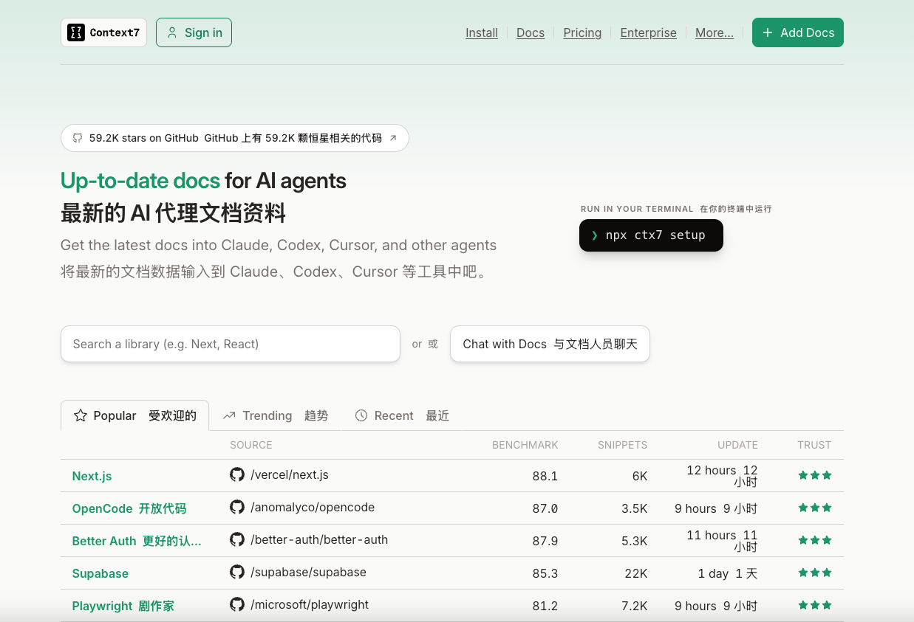

有了它，我们AI编程时，AI能随时查最新文档，就不会导致有过时的内容而导致开发质量不好了，安装方式也很简单，直接跟AI说就行

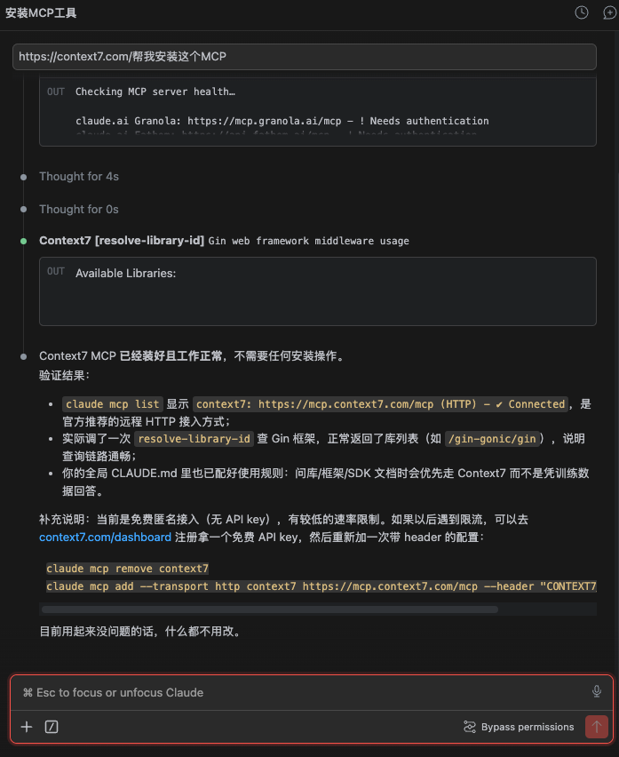

我这里是之前安装过了，它会检查到我已安装，没安装的过的它就会帮你自动安装和验证的，非常方便


然后我们就直接用提示词来开发即可

```markdown
我要用 Superpowers 模式做一个电商智能客服系统,第一步先跑通纯对话。

## 功能需求
1. 对话接口:支持多轮对话,SSE 流式输出、逐 token 推送
2. Prompt 管理:用 PromptTemplate 模板化,System Prompt 写清客服角色设定和行为约束
3. 结构化输出小功能:把用户的售后描述提取成订单号、诉求类型、期望方案这样的固定字段,用 with_structured_output 实现
4. 多轮上下文先做最简版:历史消息裁剪加 token 预算控制

## 技术栈
- Python + FastAPI + LangChain
- 模型接入直连上游,应用侧统一说 OpenAI 协议,地址、模型名、密钥全在 .env,GPT、Claude、DeepSeek、Ollama 都能换着接

## 本章不做
- 工具调用、Agent 循环,先跑通纯对话

## 验收标准
1. curl 调对话接口能看到流式回复
2. 连续问两轮,第二轮能接住第一轮的上下文
3. 发一段售后描述,能拿到结构化 JSON


## 工作要求
1. 全程走 Superpowers 流程,技能自动触发;产出不是可单测代码的任务(纯 Prompt、数据类),把 TDD 那步换成拿标注样例或评估集跑一遍验证,其余步骤照走;聊天页面是例外,用 Vibe Coding 方式直接做,我描述效果你改,不套 brainstorm、TDD、code review 那套流程
2. 过程留痕:在仓库 dev-notes/ch01.md 里追记开发过程,每完成一个阶段(brainstorm 定稿、计划评审通过、每个任务完成、code review 结论、finish)就补一段,记四样:我这一步发的关键原话、你的关键产出(spec / plan 路径、评审结论)、我拒绝或纠偏了什么、翻车与返工;不许收尾时一次性补记
3. 涉及具体库、框架、API 的用法(FastAPI、SQLAlchemy、LangChain、LangGraph、Milvus、Langfuse 这些),一律先用 Context7 MCP 查最新官方文档和接口定义再动手,别凭记忆写,版本对不上的 API 是返工重灾区
4. 上面点名的技术选型是定死的,实现中发现矛盾或走不通,停下来问我,不要自行换方案
5. 完结交付:功能演示命令、测试结果、dev-notes 路径
```

这段提示词输入给Claude Code后，就开始进行Superpowers的流程了

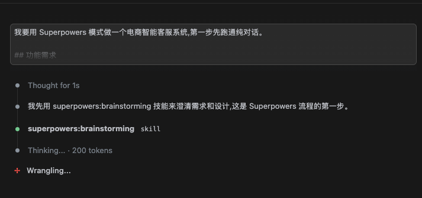

这里按照步骤，我们会先进入Superpowers的「brainstorming」步骤，其实就是进行澄清需求和设计

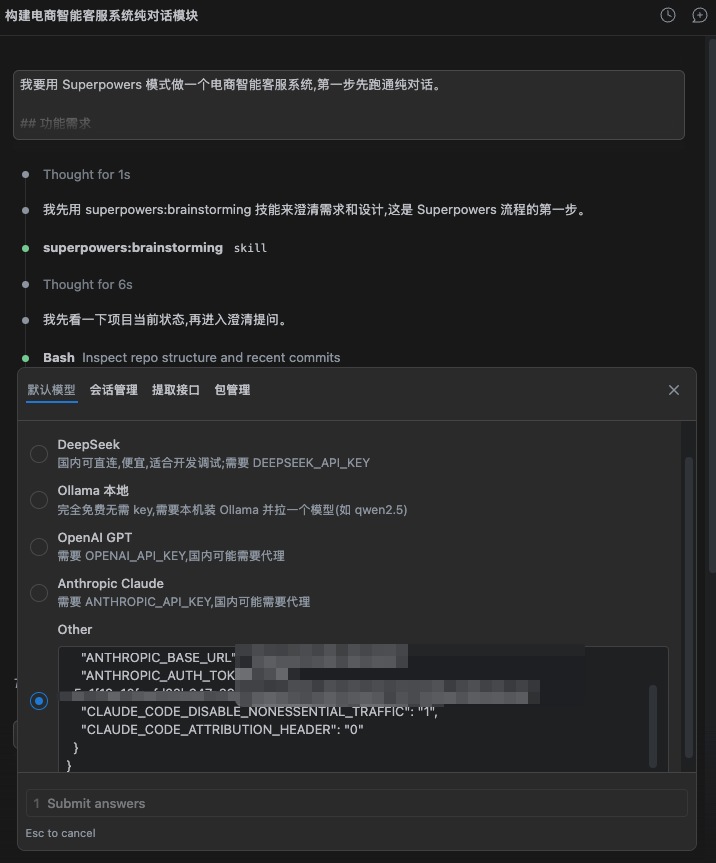

我们根据AI提问的问题，进行回答后，AI就会根据答案，生成spec文档

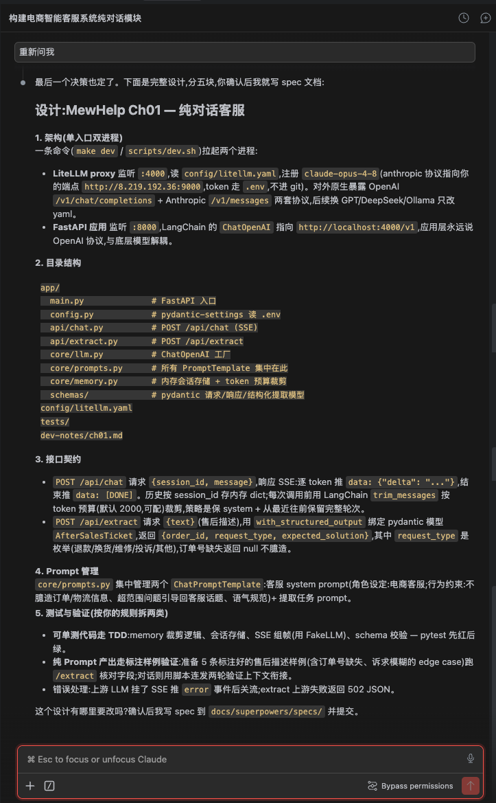

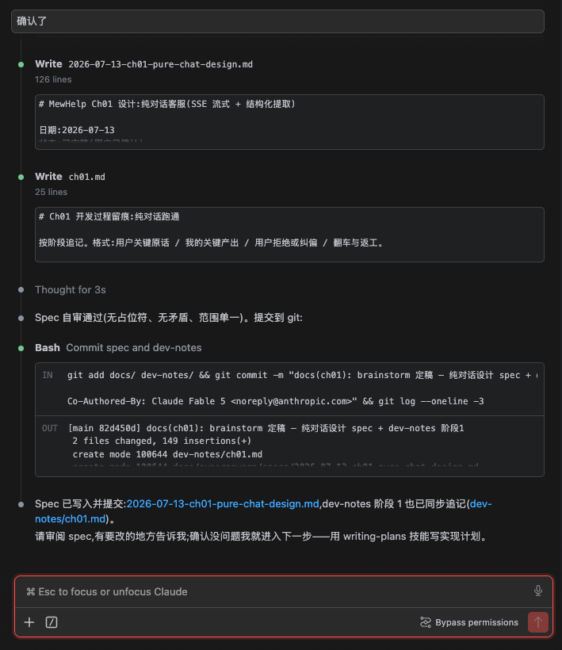

然后下一步，是「writing-plans」，编写我们的实现计划

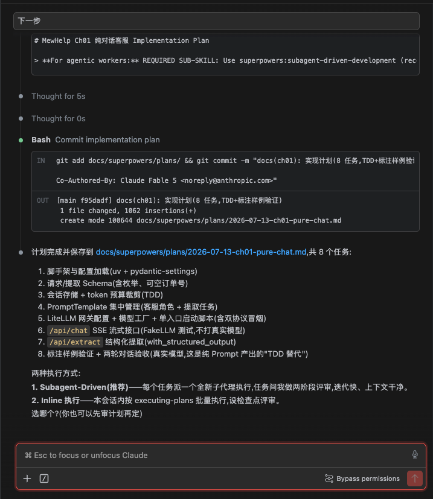

实现计划订好后，我们就就可以进行开发，开发方式是有两种的，分别是

* Subagent-Driven：每个任务派一个全新子代理执行,任务间我做两阶段评审,迭代快、上下文干净。

* **&#x20;**&#x49;nline 执行：本会话内按 executing-plans 批量执行,设检查点评审。


这里我们其实推荐用Subagent-Driven，因为又快，同时也能评审，非常好用，选择后会进入「subagent-driven- development」步骤

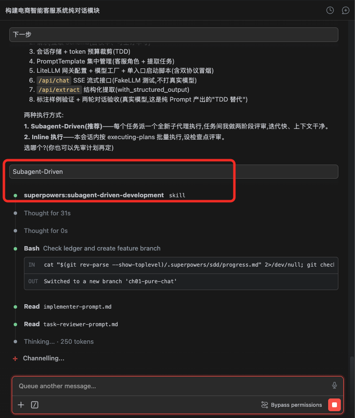


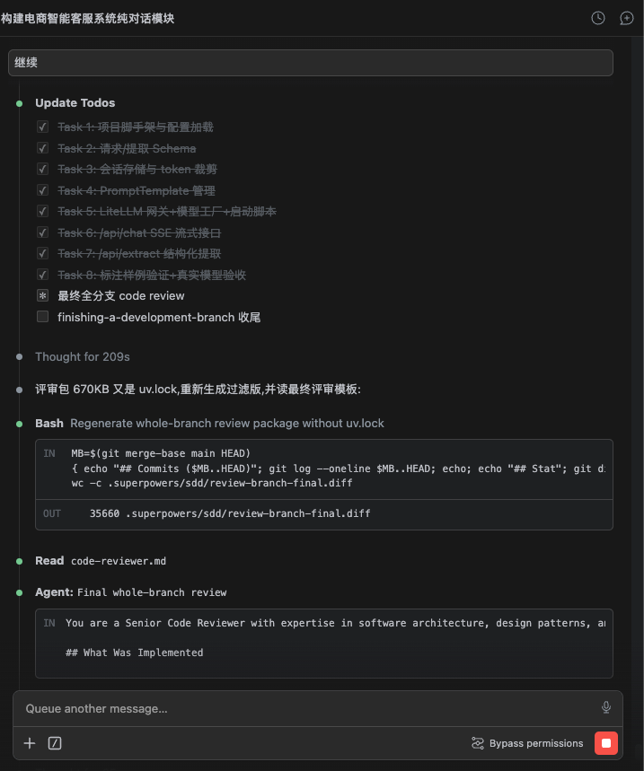

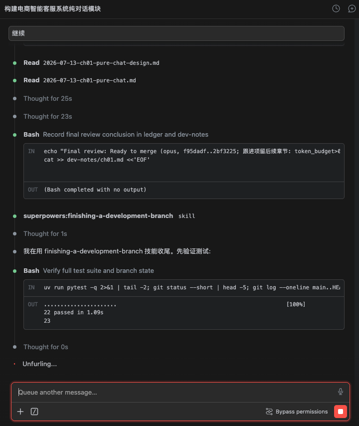

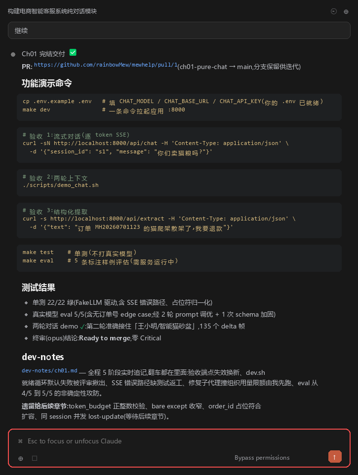

后端做好了，还缺个前端页面，这里我们就先简单做个前端就行

```bash
聊天页面:一个客服对话 Web 界面,消息气泡排布,对接 SSE 接口把回复逐字渲染出来,能连续多轮聊
浏览器打开聊天页,发一个问题能看到回复逐字蹦出来,接着追问一句上下文也接得住
```

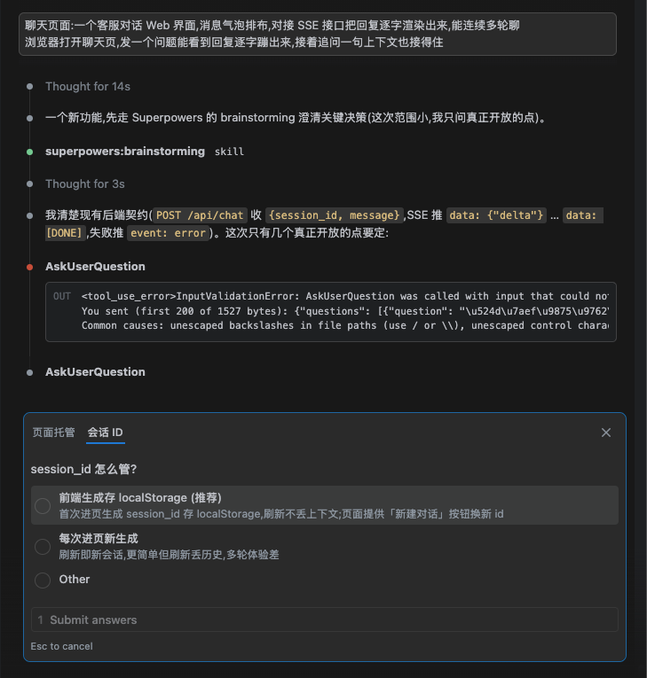

中间的步骤和上面的一样，这里不赘述了，我们看最终的验收结果，先配置好我们的模型

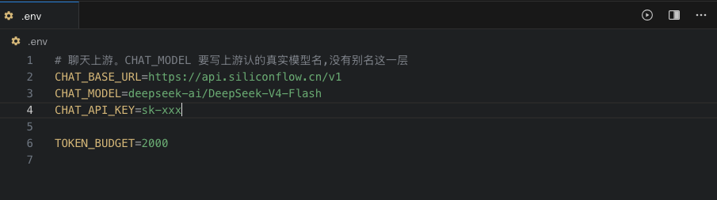

然后，我们启动项目，我这里是make dev，大家可以根据自己的习惯，使用自己的启动命令

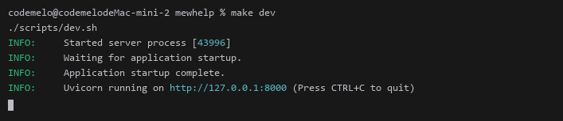

进来后是一段前端页面，有点丑，我自己优化了下

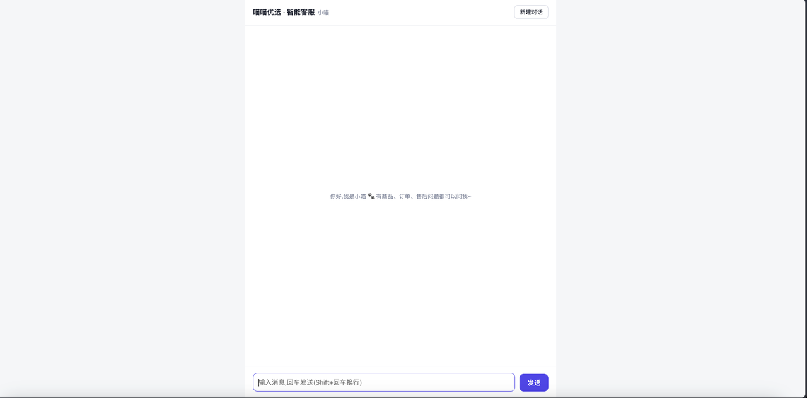

调整完后是这样子，大家可以把自己想要的风格跟AI说，然后让它去调整就行了

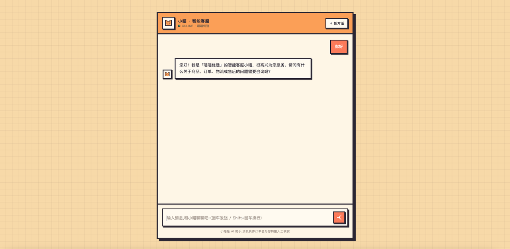


## 验证过程

这章主要是看是否能正常对话，以及上下文是否知道，所以我们说下以下的对话就能测出来了

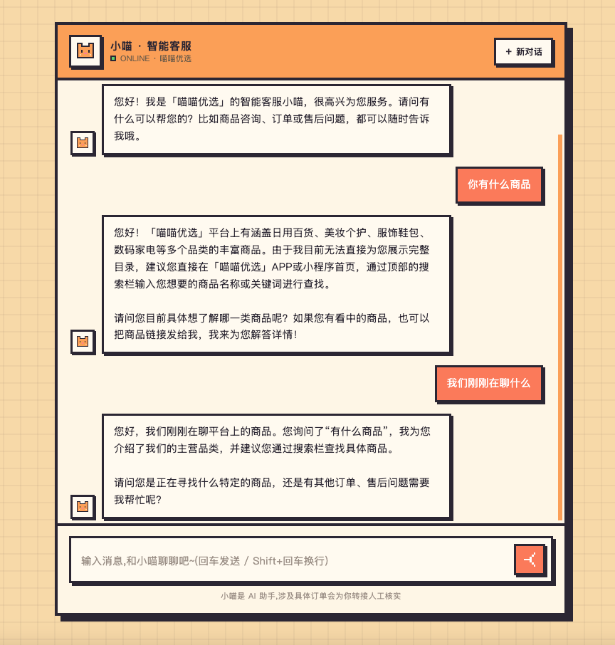

对于自己回答不出的，比如售后问题，不能答也会拒答

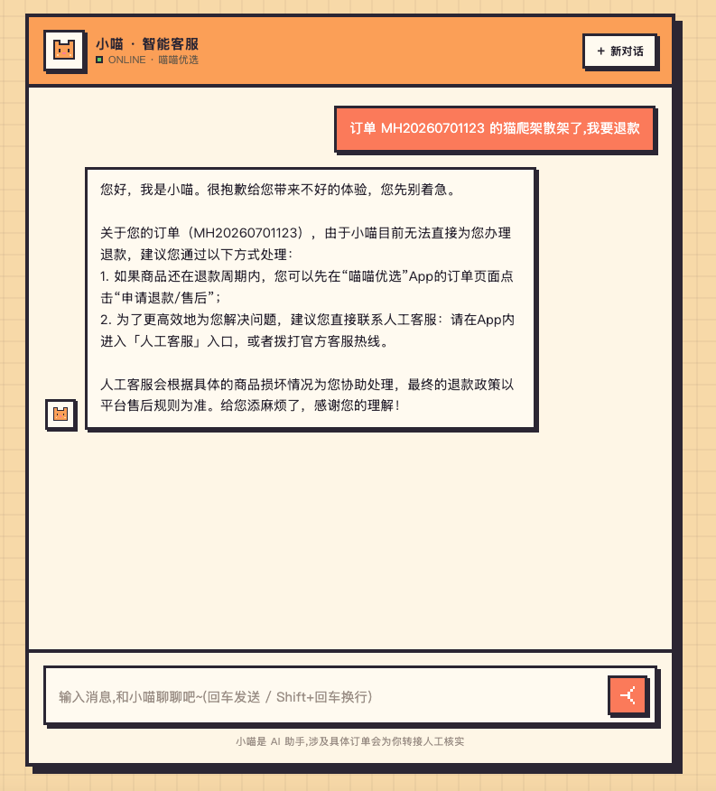


本章验收没问题


## 本章sepc和plan

### Spec文档

````markdown
# MewHelp Ch01 设计:纯对话客服(SSE 流式 + 结构化提取)


## 目标

电商智能客服系统第一章:跑通纯对话。不做工具调用、不做 Agent 循环。

验收标准:
1. curl 调对话接口能看到流式回复(逐 token)。
2. 连续问两轮,第二轮能接住第一轮的上下文。
3. 发一段售后描述,能拿到结构化 JSON(订单号/诉求类型/期望方案)。

## 技术栈(定死,不可自行更换)

- Python 3.12 + FastAPI + LangChain
- 模型接入直连上游,应用侧统一说 OpenAI 协议;地址、模型名、密钥全在 `.env`,分 `CHAT_*` / `EMBED_*` / `RERANK_*` 三组
- 依赖管理:uv
- 验收模型:`claude-opus-4-8`,Anthropic 兼容端点 `http://8.219.192.36:9000`(token 放 `.env`,不进 git)

## 架构:单进程

一条命令(`make dev` 或 `scripts/dev.sh`)拉起 FastAPI 应用(:8000)。LangChain 的
`ChatOpenAI` 直接指向 `settings.chat_base_url`,换上游改 `.env` 里两行,不动代码。

换模型时注意 `CHAT_MODEL` 要写上游认的真实模型名。这一步没有别名可用,写错了不会在
启动时报错,而是第一次调模型时回一句 `Model does not exist`。

## 目录结构

```
app/
  main.py              # FastAPI 入口
  config.py            # pydantic-settings 读 .env
  api/chat.py          # POST /api/chat (SSE)
  api/extract.py       # POST /api/extract
  core/llm.py          # ChatOpenAI 工厂
  core/prompts.py      # 所有 PromptTemplate 集中在此
  core/memory.py       # 内存会话存储 + token 预算裁剪
  schemas/             # pydantic 请求/响应/结构化提取模型
scripts/dev.sh
tests/
dev-notes/ch01.md
.env / .env.example
```

## 接口契约

### POST /api/chat(SSE 流式对话)

请求:

```json
{"session_id": "abc", "message": "你们家猫粮发什么快递?"}
```

响应:`text/event-stream`,逐 token 推送:

```
data: {"delta": "我"}
data: {"delta": "们"}
...
data: [DONE]
```

- 历史按 `session_id` 存服务端内存 dict(本章不做持久化)。
- 每次调用前用 LangChain `trim_messages` 按 token 预算裁剪(默认 2000 token,可配),策略:保 system prompt + 从最近往前保留完整轮次。
- 上游 LLM 出错:SSE 推 `event: error` + 错误信息后关流。

### POST /api/extract(结构化提取)

请求:

```json
{"text": "我上周买的猫爬架,订单号 MH20260701123,到货就散架了,我要退款"}
```

响应(`with_structured_output` 绑定 pydantic 模型 `AfterSalesTicket`):

```json
{"order_id": "MH20260701123", "request_type": "退款", "expected_solution": "商品到货损坏,要求退款"}
```

- `request_type` 枚举:退款 / 换货 / 维修 / 投诉 / 其他。
- 订单号缺失返回 `null`,不臆造。
- 上游失败返回 502 JSON。

## Prompt 管理

`core/prompts.py` 集中管理两个 `ChatPromptTemplate`:

1. **客服对话 prompt**:system 写清角色设定(电商客服)与行为约束——不臆造订单/物流信息、超范围问题引导回客服话题、语气规范。
2. **提取任务 prompt**:面向售后描述的字段提取指令。

## 测试与验证

按"可单测代码走 TDD、纯 Prompt 产出走标注样例验证"拆两类:

**TDD(pytest,先红后绿):**
- `core/memory.py`:会话存储、token 预算裁剪逻辑
- SSE 组帧(用 FakeLLM / mock,不打真实模型)
- schema 校验(AfterSalesTicket 枚举、可空字段)

**标注样例验证(真实模型):**
- 5 条标注好的售后描述样例跑 `/api/extract` 核对字段,覆盖 edge case:订单号缺失、诉求模糊。
- 脚本连发两轮对话,验证第二轮接住第一轮上下文。

## 本章不做

- 工具调用、Agent 循环
- 会话持久化(重启丢历史,接受)
- 鉴权、限流、多副本
- 对话中自动触发提取(提取是独立接口)

## 关键决策记录

| 决策 | 选择 | 备选与理由 |
|---|---|---|
| 上游接入形态 | 应用直连,配置分三组 | 中间垫网关只为归一 rerank 格式一件实事,却要多一个进程、多一份配置、换模型改两处 |
| 会话管理 | 服务端 session_id | 客户端全量 history 对 curl 验收不友好 |
| 提取形态 | 独立 /extract 接口 | 融合进对话需意图判断,超出本章"纯对话"范围 |
| 依赖管理 | uv | 用户确认 |
````

### Plan文档

````markdown
# MewHelp Ch01 纯对话客服 Implementation Plan

> **For agentic workers:** REQUIRED SUB-SKILL: Use superpowers:subagent-driven-development (recommended) or superpowers:executing-plans to implement this plan task-by-task. Steps use checkbox (`- [ ]`) syntax for tracking.

**Goal:** 跑通电商客服纯对话:SSE 流式多轮对话 + PromptTemplate 管理 + 结构化售后提取 + token 预算裁剪。

**Architecture:** 单进程 FastAPI 应用(:8000),LangChain ChatOpenAI 直连 `settings.chat_base_url`。会话历史存服务端内存,按 session_id 索引,调用前 trim_messages 裁剪。

**Tech Stack:** Python 3.12, uv, FastAPI, LangChain (langchain-openai), pydantic-settings, pytest。

**Spec:** `docs/superpowers/specs/2026-07-13-ch01-pure-chat-design.md`

## Global Constraints

- 技术选型定死:FastAPI + LangChain,上游直连,发现走不通停下问用户,不许换方案。
- 验收模型 `claude-opus-4-8`,Anthropic 兼容端点 `http://8.219.192.36:9000`,token 只放 `.env`(gitignore),文件里一律写 `os.environ/ANTHROPIC_AUTH_TOKEN`。
- 对话接口:`POST /api/chat`,请求 `{"session_id": str, "message": str}`,SSE 帧 `data: {"delta": "..."}`,结束帧 `data: [DONE]`,错误帧 `event: error`。
- 提取接口:`POST /api/extract`,请求 `{"text": str}`,响应 `{order_id, request_type, expected_solution}`;`request_type` 枚举:退款/换货/维修/投诉/其他;订单号缺失为 null。
- token 预算默认 2000,可经 `.env` 配置(`TOKEN_BUDGET`)。
- 单测不打真实模型(FakeLLM/stub);真实模型只用于 Task 8 标注样例验证。
- 每个任务完成即 commit,commit message 末尾带 `Co-Authored-By: Claude Fable 5 <noreply@anthropic.com>`。
- dev-notes/ch01.md 由主会话(而非子代理)按阶段追记,不属于任何任务的文件清单。

---

### Task 1: 项目脚手架与配置加载

**Files:**
- Create: `pyproject.toml`(uv init 生成后改)
- Create: `.gitignore`, `.env.example`, `.env`(不进 git)
- Create: `app/__init__.py`, `app/config.py`
- Test: `tests/test_config.py`

**Interfaces:**
- Produces: `app.config.Settings`(pydantic-settings),字段:`chat_model: str`、`chat_base_url: str`、`chat_api_key: str`(这三项跟着账号走,故意不给默认值,缺了在启动就报 Field required)、`token_budget: int = 2000`;模块级单例 `settings = Settings()`。后续所有任务 `from app.config import settings`。

- [ ] **Step 1: uv 初始化与依赖**

```bash
cd /Users/codemelo/mewhelp-all/mewhelp
uv init --python 3.12 --name mewhelp --bare
uv add fastapi "uvicorn[standard]" langchain langchain-openai pydantic-settings
uv add --dev pytest pytest-asyncio httpx
```

在 `pyproject.toml` 追加:

```toml
[tool.pytest.ini_options]
asyncio_mode = "auto"
testpaths = ["tests"]
```

- [ ] **Step 2: .gitignore 与 env 文件**

`.gitignore`:

```
.venv/
__pycache__/
*.pyc
.env
.pytest_cache/
```

`.env.example`:

```bash
# 聊天上游。CHAT_MODEL 要写上游认的真实模型名,没有别名这一层
CHAT_BASE_URL=https://api.siliconflow.cn/v1
CHAT_MODEL=deepseek-ai/DeepSeek-V4-Flash
CHAT_API_KEY=sk-xxx

TOKEN_BUDGET=2000
```

本章只用得着聊天这一组。嵌入和重排两组等第 3、4 章建知识库时再加。

`.env`:同上,填入你自己的真实 key。

- [ ] **Step 3: 写失败测试**

`tests/__init__.py`(空)、`tests/test_config.py`:

```python
from app.config import Settings

import pytest
from pydantic import ValidationError

def test_账号相关的三项必填(monkeypatch):
    # 这三项跟着账号走,给默认值等于替人猜:猜错不在启动时报错,而是第一次调上游时
    # 抛一个看不懂的 401
    for k in ("CHAT_MODEL", "CHAT_BASE_URL", "CHAT_API_KEY"):
        monkeypatch.delenv(k, raising=False)
    with pytest.raises(ValidationError):
        Settings(_env_file=None)

def test_settings_env_override(monkeypatch):
    for k, v in {"CHAT_MODEL": "m", "CHAT_BASE_URL": "u", "CHAT_API_KEY": "k"}.items():
        monkeypatch.setenv(k, v)
    monkeypatch.setenv("TOKEN_BUDGET", "500")
    assert Settings(_env_file=None).token_budget == 500
```

- [ ] **Step 4: 跑测试确认失败**

Run: `uv run pytest tests/test_config.py -v`
Expected: FAIL(ModuleNotFoundError: app.config)

- [ ] **Step 5: 实现 config.py**

`app/__init__.py`(空)、`app/config.py`:

```python
from pydantic_settings import BaseSettings, SettingsConfigDict

class Settings(BaseSettings):
    model_config = SettingsConfigDict(env_file=".env", extra="ignore")

    # 这三项故意不给默认值,缺了在启动就报 Field required,直接指向 .env
    chat_model: str
    chat_base_url: str
    chat_api_key: str
    token_budget: int = 2000

settings = Settings()
```

- [ ] **Step 6: 跑测试确认通过**

Run: `uv run pytest tests/test_config.py -v`
Expected: 2 passed

- [ ] **Step 7: Commit**

```bash
git add pyproject.toml uv.lock .gitignore .env.example app/ tests/
git commit -m "feat(ch01): 项目脚手架与配置加载"
```

---

### Task 2: 请求/响应与结构化提取 Schema

**Files:**
- Create: `app/schemas/__init__.py`, `app/schemas/chat.py`, `app/schemas/extract.py`
- Test: `tests/test_schemas.py`

**Interfaces:**
- Produces:
  - `app.schemas.chat.ChatRequest(session_id: str, message: str)`——两字段均必填、非空(min_length=1)。
  - `app.schemas.extract.ExtractRequest(text: str)`(min_length=1)。
  - `app.schemas.extract.RequestType(str, Enum)`:成员 REFUND="退款", EXCHANGE="换货", REPAIR="维修", COMPLAINT="投诉", OTHER="其他"。
  - `app.schemas.extract.AfterSalesTicket(order_id: str | None, request_type: RequestType, expected_solution: str)`——带 Field description,供 with_structured_output 生成 schema 用。

- [ ] **Step 1: 写失败测试**

`tests/test_schemas.py`:

```python
import pytest
from pydantic import ValidationError

from app.schemas.chat import ChatRequest
from app.schemas.extract import AfterSalesTicket, ExtractRequest, RequestType

def test_chat_request_rejects_empty_message():
    with pytest.raises(ValidationError):
        ChatRequest(session_id="s1", message="")

def test_extract_request_rejects_empty_text():
    with pytest.raises(ValidationError):
        ExtractRequest(text="")

def test_ticket_order_id_nullable():
    t = AfterSalesTicket(order_id=None, request_type="退款", expected_solution="退全款")
    assert t.order_id is None
    assert t.request_type is RequestType.REFUND

def test_ticket_rejects_unknown_request_type():
    with pytest.raises(ValidationError):
        AfterSalesTicket(order_id=None, request_type="砍价", expected_solution="x")
```

- [ ] **Step 2: 跑测试确认失败**

Run: `uv run pytest tests/test_schemas.py -v`
Expected: FAIL(ModuleNotFoundError)

- [ ] **Step 3: 实现 schemas**

`app/schemas/__init__.py`(空)。

`app/schemas/chat.py`:

```python
from pydantic import BaseModel, Field

class ChatRequest(BaseModel):
    session_id: str = Field(min_length=1, description="会话 ID,同一会话多轮复用")
    message: str = Field(min_length=1, description="用户本轮消息")
```

`app/schemas/extract.py`:

```python
from enum import Enum

from pydantic import BaseModel, Field

class ExtractRequest(BaseModel):
    text: str = Field(min_length=1, description="用户的售后描述原文")

class RequestType(str, Enum):
    REFUND = "退款"
    EXCHANGE = "换货"
    REPAIR = "维修"
    COMPLAINT = "投诉"
    OTHER = "其他"

class AfterSalesTicket(BaseModel):
    """从用户售后描述中提取的结构化工单。"""

    order_id: str | None = Field(
        default=None, description="订单号,原文未出现则为 null,禁止编造"
    )
    request_type: RequestType = Field(description="用户诉求类型")
    expected_solution: str = Field(description="用户期望的处理方案,一句话概括")
```

- [ ] **Step 4: 跑测试确认通过**

Run: `uv run pytest tests/test_schemas.py -v`
Expected: 4 passed

- [ ] **Step 5: Commit**

```bash
git add app/schemas/ tests/test_schemas.py
git commit -m "feat(ch01): 对话与售后提取 schema"
```

---

### Task 3: 会话存储与 token 预算裁剪

**Files:**
- Create: `app/core/__init__.py`, `app/core/memory.py`
- Test: `tests/test_memory.py`

**Interfaces:**
- Produces:
  - `app.core.memory.SessionStore`:`get(session_id: str) -> list[BaseMessage]`(不存在返回空列表,不建会话)、`append(session_id: str, *messages: BaseMessage) -> None`。
  - `app.core.memory.trim_history(messages: list[BaseMessage], max_tokens: int) -> list[BaseMessage]`:strategy="last",从最近往前保留,保证从 HumanMessage 开始(不留半轮);历史里不含 system(system 由 prompt 模板负责)。
- Consumes: 无(仅 langchain_core)。

- [ ] **Step 1: 写失败测试**

`tests/test_memory.py`:

```python
from langchain_core.messages import AIMessage, HumanMessage

from app.core.memory import SessionStore, trim_history

def test_store_get_unknown_session_returns_empty():
    assert SessionStore().get("nope") == []

def test_store_append_and_get_isolated_by_session():
    store = SessionStore()
    store.append("a", HumanMessage("hi"), AIMessage("hello"))
    store.append("b", HumanMessage("嗨"))
    assert len(store.get("a")) == 2
    assert len(store.get("b")) == 1

def test_trim_keeps_recent_and_starts_on_human():
    msgs = []
    for i in range(20):
        msgs.append(HumanMessage(f"问题{i}:" + "喵" * 50))
        msgs.append(AIMessage(f"回答{i}:" + "喵" * 50))
    trimmed = trim_history(msgs, max_tokens=200)
    assert 0 < len(trimmed) < len(msgs)
    assert trimmed[0].type == "human"
    assert trimmed[-1] == msgs[-1]

def test_trim_noop_when_under_budget():
    msgs = [HumanMessage("hi"), AIMessage("hello")]
    assert trim_history(msgs, max_tokens=2000) == msgs
```

- [ ] **Step 2: 跑测试确认失败**

Run: `uv run pytest tests/test_memory.py -v`
Expected: FAIL(ModuleNotFoundError)

- [ ] **Step 3: 实现 memory.py**

`app/core/__init__.py`(空)、`app/core/memory.py`:

```python
from langchain_core.messages import BaseMessage
from langchain_core.messages.utils import count_tokens_approximately, trim_messages

class SessionStore:
    """内存会话存储,session_id -> 消息列表。本章不做持久化。"""

    def __init__(self) -> None:
        self._sessions: dict[str, list[BaseMessage]] = {}

    def get(self, session_id: str) -> list[BaseMessage]:
        return self._sessions.get(session_id, [])

    def append(self, session_id: str, *messages: BaseMessage) -> None:
        self._sessions.setdefault(session_id, []).extend(messages)

def trim_history(messages: list[BaseMessage], max_tokens: int) -> list[BaseMessage]:
    return trim_messages(
        messages,
        strategy="last",
        token_counter=count_tokens_approximately,
        max_tokens=max_tokens,
        start_on="human",
        allow_partial=False,
    )
```

- [ ] **Step 4: 跑测试确认通过**

Run: `uv run pytest tests/test_memory.py -v`
Expected: 4 passed

- [ ] **Step 5: Commit**

```bash
git add app/core/ tests/test_memory.py
git commit -m "feat(ch01): 会话存储与 token 预算裁剪"
```

---

### Task 4: PromptTemplate 集中管理

**Files:**
- Create: `app/core/prompts.py`
- Test: `tests/test_prompts.py`

**Interfaces:**
- Produces:
  - `app.core.prompts.CUSTOMER_SERVICE_PROMPT: ChatPromptTemplate`——`("system", ...)` + `MessagesPlaceholder("history")`;`history` 传入已含本轮 HumanMessage 的完整(已裁剪)历史。
  - `app.core.prompts.EXTRACT_PROMPT: ChatPromptTemplate`——`("system", ...)` + `("human", "{text}")`。
- 这是"纯 Prompt 产出":单测只锁模板结构可渲染、关键约束词在场;效果验证放 Task 8 标注样例。

- [ ] **Step 1: 写失败测试**

`tests/test_prompts.py`:

```python
from langchain_core.messages import HumanMessage

from app.core.prompts import CUSTOMER_SERVICE_PROMPT, EXTRACT_PROMPT

def test_customer_service_prompt_renders_with_history():
    msgs = CUSTOMER_SERVICE_PROMPT.format_messages(
        history=[HumanMessage("你们卖猫粮吗?")]
    )
    assert msgs[0].type == "system"
    assert msgs[-1].content == "你们卖猫粮吗?"
    # 行为约束必须写进 system prompt
    for keyword in ("客服", "不", "订单"):
        assert keyword in msgs[0].content

def test_extract_prompt_renders_text():
    msgs = EXTRACT_PROMPT.format_messages(text="订单 MH1 坏了要退款")
    assert msgs[0].type == "system"
    assert "订单 MH1 坏了要退款" in msgs[-1].content
```

- [ ] **Step 2: 跑测试确认失败**

Run: `uv run pytest tests/test_prompts.py -v`
Expected: FAIL(ImportError)

- [ ] **Step 3: 实现 prompts.py**

`app/core/prompts.py`:

```python
from langchain_core.prompts import ChatPromptTemplate, MessagesPlaceholder

CUSTOMER_SERVICE_SYSTEM = """你是「喵喵优选」电商平台的智能客服「小喵」。

## 角色
- 语气亲切专业,回答简洁,中文作答,适度使用礼貌用语,不卖萌刷屏。

## 职责范围
- 解答商品咨询、订单、物流、售后(退款/换货/维修/投诉)相关问题。
- 与购物无关的话题(写代码、闲聊时政等),礼貌说明职责范围并引导回购物相关问题。

## 行为约束(必须遵守)
- 不臆造任何订单、物流、库存、价格信息;查不到就明说,并引导用户提供订单号。
- 本阶段没有查询系统的权限,涉及具体订单状态时,告知用户会转人工核实,不编造进度。
- 不承诺无法保证的赔偿或时效;退款政策表述统一为「以平台售后规则为准」。
- 用户情绪激动时先安抚再处理问题,不与用户争执。"""

CUSTOMER_SERVICE_PROMPT = ChatPromptTemplate.from_messages(
    [
        ("system", CUSTOMER_SERVICE_SYSTEM),
        MessagesPlaceholder("history"),
    ]
)

EXTRACT_SYSTEM = """你是电商售后工单提取器。从用户的售后描述中提取结构化字段:
- order_id:订单号,仅当原文明确出现时提取,否则为 null,禁止编造或补全。
- request_type:诉求类型,只能是:退款、换货、维修、投诉、其他。判断不了选「其他」。
- expected_solution:用一句话概括用户期望的处理方案,忠于原文,不添加原文没有的承诺。"""

EXTRACT_PROMPT = ChatPromptTemplate.from_messages(
    [
        ("system", EXTRACT_SYSTEM),
        ("human", "{text}"),
    ]
)
```

- [ ] **Step 4: 跑测试确认通过**

Run: `uv run pytest tests/test_prompts.py -v`
Expected: 2 passed

- [ ] **Step 5: Commit**

```bash
git add app/core/prompts.py tests/test_prompts.py
git commit -m "feat(ch01): PromptTemplate 集中管理(客服角色+提取任务)"
```

---

### Task 5: 模型工厂与启动脚本

**Files:**
- Create: `scripts/dev.sh`, `app/core/llm.py`, `Makefile`
- Test: `tests/test_llm.py`

**Interfaces:**
- Produces:
  - `app.core.llm.get_chat_model(streaming: bool = False) -> ChatOpenAI`——读 settings,直连聊天上游。
  - `make dev` 拉起应用;`make test` 跑 pytest。
- Consumes: `app.config.settings`(Task 1)。

- [ ] **Step 1: 写失败测试**

`tests/test_llm.py`:

```python
from app.config import settings
from app.core.llm import get_chat_model

def test_factory_points_to_chat_upstream():
    m = get_chat_model()
    assert m.model_name == settings.chat_model      # 跟随配置,不硬编码模型名
    assert str(m.openai_api_base) == settings.chat_base_url

def test_factory_streaming_flag():
    assert get_chat_model(streaming=True).streaming is True
```

第一条为什么断言「等于 settings 里的值」而不是写死某个模型名:模型名是跟着账号走的配置,
测试写死它,换上游时这条会先红,而它红了并不说明代码坏了。

- [ ] **Step 2: 跑测试确认失败**

Run: `uv run pytest tests/test_llm.py -v`
Expected: FAIL(ModuleNotFoundError)

- [ ] **Step 3: 实现 llm.py**

`app/core/llm.py`:

```python
from langchain_openai import ChatOpenAI

from app.config import settings

def get_chat_model(streaming: bool = False) -> ChatOpenAI:
    """直连聊天上游。地址、模型名、密钥全从 .env 来,换上游不动这里。"""
    return ChatOpenAI(
        model=settings.chat_model,
        base_url=settings.chat_base_url,
        api_key=settings.chat_api_key,
        streaming=streaming,
        temperature=0.3,
    )
```

- [ ] **Step 4: 跑测试确认通过**

Run: `uv run pytest tests/test_llm.py -v`
Expected: 2 passed

- [ ] **Step 5: 启动脚本**

`scripts/dev.sh`:

```bash
#!/usr/bin/env bash
# 单入口拉起 FastAPI 应用(:8000)
set -euo pipefail
cd "$(dirname "$0")/.."

# 中文 Windows 默认 GBK,读仓库里带中文的 markdown / jsonl 会抛 UnicodeDecodeError。
# 必须在 Python 启动前生效,写进 .env 太晚。
export PYTHONUTF8=1

if [ ! -f .env ]; then
  echo "缺少 .env,请 cp .env.example .env 并填三组配置" >&2
  exit 1
fi
set -a; source .env; set +a

uv run uvicorn app.main:app --port 8000
```

`chmod +x scripts/dev.sh`

`Makefile`:

```makefile
.PHONY: dev test eval

dev:
    ./scripts/dev.sh

test:
    uv run pytest -v

eval:
    uv run python scripts/eval_extract.py
```

- [ ] **Step 6: 上游冒烟(需要 .env 里有真实 key)**

```bash
set -a; source .env; set +a
curl -s "$CHAT_BASE_URL/chat/completions"   -H "Authorization: Bearer $CHAT_API_KEY" -H 'Content-Type: application/json'   -d "{\"model\":\"$CHAT_MODEL\",\"messages\":[{\"role\":\"user\",\"content\":\"说\\\"上游通了\\\"四个字\"}]}"
```

Expected: 返回含"上游通了"的 JSON。失败→停下排查(先查 key 和 `CHAT_MODEL` 是不是上游认的
真名),不许换技术方案,连不通就报告用户。

- [ ] **Step 7: Commit**

```bash
git add scripts/dev.sh Makefile app/core/llm.py tests/test_llm.py
git commit -m "feat(ch01): 模型工厂直连上游+单入口启动脚本"
```

---

### Task 6: POST /api/chat SSE 流式对话

**Files:**
- Create: `app/api/__init__.py`, `app/api/chat.py`, `app/main.py`
- Test: `tests/test_chat_api.py`

**Interfaces:**
- Consumes: `ChatRequest`(Task 2)、`SessionStore`/`trim_history`(Task 3)、`CUSTOMER_SERVICE_PROMPT`(Task 4)、`get_chat_model`(Task 5)、`settings`(Task 1)。
- Produces:
  - `app.api.chat.router`(POST `/api/chat`)、`app.api.chat.get_model()`(FastAPI 依赖,测试用 `app.dependency_overrides` 替换)、模块级 `store = SessionStore()`。
  - `app.main.app`(FastAPI 实例,include chat router;Task 7 再 include extract router)。

- [ ] **Step 1: 写失败测试**

`tests/test_chat_api.py`:

```python
import json

from fastapi.testclient import TestClient
from langchain_core.language_models import FakeListChatModel

from app.api import chat as chat_api
from app.main import app

def make_client(responses: list[str]) -> TestClient:
    fake = FakeListChatModel(responses=responses)
    app.dependency_overrides[chat_api.get_model] = lambda: fake
    return TestClient(app)

def collect_sse(resp) -> tuple[list[str], str]:
    """返回 (delta 列表, 终止帧)。"""
    deltas, last = [], ""
    for line in resp.iter_lines():
        if not line.startswith("data: "):
            continue
        payload = line[len("data: "):]
        if payload == "[DONE]":
            last = payload
        else:
            deltas.append(json.loads(payload)["delta"])
    return deltas, last

def teardown_function():
    app.dependency_overrides.clear()
    chat_api.store._sessions.clear()

def test_chat_streams_tokens_and_done():
    client = make_client(["你好呀"])
    with client.stream(
        "POST", "/api/chat", json={"session_id": "s1", "message": "在吗"}
    ) as resp:
        assert resp.status_code == 200
        assert resp.headers["content-type"].startswith("text/event-stream")
        deltas, last = collect_sse(resp)
    assert "".join(deltas) == "你好呀"
    assert len(deltas) > 1  # 逐 token,不是一次性整段
    assert last == "[DONE]"

def test_chat_persists_history_for_next_turn():
    client = make_client(["第一轮答", "第二轮答"])
    with client.stream(
        "POST", "/api/chat", json={"session_id": "s2", "message": "第一问"}
    ) as r:
        collect_sse(r)
    with client.stream(
        "POST", "/api/chat", json={"session_id": "s2", "message": "第二问"}
    ) as r:
        collect_sse(r)
    history = chat_api.store.get("s2")
    assert [m.content for m in history] == ["第一问", "第一轮答", "第二问", "第二轮答"]

def test_chat_validates_empty_message():
    client = make_client(["x"])
    assert (
        client.post("/api/chat", json={"session_id": "s3", "message": ""}).status_code
        == 422
    )
```

- [ ] **Step 2: 跑测试确认失败**

Run: `uv run pytest tests/test_chat_api.py -v`
Expected: FAIL(ModuleNotFoundError: app.api / app.main)

- [ ] **Step 3: 实现 chat.py 与 main.py**

`app/api/__init__.py`(空)。

`app/api/chat.py`:

```python
import json
import logging
from collections.abc import AsyncIterator

from fastapi import APIRouter, Depends
from fastapi.responses import StreamingResponse
from langchain_core.language_models import BaseChatModel
from langchain_core.messages import AIMessage, HumanMessage

from app.config import settings
from app.core.llm import get_chat_model
from app.core.memory import SessionStore, trim_history
from app.core.prompts import CUSTOMER_SERVICE_PROMPT
from app.schemas.chat import ChatRequest

logger = logging.getLogger(__name__)
router = APIRouter()
store = SessionStore()

def get_model() -> BaseChatModel:
    return get_chat_model(streaming=True)

@router.post("/api/chat")
async def chat(req: ChatRequest, model: BaseChatModel = Depends(get_model)):
    history = [*store.get(req.session_id), HumanMessage(req.message)]
    history = trim_history(history, max_tokens=settings.token_budget)
    messages = CUSTOMER_SERVICE_PROMPT.format_messages(history=history)

    async def event_stream() -> AsyncIterator[str]:
        chunks: list[str] = []
        try:
            async for chunk in model.astream(messages):
                text = chunk.content if isinstance(chunk.content, str) else ""
                if not text:
                    continue
                chunks.append(text)
                yield f"data: {json.dumps({'delta': text}, ensure_ascii=False)}\n\n"
        except Exception:
            logger.exception("上游 LLM 流式调用失败 session_id=%s", req.session_id)
            yield "event: error\n"
            yield f"data: {json.dumps({'message': '上游模型暂时不可用,请稍后重试'}, ensure_ascii=False)}\n\n"
            return
        store.append(req.session_id, HumanMessage(req.message), AIMessage("".join(chunks)))
        yield "data: [DONE]\n\n"

    return StreamingResponse(event_stream(), media_type="text/event-stream")
```

`app/main.py`:

```python
from fastapi import FastAPI

from app.api.chat import router as chat_router

app = FastAPI(title="MewHelp", version="0.1.0")
app.include_router(chat_router)
```

- [ ] **Step 4: 跑测试确认通过**

Run: `uv run pytest tests/test_chat_api.py -v`
Expected: 3 passed。若 `FakeListChatModel` 流式只吐单块导致 `len(deltas) > 1` 失败:FakeListChatModel 按字符流式是 langchain_core 既有行为,先用 `uv run python -c "..."` 实测其 astream 行为再修断言,不许删断言。

- [ ] **Step 5: 全量回归**

Run: `uv run pytest -v`
Expected: 全部通过

- [ ] **Step 6: Commit**

```bash
git add app/api/ app/main.py tests/test_chat_api.py
git commit -m "feat(ch01): SSE 流式对话接口(多轮上下文+预算裁剪)"
```

---

### Task 7: POST /api/extract 结构化提取

**Files:**
- Create: `app/api/extract.py`
- Modify: `app/main.py`(include extract router)
- Test: `tests/test_extract_api.py`

**Interfaces:**
- Consumes: `ExtractRequest`/`AfterSalesTicket`(Task 2)、`EXTRACT_PROMPT`(Task 4)、`get_chat_model`(Task 5)。
- Produces: `app.api.extract.router`(POST `/api/extract`)、`app.api.extract.get_extractor()`(依赖,返回 `EXTRACT_PROMPT | model.with_structured_output(AfterSalesTicket)` 的 Runnable;测试替换它)。

- [ ] **Step 1: 写失败测试**

`tests/test_extract_api.py`:

```python
from fastapi.testclient import TestClient
from langchain_core.runnables import RunnableLambda

from app.api import extract as extract_api
from app.main import app
from app.schemas.extract import AfterSalesTicket

def override(runnable):
    app.dependency_overrides[extract_api.get_extractor] = lambda: runnable
    return TestClient(app)

def teardown_function():
    app.dependency_overrides.clear()

def test_extract_returns_structured_json():
    ticket = AfterSalesTicket(
        order_id="MH20260701123", request_type="退款", expected_solution="到货损坏要求退款"
    )
    client = override(RunnableLambda(lambda _: ticket))
    resp = client.post("/api/extract", json={"text": "订单 MH20260701123 散架了,退款"})
    assert resp.status_code == 200
    assert resp.json() == {
        "order_id": "MH20260701123",
        "request_type": "退款",
        "expected_solution": "到货损坏要求退款",
    }

def test_extract_upstream_failure_returns_502():
    def boom(_):
        raise RuntimeError("upstream down")

    client = override(RunnableLambda(boom))
    resp = client.post("/api/extract", json={"text": "随便说点什么"})
    assert resp.status_code == 502
    assert "detail" in resp.json()

def test_extract_validates_empty_text():
    client = override(RunnableLambda(lambda _: None))
    assert client.post("/api/extract", json={"text": ""}).status_code == 422
```

- [ ] **Step 2: 跑测试确认失败**

Run: `uv run pytest tests/test_extract_api.py -v`
Expected: FAIL(ImportError)

- [ ] **Step 3: 实现 extract.py 并挂载**

`app/api/extract.py`:

```python
import logging

from fastapi import APIRouter, Depends, HTTPException
from langchain_core.runnables import Runnable

from app.core.llm import get_chat_model
from app.core.prompts import EXTRACT_PROMPT
from app.schemas.extract import AfterSalesTicket, ExtractRequest

logger = logging.getLogger(__name__)
router = APIRouter()

def get_extractor() -> Runnable:
    model = get_chat_model()
    return EXTRACT_PROMPT | model.with_structured_output(AfterSalesTicket)

@router.post("/api/extract", response_model=AfterSalesTicket)
async def extract(
    req: ExtractRequest, extractor: Runnable = Depends(get_extractor)
) -> AfterSalesTicket:
    try:
        return await extractor.ainvoke({"text": req.text})
    except Exception as exc:
        logger.exception("结构化提取失败")
        raise HTTPException(status_code=502, detail="上游模型暂时不可用,请稍后重试") from exc
```

`app/main.py` 修改为:

```python
from fastapi import FastAPI

from app.api.chat import router as chat_router
from app.api.extract import router as extract_router

app = FastAPI(title="MewHelp", version="0.1.0")
app.include_router(chat_router)
app.include_router(extract_router)
```

- [ ] **Step 4: 跑测试确认通过**

Run: `uv run pytest tests/test_extract_api.py -v`
Expected: 3 passed

- [ ] **Step 5: 全量回归**

Run: `uv run pytest -v`
Expected: 全部通过

- [ ] **Step 6: Commit**

```bash
git add app/api/extract.py app/main.py tests/test_extract_api.py
git commit -m "feat(ch01): 结构化售后提取接口(with_structured_output)"
```

---

### Task 8: 标注样例验证与真实模型验收(纯 Prompt 产出的"TDD 替代")

**Files:**
- Create: `tests/data/extract_samples.json`, `scripts/eval_extract.py`, `scripts/demo_chat.sh`, `README.md`

**Interfaces:**
- Consumes: 运行中的完整服务(`make dev`)。
- Produces: `make eval` 跑提取评估并打印通过率;`scripts/demo_chat.sh` 演示两轮流式对话;README 记录验收命令。

- [ ] **Step 1: 写标注样例(含 edge case)**

`tests/data/extract_samples.json`:

```json
[
  {
    "text": "我上周买的猫爬架,订单号 MH20260701123,到货就散架了,我要退款",
    "expected": {"order_id": "MH20260701123", "request_type": "退款"}
  },
  {
    "text": "猫粮买错口味了想换成三文鱼味的,单号MH20260705888,能操作吗",
    "expected": {"order_id": "MH20260705888", "request_type": "换货"}
  },
  {
    "text": "自动喂食器用了三天就不出粮了,帮我修一下,订单号忘了回头补",
    "expected": {"order_id": null, "request_type": "维修"}
  },
  {
    "text": "你们家快递员态度太差了,把箱子扔门口就走,我要投诉他",
    "expected": {"order_id": null, "request_type": "投诉"}
  },
  {
    "text": "东西收到了,就是想问问后续保养要注意啥",
    "expected": {"order_id": null, "request_type": "其他"}
  }
]
```

- [ ] **Step 2: 写评估脚本**

`scripts/eval_extract.py`:

```python
"""对 /api/extract 跑标注样例,核对 order_id 与 request_type(expected_solution 人工目检)。"""
import json
import pathlib
import sys

import httpx

SAMPLES = pathlib.Path(__file__).parent.parent / "tests/data/extract_samples.json"
BASE = "http://localhost:8000"

def main() -> int:
    samples = json.loads(SAMPLES.read_text())
    failures = 0
    for i, s in enumerate(samples, 1):
        r = httpx.post(f"{BASE}/api/extract", json={"text": s["text"]}, timeout=60)
        r.raise_for_status()
        got = r.json()
        exp = s["expected"]
        ok = got["order_id"] == exp["order_id"] and got["request_type"] == exp["request_type"]
        status = "PASS" if ok else "FAIL"
        failures += not ok
        print(f"[{status}] #{i} {s['text'][:24]}...")
        print(f"       期望 order_id={exp['order_id']} type={exp['request_type']}")
        print(f"       实际 order_id={got['order_id']} type={got['request_type']} 方案={got['expected_solution']}")
    print(f"\n{len(samples) - failures}/{len(samples)} 通过")
    return 1 if failures else 0

if __name__ == "__main__":
    sys.exit(main())
```

- [ ] **Step 3: 写两轮对话演示脚本**

`scripts/demo_chat.sh`:

```bash
#!/usr/bin/env bash
# 验收:两轮流式对话,第二轮须接住第一轮上下文
set -euo pipefail
SID="demo-$$"

echo "=== 第一轮:自报家门+提商品 ==="
curl -sN http://localhost:8000/api/chat -H 'Content-Type: application/json' \
  -d "{\"session_id\": \"$SID\", \"message\": \"我叫王小明,昨天买了你们的智能猫砂盆\"}"
echo; echo "=== 第二轮:考上下文(我叫什么?买了什么?) ==="
curl -sN http://localhost:8000/api/chat -H 'Content-Type: application/json' \
  -d "{\"session_id\": \"$SID\", \"message\": \"还记得我叫什么、买了什么吗?\"}"
echo
```

`chmod +x scripts/demo_chat.sh`

- [ ] **Step 4: 起服务跑真实验收**

```bash
make dev &   # 或单独终端
sleep 15
uv run python scripts/eval_extract.py
./scripts/demo_chat.sh
```

Expected:
- eval:5/5 通过(order_id 与 request_type 全对;expected_solution 人工目检合理)。若 <5/5:改 `app/core/prompts.py` 的 EXTRACT_SYSTEM(这是 prompt 调优,允许迭代),重跑;连续 3 次调不到 5/5 → 停下向用户报告样例与实际输出。
- demo_chat:第一轮流式回复可见逐段 `data: {"delta": ...}`;第二轮回复中能复述"王小明"与"智能猫砂盆"。

- [ ] **Step 5: 写 README**

`README.md`:

```markdown
# MewHelp — 电商智能客服(Ch01:纯对话)

FastAPI + LangChain,模型上游直连。

## 启动

    cp .env.example .env   # 填入 ANTHROPIC_AUTH_TOKEN
    make dev               # :8000 应用

## 验收

    # 1. 流式对话
    curl -sN http://localhost:8000/api/chat -H 'Content-Type: application/json' \
      -d '{"session_id": "s1", "message": "你们卖猫粮吗?"}'

    # 2. 两轮上下文
    ./scripts/demo_chat.sh

    # 3. 结构化提取
    curl -s http://localhost:8000/api/extract -H 'Content-Type: application/json' \
      -d '{"text": "订单 MH20260701123 的猫爬架散架了,我要退款"}'

## 测试

    make test   # 单测(不打真实模型)
    make eval   # 标注样例评估(需服务运行中)
```

- [ ] **Step 6: Commit**

```bash
git add tests/data/ scripts/eval_extract.py scripts/demo_chat.sh README.md
git commit -m "feat(ch01): 标注样例评估+两轮对话验收脚本+README"
```

---

## 验收清单(对照 spec)

- [ ] curl `/api/chat` 可见逐 token SSE 流(Task 8 demo)
- [ ] 两轮对话第二轮接住上下文(Task 8 demo)
- [ ] 售后描述 → 结构化 JSON,5/5 标注样例通过(Task 8 eval)
- [ ] `uv run pytest` 全绿
- [ ] 聊天上游直连可用(Task 5 冒烟)
````

