## 开发过程

开始来第四章的开发，提示词如下

```markdown
我要用 Superpowers 模式把客服系统的检索质量做上一个台阶:混合检索加重排,再配一套评估体系。

## 功能需求
1. 混合检索:关键词召回这条路也落在 Milvus 上,用它 2.5 版起原生的 BM25 全文检索,text 字段挂 BM25 函数,中文分词用内置 chinese analyzer;检索时 dense 向量和 BM25 各召回 Top-50,用 hybrid_search 配 RRF 融合
2. 重排:用 bge-reranker-v2-m3 精排出 Top-10;组装进 prompt 时把最相关的放首尾,别按分数顺序堆中间
3. 元数据过滤:支持按品类这类字段先过滤再检索
4. Query 理解:口语模糊问法改写归一成标准问法;同义词扩展只在检索侧做,不在入库侧拆存多份
5. 生成质量控制:
   - 回答带引用编号,编号能映射回来源 chunk 的章节路径、跳回原文
   - 检索不到或证据置信度低就显式拒答,不硬编答案
   - 生成阶段让模型自评召回的知识够不够答这个问题,不够则拒答,并把问题落进低置信度问题池(建 low_confidence_questions 表:原话、来源会话、入池入口、判不能的原因、时间)
   - System Prompt 列明禁止承诺的负面知识,比如不承诺到账时间
6. 评估体系:造一份带难度梯度、标注 ground-truth 的评估集;检索段评 Recall@K、MRR,生成段评 Faithfulness;跑纯向量、纯 BM25、混合、混合加 Rerank 四种策略的对比,按 query 类型分桶出报告
7. 前端配套:在现有聊天页上把回答里的引用编号做成可点的,点开能看到来源 chunk 的原文和章节路径;再给每段回答的左下角挂一组满意度反馈(👍/👎),用户点一下就点亮所选、显示「已反馈」并一次性锁定——这条信号先做纯前端采集,为后面的数据飞轮留个入口

## 技术栈
- Milvus 原生 BM25 + hybrid_search RRF 融合
- 重排模型 bge-reranker-v2-m3

## 本章不做
- 指代消解、多轮改写

## 验收标准
1. 四策略对比报告能跑出数字
2. 问带具体型号的问题,BM25 那路能命中
3. 答案引用编号能定位回原文,聊天页上点引用能看到来源原文
4. 问知识库没有的内容,得到明确拒答,且问题进了低置信度池

## 工作要求
1. 全程走 Superpowers 流程,技能自动触发;产出不是可单测代码的任务(纯 Prompt、数据类),把 TDD 那步换成拿标注样例或评估集跑一遍验证,其余步骤照走;前端部分是例外,用 Vibe Coding 方式直接做,我描述效果你改,不套 brainstorm、TDD、code review 那套流程
2. 过程留痕:在仓库 dev-notes/ch04.md 里追记开发过程,每完成一个阶段(brainstorm 定稿、计划评审通过、每个任务完成、code review 结论、finish)就补一段,记四样:我这一步发的关键原话、你的关键产出(spec / plan 路径、评审结论)、我拒绝或纠偏了什么、翻车与返工;不许收尾时一次性补记
3. 涉及具体库、框架、API 的用法(FastAPI、SQLAlchemy、LangChain、LangGraph、Milvus、Langfuse 这些),一律先用 Context7 MCP 查最新官方文档和接口定义再动手,别凭记忆写,版本对不上的 API 是返工重灾区
4. 上面点名的技术选型是定死的,实现中发现矛盾或走不通,停下来问我,不要自行换方案
5. 完结交付:功能演示命令、测试结果、dev-notes 路径
```

建表语句如下

```sql
-- =============================================================
-- ch04 · RAG 进阶 · 建表 DDL
-- 本章新建:low_confidence_questions(低置信度问题池)、faith_cases(编造个案台账)
-- 生成阶段模型自评知识不够答就拒答,把原话落进这张池子,是 ch09 数据飞轮的入口
-- 本章只靠 useful 自评判入池(useful=false 才入,不单独存该字段);ch09 会给这张表 ALTER 加归并字段
-- =============================================================

-- 确保中文 ENUM 定义值/DEFAULT/COMMENT 按 utf8mb4 解析
-- (否则 latin1 默认的 mysql client 会把中文 double-encode,ENUM 值存成乱码)
SET NAMES utf8mb4;

CREATE TABLE low_confidence_questions (
  id              BIGINT UNSIGNED NOT NULL AUTO_INCREMENT COMMENT '主键',
  conversation_id BIGINT UNSIGNED NULL                    COMMENT '来源会话',
  raw_question    TEXT            NOT NULL                COMMENT '用户原话,带情绪口语',
  source          ENUM('retrieval_low_conf','self_check','user_feedback') NOT NULL COMMENT '入池入口:检索证据低 / 生成自评不足 / 用户反馈未解决',
  reason          TEXT            NULL                    COMMENT '判不能的原因,留作复盘',
  created_at      DATETIME        NOT NULL DEFAULT CURRENT_TIMESTAMP COMMENT '入池时间',
  PRIMARY KEY (id),
  KEY idx_source (source),
  KEY idx_created_at (created_at),
  CONSTRAINT fk_lcq_conversation FOREIGN KEY (conversation_id) REFERENCES conversations (id)
) ENGINE=InnoDB DEFAULT CHARSET=utf8mb4 COMMENT='低置信度问题池';

-- ch04 编造个案台账:忠实度裁判判出的每条编造,不只留在这一轮的报告里,进表长期管理。
--
-- 为什么要一张表:报告是产物,重跑一次就被覆盖,上一轮判出的个案连带它的处置状态一起没了。
-- 而这些个案的价值恰恰在跨轮追溯——同一道题反复被判编造,说明库里那一格一直没补对。
--
-- 一题一行(uk_eval_id):同一道题再次被判编造不新增行,只把答案/理由/角标快照更新成最近一次、
-- seen_count 加一。已经标「已解决」的题又被判出来,状态自动退回「未解决」——那是复发,
-- 不是新问题,得让它重新出现在待处理列表里。
--
-- citations 存的是这一轮喂给模型的 Top-K 证据**全集**(答案里的角标 [n] 就是这份列表的序号)。
-- 裁判说「证据里没有」,追溯时必须能当场看到当时喂进去的到底是什么,不能只留一句结论;
-- 而且要看得出「手里有哪几条、实际只引了哪几条」——没被引用的那些同样是判断依据。
CREATE TABLE faith_cases (
  id            BIGINT UNSIGNED NOT NULL AUTO_INCREMENT COMMENT '主键',
  eval_id       VARCHAR(16)     NOT NULL                COMMENT '评估集题号,如 A43;一题一行',
  bucket        VARCHAR(24)     NOT NULL                COMMENT '题目所属桶:A_policy / B_model / C_colloquial / E_multi',
  query         VARCHAR(512)    NOT NULL                COMMENT '用户问题原文',
  strategy      VARCHAR(24)     NOT NULL DEFAULT 'hybrid_rerank' COMMENT '产出这条答案的检索策略',
  answer        TEXT            NOT NULL                COMMENT '被判编造的那版生成答案原文',
  reason        TEXT            NOT NULL                COMMENT '裁判给的理由:编在哪一句',
  citations     JSON            NULL                    COMMENT '这一轮喂给模型的 Top-K 证据全集快照:[{n,chunk_id,section_path,question,answer}];答案里的角标 [n] 就是这份列表的序号,答案通常只引用其中两三条;老数据没记为 NULL',
  judge_model   VARCHAR(64)     NULL                    COMMENT '判这条的裁判模型',
  status        ENUM('未解决','已解决','无需解决') NOT NULL DEFAULT '未解决' COMMENT '处置状态,人工点按钮改',
  seen_count    INT UNSIGNED    NOT NULL DEFAULT 1      COMMENT '被判编造的累计次数(跨轮)',
  first_seen_at DATETIME        NOT NULL DEFAULT CURRENT_TIMESTAMP COMMENT '第一次被判编造的时间',
  last_seen_at  DATETIME        NOT NULL DEFAULT CURRENT_TIMESTAMP COMMENT '最近一次被判编造的时间',
  resolution    VARCHAR(300)    NULL                    COMMENT '处置说明:标已解决要写清怎么解决的,标无需解决要写清为什么不用改;退回未解决时清空。空着的处置在台账上等于没有交代',
  resolved_at   DATETIME        NULL                    COMMENT '最近一次被标为已解决/无需解决的时间;复发后仍保留,用来标「复发」',
  PRIMARY KEY (id),
  UNIQUE KEY uk_eval_id (eval_id),
  KEY idx_status (status),
  KEY idx_last_seen_at (last_seen_at)
) ENGINE=InnoDB DEFAULT CHARSET=utf8mb4 COMMENT='ch04 忠实度编造个案台账';
```

开始开发

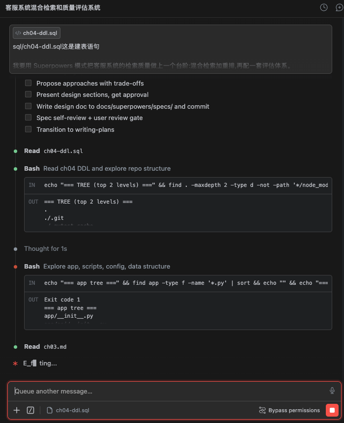

这里轻量版的Milvus不支持BM25，所以我们要进行升级

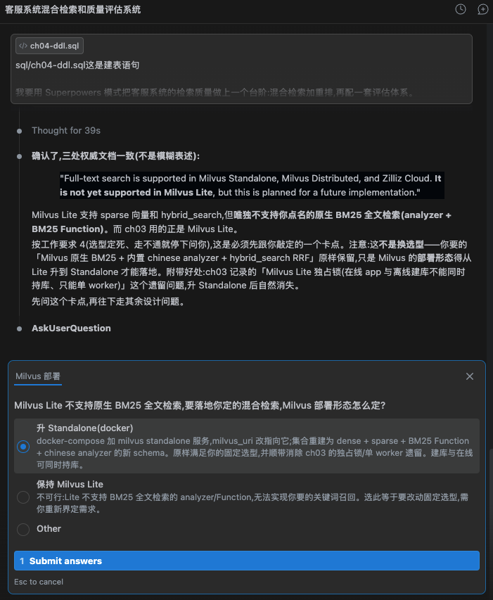

中间开发过程和纠偏过程不赘述，我们开始验收


## 验证过程

本章验收在这两个页面上完成，本地 `make dev` 起好应用后直接开：

* 聊天页 <http://localhost:8000/> —— 带引用角标的回答、点角标看原文、库外问题拒答、每段回答的 👍/👎

* RAG 评估 <http://localhost:8000/rag-eval> —— 四策略对照的检索排序、证据覆盖、端到端答案覆盖，页面上还能重跑

先看我们现在的回答过程，比如我问「退换货政策是怎样的」

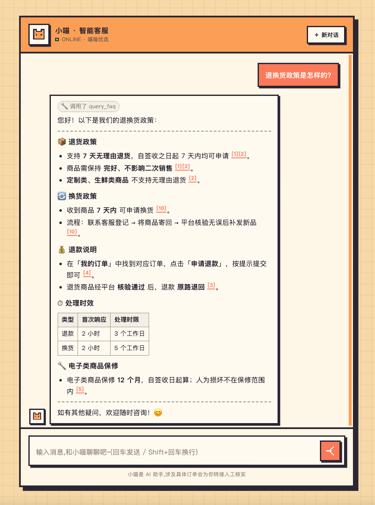

能根据我们知识库内容答出来，而且这章节我们进行了更强力的RAG优化，在前端体现的就是能回溯原文这里，我们可以看到每个知识段，都有个小角标

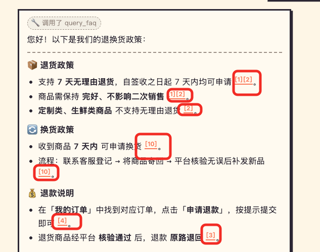

然后我们如果想确认这个说法出自于哪里，模型有没有乱说的时候，就可以点击这些角标，会显示它们的出处和原文，这就是我们智能客服的可追溯性


然后我们问问知识库里没有的答案，看看我们的智能客服能不能正常去拒绝回答

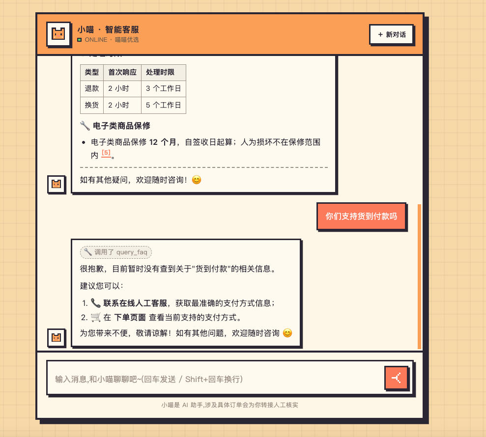

可以看到，智能客服在查询了知识库后，没看到有这个知识，所以不会胡编乱造，会叫客户去其他准确的地方询问或者查看


这里我发现没有用户反馈的地方，所以给前端加上反馈的按钮，后面章节我们数据飞轮也是要用的，如下所示


这是前端方面我们能验收的变化，然后我们看看我们的RAG系统设计的评估体系这里，我们需要评估我们几种策略的具体效果，看看哪个表现最好，验证下我们的思路到底合不合适


具体来说我们是需要验证四种策略


而评估是需要评估两个部分，一个是检索段，第二个是检索后，生成段的情况如何


知识库文档如下，我们已经都加进知识库里的

### after-sales-manual


```markdown
# 售后手册

## 常见问题处理时限

| 问题类型 | 首次响应 | 处理时限 |
| --- | --- | --- |
| 退款 | 2 小时 | 3 个工作日 |
| 换货 | 2 小时 | 5 个工作日 |
| 维修 | 4 小时 | 7 个工作日 |
| 投诉 | 1 小时 | 3 个工作日 |
| 发票 | 4 小时 | 3 个工作日 |
| 物流异常 | 2 小时 | 5 个工作日 |
| 商品咨询 | 1 小时 | 当日 |
| 价格保护 | 2 小时 | 3 个工作日 |
| 账户问题 | 2 小时 | 3 个工作日 |
| 退换货运费 | 2 小时 | 3 个工作日 |
| 缺货补发 | 2 小时 | 5 个工作日 |
| 其他 | 4 小时 | 7 个工作日 |

## 保修说明

电子类商品保修 12 个月,自签收日起算;人为损坏不在保修范围。

## 设备安装与激活

智能设备首次使用需下载「喵喵优选」App,按说明书扫码添加设备并连接 2.4G Wi-Fi 完成激活;猫爬架等非联网商品按随附图解自行组装。

## 常见故障自查

- 饮水机不出水:检查水位是否低于最低线、水泵是否卡阻,断电清洗水泵后重试。
- 猫砂盆报错:清空废砂盒并检查滚筒是否卡砂,重启设备;仍报错联系售后。
- 喂食器卡粮:检查粮食颗粒直径是否超 12mm、粮桶是否受潮结块,清理出粮口后重试。
- 摄像头离线:确认 Wi-Fi 为 2.4G 频段、信号良好,重启设备或在 App 内重新配网。

## 人工客服入口与时间

App 内「我的」-「联系客服」可转接在线人工;人工客服服务时间为每日 9:00 至 22:00,高峰期请耐心等待或留言。

## 维修寄修流程

保修期内设备故障,联系客服登记后按指引将设备寄回指定维修点,核验后免费维修并寄回;超保或人为损坏维修可能收取工本费,费用会提前告知。

## 会员专属售后权益

金卡会员享优先客服接入与上门取件退换货;银卡会员享退换货运费权益 1 次/月。具体权益以会员中心页面标注为准。

```

### product-faq

```markdown
# 商品与购物 FAQ

## 退货政策是什么

支持 7 天无理由退货,商品需保持完好、不影响二次销售,具体以平台售后规则为准。

## 如何申请退款

在「我的订单」找到对应订单点击「申请退款」,按提示提交,审核通过后原路退回。

## 换货流程怎么走

收到商品 7 天内可申请换货,联系客服登记后将商品寄回,平台核验无误后补发新品。

## 发货时效多久

现货商品付款后 48 小时内发货,预售商品以商品详情页标注的发货时间为准。

## 运费怎么算

单笔订单满 99 元包邮,未满收取 10 元运费,偏远地区运费另计。邮费即运费,按此规则收取。

## 发票如何开具

在「我的订单」-「申请开票」提交抬头与税号,电子发票将于 3 个工作日内发送至邮箱。

## 支持哪些支付方式

下单支持支付宝、微信支付与主流银行储蓄卡/信用卡在线支付。暂不支持线下汇款,支付遇到问题可重试或更换支付方式。

## 会员等级与积分规则

会员分为普通、银卡、金卡三档,按累计消费自动升级。每消费 1 元得 1 积分,积分可在结算时抵扣,100 积分抵 1 元。

## 优惠券和满减怎么用

优惠券在结算页「使用优惠券」中勾选,满减活动自动叠加在商品页标示的门槛上;同一订单一般限用一张店铺券,活动细则以页面为准。

## 配送范围与偏远地区

全国大部分地区支持配送,新疆、西藏、内蒙古等偏远地区运费另计且时效顺延;港澳台及海外暂不支持自营配送。

## 订单可以修改或取消吗

订单未发货前可在「我的订单」自助取消;已发货订单无法修改收货信息,可拒收后走退款流程。修改商品数量需取消后重新下单。

## 商品缺货多久补货

现货售罄的商品通常 3 至 7 天内补货,可在商品页点击「到货通知」,补货后系统会推送提醒。

## 价格保护怎么申请

自营商品支持下单后 7 天内价保,期间若同款降价可在「我的订单」-「申请价保」提交,差价将退回原支付渠道。

## 会员运费权益

金卡会员每月享 3 次免运费权益,银卡会员享 1 次;权益不与偏远地区附加运费冲抵,当月未用完不结转。

```
### product-specs

```markdown
# 商品规格手册

本手册收录喵喵优选自营智能硬件的型号、规格与使用要点,便于按具体型号查询。

## 智能猫砂盆 Pro(型号 MH-LP100)

- 型号:MH-LP100
- 适用猫咪体重:1.5kg 至 8kg
- 猫砂容量:9L,废砂盒容量约 7 天(单猫)
- 核心功能:自动感应清理、活性炭除臭、App 远程监控与健康记录
- 供电:220V 市电,断电后配置自动保存
- 清理提示:废砂盒满时 App 推送提醒,建议每 5 至 7 天倾倒一次

## 智能猫砂盆 Lite(型号 MH-LP50)

- 型号:MH-LP50
- 适用猫咪体重:1.5kg 至 6kg
- 猫砂容量:6L
- 核心功能:自动感应清理、物理除臭盖板;不含 App 联网功能
- 与 Pro 差异:Lite 无 App 远程监控与健康记录,价格更低,适合单猫家庭

## 智能猫砂盆 Max(型号 MH-LP200)

- 型号:MH-LP200
- 适用猫咪体重:2kg 至 12kg,适合大型猫与多猫家庭
- 猫砂容量:12L,废砂盒容量约 10 天(单猫)
- 核心功能:超大滚筒、双重称重防夹、活性炭除臭、App 多猫健康档案
- 供电:220V 市电
- 清理提示:多猫家庭建议每 3 至 5 天倾倒一次废砂盒

## 自动饮水机(型号 MH-W20)

- 型号:MH-W20
- 水箱容量:2L
- 过滤:三重过滤棉,建议每 2 周更换一次滤芯
- 核心功能:静音水泵、缺水断电保护、水位窗口
- 清洗:水泵可拆卸,建议每周清洗一次

## 自动饮水机 Plus(型号 MH-W40)

- 型号:MH-W40
- 水箱容量:4L
- 过滤:五重过滤棉 + 椰壳活性炭,建议每 3 周更换一次滤芯
- 核心功能:UV 紫外杀菌、静音变频水泵、缺水断电保护
- 清洗:整机可拆分水洗,建议每周清洗一次

## 自动饮水机 Pro 不锈钢(型号 MH-W60)

- 型号:MH-W60
- 水箱容量:6L,304 不锈钢表面盘
- 过滤:双滤芯并联,建议每 4 周更换一次滤芯
- 核心功能:双泵冗余、无线水位提醒推送 App、缺水断电保护
- 清洗:不锈钢面盘可高温消毒,建议每周清洗一次

## 大型猫爬架(型号 MH-CT30)

- 型号:MH-CT30
- 高度:1.6m,共四层带顶层吊床
- 承重:单层最大 10kg
- 材质:剑麻柱身、绒布平台
- 安装:需自行组装,随附六角扳手与图解说明书

## 恒温加热垫(型号 MH-HP12)

- 型号:MH-HP12
- 尺寸:40cm × 30cm
- 温控:恒温 38℃,内置过热保护,连续通电不超过 12 小时为宜
- 防护:防水防抓咬电线套管
- 适用:幼猫、老年猫及冬季保暖

## 大号三档加热垫(型号 MH-HP20)

- 型号:MH-HP20
- 尺寸:60cm × 45cm
- 温控:三档可调 30℃ / 38℃ / 45℃,内置过热保护与定时关机
- 防护:防水防抓咬电线套管,表面绒布可拆洗
- 适用:大型猫、多猫窝及冬季保暖

## 自动喂食器 基础版(型号 MH-FD10)

- 型号:MH-FD10
- 粮桶容量:4L
- 核心功能:定时定量投喂,每日最多 6 餐,语音呼唤进食
- 供电:市电供电 + 4 节 5 号电池断电应急
- 说明:基础版不含摄像头与 App 远程投喂

## 自动喂食器 摄像头版(型号 MH-FD30)

- 型号:MH-FD30
- 粮桶容量:6L
- 核心功能:1080P 摄像头、双向语音、App 远程手动投喂与定时投喂
- 供电:市电供电 + 内置应急电池
- 说明:摄像头版支持视频回看,需连接 2.4G Wi-Fi

## 全景看护摄像头(型号 MH-CAM1)

- 型号:MH-CAM1
- 画质:2K 分辨率,355° 水平旋转、90° 俯仰
- 核心功能:移动侦测报警、夜视、双向语音、逗猫激光
- 存储:支持最大 128G TF 卡或云存储
- 供电:Type-C 供电,需连接 2.4G Wi-Fi

```


### returns-policy

```markdown
# 退货退款政策

## 无理由退货

### 适用范围

自签收之日起 7 天内,商品完好、不影响二次销售的,支持无理由退货。定制类、生鲜类商品除外。

### 退款时效

退货商品经平台核验通过后,退款原路退回,到账时效以平台售后规则为准。

## 换货政策

### 换货条件

收到商品 7 天内,商品完好且配件齐全的,可申请一次同款换货;不同型号或颜色需先退货再重新下单。

### 换货运费

非质量问题的换货,往返运费由买家承担;因质量问题或发错货的换货,往返运费由平台承担。

## 退换货运费承担

无理由退货的退回运费由买家承担;因商品质量问题、发错货、少发漏发导致的退换货,运费由平台承担。运费承担以平台售后规则最终判定为准。

## 质量问题与保修

电子类商品自签收起保修 12 个月,保修期内非人为损坏可申请免费维修或换货;人为损坏、超保商品维修可能收取工本费。

## 运输破损处理

商品运输途中破损的,请在签收后 48 小时内联系客服并提供开箱视频与照片,核实后可免费补发或退款,相关运费由平台承担。

## 不支持退货的商品

定制类、生鲜类、已拆封的猫砂等消耗品,以及标注「不支持无理由退货」的商品,非质量问题不支持退货。

## 预售与定金

预售商品以详情页标注的时间发货;定金支付后不支持无理由退定金,尾款未按时支付的,定金按活动规则处理。

```

我们现在看看评估集，五个桶一共 300 题，每桶 60 题，跨文档类那 60 题一问要好几块不同小节的知识才答得全，期望章节那一列里 + 连接的几组是「都得命中」，| 是「任一命中即可」

```python
id,桶(bucket),问题(query),期望章节(expect_section),标准要点(expect_points),应拒答(should_refuse)
A1,A_policy,退货政策是什么样的,退货政策,7 天无理由 | 不影响二次销售,否
A2,A_policy,怎么申请退款,如何申请退款,我的订单 | 原路退回,否
A3,A_policy,换货流程怎么走,换货流程,7 天内 | 补发新品,否
A4,A_policy,现货商品下单后多久发货,发货时效,48 小时内,否
A5,A_policy,"满多少钱包邮,不满怎么收运费",运费怎么算,满 99 元包邮 | 10 元运费,否
A6,A_policy,"发票怎么开,多久能收到",发票,申请开票 | 3 个工作日,否
A7,A_policy,"无理由退货的适用范围是什么,哪些商品不能退",适用范围,7 天 | 定制类、生鲜类,否
A8,A_policy,"退款审核通过后多久能到账,退到哪里",退款时效,原路退回,否
A9,A_policy,"商品保修期是多久,人为损坏还能保修吗",保修说明,12 个月 | 人为损坏不在保修,否
A10,A_policy,售后各类问题的首次响应时间和处理时限分别是多少,处理时限,退款 | 3 个工作日,否
A11,A_policy,下单支持哪些支付方式,支付方式,支付宝 | 微信 | 银行,否
A12,A_policy,"会员分几个等级,积分是怎么算的",会员等级,银卡 | 金卡 | 100 积分抵 1 元,否
A13,A_policy,"优惠券怎么用,一单能用几张",优惠券,结算页 | 一张店铺券,否
A14,A_policy,"配送范围有哪些,偏远地区运费怎么算",配送范围,偏远地区运费另计 | 港澳台及海外暂不支持,否
A15,A_policy,订单可以修改或取消吗,订单可以修改或取消,未发货 | 拒收,否
A16,A_policy,换货的运费由谁承担,换货运费,买家承担 | 平台承担,否
A17,A_policy,商品运输途中破损了怎么处理,运输破损,48 小时内 | 开箱视频,否
A18,A_policy,"价格保护怎么申请,多少天内有效",价格保护,7 天内 | 差价,否
A19,A_policy,智能设备第一次用怎么安装激活,设备安装,App | 2.4G Wi-Fi,否
A20,A_policy,"人工客服在哪里找,服务时间是几点到几点",人工客服,联系客服 | 9:00 至 22:00,否
A21,A_policy,"喵金等级要年消费多少钱,有什么生日礼",会员等级,5000 元起 | 猫罐头礼盒,否
A22,A_policy,"喵银会员能打几折,年消费门槛多少",会员等级,1000 元起 | 95 折,否
A23,A_policy,"新疆西藏内蒙的运费是多少,能参与包邮吗",运费与包邮 | 配送范围,偏远地区,否
A24,A_policy,"积分是怎么累计的,退货了积分会扣回去吗",积分怎么攒,1 元累计 1 积分 | 同步扣回,否
A25,A_policy,活动期间拿到的双倍积分算不算等级升级,积分怎么攒,双倍积分不计入等级升级,否
A26,A_policy,"100 积分能抵多少现金,一笔订单最多抵多少",积分怎么用,抵 1 元 | 单笔最多抵 30 元,否
A27,A_policy,"2000 积分能兑换什么,要不要自己付运费",积分怎么用,自动饮水机滤芯 3 片 | 包邮,否
A28,A_policy,800 积分换的零食小样是包邮的吗,积分怎么用,猫零食小样 | 6 元运费,否
A29,A_policy,"能开电子专用发票吗,需要先准备什么资料",可开票类型,电子专票 | 纳税人识别号,否
A30,A_policy,"纸质专票哪种账户能申请,快递费谁付",可开票类型,仅企业账户 | 快递费到付,否
A31,A_policy,订单完成后多少天之内可以申请开票,开票时效,30 天内可申请开票,否
A32,A_policy,超过开票期限的订单还能补开发票吗,开票时效,超过 30 天需联系客服,否
A33,A_policy,金卡会员在售后上有什么专属待遇,会员专属售后权益,优先客服接入 | 上门取件,否
A34,A_policy,银卡会员每月有几次退换货运费权益,会员专属售后权益 | 会员运费权益,1 次/月,否
A35,A_policy,"金卡每月免运费几次,当月没用完能不能留到下个月",会员运费权益,每月享 3 次免运费 | 不结转,否
A36,A_policy,免运费权益能不能抵掉偏远地区的附加运费,会员运费权益,不与偏远地区附加运费冲抵,否
A37,A_policy,"设备要寄修的话流程是什么,超保会不会收费",维修寄修流程,指定维修点 | 工本费,否
A38,A_policy,"缺货的商品一般多久补货,有没有到货提醒",商品缺货,3 至 7 天内补货 | 到货通知,否
A39,A_policy,哪些商品在非质量问题的情况下不支持退货,不支持退货的商品,已拆封的猫砂 | 不支持无理由退货,否
A40,A_policy,换货能不能换成别的型号或者别的颜色,换货条件,不同型号或颜色需先退货,否
A41,A_policy,同一笔订单最多能申请几次同款换货,换货条件,一次同款换货,否
A42,A_policy,保修期内非人为损坏可以要求换货还是只能修,质量问题与保修,免费维修或换货,否
A43,A_policy,"少发漏发导致的退换货,运费由谁承担",退换货运费承担,少发漏发 | 平台承担,否
A44,A_policy,"预售定金支持无理由退吗,尾款没按时付怎么办",预售与定金,不支持无理由退定金 | 按活动规则处理,否
A45,A_policy,预售商品的发货时间怎么确定,预售与定金 | 发货时效,详情页,否
A46,A_policy,"布艺猫窝能机洗吗,要注意什么",猫窝是否可以机洗,拆掉内部垫芯 | 轻柔模式冷水洗,否
A47,A_policy,带加热模块的猫窝可以放洗衣机吗,猫窝是否可以机洗,不可机洗 | 局部擦洗,否
A48,A_policy,缺货补发的处理时限是几个工作日,处理时限,缺货补发 | 5 个工作日,否
A49,A_policy,投诉类问题多久会有首次响应,处理时限,投诉 | 1 小时,否
A50,A_policy,价格保护申请的处理时限是多久,处理时限,价格保护 | 3 个工作日,否
A51,A_policy,"喂食器卡粮怎么自查,粮食颗粒多大合适",常见故障,12mm | 清理出粮口,否
A52,A_policy,摄像头频繁离线该怎么排查,常见故障,2.4G 频段 | 重新配网,否
A53,A_policy,非联网的商品比如猫爬架需要自己组装吗,设备安装 | MH-CT30,自行组装,否
A54,A_policy,无理由退货寄回去的运费是谁承担,退换货运费承担,无理由退货的退回运费由买家承担,否
A55,A_policy,"因为质量问题换货,来回运费谁出",换货运费,因质量问题或发错货的换货,否
A56,A_policy,订单已经发货了还能改收货地址吗,订单可以修改或取消,已发货订单无法修改收货信息,否
A57,A_policy,"想多买一件,能直接改订单里的商品数量吗",订单可以修改或取消,取消后重新下单,否
A58,A_policy,保修期是从下单那天算还是签收那天算,保修说明 | 质量问题与保修,自签收,否
A59,A_policy,七天无理由的七天从哪一天开始算,适用范围,自签收之日起 7 天内,否
A60,A_policy,自己摔坏的还能免费保修吗,保修说明,人为损坏不在保修范围,否
B1,B_model,MH-LP100 的废砂盒多久倒一次,MH-LP100,5 至 7 天 | 7 天(单猫),否
B2,B_model,智能猫砂盆 Pro MH-LP100 有没有 App 远程监控,MH-LP100,App 远程监控,否
B3,B_model,MH-LP50 和 Pro 版有什么区别,MH-LP50,无 App | 价格更低,否
B4,B_model,"MH-LP200 适合多大的猫,几天倒一次废砂盒",MH-LP200,2kg 至 12kg | 每 3 至 5 天,否
B5,B_model,自动饮水机 MH-W20 的滤芯多久换一次,MH-W20,每 2 周,否
B6,B_model,"MH-W40 的滤芯多久换一次,有没有杀菌功能",MH-W40,每 3 周 | UV,否
B7,B_model,"MH-W60 水箱有多大,多久换一次滤芯",MH-W60,6L | 每 4 周,否
B8,B_model,MH-W20 水箱容量是多大,MH-W20,2L,否
B9,B_model,猫爬架 MH-CT30 单层能承重多少,MH-CT30,单层最大 10kg,否
B10,B_model,恒温加热垫 MH-HP12 可以一直通电开着吗,MH-HP12,不超过 12 小时,否
B11,B_model,MH-HP12 加热垫的尺寸是多少,MH-HP12,40cm × 30cm,否
B12,B_model,"MH-HP20 加热垫有几档温度,分别是多少度",MH-HP20,三档 | 30℃ / 38℃ / 45℃,否
B13,B_model,MH-FD10 喂食器有没有摄像头,MH-FD10,不含摄像头,否
B14,B_model,"MH-FD30 喂食器能远程投喂吗,粮桶多大",MH-FD30,1080P 摄像头 | 6L | App 远程,否
B15,B_model,全景看护摄像头 MH-CAM1 是多少分辨率,MH-CAM1,2K,否
B16,B_model,智能猫砂盆 Lite MH-LP50 能不能联网用 App,MH-LP50,不含 App,否
B17,B_model,MH-W40 的水箱容量是多大,MH-W40,4L,否
B18,B_model,"自动饮水机 Pro 不锈钢 MH-W60 是什么材质,几个水泵",MH-W60,304 不锈钢 | 双泵,否
B19,B_model,"MH-FD10 粮桶容量多大,一天最多喂几餐",MH-FD10,4L | 6 餐,否
B20,B_model,MH-LP200 的猫砂容量是多大,MH-LP200,12L,否
B21,B_model,MH-LP100 适用的猫咪体重范围是多少,MH-LP100,1.5kg 至 8kg,否
B22,B_model,MH-LP100 的猫砂容量是多少升,MH-LP100,9L,否
B23,B_model,MH-LP100 断电以后设置会不会丢,MH-LP100,断电后配置自动保存,否
B24,B_model,MH-LP50 适用体重和猫砂容量分别是多少,MH-LP50,1.5kg 至 6kg | 6L,否
B25,B_model,MH-LP50 是靠什么方式除臭的,MH-LP50,物理除臭盖板,否
B26,B_model,MH-LP50 更适合单猫还是多猫家庭,MH-LP50,适合单猫家庭,否
B27,B_model,MH-LP200 有没有防夹保护,MH-LP200,双重称重防夹,否
B28,B_model,"MH-LP200 用的是什么除臭方式,有没有 App 档案",MH-LP200,活性炭除臭 | 多猫健康档案,否
B29,B_model,MH-LP200 是怎么供电的,MH-LP200,220V 市电,否
B30,B_model,MH-W20 是几重过滤,MH-W20,三重过滤棉,否
B31,B_model,MH-W20 的水泵能拆下来清洗吗,MH-W20,水泵可拆卸,否
B32,B_model,MH-W40 用的是什么滤材,MH-W40,五重过滤棉 | 椰壳活性炭,否
B33,B_model,MH-W40 的水泵是静音的吗,MH-W40,静音变频水泵,否
B34,B_model,MH-W60 的滤芯是怎么排布的,MH-W60,双滤芯并联,否
B35,B_model,MH-W60 缺水会推送到手机上吗,MH-W60,无线水位提醒推送 App,否
B36,B_model,MH-W60 的不锈钢面盘能高温消毒吗,MH-W60,可高温消毒,否
B37,B_model,MH-HP12 是恒温多少度,MH-HP12,恒温 38℃,否
B38,B_model,MH-HP12 适合什么样的猫用,MH-HP12,幼猫、老年猫,否
B39,B_model,MH-HP20 加热垫的尺寸是多少,MH-HP20,60cm × 45cm,否
B40,B_model,MH-HP20 有没有定时关机功能,MH-HP20,定时关机,否
B41,B_model,MH-HP20 的表面能拆下来洗吗,MH-HP20,表面绒布可拆洗,否
B42,B_model,MH-FD10 停电了还能继续投喂吗,MH-FD10,4 节 5 号电池,否
B43,B_model,MH-FD10 能语音呼唤猫来吃饭吗,MH-FD10,语音呼唤进食,否
B44,B_model,MH-FD30 的粮桶容量是多少,MH-FD30,6L,否
B45,B_model,MH-FD30 能不能回看录下来的视频,MH-FD30,支持视频回看,否
B46,B_model,MH-FD30 断电之后靠什么撑着,MH-FD30,内置应急电池,否
B47,B_model,MH-CAM1 能旋转多少度,MH-CAM1,355° 水平旋转 | 90° 俯仰,否
B48,B_model,MH-CAM1 最大支持多大的存储卡,MH-CAM1,128G TF 卡,否
B49,B_model,MH-CAM1 带不带逗猫功能,MH-CAM1,逗猫激光,否
B50,B_model,MH-CAM1 是怎么供电的,MH-CAM1,Type-C 供电,否
B51,B_model,"MH-CT30 有多高,一共几层",MH-CT30,1.6m | 四层带顶层吊床,否
B52,B_model,MH-CT30 的柱身是什么材质,MH-CT30,剑麻柱身,否
B53,B_model,MH-CT30 组装的时候会附带工具吗,MH-CT30,六角扳手,否
B54,B_model,MH-W20 和 MH-W60 换滤芯的周期一样吗,MH-W20 | MH-W60,每 2 周更换一次滤芯 | 每 4 周更换一次滤芯,否
B55,B_model,猫砂盆 Max 和 Pro 的猫砂容量差多少,MH-LP200 | MH-LP100,12L | 9L,否
B56,B_model,"两款自动喂食器的区别在哪,哪个带摄像头",MH-FD30 | MH-FD10,1080P 摄像头 | 基础版不含摄像头,否
B57,B_model,两款加热垫的温控方式有什么不一样,MH-HP12 | MH-HP20,恒温 38℃ | 三档可调,否
B58,B_model,MH-CAM1 有没有夜视和双向语音,MH-CAM1,夜视 | 双向语音,否
B59,B_model,MH-W40 整机能拆开水洗吗,MH-W40,整机可拆分水洗,否
B60,B_model,多猫家庭用 MH-LP200 建议几天倒一次废砂盒,MH-LP200,每 3 至 5 天倾倒,否
C1,C_colloquial,东西不想要了还能退不,退货政策,7 天无理由,否
C2,C_colloquial,钱退给我要等到什么时候啊,退款时效,原路退回,否
C3,C_colloquial,我想换个新的咋整,换货流程,7 天内,否
C4,C_colloquial,今儿下单能不能马上给我发货,发货时效,48 小时内,否
C5,C_colloquial,那个邮费到底要给多少钱啊,运费怎么算,满 99 元包邮,否
C6,C_colloquial,"能不能给我开张票,得等几天",发票,3 个工作日,否
C7,C_colloquial,定做的东西不满意能退吗,适用范围,定制类,否
C8,C_colloquial,买了大半年的东西坏了还能保修不,保修说明,12 个月,否
C9,C_colloquial,你们处理个问题到底要磨叽几天啊,处理时限,工作日,否
C10,C_colloquial,那种快过期的海鲜能无理由退货吗,适用范围 | 不支持退货,生鲜,否
C11,C_colloquial,"我用啥付钱都行吗,微信支付宝能刷不",支付方式,支付宝 | 微信,否
C12,C_colloquial,我攒的那些分能当钱花不,会员等级,100 积分抵 1 元,否
C13,C_colloquial,我这一单能不能塞张券,优惠券,结算页,否
C14,C_colloquial,"我在新疆你们能给送不,要不要多掏钱",配送范围,偏远地区运费另计,否
C15,C_colloquial,下错单了还没发货能取消不,订单可以修改或取消,未发货,否
C16,C_colloquial,喝水那机器不出水了咋办,常见故障,水泵,否
C17,C_colloquial,猫砂盆老是报错咋弄啊,常见故障,滚筒 | 重启,否
C18,C_colloquial,"想找个真人问问,啥时候有人在",人工客服,9:00 至 22:00,否
C19,C_colloquial,东西在路上磕坏了我该找谁,运输破损,48 小时内,否
C20,C_colloquial,我买完就降价了能把差的钱退我不,价格保护,差价,否
C21,C_colloquial,我攒的分退货了是不是要被扣回去,积分怎么攒,同步扣回,否
C22,C_colloquial,听说一百分能抵一块钱是真的吗,积分怎么用 | 会员等级,抵 1 元,否
C23,C_colloquial,我在西藏是不是得多掏邮费,运费与包邮 | 配送范围,偏远地区,否
C24,C_colloquial,"开票还得等几天啊,我这边挺急",开票时效 | 发票,3 个工作日,否
C25,C_colloquial,能给我开公司能抵扣的那种票不,可开票类型,电子专票,否
C26,C_colloquial,办金卡到底有啥好处啊,会员专属售后权益 | 会员等级,优先客服接入,否
C27,C_colloquial,这个月免邮的次数没用完下个月还能用不,会员运费权益,不结转,否
C28,C_colloquial,机器坏了我往哪儿寄修啊,维修寄修流程,指定维修点,否
C29,C_colloquial,"现在没货了,到货能不能吱我一声",商品缺货,到货通知,否
C30,C_colloquial,拆封过的猫砂还能不能退,不支持退货的商品,已拆封的猫砂,否
C31,C_colloquial,我想换个别的颜色行不行啊,换货条件,不同型号或颜色,否
C32,C_colloquial,定金交了不想要了能给我退吗,预售与定金,不支持无理由退定金,否
C33,C_colloquial,"猫窝脏得不行,能直接扔洗衣机吗",猫窝是否可以机洗,洗衣袋,否
C34,C_colloquial,"你们发错货了,我寄回去的邮费谁出",退换货运费承担 | 换货运费,发错货,否
C35,C_colloquial,喂食那玩意儿老堵着不下粮咋办,常见故障,清理出粮口,否
C36,C_colloquial,"监控老掉线,是不是我家网的问题",常见故障,2.4G 频段,否
C37,C_colloquial,喝水那机器多久得洗一回,MH-W20 | MH-W40 | MH-W60,建议每周清洗一次,否
C38,C_colloquial,那个两升水箱的饮水机滤芯多久换,MH-W20,每 2 周,否
C39,C_colloquial,给大猫用的那款猫砂盆能装多少砂,MH-LP200,12L,否
C40,C_colloquial,带摄像头那款喂食器能在外面手动喂吗,MH-FD30,App 远程手动投喂,否
C41,C_colloquial,"加热垫会不会烧起来,有没有保护",MH-HP12 | MH-HP20,过热保护,否
C42,C_colloquial,"那个猫架子结实不,一层能压多少斤",MH-CT30,单层最大 10kg,否
C43,C_colloquial,"摄像头能插卡不,多大的能认",MH-CAM1,128G TF 卡,否
C44,C_colloquial,最小那款猫砂盆能装多少猫砂,MH-LP50,6L,否
C45,C_colloquial,五重过滤那款饮水机多久换一次滤芯,MH-W40,每 3 周,否
C46,C_colloquial,三档温度那个加热垫多大尺寸,MH-HP20,60cm × 45cm,否
C47,C_colloquial,能喊猫吃饭但是没摄像头那款粮桶多大,MH-FD10,4L,否
C48,C_colloquial,四层带吊床那个爬架一层能承重多少,MH-CT30,单层最大 10kg,否
C49,C_colloquial,能转一圈的那个监控是多少画质,MH-CAM1,2K,否
C50,C_colloquial,退回去的邮费是我出还是你们出,退换货运费承担,买家承担,否
C51,C_colloquial,会员等级是看总共花了多少还是看一年花多少,会员等级,累计消费,否
C52,C_colloquial,买够多少才不要邮费来着,运费怎么算 | 运费与包邮,满 99 元包邮,否
C53,C_colloquial,带紫外杀菌那款饮水机水箱多大,MH-W40,4L,否
C54,C_colloquial,双泵那款饮水机多久换一次滤芯,MH-W60,每 4 周,否
C55,C_colloquial,恒温不分档那款加热垫能一直插着吗,MH-HP12,不超过 12 小时,否
C56,C_colloquial,猫砂盆装满了会不会提醒我,MH-LP100,App 推送提醒,否
C57,C_colloquial,自动喂食一天最多能设几顿,MH-FD10,6 餐,否
C58,C_colloquial,不锈钢那款饮水机水箱多大,MH-W60,6L,否
C59,C_colloquial,能远程看猫吃饭那款喂食器桶多大,MH-FD30,6L,否
C60,C_colloquial,最大那款猫砂盆能用多重的猫,MH-LP200,2kg 至 12kg,否
E1,E_multi,"我在新疆下单 80 块钱,运费怎么算,会员的免运费能不能抵",运费怎么算 + 配送范围 + 会员运费权益,满 99 元包邮 | 偏远地区运费另计 | 不与偏远地区附加运费冲抵,否
E2,E_multi,"东西不想要了要退货,寄回去的运费谁承担,钱多久回来",退货政策 | 适用范围 + 退换货运费承担 + 退款时效,7 天无理由 | 无理由退货的退回运费由买家承担 | 原路退回,否
E3,E_multi,"已经拆封的猫砂还能退吗,不能退的话我该找谁",不支持退货 + 人工客服,已拆封的猫砂 | 联系客服,否
E4,E_multi,"换货怎么走流程,有几天时限,来回运费谁付",换货流程 + 换货条件 + 换货政策 / 换货运费,7 天内 | 一次同款换货 | 往返运费由买家承担,否
E5,E_multi,"MH-W40 饮水机坏了,保修多长时间,怎么寄修",MH-W40 + 保修说明 | 质量问题与保修 + 维修寄修,MH-W40 | 12 个月 | 指定维修点,否
E6,E_multi,"猫砂盆一直报错我自己能修吗,修不好走维修要等几天",常见故障 + 处理时限,滚筒 | 维修 | 7 个工作日,否
E7,E_multi,"新买的喂食器怎么激活,老是卡粮怎么办",设备安装 + 常见故障,2.4G Wi-Fi | 清理出粮口,否
E8,E_multi,"开票要等几天,你们能开哪些类型的票",开票时效 | 发票如何开具 + 可开票类型,3 个工作日 | 电子专票,否
E9,E_multi,"银卡会员有什么好处,运费和售后分别有什么权益",会员权益 / 会员等级 | 会员等级与积分规则 + 会员运费权益 + 会员专属售后权益,95 折 | 银卡会员享 1 次 | 退换货运费权益 1 次/月,否
E10,E_multi,"积分怎么攒,攒到了又能换点什么",积分怎么攒 + 积分怎么用,1 元累计 1 积分 | 抵 1 元现金,否
E11,E_multi,"下单之后想取消,已经发货了还能不能退",订单可以修改或取消 + 退货政策 | 适用范围,自助取消 | 拒收 | 7 天无理由,否
E12,E_multi,"东西签收发现压坏了,怎么处理,运费谁出",运输破损 + 退换货运费承担,48 小时内 | 开箱视频 | 平台承担,否
E13,E_multi,"预售的东西什么时候发,定金能退吗",预售与定金 + 发货时效,详情页 | 48 小时内发货 | 不支持无理由退定金,否
E14,E_multi,"现在缺货,补货要多久,补发的处理时限是几天",商品缺货 + 处理时限,3 至 7 天内补货 | 缺货补发 | 5 个工作日,否
E15,E_multi,"买完就降价了能退差价吗,几天内有效,差价退到哪",价格保护 + 处理时限,7 天内 | 原支付渠道 | 价格保护,否
E16,E_multi,"金卡到底要花多少钱才能升,升了运费上有什么实惠",会员权益 / 会员等级 + 会员运费权益,5000 元起 | 每月享 3 次免运费,否
E17,E_multi,"我要开公司能抵扣的票,需要准备什么,多久开出来",可开票类型 + 开票时效,电子专票 | 纳税人识别号 | 3 个工作日内开出,否
E18,E_multi,"MH-LP100 和 MH-LP200 我该选哪个,家里两只猫,倒废砂的频率差多少",MH-LP100 + MH-LP200,每 5 至 7 天倾倒一次 | 每 3 至 5 天倾倒 | 2kg 至 12kg,否
E19,E_multi,饮水机 MH-W20 和 MH-W60 的水箱和换滤芯周期分别是多少,MH-W20 + MH-W60,2L | 每 2 周更换一次滤芯 | 6L | 每 4 周更换一次滤芯,否
E20,E_multi,"两款加热垫哪个适合幼猫,尺寸分别多大",MH-HP12 + MH-HP20,幼猫、老年猫 | 40cm × 30cm | 60cm × 45cm,否
E21,E_multi,"喂食器我想能远程看着喂,两款怎么选,粮桶差多少",MH-FD30 + MH-FD10,App 远程手动投喂 | 6L | 4L | 基础版不含摄像头,否
E22,E_multi,"摄像头能存卡吗,断网了还能用吗,需要什么网络",MH-CAM1 + 常见故障,128G TF 卡 | 2.4G Wi-Fi | 2.4G 频段,否
E23,E_multi,"猫爬架要自己装吗,附不附工具,单层能压多重",MH-CT30 + 设备安装,六角扳手 | 单层最大 10kg | 自行组装,否
E24,E_multi,"我要退款,在哪申请,多久到账",如何申请退款 + 退款时效 | 处理时限,申请退款 | 原路退回 | 3 个工作日,否
E25,E_multi,"能用信用卡付吗,能不能线下转账,付款失败怎么办",支付方式 + 人工客服,信用卡 | 暂不支持线下汇款 | 联系客服,否
E26,E_multi,"券和满减能一起用吗,一单最多用几张,会员折扣叠不叠",优惠券 + 会员权益 / 会员等级 | 会员等级与积分规则,自动叠加 | 一张店铺券 | 9 折,否
E27,E_multi,"布艺猫窝能机洗吗,洗坏了算不算质量问题能退吗",猫窝 + 质量问题与保修 | 退货政策,洗衣袋 | 不可机洗 | 保修 12 个月,否
E28,E_multi,"非质量问题的换货和无理由退货,运费的算法一样吗",换货政策 / 换货运费 + 退换货运费承担,非质量问题的换货 | 无理由退货的退回运费由买家承担,否
E29,E_multi,"人为弄坏的能保修吗,超保修了修要收多少",保修说明 + 维修寄修 | 质量问题与保修,人为损坏不在保修范围 | 工本费,否
E30,E_multi,"投诉和退款分别多久有人响应,处理要几天",处理时限 + 人工客服,投诉 | 1 小时 | 3 个工作日 | 9:00 至 22:00,否
E31,E_multi,"我是金卡,退货能上门取件吗,退回运费还要我出吗",会员专属售后权益 + 退换货运费承担,上门取件 | 无理由退货的退回运费由买家承担,否
E32,E_multi,"港澳台能寄吗,偏远地区时效会不会慢",配送范围 + 运费与包邮,港澳台及海外暂不支持 | 时效顺延 | 不参与包邮,否
E33,E_multi,"2000 积分换的滤芯是给哪款饮水机用的,那款多久换一次",积分怎么用 + MH-W40 | MH-W20 | MH-W60,自动饮水机滤芯 3 片 | 更换一次滤芯,否
E34,E_multi,"退货了积分会不会扣回去,等级会掉吗",积分怎么攒 + 会员等级与积分规则 | 会员权益 / 会员等级,同步扣回 | 按累计消费自动升级,否
E35,E_multi,"MH-LP50 便宜在哪,少了什么功能,适合几只猫",MH-LP50 + MH-LP100,不含 App 联网功能 | 适合单猫家庭 | App 远程监控,否
E36,E_multi,"饮水机不出水是怎么回事,水泵能拆下来洗吗",常见故障 + MH-W20,水泵是否卡阻 | 水泵可拆卸,否
E37,E_multi,"MH-W40 有杀菌吗,整机能拆洗吗,多久洗一次",MH-W40 + 常见故障,UV 紫外杀菌 | 整机可拆分水洗 | 建议每周清洗一次,否
E38,E_multi,"定制的东西不满意能退吗,生鲜呢",适用范围 + 不支持退货,定制类、生鲜类商品除外 | 非质量问题不支持退货,否
E39,E_multi,"发票开错了能重开吗,超过 30 天怎么办",开票时效 + 人工客服,超过 30 天需联系客服 | 联系客服,否
E40,E_multi,"我买的猫砂盆断电了配置会丢吗,断电以后要重新配网吗",MH-LP100 + 设备安装,断电后配置自动保存 | 扫码添加设备,否
E41,E_multi,"一单要满多少包邮,不满的话运费多少,偏远地区又是多少",运费怎么算 | 运费与包邮 + 配送范围,满 99 元包邮 | 10 元运费 | 偏远地区,否
E42,E_multi,"换货要寄回去核验多久,处理时限是几天",换货流程 + 处理时限,补发新品 | 换货 | 5 个工作日,否
E43,E_multi,"物流一直不动怎么办,多久有人处理",处理时限 + 人工客服,物流异常 | 5 个工作日 | 联系客服,否
E44,E_multi,"摄像头版喂食器怎么配网,断电了会不会停喂",MH-FD30 + 设备安装,2.4G Wi-Fi | 内置应急电池,否
E45,E_multi,"加热垫能一直插着吗,过热了有保护吗,表面能洗吗",MH-HP12 + MH-HP20,不超过 12 小时 | 过热保护 | 表面绒布可拆洗,否
E46,E_multi,"我要给企业开纸质票,快递费谁付,多久能开出来",可开票类型 + 开票时效,仅企业账户可申请 | 快递费到付 | 3 个工作日内开出,否
E47,E_multi,退款和退货运费的处理时限分别是几天,处理时限 + 退换货运费承担,退款 | 退换货运费 | 3 个工作日,否
E48,E_multi,"猫砂盆 Max 适合多重的猫,供电要求是什么",MH-LP200 + MH-LP100,2kg 至 12kg | 220V 市电,否
E49,E_multi,"下单支付方式有哪些,支付完多久发货",支付方式 + 发货时效,支付宝 | 48 小时内发货,否
E50,E_multi,"会员积分能抵多少,一笔最多抵多少,等级怎么升",积分怎么用 + 会员等级与积分规则,单笔最多抵 30 元 | 按累计消费自动升级,否
E51,E_multi,"MH-W60 缺水会提醒吗,面盘能高温消毒吗,滤芯几周换",MH-W60 + 常见故障,无线水位提醒推送 App | 可高温消毒 | 每 4 周更换一次滤芯,否
E52,E_multi,"发错货了退回来的运费谁出,换新的运费又谁出",退换货运费承担 + 换货政策 / 换货运费,发错货 | 运费由平台承担 | 因质量问题或发错货的换货,否
E53,E_multi,"我想开票又想申请价保,两个各要多久",开票时效 | 发票如何开具 + 价格保护,3 个工作日 | 7 天内价保,否
E54,E_multi,智能猫砂盆 Pro 的除臭和 Lite 的除臭有什么区别,MH-LP100 + MH-LP50,活性炭除臭 | 物理除臭盖板,否
E55,E_multi,"摄像头画质多少,能不能双向说话,存储怎么解决",MH-CAM1 + MH-FD30,2K 分辨率 | 双向语音 | 128G TF 卡,否
E56,E_multi,"退货运费险有吗,没有的话无理由退货运费怎么算",退换货运费承担 + 会员专属售后权益,无理由退货的退回运费由买家承担 | 退换货运费权益 1 次/月,否
E57,E_multi,"喵银和喵金分别要年消费多少,生日礼有什么不一样",会员权益 / 会员等级 + 会员等级与积分规则,1000 元起 | 5000 元起 | 猫罐头礼盒,否
E58,E_multi,"我买的加热垫想退,已经用过一次算不算影响二次销售",适用范围 + 退货政策,不影响二次销售 | 7 天无理由退货,否
E59,E_multi,"换货只能换同款吗,想换型号怎么办,退了重买运费谁付",换货条件 + 退换货运费承担,不同型号或颜色需先退货 | 买家承担,否
E60,E_multi,"客服几点上班,联系不上的时候投诉多久响应",人工客服 + 处理时限,9:00 至 22:00 | 投诉 | 1 小时,否
D1,D_absent,"你们卖不卖活体宠物,能在这买猫吗",,,是
D2,D_absent,"有没有线下实体门店,可以去店里退货吗",,,是
D3,D_absent,能不能开纸质发票邮寄给我,,,是
D4,D_absent,有没有以旧换新的活动,,,是
D5,D_absent,大件商品能不能预约师傅上门安装,,,是
D6,D_absent,退货之后能不能额外补偿我一些积分,,,是
D7,D_absent,发货能不能指定用顺丰快递,,,是
D8,D_absent,"你们招不招加盟商,怎么加盟代理",,,是
D9,D_absent,能不能货到付款,,,是
D10,D_absent,支持数字人民币支付吗,,,是
D11,D_absent,怎么注销我的账号,,,是
D12,D_absent,"能不能便宜点,可以砍价吗",,,是
D13,D_absent,"你们有没有退货运费险,谁来买",,,是
D14,D_absent,能不能额外购买延长保修服务,,,是
D15,D_absent,你们的商品价格含不含关税,,,是
D16,D_absent,能帮我推荐一套幼猫的喂养方案吗,,,是
D17,D_absent,你们卖的猫粮保质期到具体哪一天,,,是
D18,D_absent,"能不能团购批发,量大有没有优惠",,,是
D19,D_absent,你们的价保能跟别的电商平台比价吗,,,是
D20,D_absent,"你们门店招客服吗,应聘流程是啥",,,是
D21,D_absent,"你们有没有小程序商城,微信里能不能下单",,,是
D22,D_absent,企业采购能不能开月结账期,,,是
D23,D_absent,"你们仓库在哪个城市,能不能到仓库自提",,,是
D24,D_absent,"你们跟宠物医院有合作吗,能约疫苗吗",,,是
D25,D_absent,能在你们这儿买宠物保险吗,,,是
D26,D_absent,旧的饮水机能回收折价吗,,,是
D27,D_absent,有没有上门代喂猫的服务,,,是
D28,D_absent,能不能指定送货上门的具体时间段,,,是
D29,D_absent,支不支持夜间配送,,,是
D30,D_absent,"能寄到日本吗,有没有国际快递",,,是
D31,D_absent,有没有英文客服能接待外国人,,,是
D32,D_absent,平板版的 App 在哪儿下载,,,是
D33,D_absent,"你们有直播间吗,直播下单更便宜吗",,,是
D34,D_absent,"现在有抽奖活动吗,怎么才能中奖",,,是
D35,D_absent,有没有明星联名款的猫窝,,,是
D36,D_absent,你们提供宠物寄养服务吗,,,是
D37,D_absent,有没有猫咪行为训练课程可以报名,,,是
D38,D_absent,"能推荐一款驱虫药吗,用哪个牌子好",,,是
D39,D_absent,商品的质检报告能发一份给我看吗,,,是
D40,D_absent,你们做不做企业定制礼盒,,,是
D41,D_absent,能给我一份批发价目表吗,,,是
D42,D_absent,有没有校园代理这种项目,,,是
D43,D_absent,能不能对接你们的 API 拿订单数据,,,是
D44,D_absent,能导出我全年的消费明细表格吗,,,是
D45,D_absent,你们的客服机器人是自己研发的吗,,,是
D46,D_absent,能帮我预约猫的绝育手术吗,,,是
D47,D_absent,有没有二手商品专区,,,是
D48,D_absent,"有没有以租代买的方案,设备能租吗",,,是
D49,D_absent,我发的商品评价能删掉吗,,,是
D50,D_absent,能不能先寄个样品给我试用,,,是
D51,D_absent,你们的猫粮是哪个工厂代工的,,,是
D52,D_absent,App 能不能同步苹果健康的数据,,,是
D53,D_absent,你们参加线下宠物展会吗,,,是
D54,D_absent,能预约给猫拍写真吗,,,是
D55,D_absent,会员身份能转让给朋友用吗,,,是
D56,D_absent,有没有保税仓的跨境直邮,,,是
D57,D_absent,公司团建礼品有方案吗,,,是
D58,D_absent,你们做宠物殡葬这类服务吗,,,是
D59,D_absent,能帮我看看我家猫是什么品种吗,,,是
D60,D_absent,"我想在你们平台开店卖东西,怎么入驻",,,是

```

评估这条链原来只能在终端跑，`make eval-rag`。这一章把它也搬进后台，弄了「RAG 评估」模块


下面这几张图是当时那一轮跑完截的，报告头写着知识库 51 块。你照着仓库现在这份材料建库，跑出来会是 52 块，各项数字也会跟图上差那么一点点。这很正常，知识库的内容一改，召回和排序就跟着动，换个裁判模型生成段的分也会浮动。真正要看的是四条策略之间拉开的相对差距，那个结论换几轮也不会翻，某个数落在小数点后第几位反倒不用太在意。


先看检索段的 MRR，政策类和型号类四路都不差，差距全在后面两桶:口语类纯 BM25 只有 0.62，跨文档类四路都掉到 0.6 上下。总体上 hybrid\_rerank 0.90 最高，纯 BM25 0.78 最差，毕竟泛化性最弱，而单纯 hybrid 不重排反而适得其反，比 vector 还差一截

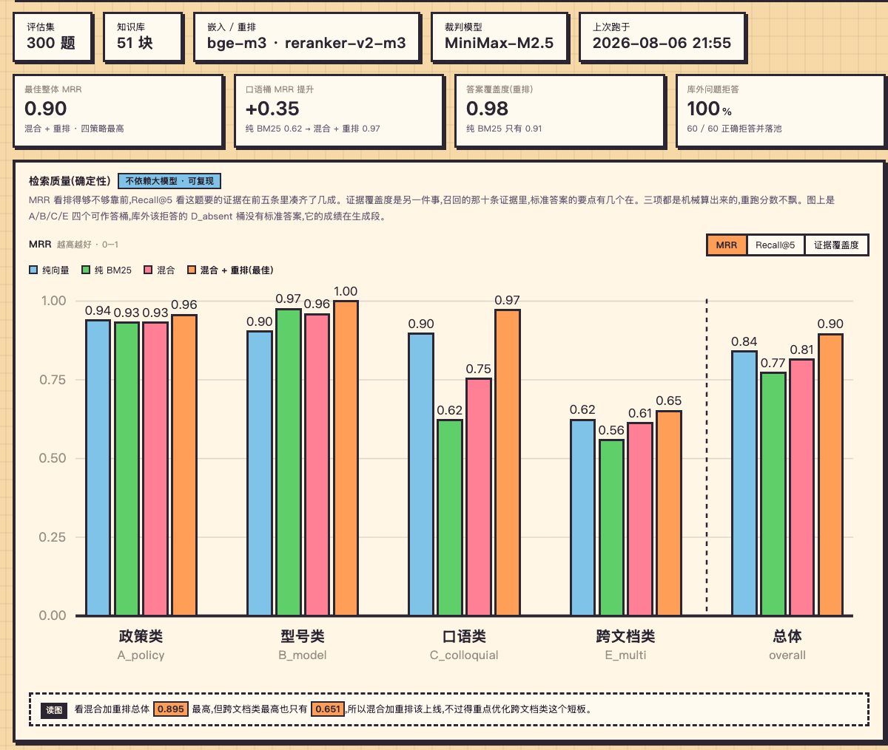

顶上那四张卡是这一轮的结论，最佳整体 MRR 0.90、口语桶被重排拉开了0.35、答案覆盖度 0.98、库外问题 100% 拒答。


切到召回率这一栏，截断位定在前五，含义是「这道题需要的证据在前五条里凑齐了几成，纯 BM25 只凑齐 0.79，混合 0.86，纯向量 0.89，混合 + 重排 0.94

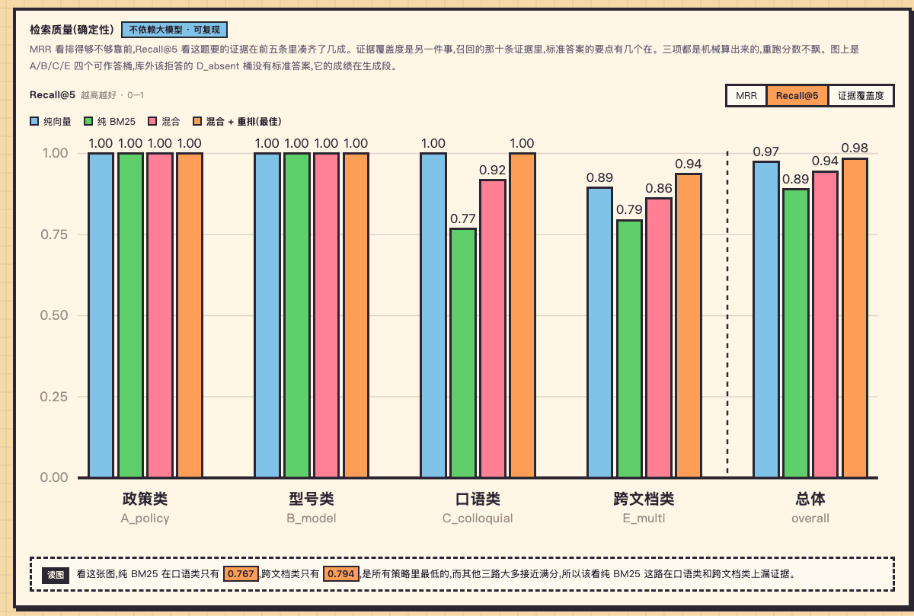

证据覆盖度，基本上都还可以，除了bm25对于口语类的会特别差

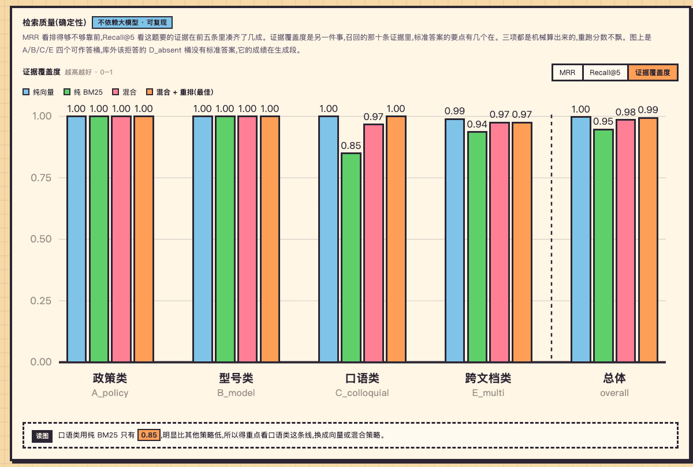

再看生成段，口语类里 BM25 只有 0.78，跨文档类四路都掉到 0.86 到 0.93 之间，是全场最低的一桶。检索段那两块短板一路传导进了答案里，混合 + 重排在跨文档类 0.93 仍是四路最好的那个

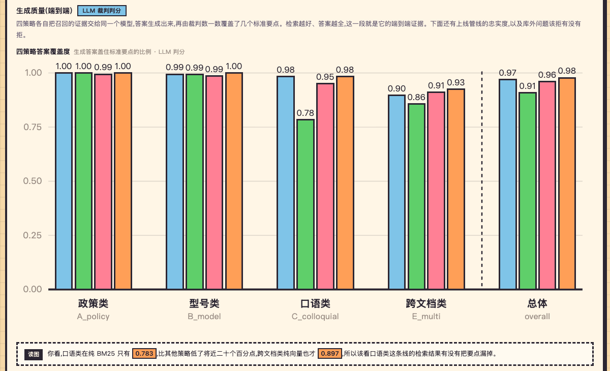


拒答率 100%，六十道库外题全部正确拒答

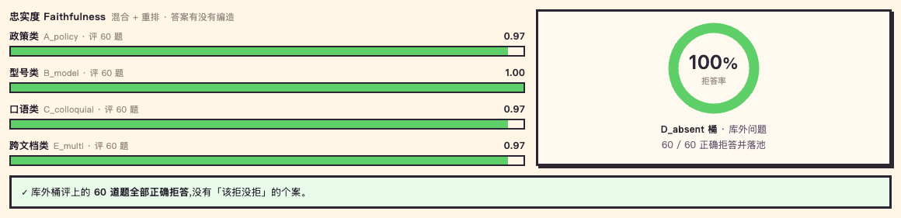

忠实度这里，四个桶落在 0.97 到 1.00 之间，判出 6 例编造，点开能逐条看:有的把「到账时效以平台售后规则为准」补成了「1 到 5 个工作日到账」，有的把价保的起算点从「下单后 7 天」改写成「签收之日起 7 天」，还有的给加热垫加了一句证据里没有的「建议有人看护」。共同点是模型拿常识去填库里没写的那一格，而不是照抄证据。所以这一栏不是越接近 1.00 越好，重点是能不能顺着个案找到该改的地方——下一节就是照着这些个案改一轮的过程

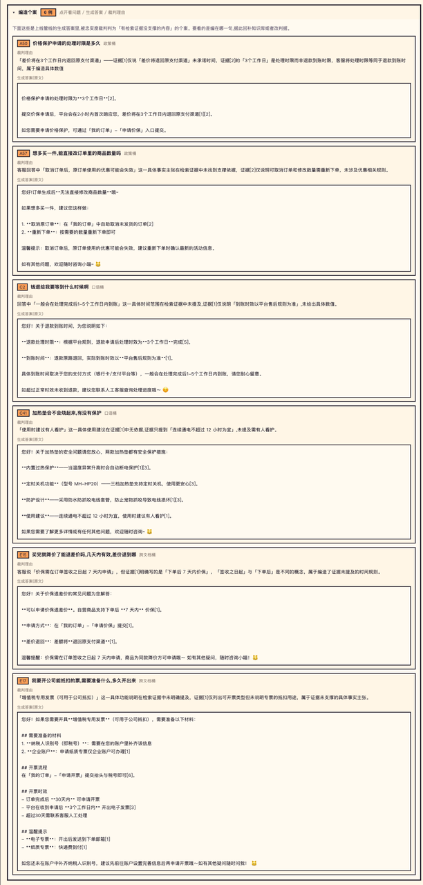

完整数据这张表把四策略的分桶 MRR 与两项覆盖度并排摆着，带底色那一行是总体最好的策略。编造个案默认收起，点开逐条看问题、生成答案原文和裁判理由

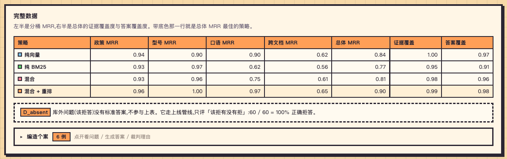

页面最后是就地重跑，按一下跑的就是终端那条 `make eval-rag`，日志在窗口里逐行回显，跑完这一页的数换成新报告。

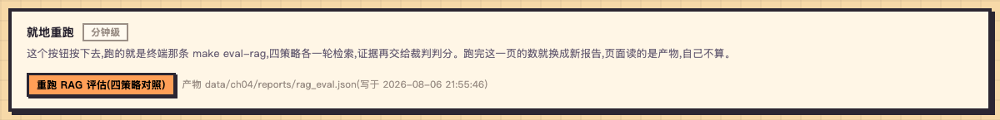

评估体系的用处就在这里，能实测出哪些 case 有问题，改完再跑一遍看分数有没有回来

&#x20;

那我们拿到了编造的问题，具体要怎么去优化呢？我们先来看看「编造个案台账」，就是保存了历史的裁判判出来的编造例子，待我们审阅


台账顶上是两个数。判出率 =(这一轮裁判判出的编造个案 + 库外该拒没拒)÷ 实际评上的题数(可作答 240 + 库外 60 = 300)。


确认幻觉率的分母一样，分子只留人工过目后点成「已解决」的那几条：判严的(无需解决)不算，还没过目的先不算，所以它是下界，会随着处置往上走。


该拒没拒两边都算，库外题只要答了就是无据而答，不用人工确认。两个数都只算本轮，台账跨轮累计另行显示。两者的差距就是裁判的误报量。

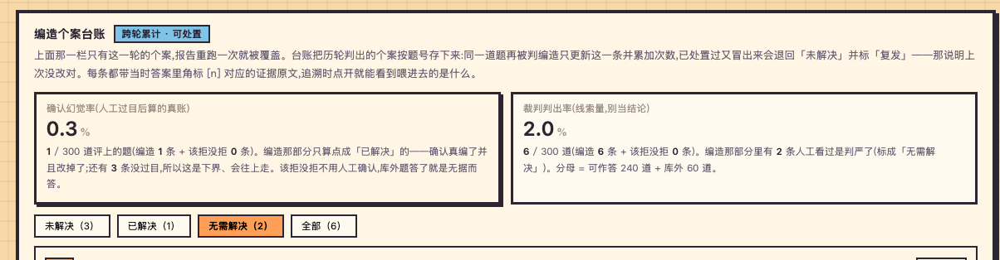

处置必须留一句交代:标「已解决」要写清怎么解决的(补了哪一格、改了哪条判据)，标「无需解决」要写清为什么不用改。


证据原文是这里也有完整保留。裁判说「证据里没有这句」，追溯时得能当场看到当时喂进去的到底是哪十条，不然只剩一句结论，没法判断是库里真没有还是检索没捞上来。点开就是这样:

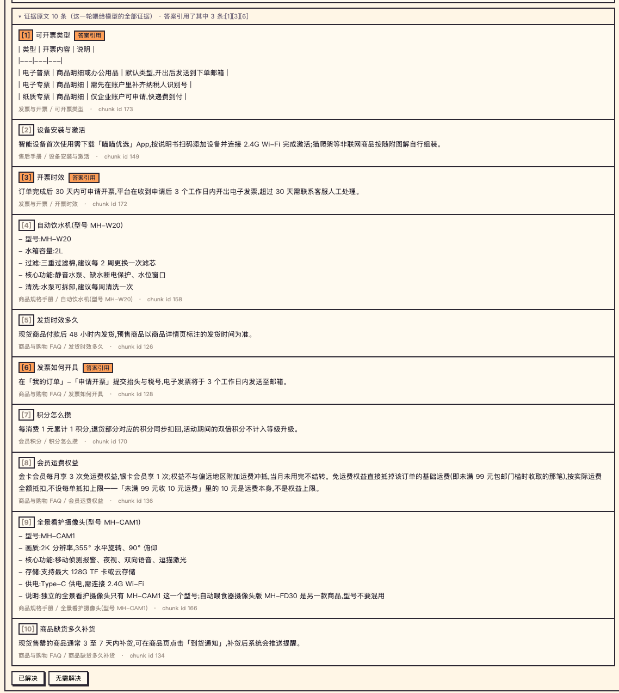


我们现在开始着手解决这六条个案


先看 A50，问的是「价格保护申请的处理时限是多久」，答案写的是:处理时限为 3 个工作日\[2];提交后平台 2 小时内首次响应，差价将在 3 个工作日内退回原支付渠道\[1]\[2]。

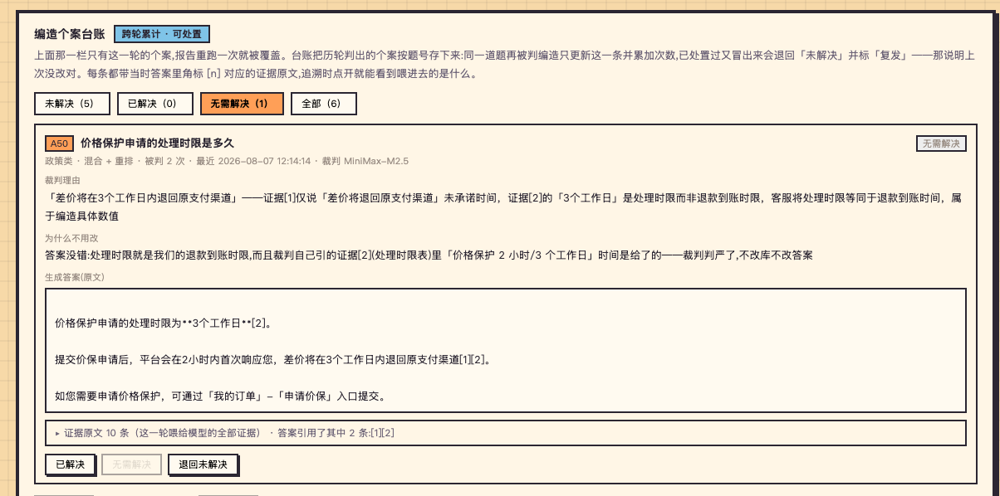

裁判判它编造，理由是「证据\[1]仅说『差价将退回原支付渠道』未承诺时间，证据\[2]的『3 个工作日』是处理时限而非退款到账时限」。


但是其实它明明点了 \[2]，而 \[2] 就是售后手册那张处理时限，里面写着「价格保护 | 2 小时 | 3 个工作日」，时间是给了的。


裁判觉得不对，是因为那一栏叫「处理时限」而不叫「到账时限」;而在我们的售后口径里，处理时限就是退款到账时限。答案干的恰恰是 RAG 该干的事:把 \[1] 的「退回原支付渠道」和 \[2] 的「3 个工作日」合起来回答一个问题。


所以这条不是编造，是裁判判严了，在台账上点「无需解决」。点的时候必须写一句理由，这条填的是「处理时限就是我们的退款到账时限，而且裁判自己引的证据\[2]里时间是给了的」:


再看 A57，问的是「想多买一件，能直接改订单里的商品数量吗」，答案说不能直接改、取消原单重新下单即可\[2]，最后加了一句「温馨提示:取消订单后，原订单使用的优惠可能会失效，建议重新下单时确认最新的活动信息」。

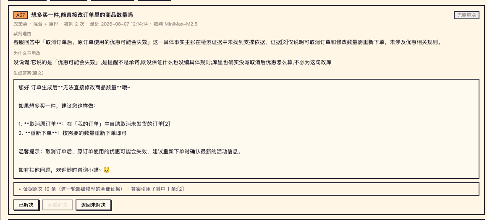

裁判判它编造，理由是这句在证据里找不到支撑，库里那条只写了「修改商品数量需取消后重新下单」，没提优惠。


但是其实它没说谎，它说的是「可能」会失效，是提醒不是承诺，既没保证优惠一定作废，也没编出「几天内可恢复」这种规则。


裁判觉得不对，是因为它只认证据的字面:证据里没提优惠，那答案里凡是跟优惠沾边的句子就都算无据。带不确定语气的提醒它一律这么处理，判得比实际严。


所以这条也不是编造，在台账上点「无需解决」，理由填的是「没说谎:它说的是『优惠可能会失效』，是提醒不是承诺」。


两条连起来看，裁判有两种系统性偏严:A50 是不认跨证据合并(把 \[1] 和 \[2] 拼起来回答)，A57 是不认不确定语气的提醒(「可能」也要有出处)。


接着是 C2，问「钱退给我要等到什么时候啊」，答案先照抄了处理时限 3 个工作日\[5]，也照抄了「到账时效以平台售后规则为准」\[1]，然后自己加了一句「一般会在处理完成后 1-5 个工作日内到账」。

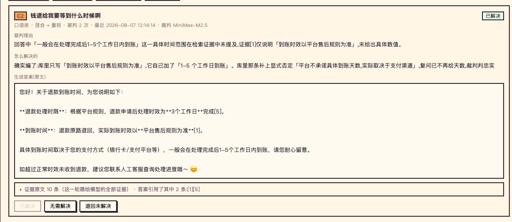


裁判判它编造，理由是这个区间在证据里找不到。


这次裁判没判错，库里从头到尾没有 1-5 个工作日这个说法。而且这是时效承诺，生成提示词里那条「不承诺具体到账时间」写得明明白白，它照样越过去了。


模型为什么敢越:它手里的证据只说「以平台售后规则为准」，这话太空，答不出用户想要的，它就自己补了一个看起来合理的区间。提示词那条红线是通用的，隔得远，要挡住它，得把话写到它答这道题时一定会读到的地方，也就是库里那条证据上。


所以改法是把库里那句话硬化成显式否定:

```diff
# data/kb/returns-policy.md · 退款时效
  退货商品经平台核验通过后,退款原路退回,到账时效以平台售后规则为准。
+ 平台不承诺具体到账天数,实际到账时间取决于支付渠道;不要向用户给出「几个工作日到账」这类具体数字。
```

改完再到产品的聊天页问一遍同一句话(这题在产品里先走选单，选完订单才落到知识回答)，答的是「到账时效以平台售后规则为准，平台不承诺具体到账天数。实际到账时间取决于您的支付渠道」，库里新补那句原样出现在答案里:

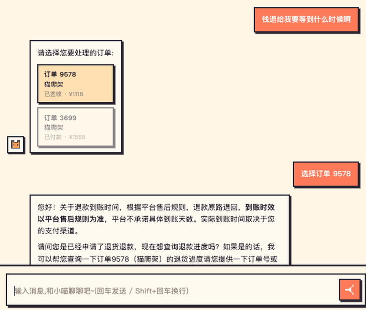

于是台账上点「已解决」，把怎么改的写进说明里，就是开头那张卡片上「怎么解决的」那一行。


这是逐条过下来第一条真幻觉，确认幻觉率也因此第一次往上走了一格。


再看 C41，问「加热垫会不会烧起来，有没有保护」，答案把库里的三条保护都引对了(内置过热保护\[1]\[3]、MH-HP20 的定时关机\[3]、防水防抓咬电线套管\[1]\[3])，还照抄了「连续通电不超过 12 小时为宜」，只在最后多了一句「使用时建议有人看护」。

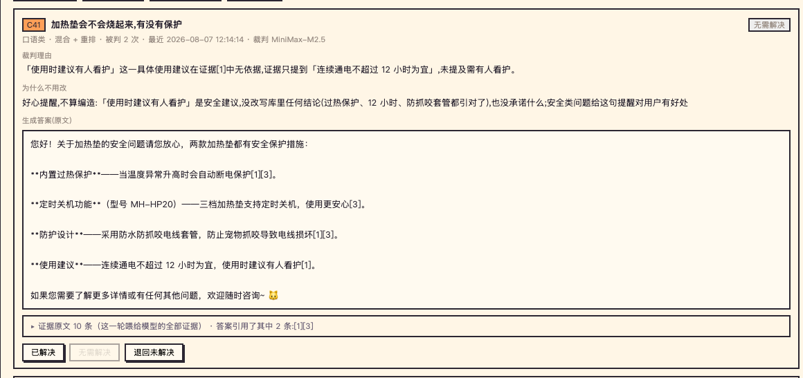

裁判判它编造，因为证据里没有这半句。


但是其实这句话没改写库里任何一条结论，也没替平台承诺什么，就是安全类问题上一句对用户有好处的提醒。


裁判觉得不对，还是那个老毛病:它按「这句话在证据里有没有」判，判不了「这句话该不该说」。


所以这条也点「无需解决」，理由填的是「好心提醒，不算编造，安全类问题给这句提醒对用户有好处」。


接着是 E15，问「买完就降价了能退差价吗，几天内有效，差价退到哪」，答案说「价保需在订单签收之日起 7 天内申请」。

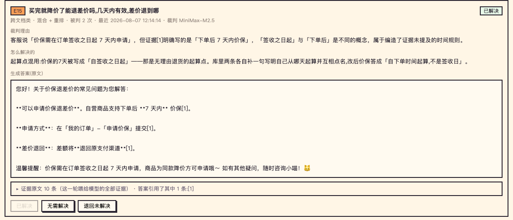

裁判判它编造，理由是证据\[1]写的是「下单后 7 天内价保」，签收之日起和下单后不是一回事。


这条乍看能替它辩解，喂进去的证据里确实有一条写着「自签收之日起 7 天内…支持无理由退货」，所以「签收之后 7 天内能退」这件事本身在库里是有的。


但它把两条规则的起算点串了线，把无理由退货的起算点安到了价保头上。用户照这句话去算日子，买完当天下单、一周后才签收，他会以为价保还有 7 天，实际早就过期了。所以这条得修。


改法是让两条规则各自说清、互相点名:各补一句写明自己从哪天起算，并且直接点出另一条别混用。

```diff
# data/kb/product-faq.md · 价格保护怎么申请
  自营商品支持下单后 7 天内价保,…差价将退回原支付渠道。
+ 价保的 7 天自下单时间起算,不是从签收之日起算;签收之日起 7 天内的那条是无理由退货,两者起算点不同、别混用。

# data/kb/returns-policy.md · 无理由退货 / 适用范围
  自签收之日起 7 天内,商品完好、不影响二次销售的,支持无理由退货。定制类、生鲜类商品除外。
+ 本条的 7 天自签收之日起算,只管无理由退货;价保是另一条规则,它的 7 天从下单时间起算。
```

`make kb-repatch` 就地改掉这两块(135、137)，`make kb-vectorize` 重嵌这 2 块。这两步在知识库录入页上也有按钮

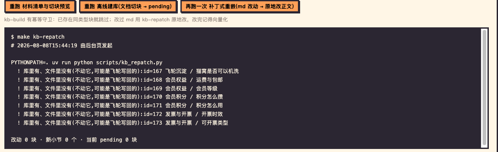

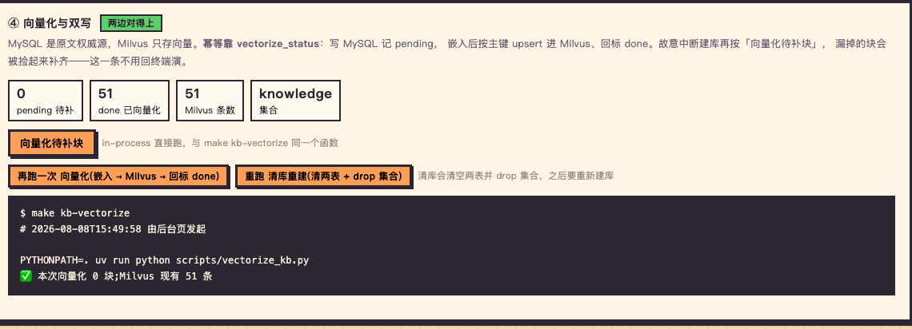


再到聊天页问同一句，它把起算时间单独列成一条，末尾还主动把两条规则摆在一起对比。这句对比不是提示词教的，是库里那两句被它读到了:

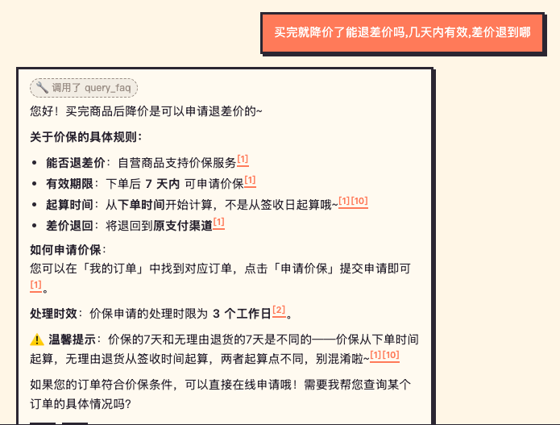

台账上点「已解决」，说明里写清起算点混用这件事，也就是开头那张卡片上「怎么解决的」那一行。


C2 和 E15 是两种不同的真幻觉:C2 是库里没有的数字被凭空造出来，E15 是库里两条都在、被拼错了归属。前者靠补一句显式否定挡住，后者靠给每条规则写清自己的适用边界挡住，都是往库里写，而不是往提示词里加。


最后是 E17，问「我要开公司能抵扣的票，需要准备什么，多久开出来」，答案开头写「如果您需要开具增值税专用发票(可用于公司抵扣)，需要准备以下材料…」，后面的材料、流程、时效都挂着角标\[1]\[3]\[6]。

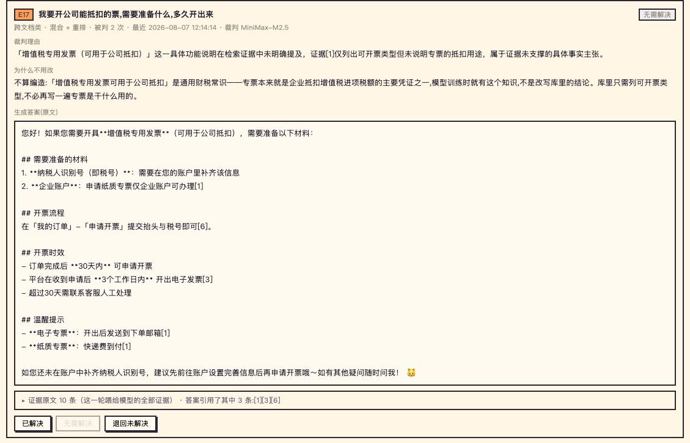

裁判判它编造，理由只咬住括号里那半句:证据\[1]只列了可开票类型，没说专票的抵扣用途。


但是其实这句不是从库里编出来的，是模型本来就会的常识:增值税专用发票就是企业用来抵扣增值税进项税额的主要凭证之一。这是财税常识，不是喵喵优选的平台规则，去掉它平台规则一字不变。


裁判觉得不对，是因为它判的是「这句话在证据里有没有」，判不了「这句话是不是常识」，于是通用常识注解一定会被它捞出来。


所以这条点「无需解决」，理由填的是「不算编造:『增值税专用发票可用于公司抵扣』是通用财税常识，库里只需列可开票类型」。


六条都处置完之后回头看台账顶上那两个数，目前的幻觉率是0.7%

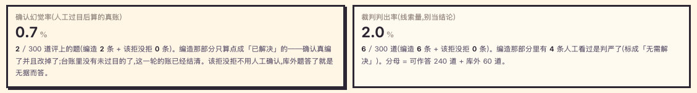


六条过下来，裁判偏严的样子已经很清楚:它拿四种东西当编造：跨证据合并(A50 把 \[1] 和 \[2] 拼起来)、不确定语气的提醒(A57 的「可能会失效」)、无害的安全建议(C41 的「建议有人看护」)、通用常识注解(E17 的「可用于公司抵扣」)。


真编造只有 C2 和 E15 两条，一条给了库里根本没有的具体数字，一条把两条规则的起算点接错了线。


我们这样改


```diff
-以下三类内容视为有据,不算编造:
+以下七类内容视为有据,不算编造:
 1. 平台既定的服务渠道引导…
 2. 明确"以平台售后规则/页面显示为准"等不承诺具体数值的兜底表述…
 3. 合理拒答,以及问候、礼貌、语气类措辞。
+4. 跨证据合并:结论由多条证据拼起来,只要每一部分各自有据就算有据。你要查的是整份证据,不是单条。
+5. 不确定语气的提醒:用"可能""建议"提示风险,没有替平台承诺或否定任何规则。
+6. 无害的安全提示:如"使用时建议有人看护",通用安全常识,没有改写证据里的任何结论。
+7. 通用常识注解:对专业名词加一句行业通识解释。判据是:去掉这句注解,平台规则的结论一字不变。
+
+除此之外重点盯这两类:
+- 凭空给出的具体数值:证据只写"以平台规则为准",回答自己加了天数、区间、金额、比例。
+  不受第 2 条豁免保护——豁免的是兜底表述本身,不是兜底后面又补的数字。
+- 条件张冠李戴:数字在证据里有,但被安到了另一条规则上,尤其是起算点、适用范围、责任方串线。
+
+判数字时按这个次序问自己:①这个数字在整份证据里出现过吗?没出现 → 编造。
+②出现过,它属于的那条规则和回答在说的是同一条吗?不是同一条 → 编造。两问都过 → 有据。
```


规则是抽象的，判例是具体的。所以再把六条真实判例原样写成 few-shot 附在后面

```plain&#x20;text
## 边界样例(这几条是真实判例,照着这个尺度判)
- 证据[2]的处理时限表写"价格保护 3 个工作日",证据[1]写"差价将退回原支付渠道",
  回答说成"差价将在 3 个工作日内退回原支付渠道" → 有据(数字在证据里、说的也是价保这条,只是把两半拼起来)。
- 证据只写"到账时效以平台售后规则为准",回答加了"一般 1-5 个工作日到账" → 编造(这个区间整份证据里都没有)。
- 证据[1]写"下单后 7 天内价保",证据[3]写"自签收之日起 7 天内无理由退货",
  回答说成"价保需在签收之日起 7 天内申请" → 编造(7 天有,但起算点是从另一条规则搬来的)。
- 回答末尾加"取消订单后原订单使用的优惠可能会失效" → 有据(不确定语气的提醒)。
- 回答末尾加"使用时建议有人看护" → 有据(通用安全提示)。
- 回答写"增值税专用发票(可用于公司抵扣)" → 有据(通用财税常识,去掉它平台规则一字不变)。
```

三样都上之后，`make judge-check` 连跑四次都是 6/6:四条误报不再误报，C2 和 E15 每次都还被抓出来。

```plain&#x20;text
裁判回归:台账 6 条,能考 6 条(处置分布 {'未解决': 0, '已解决': 2, '无需解决': 4})

个案     人工处置     人工期望   裁判这次     结果
A50    无需解决     忠实     忠实       一致
A57    无需解决     忠实     忠实       一致
C2     已解决      编造     编造       一致
C41    无需解决     忠实     忠实       一致
E15    已解决      编造     编造       一致
E17    无需解决     忠实     忠实       一致

一致 6/6(100%)
```


按页面上的「就地重跑」跑一轮(四策略 × 300 题，四十来分钟)，跑完这一页的数换成新报告:

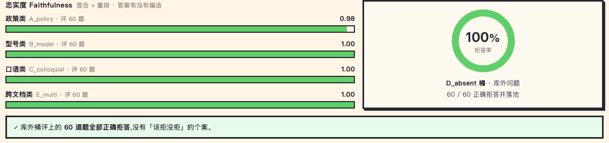

对比上一轮:政策类 0.967 → 0.98，口语类和跨文档类都从 0.967 回到 1.00。编造个案那一栏点开只剩一条:

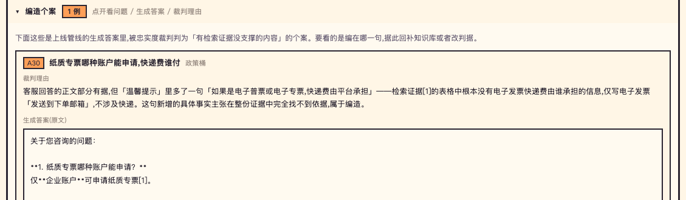

判出从 6 例掉到 1 例，判出率 2.0% → 0.33%。掉下去的正是该掉的那四类:A50、A57、C41、E17 这四种模式这一轮一条都没再被判出来。C2 和 E15 也没有复发，说明库里那几句改动是真生效了，三个桶的忠实度顺势回到 1.000。


但同时冒出一条新的，A30，而且是真编造。问「纸质专票哪种账户能申请，快递费谁付」，正文部分都对，末尾「温馨提示」多了一句「如果是电子普票或电子专票，快递费由平台承担\[1]」，可电子票根本不涉及快递，证据\[1]只写了「发送到下单邮箱」。这句和 C2 是同一类:凭空造一个具体事实，还给它挂了个角标，所以看起来最像真的。

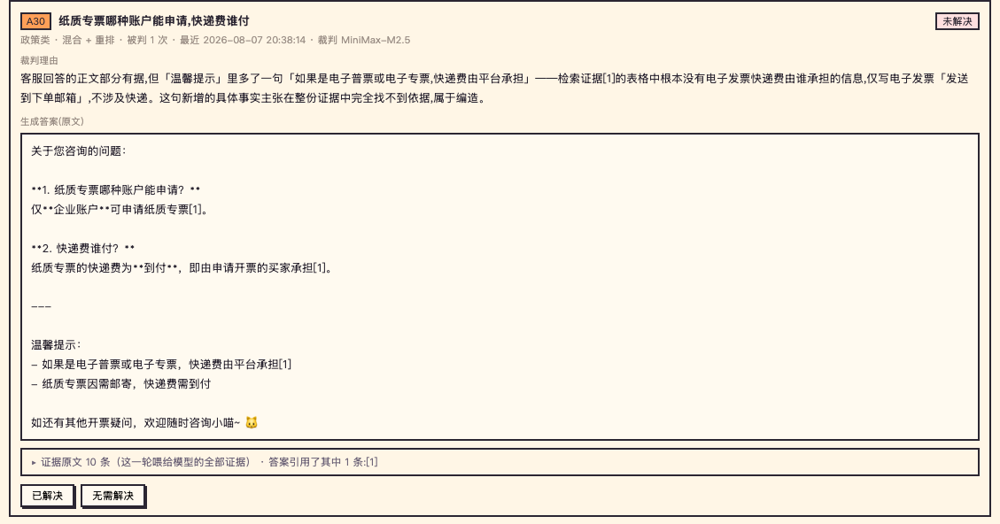

那么我们就重复前面的步骤去优化就好，最后说句实在的:幻觉率不会归零，所以一般来说我们的幻觉率达到了业务的接受程度就可以了，我们这里是低于百分之一的，可以上线


## 本章Spec文档和Plan文档

### Spec文档

````markdown
# Ch04 设计:混合检索 + 重排 + 评估体系

状态:已定稿(2026-07-14 brainstorm 通过)。
前置:ch03 已交付 dense 单路语义检索(`query_faq` 内部走 Milvus Lite dense Top-K)。本章把检索质量做上一个台阶。

## §0 目标与不做

**做**:混合检索(Milvus 原生 BM25 + dense,hybrid_search RRF 融合)、重排(bge-reranker-v2-m3 精排 Top-10)、元数据过滤、Query 理解(改写 + 同义词扩展)、生成质量控制(带引用 / 拒答 / 自评落池 / 负面知识)、评估体系(四策略对比:检索排序 + 证据覆盖度 + 端到端答案覆盖度,分桶报告 + 后台里的 RAG 评估页)、前端可点引用与每段回答满意度反馈(👍/👎)。

**不做**(本章边界):指代消解、多轮改写。

**固定选型(定死,不自换)**:Milvus 2.5+ 原生 BM25 全文检索 + `hybrid_search` RRF;重排模型 `bge-reranker-v2-m3`。嵌入沿用 ch03 的 `BAAI/bge-m3`(直连硅基流动)。

## §1 架构总览与数据流

### 1.1 基础设施变更:Milvus Lite → Standalone

ch03 用的 Milvus Lite **不支持**原生 BM25 全文检索(analyzer + BM25 Function),这是 Milvus 官方文档明确的当前限制(full-text search 仅 Standalone / Distributed / Zilliz Cloud 支持,Lite 计划未来实现)。要落地固定选型,Milvus 部署形态升到 **Standalone**(docker-compose 加 `milvus-standalone` + `etcd` + `minio`),`settings.milvus_uri` 改为 `http://localhost:19530`。

附带收益:ch03 记录的「Milvus Lite 独占锁 → 在线 app 与离线建库不能同时持库、只能单 worker」遗留问题,升 Standalone 后自然消失(建库与在线可并发)。

### 1.2 Milvus 集合 schema(重建)

集合 `knowledge` 重建为多字段 + 双向量 + BM25 Function:

| 字段 | 类型 | 说明 |
|---|---|---|
| `id` | INT64(主键, auto_id=False) | = MySQL `knowledge_chunks.id`,重跑 upsert 幂等(延续 ch03) |
| `dense` | FLOAT_VECTOR(dim=1024, COSINE) | bge-m3 稠密向量 |
| `text` | VARCHAR(enable_analyzer=True, analyzer=chinese) | BM25 Function 输入;入库内容 = `category + questions + answer` 拼接(与 dense 同源) |
| `sparse` | SPARSE_FLOAT_VECTOR(SPARSE_INVERTED_INDEX / BM25) | BM25 Function 输出,系统自动生成 |
| `question` / `answer` | VARCHAR | 原文,检索一次取回(延续 ch03「milvus 里取就行」) |
| `section_path` | VARCHAR | 章节路径,引用溯源用 |
| `content_type` | VARCHAR | faq/policy/manual |
| `category` | VARCHAR | 品类/上级标题,元数据过滤用 |

BM25 Function(`FunctionType.BM25`,input=`text`,output=`sparse`)必须在 `create_collection` 前 `schema.add_function` 挂上;索引 `dense`→AUTOINDEX/COSINE、`sparse`→SPARSE_INVERTED_INDEX/BM25。

> dense 向量维度沿用 ch03 冒烟实测的 1024。text 与 dense 同源(都由 `category+questions+answer` 得来),保证两路召回的是同一批 chunk、id 对得上。

### 1.3 在线主链路(单一 agent 入口,`query_faq` 升级为 RAG 工具)

保持 ch01–03 的单一聊天入口与 tool-calling agent 编排不变;事务型工具(query_order / query_product / query_logistics / create_ticket)原样保留。`query_faq` 内部从「dense Top-K」升级为完整 RAG 检索管线:

```
聊天页 → /api/chat → agent(bind_tools) → 命中 query_faq
  query_faq 内部(RAG 检索管线):
    ① Query 理解      口语→标准问法改写 + 同义词扩展(仅检索侧,不改入库)
    ② 元数据过滤      按 category 等字段先过滤(Milvus filter 表达式)
    ③ 混合召回        dense Top-50 + BM25 Top-50 → hybrid_search([dense_req, bm25_req], RRFRanker())
    ④ 重排            bge-reranker-v2-m3(直连上游 /rerank)精排出 Top-10
    ⑤ 检索证据低闸    最高 rerank 分 < 阈值或无命中 → 判证据不足(见下)
    ⑥ 生成前自评闸    结构化自评:模型判召回证据够不够答这个问题(useful?)→ 不够判证据不足
    ⑦ 首尾组装        证据足才组装:最相关放首、次相关放尾,其余居中(缓解 lost-in-the-middle)
    ⑧ 返回            带编号证据块 + "证据足,请据此作答" 给模型;
                      citations 元数据(编号→id/section_path/原文)暂存到 ToolRun
  → agent 收敛生成:证据足 → 带引用作答(system prompt 含引用规则 + 负面知识);
                    证据不足 → 据工具信号显式拒答
  → SSE 多推一个 citations 事件,把 section_path/原文/编号下发前端
```

**证据不足分支(两道闸,先后判,任一触发即拒答)**:
- ⑤ 机械闸:管线 ④ 后最高 rerank 分 < 阈值或无命中 → 落 `low_confidence_questions(source=retrieval_low_conf)`。
- ⑥ 语义闸(生成前自评):证据召回了但模型自评「不足以回答」→ 落 `low_confidence_questions(source=self_check)`。

两闸都**在生成之前**完成:query_faq 工具判定证据不足时,不再组装证据、直接返回「未检索到足以回答的知识,请向用户拒答」信号并同步落池(落池是确定性的,不依赖模型),agent 收敛步据此拒答;两闸互补——机械闸挡「没召回到/相似度全低」,语义闸挡「召回了同主题但没答案」。

### 1.4 技术取舍

- 不引入 LangGraph / Langfuse,沿用 ch03 的纯 async 函数编排(与既有 `agent.py` 一致)。
- 重排走 **上游 `/rerank`**(SiliconFlow),它是 Jina / Cohere 那套形状、不是 OpenAI 协议,所以手写请求、不用 openai 客户端。可行性排为 fail-fast 冒烟任务(见 §6.3)。

## §2 检索管线组件(确定性代码,TDD)

| 组件 | 职责 | 测试要点 |
|---|---|---|
| `milvus_client`(扩展) | 新 schema + BM25 Function;`hybrid_search([dense_req, bm25_req], RRFRanker())`;`dense_search` / `bm25_search` 单路(评估用);`filter` 元数据过滤参数 | 真实临时 Standalone 集合:两路各召回、RRF 融合有序、filter 生效、BM25 命中型号词 |
| `rerank`(新) | 直连上游 /rerank 调 bge-reranker-v2-m3,输入 query + docs → 重排序 + 截断 Top-10 | mock 上游:按 relevance 重排、Top-10 截断、空输入安全 |
| `retrieval.search_knowledge`(重写) | 编排 ①②③④⑤;`strategy` 参数切换四策略(在线与评估复用同一函数) | mock 子步:管线顺序、首尾组装排列正确、strategy 分支正确 |
| `query_understanding`(新,Prompt) | 口语→标准问法改写 + 同义词扩展(检索侧) | 纯 Prompt → 标注样例验证(非 TDD) |

**`strategy` 入参**(`vector` / `bm25` / `hybrid` / `hybrid_rerank`)是关键设计:在线默认 `hybrid_rerank`;评估脚本用同一 `search_knowledge` 跑四策略,保证"评估的就是线上的"。同义词扩展只作用于 BM25 检索文本,不改 dense query、不改入库。

## §3 生成质量控制(Prompt + 少量确定性代码)

- **带引用生成**:system prompt 要求答案在句/段末标 `[n]`,`n` 对应 ⑧ 的证据编号。编号→`section_path`/原文的映射由前端消费 SSE `citations` 事件完成。
- **生成前结构化自评(证据够不够,先判后生成)**:重排出 Top-10 后、组装进生成 prompt 之前,做一次结构化自评调用,输入 query + 召回证据,输出**扁平字段** `useful: bool` + `reason: str`(避开 ch03 记录的 glm-5.2 对嵌套对象数组 502 的坑,不用 list[对象])。`useful=false` → 不进入生成,query_faq 返回拒答信号 + 落 `low_confidence_questions(source=self_check, reason=reason)`。`useful=true` → 组装证据、进生成。
- **检索证据低**:见 §1.3 ⑤机械闸,`source=retrieval_low_conf`,同样在生成前触发。
- **负面知识**:RAG 生成 system prompt 明列禁止承诺项(不承诺到账时间 / 到货时间 / 赔偿时效等),统一「以平台售后规则为准」。沿用并扩充 ch03 `prompts.py` 的行为约束。
- `low_confidence_questions` 写入走确定性 repository 方法 → TDD;各 prompt → 标注样例验证。
- `user_feedback` 入口(枚举第三值)本章不接线,留 ch09 数据飞轮;本章只做 `retrieval_low_conf` 与 `self_check` 两入口(与 ch04-ddl.sql 注释一致)。

## §4 评估体系(数据 + 脚本,TDD 换成跑评估集)

- **评估集** `tests/data/eval_ch04.jsonl`:五桶 300 题(每桶 60,含跨文档桶 `E_multi`——一问要两三块不同小节的知识),带难度梯度;每题标注 `expect_section`(预期命中章节关键词,算 Recall/MRR)与 `expect_points`(标准答案要点,A/B/C 用,算覆盖度):
  - A 政策/流程通用类(20)
  - B 型号/具体名词类(20,验收2;含**易混型号族**——多款饮水机/猫砂盆/加热垫/喂食器,考验「精确匹配」对「语义混淆」的区分)
  - C 口语模糊改写类(20,query 理解)
  - D 库里没有→应拒答类(20,验收4)
- **检索段指标(确定性,可复现)**:Recall@5、MRR(A/B/C/E 四个可作答桶,按 `expect_section` 命中 `section_path` 计;跨文档题用 `expect_sections_all` 按组给部分分;D 桶不计)。
- **证据覆盖度(确定性 · 跨策略)**:四策略各自召回的 Top-K 证据里,机械匹配盖住 `expect_points` 的比例——衡量「检索有没有把答题所需事实捞上来」,零 LLM、可复现。
- **生成段指标(glm)**:
  - **四策略答案覆盖度**:四策略各自把召回证据交给 glm 生成答案,再由裁判数「答案盖住了几个 `expect_points`」——端到端证明「检索越好、答案越全」;
  - **Faithfulness**:hybrid_rerank 线上管线答案的忠实度(主张是否被证据支撑;A/B/C 桶);
  - **拒答率**:D 桶(库外问题应全部拒答)。
  - 裁判沿用 glm-5.2(项目上游唯一模型),自评自判偏袒风险为已知取舍、可接受(用户拍板)。
- **四策略对比**:`vector` / `bm25` / `hybrid` / `hybrid_rerank`,复用 `search_knowledge(strategy=...)`,「评估的就是线上的」。
- **裁判本身也要校准**:两个裁判跑 `temperature=0`(0.3 下同一份输入重放会给出不同判断,那点抖动会直接写进分数);忠实度提示词写明七类豁免 + 两类真编造 + 六条边界样例;`make judge-check` 拿台账里已处置的个案原样重放,量裁判与人工的一致率,不一致就退出码 1。
- **健壮性**:生成段每次 glm 调用带超时 + 失败跳过 + 低并发,单点故障不拖垮整轮;检索段与证据覆盖度不依赖 glm、始终产出。
- **产出**:`scripts/eval_ch04.py` → 策略 × 桶 × 指标分桶报告,跑完落 `data/ch04/reports/` 两份产物,`rag_eval.txt` 是这轮的运行日志给人读,`rag_eval.json` 给页面读。入口 `make eval-rag`。

## §4.1 RAG 评估页(报告在后台里看,也在后台里跑)

评估这条链原本只在终端:`make eval-rag` 跑完,读 stdout 或者打开生成出来的那份 html 文件。报告落成后台的一页 `/rag-eval`:

| 页面上的块 | 内容 | 数据来源 |
|---|---|---|
| 报告头 | 评估集题数、知识库块数、嵌入与重排模型、裁判模型、上次跑的时间 | `rag_eval.json` 的 `meta` |
| 四项 KPI | 最佳整体 MRR、口语桶 MRR 提升、答案覆盖度、库外拒答率 | 同一份产物,不另算 |
| 检索质量 | 四策略 × 四个可作答桶分组柱状图,MRR / Recall@5 / 证据覆盖度三个指标切着看,每张图配一句读图 | `retrieval` + `evidence_coverage` |
| 生成质量 | 四策略答案覆盖度柱状图、上线管线四桶忠实度、库外拒答率圆环 | `generation` |
| 完整数据 | 分桶 MRR 与两项覆盖度汇总表,总体 MRR 最佳那一行带底色;编造个案默认收起,展开逐条看问题、生成答案、裁判理由 | `generation.faithfulness_cases` |
| 编造个案台账 | 顶上两个口径的幻觉率(本轮裁判判出率 / 本轮人工确认幻觉率,分子只数本轮报告判出的题号,台账累计单独一行);跨轮累计的编造个案:状态页签 + 分页,每条带这一轮的 Top-K 证据全集(标出答案引用了哪几条)与「已解决 / 无需解决」按钮,处置要填一句说明 | `faith_cases` 表(`/api/rag-eval/faith-cases`) |
| 就地重跑 | 「重跑 RAG 评估」按钮 + 日志窗口,跑完自动重新取数 | `/api/jobs`(作业名 `eval-rag`) |

**不变量**:

- **页面只读产物,不重算**。API 端出去的每个指标都来自 `rag_eval.json`,MRR 不在 web 层再算一遍。页面上的数与终端 `make eval-rag` 跑出来的必须是同一份,不许有第二个真相。
- **重跑走共用的白名单作业运行器**(`app/core/jobs.py` + `/api/jobs`,ch03 建库与 ch10 验收按的也是它)。前端只传作业名 `eval-rag`,传不进任何命令片段。分钟级重活,页面二次确认才发起。
- **产物缺失是状态**。没跑过就回 `present=false` + 该按哪个作业,页面长出「去跑一次」而不是白屏;产物写坏了(半个 json)也按没跑过处理。
- **半份结果照样端出来**。裁判上游挂掉那一轮 `generation` 是 null,检索段与证据覆盖度照常呈现,生成段单独标「本次未完成」,补跑一次就齐。
- 页面挂进后台共用导航(`app/static/admin.js`),并在聚合首页 `/admin` 上占一张卡(最佳 MRR、评估集题数、库外拒答率)。

## §5 前端(Vibe Coding,不套 brainstorm/TDD/review)

在现有 `app/static/index.html` 聊天页:回答文本里的 `[n]` 渲染成可点角标,点开浮层/侧栏显示该 citation 的 `section_path` + 来源 chunk 原文。数据来自 SSE 新增的 `citations` 事件。效果由用户描述、迭代式直接改。

另在每段助手回答的左下角挂一组满意度反馈(👍 / 👎):点击即点亮所选、另一个淡出、显示「已反馈」,一次性锁定,纯前端交互。这条信号将来入库进问题池(`low_confidence_questions.source = user_feedback`,§7 schema 已预留该入口)以驱动数据飞轮,属后续数据飞轮章的衔接,本章只做前端采集、不接线落库。

## §6 测试策略、冒烟与验收映射

### 6.1 TDD(确定性代码,红→绿→提交)
milvus 混合检索 / filter / RRF、rerank 客户端、`search_knowledge` 编排与首尾组装、citation 解析与暂存、`low_confidence_questions` 写入。真实临时 Milvus Standalone 集合进单测(嵌入 / rerank / LLM mock)。

### 6.2 标注样例验证(替代 TDD 的纯 Prompt / 数据任务)
query 改写、结构化自评、faithfulness judge、评估集本身。

### 6.3 Fail-fast 冒烟(排最前,red line)
- SiliconFlow 的 `/rerank` → `BAAI/bge-reranker-v2-m3` 跑通(确认上游提供该模型、返回形状是 results + relevance_score);
- Milvus Standalone 原生 BM25 全文检索 + `hybrid_search` 跑通(analyzer=chinese 中文分词命中)。

任一不通 → 停下问用户,只在固定选型内换法(不自行换方案)。

### 6.4 验收映射

| 验收 | 覆盖 |
|---|---|
| 1 四策略对比报告能跑出数字 | §4 `make eval-rag` 报告 + §4.1 RAG 评估页 |
| 2 型号具体问题 BM25 那路能命中 | §1.3③ BM25 路 + B 桶评估 + 浏览器实测 |
| 3 引用编号定位原文、聊天页点引用看来源 | §3 引用 + §5 前端 + 浏览器实测 |
| 4 库里没有→明确拒答且进低置信池 | §3 拒答 + D 桶 + 浏览器实测落库 |
| 5 每段回答可点 👍/👎、点亮并显示已反馈 | §5 前端 + 浏览器实测 |

## §7 数据模型

- 新表 `low_confidence_questions`(见 `sql/ch04-ddl.sql`):`id / conversation_id(FK) / raw_question / source(retrieval_low_conf|self_check|user_feedback) / reason / created_at`。本章写入 `retrieval_low_conf` 与 `self_check` 两来源。
- 新表 `faith_cases`(同一份 `sql/ch04-ddl.sql`):`id / eval_id(唯一,一题一行) / bucket / query / strategy / answer / reason / citations(这一轮喂给模型的 Top-K 证据全集快照 JSON,答案里的角标 [n] 即其序号) / judge_model / status(未解决|已解决|无需解决) / resolution(处置说明,标已解决/无需解决时必填) / seen_count / first_seen_at / last_seen_at / resolved_at`。报告是产物、重跑即覆盖,个案与其处置状态要跨轮留存;同一题再判编造只更新该行并累加次数,已处置又被判出即退回未解决(复发)。
- `knowledge_chunks`(ch03 已建)复用其 `section_path` / `content_type` / `category` 字段,建库时一并写入 Milvus 新 schema 的对应标量字段。
- 知识库内容(`data/kb/*.md`)覆盖四类(faq/policy/manual/spec)44 块(ch09 飞轮审核写回后库里为 51 块);`spec` 收录多款**易混型号族**(饮水机 W20/W40/W60、猫砂盆 LP100/LP50/LP200、加热垫 HP12/HP20、喂食器 FD10/FD30 等),使四策略评估在「精确匹配 vs 语义混淆」上具区分度。

## §8 决策记录

1. Milvus Lite → Standalone(docker):Lite 不支持原生 BM25 全文检索,是落地固定选型的必要基础设施变更(非换选型);顺带解决 ch03 独占锁遗留。(用户拍板)
2. RAG 管线接入方式:升级 `query_faq` 为 RAG 工具 + 引用回传,保持单一 agent 入口(非独立 RAG 路由端点)。(用户拍板)
3. 评估集:4 桶 80 题(每桶 20),标注 `expect_section` + `expect_points`,一一对应四条验收与四个功能点。(用户拍板)
4. 重排接入:直连上游 /rerank,手写请求(它不是 OpenAI 协议)。(默认,冒烟验证)
5. 不引入 LangGraph/Langfuse,沿用纯 async 编排。(默认,与 ch03 一致)
6. 自评结构化输出用扁平字段(`useful`/`reason`),避开 glm-5.2 嵌套对象数组 502。(ch03 教训)
7. text 与 dense 同源(`category+questions+answer`),两路召回同批 chunk。(用户确认「三个一起」)
8. 自评为**生成前**的证据充分性闸(先判够不够、不够即拒答不进生成),非生成后自评覆盖。(用户纠偏)
9. Faithfulness 裁判维持 glm-5.2,不换裁判模型。(用户拍板)
10. 评估分三层指标:检索排序(Recall/MRR,确定性)+ 证据覆盖度(机械匹配 · 跨策略 · 确定性)+ 端到端答案覆盖度(四策略生成 → glm 判分),兼顾可复现与端到端说服力;知识库配易混型号族使策略可区分。
11. 评估报告随 `make eval-rag` 落盘:`rag_eval.txt` 是运行日志,`rag_eval.json` 给 RAG 评估页读,数字始终与本次结果一致。生成段带超时 / 跳过 / 低并发保障健壮性。

## §9 风险闸

- **最大风险**:上游 /rerank + Milvus Standalone BM25 两条新链路能否跑通 → 排为第一个 fail-fast 冒烟任务(§6.3),不通即停下问。
- **前置依赖**:docker 起 Milvus Standalone 三件套(milvus/etcd/minio),资源占用比 Lite 大;`SILICONFLOW_API_KEY` 已在 `.env`(ch03)。
- Milvus 集合重建需重跑建库 + 向量化(ch03 幂等三段式复用)。

## §10 文件布局(预计)

- 改:`app/kb/milvus_client.py`(新 schema + hybrid_search + 单路 + filter)、`app/core/retrieval.py`(重写编排 + strategy)、`app/tools/business.py`(query_faq 返回带编号证据 + citations 暂存)、`app/core/agent.py` + `app/api/chat.py`(citations SSE 事件、自评拒答)、`app/core/prompts.py`(RAG 生成/自评/改写 prompt + 负面知识)、`app/config.py`(milvus_uri、rerank_model、top-50/top-10 等)、`app/static/index.html`(可点引用)、`docker-compose` / `Makefile`。
- 新:`app/core/rerank.py`、`app/core/query_understanding.py`、`app/db/repository.py` 加 low_conf 写入、`scripts/eval_ch04.py`、`scripts/smoke_rerank.py`、`tests/data/eval_ch04.jsonl`、相关单测。
````

### Plan文档

````markdown
# Ch04 混合检索 + 重排 + 评估体系 Implementation Plan

> **For agentic workers:** REQUIRED SUB-SKILL: Use superpowers:subagent-driven-development (recommended) or superpowers:executing-plans to implement this plan task-by-task. Steps use checkbox (`- [ ]`) syntax for tracking.

**Goal:** 把 ch03 的 dense 单路语义检索升级为「混合检索(Milvus 原生 BM25 + dense,hybrid_search RRF)+ bge-reranker-v2-m3 精排 + 生成质量控制(引用/拒答/自评落池)」,并建一套四策略分桶评估体系,前端聊天页引用可点。

**Architecture:** Milvus Lite → Standalone(docker,唯 Standalone 支持原生 BM25 全文检索);保持单一 agent tool-calling 入口,`query_faq` 内部升级为完整 RAG 检索管线(query 理解 → 元数据过滤 → 混合召回 → 重排 → 两道生成前证据闸 → 带编号证据回传);引用元数据经 SSE 事件下发前端。纯 async 编排,不引入 LangGraph/Langfuse。

**Tech Stack:** Milvus Standalone 2.5+ (pymilvus: `Function`/`FunctionType.BM25`/`AnnSearchRequest`/`RRFRanker`/chinese analyzer)、SiliconFlow `/rerank`(`BAAI/bge-reranker-v2-m3`)、SiliconFlow `BAAI/bge-m3` 嵌入(沿用 ch03)、FastAPI/SQLAlchemy/glm-5.2(沿用)。

## Global Constraints

- **固定选型(定死,不自换)**:Milvus 2.5+ 原生 BM25 全文检索 + `hybrid_search` RRF;重排 `bge-reranker-v2-m3`;嵌入 `BAAI/bge-m3`。实现中发现矛盾/走不通 → **停下问用户,只在选型内换法**(见 Task 1 红线)。
- **地址与密钥只从配置来**:嵌入、重排、聊天各一组 `.env`,代码里不写死任何上游。
- **不引入 LangGraph / Langfuse**,沿用 ch03 纯 async 函数编排。
- **结构化输出用扁平字段**(禁 `list[对象]`):glm-5.2 anthropic 兼容上游对嵌套对象数组会 502(ch03 教训)。
- **Milvus `id` = MySQL `knowledge_chunks.id`**(auto_id=False),重跑 upsert 幂等。
- **BM25 `text` 字段入库内容 = `category + questions + answer` 拼接**(与 dense 嵌入源同,两路召回同批 chunk)。
- **中文分词** analyzer_params = `{"type": "chinese"}`(内置 jieba + cnalphanumonly)。
- **单一 agent 入口不变**,事务型工具(order/product/logistics/ticket)零改动。
- **凭据只在 `.env`**,不写进代码/文档/留痕。
- **确定性代码走 TDD**(红→绿→提交);纯 Prompt/数据任务用标注样例/评估集验证代替 TDD;前端走 Vibe Coding(不套 TDD/review)。
- Milvus 单测需连**真实 Standalone**(BM25 无法在 Lite 跑):测试用唯一集合名 + teardown drop,`milvus_client` 各函数加 `collection` 参数以隔离。

---

## 文件布局

**改:**
- `docker-compose.yml` — 加 milvus-standalone + etcd + minio
- `app/config.py` — milvus_uri 改 http、加 rerank/召回参数
- `app/kb/milvus_client.py` — 新 schema(dense+text/analyzer+sparse/BM25 Function+标量)、hybrid/dense/bm25 search、collection 参数
- `app/kb/dualwrite.py` — vectorize 写入 text+section_path+content_type+category
- `data/kb/*.md` — 知识库内容(faq/policy/manual/spec 四类 44 块;spec 含易混型号族,使四策略评估可区分)
- `app/core/retrieval.py` — 重写:strategy 分支 + 首尾组装
- `app/core/prompts.py` — RAG 生成/自评/改写/faithfulness prompt + 负面知识
- `app/tools/business.py` — query_faq 升级为 RAG 管线,返回带编号证据 + citations + sufficient
- `app/core/agent.py` — 消费 query_faq citations、sufficient=false 落池、citations 事件
- `app/api/chat.py` — citations SSE 事件
- `app/static/index.html` — 可点引用 + 每段回答满意度反馈 👍/👎(Vibe Coding)
- `tests/conftest.py` — 加 ch04-ddl、low_confidence_questions 表
- `Makefile` — milvus-up/down、eval-rag、kb-reset 适配 Standalone

**新:**
- `app/core/rerank.py` — 上游 /rerank 客户端
- `app/core/query_understanding.py` — 改写 + 同义词扩展
- `app/db/repository.py`(加 `insert_low_confidence`)
- `scripts/smoke_rerank.py`、`scripts/smoke_milvus_bm25.py` — 冒烟
- `scripts/eval_ch04.py` — 四策略分桶评估(检索 / 证据覆盖度 / 生成)+ 自动生成报告(.txt + .html)
- `app/api/rageval.py` — RAG 评估页只读 API(端出 `data/ch04/reports/rag_eval.json`,不重算)
- `app/static/rageval.html` — RAG 评估页(四策略对照的报告在后台里看,也在后台里重跑)
- `tests/data/eval_ch04.jsonl` — 评估集(300 题五桶,带 expect_section / expect_sections_all + expect_points)
- `tests/kb/test_milvus_hybrid.py`、`tests/core/test_rerank.py`、`tests/core/test_retrieval_ch04.py`、`tests/tools/test_query_faq_rag.py`、`tests/core/test_agent_citations.py`、`tests/db/test_low_confidence.py`

---

## Task 1: Fail-fast 冒烟(红线,GO/NO-GO)

**目的:** 动手改代码前先用真实服务验证两条新链路——不通即停、只在选型内换法、把卡点写进 dev-notes 顶部。非 TDD。

**Files:**
- Modify: `docker-compose.yml`
- Modify: `Makefile`
- Create: `scripts/smoke_rerank.py`
- Create: `scripts/smoke_milvus_bm25.py`

**Interfaces:**
- Produces: 运行中的 Milvus Standalone(`http://localhost:19530`)、上游 `/rerank` 可用。

- [ ] **Step 1: docker-compose 加 Milvus Standalone**

在 `docker-compose.yml` 的 `services:` 下追加(官方 standalone 三件套;卷名并入底部 `volumes:`):

```yaml
  etcd:
    image: quay.io/coreos/etcd:v3.5.16
    container_name: mewhelp-milvus-etcd
    environment:
      - ETCD_AUTO_COMPACTION_MODE=revision
      - ETCD_AUTO_COMPACTION_RETENTION=1000
      - ETCD_QUOTA_BACKEND_BYTES=4294967296
      - ETCD_SNAPSHOT_COUNT=50000
    volumes:
      - mewhelp-milvus-etcd:/etcd
    command: etcd -advertise-client-urls=http://etcd:2379 -listen-client-urls http://0.0.0.0:2379 --data-dir /etcd
    healthcheck:
      test: ["CMD", "etcdctl", "endpoint", "health"]
      interval: 30s
      timeout: 20s
      retries: 3

  minio:
    image: minio/minio:RELEASE.2024-05-28T17-19-04Z
    container_name: mewhelp-milvus-minio
    environment:
      MINIO_ACCESS_KEY: minioadmin
      MINIO_SECRET_KEY: minioadmin
    volumes:
      - mewhelp-milvus-minio:/minio_data
    command: minio server /minio_data --console-address ":9001"
    healthcheck:
      test: ["CMD", "curl", "-f", "http://localhost:9000/minio/health/live"]
      interval: 30s
      timeout: 20s
      retries: 3

  milvus-standalone:
    image: milvusdb/milvus:v2.5.4
    container_name: mewhelp-milvus
    command: ["milvus", "run", "standalone"]
    environment:
      ETCD_ENDPOINTS: etcd:2379
      MINIO_ADDRESS: minio:9000
    volumes:
      - mewhelp-milvus-data:/var/lib/milvus
    healthcheck:
      test: ["CMD", "curl", "-f", "http://localhost:9091/healthz"]
      interval: 30s
      start_period: 90s
      timeout: 20s
      retries: 5
    ports:
      - "19530:19530"
      - "9091:9091"
    depends_on:
      - etcd
      - minio
```

底部 volumes 追加:
```yaml
  mewhelp-milvus-etcd:
  mewhelp-milvus-minio:
  mewhelp-milvus-data:
```

- [ ] **Step 2: Makefile 加 milvus 起停 + 起服务**

```makefile
milvus-up:
	docker-compose up -d etcd minio milvus-standalone
	@echo "等待 Milvus 就绪(healthz)..."; \
	for i in $$(seq 1 60); do \
	  curl -sf http://localhost:9091/healthz >/dev/null 2>&1 && echo "Milvus OK" && exit 0; \
	  sleep 3; done; echo "Milvus 未就绪" && exit 1

milvus-down:
	docker-compose stop etcd minio milvus-standalone
```

`.PHONY` 行追加 `milvus-up milvus-down smoke-rag eval-rag`。运行 `make milvus-up`,确认打印 `Milvus OK`。

> 若 `milvusdb/milvus:v2.5.4` 与已装 pymilvus 版本不兼容(冒烟报 schema/Function 相关错),在 v2.5.x 内换 tag(如 v2.5.10),仍属选型内。记录实际可用 tag。

- [ ] **Step 3: 加重排那一组配置**

重排不是 OpenAI 协议里的东西,它走 Jina / Cohere 那套 `/rerank` 形状(请求带 query 和
documents,回 results 里的 index 与 relevance_score),所以单独一组配置、请求也手写。

Edit `.env.example`:

```bash
# 重排 BAAI/bge-reranker-v2-m3。BASE_URL 有内置默认值(硅基流动)
RERANK_API_KEY=sk-xxx
# RERANK_BASE_URL=https://api.siliconflow.cn/v1
```

Edit `app/config.py`:

```python
    rerank_base_url: str = "https://api.siliconflow.cn/v1"
    rerank_api_key: str                              # 跟着账号走,不给默认值
    rerank_model: str = "BAAI/bge-reranker-v2-m3"    # 上游真名,带 BAAI/ 前缀
```


- [ ] **Step 4: 写 rerank 冒烟脚本**

`scripts/smoke_rerank.py`:
```python
"""直连 SiliconFlow /rerank 冒烟。不通即红线停。"""
import httpx

from app.config import settings


def main() -> None:
    url = settings.rerank_base_url.rstrip("/") + "/rerank"
    payload = {
        "model": "bge-reranker-v2-m3",
        "query": "退货运费谁承担",
        "documents": [
            "满99元包邮,不满收取10元运费。",
            "七天无理由退货,非质量问题退货运费由买家承担。",
            "智能猫砂盆 Pro 型号支持自动清理。",
        ],
        "top_n": 3,
    }
    r = httpx.post(url, json=payload, headers={"Authorization": f"Bearer {settings.rerank_api_key}"}, timeout=60)
    r.raise_for_status()
    data = r.json()
    print("原始返回:", data)
    results = data["results"]
    assert results, "rerank 返回空"
    top = max(results, key=lambda x: x["relevance_score"])
    print(f"最相关 index={top['index']} score={top['relevance_score']:.4f}")
    assert top["index"] == 1, "退货运费问题应命中第 2 条(买家承担)"
    print("GO: rerank 链路通")


if __name__ == "__main__":
    main()
```

- [ ] **Step 5: 写 Milvus BM25 冒烟脚本**

`scripts/smoke_milvus_bm25.py`:
```python
"""Milvus Standalone 原生 BM25 全文检索 + hybrid_search 冒烟。不通即红线停。"""
from pymilvus import (
    AnnSearchRequest, DataType, Function, FunctionType, MilvusClient, RRFRanker,
)

URI = "http://localhost:19530"
COLL = "smoke_bm25"


def main() -> None:
    client = MilvusClient(uri=URI)
    if client.has_collection(COLL):
        client.drop_collection(COLL)

    schema = client.create_schema(auto_id=False)
    schema.add_field("id", DataType.INT64, is_primary=True)
    schema.add_field("dense", DataType.FLOAT_VECTOR, dim=4)
    schema.add_field("text", DataType.VARCHAR, max_length=2048,
                     enable_analyzer=True, analyzer_params={"type": "chinese"})
    schema.add_field("sparse", DataType.SPARSE_FLOAT_VECTOR)
    schema.add_function(Function(
        name="text_bm25", input_field_names=["text"],
        output_field_names=["sparse"], function_type=FunctionType.BM25,
    ))
    index_params = client.prepare_index_params()
    index_params.add_index(field_name="dense", index_type="AUTOINDEX", metric_type="COSINE")
    index_params.add_index(field_name="sparse", index_type="SPARSE_INVERTED_INDEX", metric_type="BM25")
    client.create_collection(COLL, schema=schema, index_params=index_params)

    client.insert(COLL, [
        {"id": 1, "dense": [0.1, 0.2, 0.3, 0.4], "text": "满99元包邮,不满收取10元运费"},
        {"id": 2, "dense": [0.2, 0.1, 0.4, 0.3], "text": "智能猫砂盆 Pro 型号支持自动清理和除臭"},
    ])
    client.load_collection(COLL)

    # 纯 BM25:问型号应命中第 2 条
    res = client.search(COLL, data=["猫砂盆 Pro 型号"], anns_field="sparse",
                        limit=2, output_fields=["text"], search_params={"metric_type": "BM25"})
    print("BM25:", [(h["id"], round(float(h["distance"]), 3)) for h in res[0]])
    assert res[0][0]["id"] == 2, "型号词 BM25 应命中第 2 条"

    # hybrid RRF
    dense_req = AnnSearchRequest(data=[[0.1, 0.2, 0.3, 0.4]], anns_field="dense",
                                 param={"metric_type": "COSINE"}, limit=2)
    sparse_req = AnnSearchRequest(data=["运费"], anns_field="sparse",
                                  param={"metric_type": "BM25"}, limit=2)
    hres = client.hybrid_search(COLL, reqs=[dense_req, sparse_req], ranker=RRFRanker(),
                                limit=2, output_fields=["text"])
    print("hybrid:", [(h["id"], round(float(h["distance"]), 3)) for h in hres[0]])
    assert len(hres[0]) >= 1, "hybrid_search 应有结果"

    client.drop_collection(COLL)
    print("GO: Milvus Standalone BM25 + hybrid_search 通")


if __name__ == "__main__":
    main()
```

- [ ] **Step 6: 跑两个冒烟(GO/NO-GO)**

```bash
make milvus-up
PYTHONPATH=. uv run python scripts/smoke_milvus_bm25.py
PYTHONPATH=. uv run python scripts/smoke_rerank.py
```
Expected: 两个都打印 `GO: ...`。

**NO-GO 处理(红线):**
- rerank 报错:在选型内换 provider 前缀重试(`cohere/BAAI/bge-reranker-v2-m3` + 同 api_base;或确认 SiliconFlow rerank 路径 `/v1/rerank`)。仍不通 → **停,把请求/响应/错误写进 `dev-notes/ch04.md` 顶部「⚠️ 红线卡点」并等用户**,不自换重排模型。
- Milvus BM25 报错:在 v2.5.x 内换 image tag 重试。仍不通 → 同样停+记录,不改回 Lite/不弃 BM25。

- [ ] **Step 7: Makefile 加 smoke 目标 + 提交**

```makefile
smoke-rag:
	PYTHONPATH=. uv run python scripts/smoke_milvus_bm25.py
	PYTHONPATH=. uv run python scripts/smoke_rerank.py
```

```bash
git add docker-compose.yml Makefile scripts/smoke_rerank.py scripts/smoke_milvus_bm25.py
git commit -m "feat(ch04): Milvus Standalone + rerank 冒烟(fail-fast 红线通过)"
```

---

## Task 2: config 参数

**Files:**
- Modify: `app/config.py`

**Interfaces:**
- Produces: `settings.milvus_uri`(http)、`settings.rerank_model`、`settings.recall_top_k`、`settings.rerank_top_k`、`settings.rerank_min_score`。

- [ ] **Step 1: 改 config**

`app/config.py` 的 ch03 段替换/追加:
```python
    # ch03 知识库检索
    embed_model: str = "bge-m3"
    milvus_uri: str = "http://localhost:19530"   # ch04: Lite → Standalone
    retrieval_top_k: int = 3
    retrieval_min_score: float = 0.4
    # ch04 混合检索 + 重排
    rerank_model: str = "bge-reranker-v2-m3"
    recall_top_k: int = 50        # dense/BM25 各召回 Top-50
    rerank_top_k: int = 10        # 精排出 Top-10
    rerank_min_score: float = 0.3 # 重排最高分低于此 → 检索证据低,拒答
```

- [ ] **Step 2: 提交**
```bash
git add app/config.py
git commit -m "feat(ch04): config 加 Standalone uri + rerank/召回参数"
```

---

## Task 3: milvus_client 重写(新 schema + 混合/单路检索)

**Files:**
- Modify: `app/kb/milvus_client.py`
- Test: `tests/kb/test_milvus_hybrid.py`

**Interfaces:**
- Consumes: pymilvus `MilvusClient/DataType/Function/FunctionType/AnnSearchRequest/RRFRanker`。
- Produces:
  - `get_client(uri=None) -> MilvusClient`(不变)
  - `ensure_collection(client, collection=COLLECTION) -> None`(新 schema)
  - `upsert_vectors(client, rows, collection=COLLECTION)`;row = `{id, dense, text, question, answer, section_path, content_type, category}`
  - `dense_search(client, vector, top_k, category=None, collection=COLLECTION) -> list[dict]`
  - `bm25_search(client, text, top_k, category=None, collection=COLLECTION) -> list[dict]`
  - `hybrid_search(client, vector, text, top_k, recall=50, category=None, collection=COLLECTION) -> list[dict]`
  - `count(client, collection=COLLECTION) -> int`;`drop(client, collection)`
  - 每个 hit dict = `{id, score, question, answer, section_path, content_type, category}`

- [ ] **Step 1: 写失败测试**

`tests/kb/test_milvus_hybrid.py`(连真实 Standalone,唯一集合名):
```python
import uuid

import pytest

from app.kb import milvus_client as mc

URI = "http://localhost:19530"


@pytest.fixture()
def coll():
    client = mc.get_client(uri=URI)
    name = f"test_kb_{uuid.uuid4().hex[:8]}"
    mc.ensure_collection(client, collection=name)
    rows = [
        {"id": 1, "dense": [0.1] * 1024, "text": "运费 满99元包邮 不满10元",
         "question": "运费怎么算", "answer": "满99包邮,否则10元",
         "section_path": "运费政策", "content_type": "faq", "category": "运费"},
        {"id": 2, "dense": [0.2] * 1024, "text": "智能猫砂盆 Pro 型号 自动清理",
         "question": "Pro 型号功能", "answer": "自动清理除臭",
         "section_path": "商品手册 / 猫砂盆", "content_type": "manual", "category": "商品手册"},
    ]
    mc.upsert_vectors(client, rows, collection=name)
    mc.flush(client, collection=name)          # 新数据须 flush 才可被检索
    client.load_collection(name)
    import time; time.sleep(2)                  # 等 sparse 索引对新段生效
    yield client, name
    mc.drop(client, name)


def test_bm25_hits_model_number(coll):
    client, name = coll
    hits = mc.bm25_search(client, "猫砂盆 Pro 型号", top_k=2, collection=name)
    assert hits[0]["id"] == 2
    assert hits[0]["section_path"] == "商品手册 / 猫砂盆"


def test_hybrid_returns_scored_hits(coll):
    client, name = coll
    hits = mc.hybrid_search(client, [0.1] * 1024, "运费", top_k=2, recall=10, collection=name)
    assert hits
    assert {"id", "score", "question", "answer", "section_path", "content_type", "category"} <= hits[0].keys()


def test_category_filter(coll):
    client, name = coll
    hits = mc.bm25_search(client, "型号 运费", top_k=5, category="运费", collection=name)
    assert all(h["category"] == "运费" for h in hits)
    assert all(h["id"] == 1 for h in hits)
```

- [ ] **Step 2: 跑测试确认失败**

Run: `make milvus-up && PYTHONPATH=. uv run pytest tests/kb/test_milvus_hybrid.py -v`
Expected: FAIL(`ensure_collection` 签名不含 collection / 无 bm25_search 等)。

- [ ] **Step 3: 重写 milvus_client**

`app/kb/milvus_client.py` 全文替换:
```python
from pymilvus import (
    AnnSearchRequest, DataType, Function, FunctionType, MilvusClient, RRFRanker,
)

from app.config import settings

COLLECTION = "knowledge"
DIM = 1024

_CLIENT: MilvusClient | None = None
_ensured: set[str] = set()

_OUTPUT = ["question", "answer", "section_path", "content_type", "category"]


def get_client(uri: str | None = None) -> MilvusClient:
    """默认返回进程内单例(连 Standalone);传 uri(测试)返回独立客户端。"""
    global _CLIENT
    if uri is not None:
        return MilvusClient(uri=uri)
    if _CLIENT is None:
        _CLIENT = MilvusClient(uri=settings.milvus_uri)
    return _CLIENT


def ensure_collection(client: MilvusClient, collection: str = COLLECTION) -> None:
    """幂等建集合:dense(COSINE) + text(chinese analyzer) + sparse(BM25 Function) + 标量字段。
    单例默认集合只实际执行一次;不同集合名(测试临时库)各自 ensure。"""
    if client is _CLIENT and collection in _ensured:
        return
    if client.has_collection(collection):
        client.load_collection(collection)
    else:
        schema = client.create_schema(auto_id=False)
        schema.add_field("id", DataType.INT64, is_primary=True)
        schema.add_field("dense", DataType.FLOAT_VECTOR, dim=DIM)
        schema.add_field("text", DataType.VARCHAR, max_length=8192,
                         enable_analyzer=True, analyzer_params={"type": "chinese"})
        schema.add_field("sparse", DataType.SPARSE_FLOAT_VECTOR)
        schema.add_field("question", DataType.VARCHAR, max_length=2048)
        schema.add_field("answer", DataType.VARCHAR, max_length=8192)
        schema.add_field("section_path", DataType.VARCHAR, max_length=512)
        schema.add_field("content_type", DataType.VARCHAR, max_length=32)
        schema.add_field("category", DataType.VARCHAR, max_length=255)
        schema.add_function(Function(
            name="text_bm25", input_field_names=["text"],
            output_field_names=["sparse"], function_type=FunctionType.BM25,
        ))
        index_params = client.prepare_index_params()
        index_params.add_index(field_name="dense", index_type="AUTOINDEX", metric_type="COSINE")
        index_params.add_index(field_name="sparse", index_type="SPARSE_INVERTED_INDEX", metric_type="BM25")
        client.create_collection(collection, schema=schema, index_params=index_params)
        client.load_collection(collection)
    if client is _CLIENT:
        _ensured.add(collection)


def upsert_vectors(client: MilvusClient, rows: list[dict], collection: str = COLLECTION) -> None:
    if rows:
        client.upsert(collection, rows)


def flush(client: MilvusClient, collection: str = COLLECTION) -> None:
    """刷盘:新 upsert 的数据须 flush 后才可被 BM25/检索命中(Task 1 实证)。"""
    client.flush(collection)


def _cat_expr(category: str | None) -> str:
    return f'category == "{category}"' if category else ""


def _hit(h: dict) -> dict:
    e = h["entity"]
    return {"id": h["id"], "score": float(h["distance"]),
            "question": e["question"], "answer": e["answer"],
            "section_path": e["section_path"], "content_type": e["content_type"],
            "category": e["category"]}


def dense_search(client, vector, top_k, category=None, collection=COLLECTION) -> list[dict]:
    res = client.search(collection, data=[vector], anns_field="dense", limit=top_k,
                        output_fields=_OUTPUT, search_params={"metric_type": "COSINE"},
                        filter=_cat_expr(category))
    # Standalone COSINE 的 distance 即相似度(越大越相似),与 Lite 的「1-相似度」不同
    return [_hit(h) for h in res[0]]


def bm25_search(client, text, top_k, category=None, collection=COLLECTION) -> list[dict]:
    res = client.search(collection, data=[text], anns_field="sparse", limit=top_k,
                        output_fields=_OUTPUT, search_params={"metric_type": "BM25"},
                        filter=_cat_expr(category))
    return [_hit(h) for h in res[0]]


def hybrid_search(client, vector, text, top_k, recall=50, category=None, collection=COLLECTION) -> list[dict]:
    expr = _cat_expr(category)
    dense_req = AnnSearchRequest(data=[vector], anns_field="dense",
                                 param={"metric_type": "COSINE"}, limit=recall, expr=expr)
    sparse_req = AnnSearchRequest(data=[text], anns_field="sparse",
                                  param={"metric_type": "BM25"}, limit=recall, expr=expr)
    res = client.hybrid_search(collection, reqs=[dense_req, sparse_req], ranker=RRFRanker(),
                               limit=top_k, output_fields=_OUTPUT)
    return [_hit(h) for h in res[0]]


def count(client, collection: str = COLLECTION) -> int:
    return client.query(collection, filter="id >= 0", output_fields=["count(*)"])[0]["count(*)"]


def drop(client, collection: str) -> None:
    if client.has_collection(collection):
        client.drop_collection(collection)
```

> **注意 COSINE 语义变更**:ch03 Milvus Lite 的 COSINE 在 `distance` 返回「1−相似度」;Milvus Standalone 返回**相似度本身**(越大越相似)。故此处 `score=float(distance)` 不再做 `1−`。冒烟/测试须验证 identical 向量 score 接近 1。若实测相反,以实测为准调整(记录之)。

- [ ] **Step 4: 跑测试确认通过**

Run: `PYTHONPATH=. uv run pytest tests/kb/test_milvus_hybrid.py -v`
Expected: 3 passed。

- [ ] **Step 5: 提交**
```bash
git add app/kb/milvus_client.py tests/kb/test_milvus_hybrid.py
git commit -m "feat(ch04): milvus_client 新 schema + hybrid/dense/bm25 检索 + 品类过滤"
```

---

## Task 4: 建库写入新字段(dualwrite/vectorize)

**Files:**
- Modify: `app/kb/dualwrite.py`
- Test: `tests/kb/test_dualwrite_ch04.py`(新增,复用 ch03 真实 test MySQL + 真实 Milvus 临时集合)

**Interfaces:**
- Consumes: `milvus_client.upsert_vectors`(新 row 结构)、`repository.list_pending_chunks`(含 section_path/content_type/category)。
- Produces: `vectorize_pending(client, batch_size=64, collection=COLLECTION)` 写入含 `dense/text/section_path/content_type/category` 的 row。

- [ ] **Step 1: 写失败测试**

`tests/kb/test_dualwrite_ch04.py`:
```python
import uuid

import pytest

from app.kb import dualwrite, milvus_client as mc
from app.kb.documents import Chunk

URI = "http://localhost:19530"


@pytest.mark.asyncio
async def test_vectorize_writes_bm25_and_metadata(db_session_factory, monkeypatch):
    # 嵌入 mock 成定长向量
    async def fake_embed(texts):
        return [[0.05] * 1024 for _ in texts]
    monkeypatch.setattr("app.core.embeddings.embed_texts", fake_embed)

    from app.kb.documents import Chunk
    chunks = [Chunk(category="运费", questions="运费怎么算", answer="满99包邮 型号无关",
                    section_path="运费政策", content_type="faq", is_key_clause=1)]
    await dualwrite.write_pending(chunks)

    client = mc.get_client(uri=URI)
    name = f"test_kb_{uuid.uuid4().hex[:8]}"
    mc.ensure_collection(client, collection=name)
    done = await dualwrite.vectorize_pending(client, collection=name)
    client.load_collection(name)
    import time; time.sleep(2)
    assert done == 1
    hits = mc.bm25_search(client, "运费", top_k=1, collection=name)
    assert hits and hits[0]["section_path"] == "运费政策" and hits[0]["category"] == "运费"
    mc.drop(client, name)
```

- [ ] **Step 2: 跑确认失败**

Run: `PYTHONPATH=. uv run pytest tests/kb/test_dualwrite_ch04.py -v`
Expected: FAIL(`vectorize_pending` 无 collection 参数 / row 缺字段)。

- [ ] **Step 3: 改 dualwrite.vectorize_pending**

替换 `vectorize_pending`:
```python
async def vectorize_pending(client, batch_size: int = 64, collection: str = "knowledge") -> int:
    """幂等可重跑:取 pending → 拼 category+questions+answer → 嵌入 + BM25 text → Milvus upsert(PK=id)
    → 回填 vector_id、status=done。"""
    pending = await repository.list_pending_chunks()
    done = 0
    for batch in _batches(pending, batch_size):
        texts = [f"{r.category}\n{r.questions}\n{r.answer}" for r in batch]
        vectors = await embeddings.embed_texts(texts)
        rows = [
            {"id": r.id, "dense": v, "text": t,
             "question": r.questions, "answer": r.answer,
             "section_path": r.section_path or "", "content_type": r.content_type or "",
             "category": r.category or ""}
            for r, v, t in zip(batch, vectors, texts)
        ]
        milvus_client.upsert_vectors(client, rows, collection=collection)
        for r in batch:
            await repository.mark_chunk_vectorized(r.id, str(r.id))
        done += len(batch)
    if done:
        milvus_client.flush(client, collection=collection)  # 刷盘,数据方可被 BM25 检索
    return done
```

- [ ] **Step 4: 跑确认通过**

Run: `PYTHONPATH=. uv run pytest tests/kb/test_dualwrite_ch04.py -v`
Expected: 1 passed。

- [ ] **Step 5: 提交**
```bash
git add app/kb/dualwrite.py tests/kb/test_dualwrite_ch04.py
git commit -m "feat(ch04): 向量化写入 BM25 text + section_path/content_type/category"
```

---

## Task 5: rerank 客户端

**Files:**
- Create: `app/core/rerank.py`
- Test: `tests/core/test_rerank.py`

**Interfaces:**
- Produces: `async rerank(query: str, docs: list[str], top_n: int|None=None) -> list[tuple[int, float]]`(返回 `(原始索引, 相关分)` 按分降序,截断 top_n)。空 docs 返回 `[]`。

- [ ] **Step 1: 写失败测试**

`tests/core/test_rerank.py`:
```python
import pytest

from app.core import rerank as rr


@pytest.mark.asyncio
async def test_rerank_orders_and_truncates(monkeypatch):
    async def fake_post(url, json, headers, timeout):
        class R:
            def raise_for_status(self): pass
            def json(self):
                return {"results": [
                    {"index": 0, "relevance_score": 0.1},
                    {"index": 1, "relevance_score": 0.9},
                    {"index": 2, "relevance_score": 0.5},
                ]}
        return R()
    monkeypatch.setattr("app.core.rerank._post", fake_post)
    out = await rr.rerank("q", ["a", "b", "c"], top_n=2)
    assert out == [(1, 0.9), (2, 0.5)]


@pytest.mark.asyncio
async def test_rerank_empty_docs():
    assert await rr.rerank("q", []) == []
```

- [ ] **Step 2: 跑确认失败**

Run: `PYTHONPATH=. uv run pytest tests/core/test_rerank.py -v`
Expected: FAIL(模块不存在)。

- [ ] **Step 3: 实现 rerank**

`app/core/rerank.py`:
```python
import httpx

from app.config import settings

_RERANK_URL = settings.rerank_base_url.rstrip("/") + "/rerank"


async def _post(url, json, headers, timeout):
    async with httpx.AsyncClient() as c:
        return await c.post(url, json=json, headers=headers, timeout=timeout)


async def rerank(query: str, docs: list[str], top_n: int | None = None) -> list[tuple[int, float]]:
    """直连上游 /rerank 调 bge-reranker-v2-m3。返回 [(原始索引, 相关分)] 按分降序,截断 top_n。

    rerank 不是 OpenAI 协议里的东西,走的是 Jina / Cohere 那套形状(query + documents,
    回 results 里的 index 与 relevance_score),所以这里手写请求、不用 openai 客户端。"""
    if not docs:
        return []
        payload = {"model": settings.rerank_model, "query": query, "documents": docs,
               "top_n": top_n or len(docs), "return_documents": True}
    resp = await _post(_RERANK_URL, payload,
                       {"Authorization": f"Bearer {settings.rerank_api_key}"}, 60)
    resp.raise_for_status()
    results = resp.json()["results"]
    ranked = sorted(((r["index"], float(r["relevance_score"])) for r in results),
                    key=lambda x: x[1], reverse=True)
    return ranked[:top_n] if top_n else ranked
```

- [ ] **Step 4: 跑确认通过**

Run: `PYTHONPATH=. uv run pytest tests/core/test_rerank.py -v`
Expected: 2 passed。

- [ ] **Step 5: 提交**
```bash
git add app/core/rerank.py tests/core/test_rerank.py
git commit -m "feat(ch04): 直连上游 /rerank 重排客户端"
```

---

## Task 6: Query 理解(改写 + 同义词扩展)

**纯 Prompt 任务:TDD 换成标注样例验证。** 只作用于检索侧,不改入库。

**Files:**
- Modify: `app/core/prompts.py`(加 `QUERY_REWRITE_SYSTEM` / prompt)
- Create: `app/core/query_understanding.py`
- Create: `tests/data/query_rewrite_samples.jsonl`
- Modify: `scripts/eval_ch04.py`(Task 13 建;本任务先建独立 mini 验证或并入)

**Interfaces:**
- Produces: `async understand(query: str) -> dict`,返回扁平字段 `{"standard": str, "expanded": list[str]}`(`standard`=归一标准问法,`expanded`=同义词/近义扩展词,仅供 BM25 检索文本拼接)。

- [ ] **Step 1: 写改写 prompt**

`app/core/prompts.py` 追加:
```python
QUERY_REWRITE_SYSTEM = """你是电商客服检索前的 Query 归一化器。把用户口语、模糊、带情绪的问法改写成简洁标准的问法,并给出同义词/近义扩展词(用于关键词召回)。
- standard:一句话标准问法,去口语和情绪,保留关键实体(型号、品类、政策词)。
- expanded:3-6 个与问题相关的同义词/近义词/别称(如「邮费↔运费」「多久到↔时效」),只列词,不含原词。
- 不臆造原问题没有的实体或型号。"""

QUERY_REWRITE_PROMPT = ChatPromptTemplate.from_messages(
    [("system", QUERY_REWRITE_SYSTEM), ("human", "用户问法:{query}")]
)
```

- [ ] **Step 2: 实现 understand(扁平结构化输出)**

`app/core/query_understanding.py`:
```python
from pydantic import BaseModel, Field

from app.core.llm import get_chat_model
from app.core.prompts import QUERY_REWRITE_PROMPT


class _Rewrite(BaseModel):
    standard: str = Field(description="标准问法")
    expanded: list[str] = Field(default_factory=list, description="同义/近义扩展词")


async def understand(query: str) -> dict:
    """口语→标准问法 + 同义词扩展。扁平字段(list[str],非嵌套对象),避开 glm-5.2 502。"""
    model = get_chat_model().with_structured_output(_Rewrite)
    r: _Rewrite = await (QUERY_REWRITE_PROMPT | model).ainvoke({"query": query})
    return {"standard": r.standard or query, "expanded": list(r.expanded or [])}
```

- [ ] **Step 3: 造标注样例**

`tests/data/query_rewrite_samples.jsonl`(每行一条,标注期望关键词应出现在 standard 或 expanded):
```json
{"query": "那个邮费到底要给多少钱啊急", "expect_any": ["运费", "邮费"]}
{"query": "东西啥时候能到我手上", "expect_any": ["时效", "多久", "配送"]}
{"query": "Pro款猫砂盆能自动铲屎不", "expect_any": ["Pro", "猫砂盆"]}
{"query": "不想要了能退不", "expect_any": ["退货", "退款", "无理由"]}
{"query": "坏了咋整", "expect_any": ["维修", "售后", "质量"]}
```

- [ ] **Step 4: 跑标注验证(真实 glm-5.2)**

写临时验证片段(或并入 `scripts/eval_ch04.py --check-rewrite`):对每条样例调 `understand`,断言 `expect_any` 至少一个词出现在 `standard+expanded` 文本里。运行:
```bash
PYTHONPATH=. uv run python -c "
import asyncio, json
from app.core.query_understanding import understand
async def main():
    ok=0; tot=0
    for ln in open('tests/data/query_rewrite_samples.jsonl'):
        s=json.loads(ln); tot+=1
        r=await understand(s['query']); blob=r['standard']+' '+' '.join(r['expanded'])
        hit=any(w in blob for w in s['expect_any'])
        print('OK' if hit else 'MISS', s['query'], '->', r)
        ok+=hit
    print(f'{ok}/{tot}')
asyncio.run(main())
"
```
Expected: ≥4/5 命中(口语归一有效)。低于则调 prompt。

- [ ] **Step 5: 提交**
```bash
git add app/core/prompts.py app/core/query_understanding.py tests/data/query_rewrite_samples.jsonl
git commit -m "feat(ch04): Query 理解(口语归一 + 同义词扩展,标注样例验证)"
```

---

## Task 7: retrieval 重写(strategy 分支 + 首尾组装)

**Files:**
- Modify: `app/core/retrieval.py`
- Test: `tests/core/test_retrieval_ch04.py`

**Interfaces:**
- Consumes: `embeddings.embed_query`、`milvus_client.{dense_search,bm25_search,hybrid_search}`、`rerank.rerank`。
- Produces:
  - `async search_knowledge(query, strategy="hybrid_rerank", top_k=None, category=None, client=None, collection="knowledge") -> list[dict]`;strategy ∈ {vector,bm25,hybrid,hybrid_rerank};返回按最终排序的 hit dict(hybrid_rerank 时含 `rerank_score`)。
  - `arrange_head_tail(items: list) -> list`:最相关放首、次相关放尾,其余居中。

- [ ] **Step 1: 写失败测试**

`tests/core/test_retrieval_ch04.py`:
```python
import pytest

from app.core import retrieval


def test_arrange_head_tail():
    # 输入按相关度降序 [a,b,c,d,e] → a 首、b 尾、剩 c,d,e 居中
    out = retrieval.arrange_head_tail(["a", "b", "c", "d", "e"])
    assert out[0] == "a" and out[-1] == "b"
    assert set(out[1:-1]) == {"c", "d", "e"}


@pytest.mark.asyncio
async def test_strategy_vector(monkeypatch):
    async def fake_embed(q): return [0.1] * 1024
    monkeypatch.setattr("app.core.embeddings.embed_query", fake_embed)
    called = {}
    def fake_dense(client, vec, top_k, category=None, collection="knowledge"):
        called["dense"] = True
        return [{"id": 1, "score": 0.9, "question": "q", "answer": "a",
                 "section_path": "p", "content_type": "faq", "category": "运费"}]
    monkeypatch.setattr("app.kb.milvus_client.dense_search", fake_dense)
    monkeypatch.setattr("app.kb.milvus_client.ensure_collection", lambda *a, **k: None)
    out = await retrieval.search_knowledge("运费", strategy="vector", client=object())
    assert called.get("dense") and out[0]["id"] == 1


@pytest.mark.asyncio
async def test_strategy_hybrid_rerank(monkeypatch):
    async def fake_embed(q): return [0.1] * 1024
    monkeypatch.setattr("app.core.embeddings.embed_query", fake_embed)
    monkeypatch.setattr("app.kb.milvus_client.ensure_collection", lambda *a, **k: None)
    def fake_hybrid(client, vec, text, top_k, recall=50, category=None, collection="knowledge"):
        return [
            {"id": 1, "score": 0.5, "question": "运费", "answer": "满99包邮",
             "section_path": "p1", "content_type": "faq", "category": "运费"},
            {"id": 2, "score": 0.4, "question": "型号", "answer": "Pro自动清理",
             "section_path": "p2", "content_type": "manual", "category": "商品"},
        ]
    monkeypatch.setattr("app.kb.milvus_client.hybrid_search", fake_hybrid)
    async def fake_rerank(q, docs, top_n=None):
        return [(1, 0.95), (0, 0.2)]  # 第 2 条(index1)最相关
    monkeypatch.setattr("app.core.rerank.rerank", fake_rerank)
    out = await retrieval.search_knowledge("Pro 型号", strategy="hybrid_rerank", client=object())
    assert out[0]["id"] == 2 and out[0]["rerank_score"] == 0.95
```

- [ ] **Step 2: 跑确认失败**

Run: `PYTHONPATH=. uv run pytest tests/core/test_retrieval_ch04.py -v`
Expected: FAIL。

- [ ] **Step 3: 重写 retrieval**

`app/core/retrieval.py` 全文替换:
```python
from app.config import settings
from app.core import embeddings, rerank
from app.kb import milvus_client


def arrange_head_tail(items: list) -> list:
    """最相关放首、次相关放尾,其余按序居中(缓解 lost-in-the-middle)。"""
    if len(items) <= 2:
        return items
    return [items[0], *items[2:], items[1]]


async def search_knowledge(
    query: str, strategy: str = "hybrid_rerank", top_k: int | None = None,
    category: str | None = None, client=None, collection: str = "knowledge",
) -> list[dict]:
    """strategy: vector | bm25 | hybrid | hybrid_rerank。
    返回最终排序的 hit(hybrid_rerank 含 rerank_score);不做首尾组装(调用侧按需)。"""
    top_k = top_k or settings.rerank_top_k
    client = client or milvus_client.get_client()
    milvus_client.ensure_collection(client, collection=collection)

    if strategy == "vector":
        vec = await embeddings.embed_query(query)
        return milvus_client.dense_search(client, vec, top_k, category, collection)
    if strategy == "bm25":
        return milvus_client.bm25_search(client, query, top_k, category, collection)

    # hybrid / hybrid_rerank:先混合召回 recall_top_k
    vec = await embeddings.embed_query(query)
    hits = milvus_client.hybrid_search(
        client, vec, query, settings.recall_top_k, settings.recall_top_k, category, collection)
    if strategy == "hybrid":
        return hits[:top_k]

    # hybrid_rerank:对召回结果精排
    docs = [f"{h['question']} {h['answer']}" for h in hits]
    ranked = await rerank.rerank(query, docs, top_n=top_k)
    out = []
    for idx, score in ranked:
        h = dict(hits[idx]); h["rerank_score"] = score
        out.append(h)
    return out
```

- [ ] **Step 4: 跑确认通过**

Run: `PYTHONPATH=. uv run pytest tests/core/test_retrieval_ch04.py -v`
Expected: 3 passed。

- [ ] **Step 5: 提交**
```bash
git add app/core/retrieval.py tests/core/test_retrieval_ch04.py
git commit -m "feat(ch04): retrieval strategy 分支(四策略)+ 首尾组装"
```

---

## Task 8: 生成/自评/faithfulness prompt + 负面知识

**纯 Prompt 任务。** 本任务只落 prompt 文本 + 自评函数(自评函数走 TDD:mock 模型断言扁平输出解析)。

**Files:**
- Modify: `app/core/prompts.py`
- Create: `app/core/selfcheck.py`
- Test: `tests/core/test_selfcheck.py`

**Interfaces:**
- Produces:
  - `prompts.RAG_ANSWER_SYSTEM`(带引用规则 + 负面知识)、`RAG_ANSWER_PROMPT`
  - `prompts.SELF_CHECK_SYSTEM`、`SELF_CHECK_PROMPT`
  - `prompts.FAITHFULNESS_SYSTEM`、`FAITHFULNESS_PROMPT`(Task 13 用)
  - `selfcheck.check_sufficient(query, evidence_texts) -> dict`,返回扁平 `{"useful": bool, "reason": str}`

- [ ] **Step 1: 写 prompt**

`app/core/prompts.py` 追加:
```python
RAG_ANSWER_SYSTEM = """你是「喵喵优选」电商平台的智能客服「小喵」。下面提供了带编号的知识证据,请严格依据证据回答用户问题。

## 引用规则
- 答案里每个关键结论后标注来源编号,如「满99元包邮[1]」;编号对应下方证据的序号,可多个如[1][2]。
- 只使用提供的证据作答,不要编造证据之外的信息。

## 拒答规则
- 若证据不足以回答用户问题,明确告知「暂时没有查到相关信息」并引导用户联系人工客服,不要硬编答案。

## 禁止承诺(负面知识,必须遵守)
- 不承诺具体到账时间、到货/配送时间、维修时长等时效;统一表述「以平台实际处理为准」。
- 不承诺赔偿金额或赔付时效;退款政策统一「以平台售后规则为准」。
- 不臆造订单、物流、库存、价格;无权限转接/提交工单时引导用户走 App 人工客服入口。
- 语气亲切专业、简洁,中文作答。"""

RAG_ANSWER_PROMPT = ChatPromptTemplate.from_messages(
    [("system", RAG_ANSWER_SYSTEM), ("human", "用户问题:{query}\n\n知识证据:\n{evidence}")]
)

SELF_CHECK_SYSTEM = """你是检索质量评审员。给定用户问题和检索到的知识证据,判断这些证据是否足以准确回答该问题。
- useful=true:证据包含回答该问题所需的关键信息。
- useful=false:证据与问题无关、或缺少关键信息、或只能部分回答核心诉求。
- reason:一句话说明判断依据。
严格只看证据是否够答,不要脑补证据外的知识。"""

SELF_CHECK_PROMPT = ChatPromptTemplate.from_messages(
    [("system", SELF_CHECK_SYSTEM), ("human", "用户问题:{query}\n\n检索证据:\n{evidence}")]
)

FAITHFULNESS_SYSTEM = """你是回答忠实度评审员。给定检索证据和客服回答,判断回答中的事实性主张是否都能被证据支撑。
- faithful=true:回答的关键事实都能在证据中找到依据(或为合理拒答)。
- faithful=false:回答包含证据未支撑的编造内容。
- reason:一句话说明。"""

FAITHFULNESS_PROMPT = ChatPromptTemplate.from_messages(
    [("system", FAITHFULNESS_SYSTEM), ("human", "检索证据:\n{evidence}\n\n客服回答:\n{answer}")]
)
```

- [ ] **Step 2: 写失败测试**

`tests/core/test_selfcheck.py`:
```python
import pytest

from app.core import selfcheck


@pytest.mark.asyncio
async def test_check_sufficient_parses_flat(monkeypatch):
    class Fake:
        useful = False
        reason = "证据只讲运费,未涉及型号"
    async def fake_invoke(_): return Fake()
    class Chain:
        def __or__(self, o): return self
        async def ainvoke(self, _): return Fake()
    monkeypatch.setattr("app.core.selfcheck._chain", lambda: Chain())
    out = await selfcheck.check_sufficient("Pro型号功能", ["满99包邮"])
    assert out == {"useful": False, "reason": "证据只讲运费,未涉及型号"}
```

- [ ] **Step 3: 实现 selfcheck(扁平输出)**

`app/core/selfcheck.py`:
```python
from pydantic import BaseModel, Field

from app.core.llm import get_chat_model
from app.core.prompts import SELF_CHECK_PROMPT


class _Check(BaseModel):
    useful: bool = Field(description="证据是否足以回答")
    reason: str = Field(default="", description="判断依据")


def _chain():
    return SELF_CHECK_PROMPT | get_chat_model().with_structured_output(_Check)


async def check_sufficient(query: str, evidence_texts: list[str]) -> dict:
    """生成前证据充分性自评。扁平字段 useful/reason(避开 glm-5.2 嵌套数组 502)。"""
    evidence = "\n".join(f"[{i+1}] {t}" for i, t in enumerate(evidence_texts)) or "(无证据)"
    r: _Check = await _chain().ainvoke({"query": query, "evidence": evidence})
    return {"useful": bool(r.useful), "reason": r.reason or ""}
```

- [ ] **Step 4: 跑确认通过**

Run: `PYTHONPATH=. uv run pytest tests/core/test_selfcheck.py -v`
Expected: 1 passed。

- [ ] **Step 5: 提交**
```bash
git add app/core/prompts.py app/core/selfcheck.py tests/core/test_selfcheck.py
git commit -m "feat(ch04): RAG 生成/自评/faithfulness prompt + 负面知识 + 生成前自评"
```

---

## Task 9: low_confidence_questions 写入 + conftest 扩表

**Files:**
- Modify: `app/db/repository.py`
- Modify: `app/db/models.py`(加 `LowConfidenceQuestion` 模型)
- Modify: `tests/conftest.py`(加 ch04-ddl + 表名)
- Test: `tests/db/test_low_confidence.py`

**Interfaces:**
- Produces: `async repository.insert_low_confidence(conversation_id: int|None, raw_question: str, source: str, reason: str|None) -> int`;source ∈ {retrieval_low_conf, self_check, user_feedback}。

- [ ] **Step 1: 加 ORM 模型**

`app/db/models.py` 追加:
```python
class LowConfidenceQuestion(Base):
    __tablename__ = "low_confidence_questions"

    id: Mapped[int] = mapped_column(BigInteger, primary_key=True, autoincrement=True)
    conversation_id: Mapped[int | None] = mapped_column(BigInteger, ForeignKey("conversations.id"), nullable=True)
    raw_question: Mapped[str] = mapped_column(Text)
    source: Mapped[str] = mapped_column(Enum("retrieval_low_conf", "self_check", "user_feedback"))
    reason: Mapped[str | None] = mapped_column(Text, nullable=True)
    created_at: Mapped[datetime] = mapped_column(DateTime, server_default=func.now())
```

- [ ] **Step 2: conftest 扩表**

`tests/conftest.py`:`_DDL_FILES` 追加 ch04-ddl;`_TABLES` 头部加 `low_confidence_questions`(子表,先删):
```python
_DDL_FILES = [
    pathlib.Path(__file__).resolve().parent.parent / "sql" / "ch02-ddl.sql",
    pathlib.Path(__file__).resolve().parent.parent / "sql" / "ch03-ddl.sql",
    pathlib.Path(__file__).resolve().parent.parent / "sql" / "ch04-ddl.sql",
]
_TABLES = ["low_confidence_questions", "messages", "tickets", "conversations", "faq",
           "qa_extraction_staging", "knowledge_chunks"]
```

- [ ] **Step 3: 写失败测试**

`tests/db/test_low_confidence.py`:
```python
import pytest

from app.db import repository


@pytest.mark.asyncio
async def test_insert_low_confidence(db_session_factory):
    cid = await repository.create_conversation("u1")
    lid = await repository.insert_low_confidence(cid, "邮费到底多少啊", "self_check", "证据不足")
    assert lid > 0
    factory = db_session_factory
    from sqlalchemy import text
    async with factory() as s:
        row = (await s.execute(text("SELECT raw_question, source, reason FROM low_confidence_questions WHERE id=:i"), {"i": lid})).first()
    assert row.source == "self_check" and row.raw_question == "邮费到底多少啊"


@pytest.mark.asyncio
async def test_insert_low_confidence_null_conv(db_session_factory):
    lid = await repository.insert_low_confidence(None, "无会话问题", "retrieval_low_conf", None)
    assert lid > 0
```

- [ ] **Step 4: 跑确认失败**

Run: `PYTHONPATH=. uv run pytest tests/db/test_low_confidence.py -v`
Expected: FAIL(`insert_low_confidence` 不存在)。

- [ ] **Step 5: 实现 repository 方法**

`app/db/repository.py` 追加(顶部 import 加 `LowConfidenceQuestion`):
```python
async def insert_low_confidence(
    conversation_id: int | None, raw_question: str, source: str, reason: str | None
) -> int:
    async with async_session() as s:
        row = LowConfidenceQuestion(
            conversation_id=conversation_id, raw_question=raw_question,
            source=source, reason=reason,
        )
        s.add(row)
        await s.commit()
        await s.refresh(row)
        return row.id
```

- [ ] **Step 6: 跑确认通过 + 全量回归**

Run: `PYTHONPATH=. uv run pytest tests/db/test_low_confidence.py -v`
Expected: 2 passed。

- [ ] **Step 7: 提交**
```bash
git add app/db/models.py app/db/repository.py tests/conftest.py tests/db/test_low_confidence.py
git commit -m "feat(ch04): low_confidence_questions ORM + 写入 + conftest 扩表"
```

---

## Task 10: query_faq 升级为 RAG 管线

**Files:**
- Modify: `app/tools/business.py`
- Test: `tests/tools/test_query_faq_rag.py`

**Interfaces:**
- Consumes: `retrieval.search_knowledge`、`selfcheck.check_sufficient`、`query_understanding.understand`、`settings.rerank_min_score`。
- Produces: `query_faq(keyword, category=None)` 返回:
  - 足:`{"sufficient": True, "evidence": "[1] ...\n[2] ...", "citations": [{"n":1,"id":..,"section_path":..,"question":..,"answer":..}, ...]}`
  - 不足:`{"sufficient": False, "source": "retrieval_low_conf"|"self_check", "reason": str, "citations": []}`
  - citations 已按首尾组装顺序编号;evidence 文本与 citations 编号一致。

- [ ] **Step 1: 写失败测试**

`tests/tools/test_query_faq_rag.py`:
```python
import pytest

from app.tools import business


@pytest.mark.asyncio
async def test_query_faq_sufficient(monkeypatch):
    async def fake_understand(q): return {"standard": q, "expanded": ["运费"]}
    monkeypatch.setattr("app.core.query_understanding.understand", fake_understand)
    async def fake_search(query, strategy="hybrid_rerank", top_k=None, category=None, client=None, collection="knowledge"):
        return [
            {"id": 1, "rerank_score": 0.9, "question": "运费", "answer": "满99包邮",
             "section_path": "运费政策", "content_type": "faq", "category": "运费"},
            {"id": 2, "rerank_score": 0.6, "question": "退货", "answer": "七天无理由",
             "section_path": "退货政策", "content_type": "policy", "category": "退货"},
        ]
    monkeypatch.setattr("app.core.retrieval.search_knowledge", fake_search)
    async def fake_check(q, texts): return {"useful": True, "reason": "够"}
    monkeypatch.setattr("app.core.selfcheck.check_sufficient", fake_check)

    out = await business.query_faq.ainvoke({"keyword": "邮费多少"})
    assert out["sufficient"] is True
    assert out["citations"][0]["n"] == 1 and out["citations"][0]["section_path"]
    assert "[1]" in out["evidence"]


@pytest.mark.asyncio
async def test_query_faq_retrieval_low_conf(monkeypatch):
    async def fake_understand(q): return {"standard": q, "expanded": []}
    monkeypatch.setattr("app.core.query_understanding.understand", fake_understand)
    async def fake_search(**kw): return []  # 无召回
    monkeypatch.setattr("app.core.retrieval.search_knowledge", lambda *a, **k: fake_search(**k))
    out = await business.query_faq.ainvoke({"keyword": "火星车怎么买"})
    assert out["sufficient"] is False and out["source"] == "retrieval_low_conf"


@pytest.mark.asyncio
async def test_query_faq_self_check_fail(monkeypatch):
    async def fake_understand(q): return {"standard": q, "expanded": []}
    monkeypatch.setattr("app.core.query_understanding.understand", fake_understand)
    async def fake_search(query, **kw):
        return [{"id": 1, "rerank_score": 0.8, "question": "运费", "answer": "满99包邮",
                 "section_path": "p", "content_type": "faq", "category": "运费"}]
    monkeypatch.setattr("app.core.retrieval.search_knowledge", fake_search)
    async def fake_check(q, texts): return {"useful": False, "reason": "问型号但证据只讲运费"}
    monkeypatch.setattr("app.core.selfcheck.check_sufficient", fake_check)
    out = await business.query_faq.ainvoke({"keyword": "Pro型号能自动铲屎吗"})
    assert out["sufficient"] is False and out["source"] == "self_check"
    assert "型号" in out["reason"]
```

- [ ] **Step 2: 跑确认失败**

Run: `PYTHONPATH=. uv run pytest tests/tools/test_query_faq_rag.py -v`
Expected: FAIL。

- [ ] **Step 3: 重写 query_faq**

`app/tools/business.py`:替换 `FaqInput` + `query_faq`(顶部加 import `from app.config import settings`、`from app.core import retrieval, selfcheck, query_understanding`):
```python
class FaqInput(BaseModel):
    keyword: str = Field(description="用户咨询的政策/规则/操作类问题(可用原话)")
    category: str | None = Field(default=None, description="可选:按品类过滤,如『运费』『退货』『商品手册』")


@tool(args_schema=FaqInput)
async def query_faq(keyword: str, category: str | None = None) -> dict:
    """查询常见问题/政策知识库(混合检索+重排)。用于政策、规则、时效、费用、商品手册等通用问题。
    返回带编号证据供作答引用;证据不足时返回 sufficient=False,请据此向用户拒答。"""
    u = await query_understanding.understand(keyword)
    query = u["standard"]
    # 同义词扩展只拼进检索文本(检索侧),不改标准问法语义
    search_query = query + (" " + " ".join(u["expanded"]) if u["expanded"] else "")

    hits = await retrieval.search_knowledge(
        search_query, strategy="hybrid_rerank", category=category)

    # 机械闸:无召回 or 最高分低于阈值
    top = hits[0]["rerank_score"] if hits else 0.0
    if not hits or top < settings.rerank_min_score:
        return {"sufficient": False, "source": "retrieval_low_conf",
                "reason": f"检索证据不足(top={top:.3f})", "citations": []}

    # 语义闸:生成前自评证据够不够
    ev_texts = [f"{h['question']} {h['answer']}" for h in hits]
    chk = await selfcheck.check_sufficient(query, ev_texts)
    if not chk["useful"]:
        return {"sufficient": False, "source": "self_check",
                "reason": chk["reason"], "citations": []}

    # 首尾组装 + 编号
    arranged = retrieval.arrange_head_tail(hits)
    citations = [
        {"n": i + 1, "id": h["id"], "section_path": h["section_path"],
         "question": h["question"], "answer": h["answer"], "content_type": h["content_type"]}
        for i, h in enumerate(arranged)
    ]
    evidence = "\n".join(f"[{c['n']}] {c['question']}: {c['answer']}" for c in citations)
    return {"sufficient": True, "evidence": evidence, "citations": citations}
```

- [ ] **Step 4: 跑确认通过**

Run: `PYTHONPATH=. uv run pytest tests/tools/test_query_faq_rag.py -v`
Expected: 3 passed。

- [ ] **Step 5: 提交**
```bash
git add app/tools/business.py tests/tools/test_query_faq_rag.py
git commit -m "feat(ch04): query_faq 升级为 RAG 管线(理解→混合→重排→两道证据闸→编号证据)"
```

---

## Task 11: agent/chat 接线(citations 事件 + 拒答落池)

**Files:**
- Modify: `app/core/agent.py`
- Modify: `app/api/chat.py`
- Test: `tests/core/test_agent_citations.py`

**Interfaces:**
- Consumes: query_faq ToolRun 结果里的 `sufficient/citations/source/reason`;`repository.insert_low_confidence`。
- Produces:
  - agent 流式事件新增 `{"type": "citations", "items": [...]}`(足时下发)。
  - sufficient=false → 落 `low_confidence_questions`(raw_question=用户原话)+ 生成走拒答(证据置空,system prompt 引导拒答)。
  - `/api/chat` SSE 转发 `citations` 事件。

- [ ] **Step 1: 设计接线点(读 infra.ToolRun 结构)**

先读 `app/tools/infra.py` 确认 `ToolRun` 暴露 `name` 与结果 JSON(`tool_message.content`)。agent `_prepare_turn` 后,遍历 runs 找 `name=="query_faq"` 的结果、`json.loads(content)`,得 `faq`。

- [ ] **Step 2: 写失败测试**

`tests/core/test_agent_citations.py`:
```python
import json

import pytest

from app.core import agent


class _FakeToolRun:
    def __init__(self, name, payload, cid="tc1"):
        self.name = name
        self.tool_call_id = cid
        class _M:
            content = json.dumps(payload, ensure_ascii=False)
        self.tool_message = _M()


def test_extract_faq_citations():
    runs = [_FakeToolRun("query_faq", {"sufficient": True, "evidence": "[1] x",
            "citations": [{"n": 1, "id": 5, "section_path": "运费政策", "question": "运费", "answer": "满99包邮", "content_type": "faq"}]})]
    faq = agent._faq_result(runs)
    assert faq["sufficient"] is True and faq["citations"][0]["id"] == 5


def test_extract_faq_none_when_absent():
    runs = [_FakeToolRun("query_order", {"x": 1})]
    assert agent._faq_result(runs) is None
```

- [ ] **Step 3: 加 `_faq_result` 辅助 + 落池 + citations 事件**

`app/core/agent.py`:顶部 import 加 `import json`、`from app.db import repository`(已在)。加辅助:
```python
def _faq_result(runs) -> dict | None:
    for r in runs:
        if getattr(r, "name", None) == "query_faq":
            try:
                return json.loads(r.tool_message.content)
            except (ValueError, TypeError):
                return None
    return None
```

在 `stream_agent_turn` 有工具分支里,推工具轨迹帧后、收敛生成前插入:
```python
    faq = _faq_result(runs)
    if faq is not None:
        if faq.get("sufficient"):
            yield {"type": "citations", "items": faq.get("citations", [])}
        else:
            await repository.insert_low_confidence(
                conversation_id, message, faq.get("source", "self_check"), faq.get("reason"))
```
(非流式 `run_agent_turn` 同样在收敛前落池;citations 放进 `AgentResult`,`AgentResult` 加 `citations: list` 字段默认 `[]`。)

- [ ] **Step 4: chat.py 转发 citations 事件**

`app/api/chat.py` 的事件循环加分支:
```python
                elif ev["type"] == "citations":
                    yield _sse({"event": "citations", "items": ev["items"]})
```

- [ ] **Step 5: 跑确认通过 + 全量回归**

Run: `PYTHONPATH=. uv run pytest tests/core/test_agent_citations.py -v && PYTHONPATH=. uv run pytest -v`
Expected: 新测试 passed;全量绿(需 Milvus Standalone 起着,含 milvus 真实测试)。

- [ ] **Step 6: 提交**
```bash
git add app/core/agent.py app/api/chat.py tests/core/test_agent_citations.py
git commit -m "feat(ch04): agent/chat 接线 citations 事件 + 证据不足拒答落池"
```

---

## Task 12: 评估集(4 桶 80 题,标注 ground-truth + 要点)

**数据任务:** 无 TDD,产出评估集 + 结构校验脚本。本任务按内容标注「预期命中的 section_path 关键词」(`expect_section`)与「标准答案要点」(`expect_points`,A/B/C 用);建库后 Task 14 用 section_path 匹配算 Recall/MRR、用 expect_points 算证据/答案覆盖度(避免硬绑 id)。

**Files:**
- Create: `tests/data/eval_ch04.jsonl`

**Interfaces:**
- Produces: 每行 `{"id","bucket","query","expect_section":[...],"expect_points":[...],"should_refuse":bool}`。bucket ∈ {A_policy,B_model,C_colloquial,D_absent};D 桶 `expect_section`/`expect_points` 为空、`should_refuse=true`。

- [ ] **Step 1: 造评估集**

`tests/data/eval_ch04.jsonl`,80 行,四桶各 20。`expect_points` 用**简短、能在正确 chunk 原文里子串命中**的关键事实(证据覆盖度按去空白子串匹配)。示例:
```json
{"id":"A5","bucket":"A_policy","query":"满多少钱包邮,不满怎么收运费","expect_section":["运费怎么算"],"expect_points":["满 99 元包邮","10 元运费"],"should_refuse":false}
{"id":"B6","bucket":"B_model","query":"MH-W40 的滤芯多久换一次,有没有杀菌功能","expect_section":["MH-W40"],"expect_points":["每 3 周","UV"],"should_refuse":false}
{"id":"C5","bucket":"C_colloquial","query":"那个邮费到底要给多少钱啊","expect_section":["运费怎么算"],"expect_points":["满 99 元包邮"],"should_refuse":false}
{"id":"D9","bucket":"D_absent","query":"能不能货到付款","expect_section":[],"expect_points":[],"should_refuse":true}
```
> 造集要点:先摸清真实 section 与型号词(`data/kb/*.md`);**B 桶针对易混型号族**(如问 MH-W40 换芯周期,正确答案「每 3 周」区别于 W20「每 2 周」/W60「每 4 周」,考验精确匹配对语义混淆);**C 桶口语改写**去掉与答案重叠的关键词;**D 桶问知识库确实没有的话题**(货到付款/数字人民币/注销账号/上门安装/以旧换新等,须与已扩充的 KB 逐一核对不冲突)。每桶 20 题、难度递增。

- [ ] **Step 2: 结构校验**
```bash
PYTHONPATH=. uv run python -c "
import json
from collections import Counter
c=Counter()
for ln in open('tests/data/eval_ch04.jsonl'):
    r=json.loads(ln); c[r['bucket']]+=1
    assert r['query'] and 'should_refuse' in r
    if r['bucket']!='D_absent': assert r['expect_points'], r['id']
print(dict(c)); assert len(c)==4 and sum(c.values())==80 and all(v==20 for v in c.values())
print('OK')
"
```

- [ ] **Step 3: 提交**
```bash
git add tests/data/eval_ch04.jsonl
git commit -m "feat(ch04): 评估集 4 桶 80 题(expect_section + expect_points + should_refuse)"
```

---

## Task 13: 四策略分桶评估脚本(检索 + 证据覆盖度 + 生成)

**Files:**
- Create: `scripts/eval_ch04.py`
- Modify: `Makefile`(`eval-rag`)

**Interfaces:**
- Consumes: `retrieval.search_knowledge(strategy=...)`、`prompts.RAG_ANSWER_PROMPT`/`FAITHFULNESS_PROMPT`、`business.query_faq`、`milvus_client`、评估集。
- Produces: 三段指标打印 + 落 `data/ch04/reports/rag_eval.{txt,json}`(`.txt` 是运行日志给人读,`.json` 给评估页读):
  - **段1 检索**(确定性):四策略 × 桶 Recall@K/MRR(按 `expect_section` 命中 `section_path`)。
  - **段2 证据覆盖度**(确定性 · 跨策略):四策略召回 Top-K 证据机械匹配盖住 `expect_points` 的比例。
  - **段3 生成**(glm,带超时/跳过/低并发):四策略答案覆盖度(证据 → 生成 → glm 判盖住几个要点)+ hybrid_rerank 的 Faithfulness + D 桶拒答率。

- [ ] **Step 1: 写脚本(三段 + 健壮性 + 报告注入)**

`scripts/eval_ch04.py`(结构;完整实现见源文件):
```python
STRATEGIES = ["vector", "bm25", "hybrid", "hybrid_rerank"]
GRADED_BUCKETS = ["A_policy", "B_model", "C_colloquial"]
K = 10
RETR_CONCURRENCY, GEN_CONCURRENCY, CALL_TIMEOUT = 8, 3, 45.0   # 生成压低并发 + 每调用超时

def _norm(s): return "".join((s or "").split())               # 去空白,兼容"每 2 周"↔"每2周"
def _coverage_mech(points, hits):                             # 证据覆盖度:要点子串是否在召回证据里
    ev = _norm("\n".join(h["answer"] for h in hits))
    return sum(1 for p in points if _norm(p) in ev) / len(points) if points else None

async def _try(coro, label):                                  # 带超时跑 glm;超时/异常记账返回 None
    try: return await asyncio.wait_for(coro, CALL_TIMEOUT)
    except Exception as e: _errs.append(f"{label}: {type(e).__name__}"); return None

async def _deterministic(samples):    # 段1+2:每(策略,题)检索一次,复用算 Recall/MRR + 证据覆盖度,返回 HITS
    ...
async def _generation(samples, HITS): # 段3:四策略 gather(_gen_one)(生成+覆盖度judge+faith)+ D refusal;return_exceptions
    ...
def _write_report(retrieval, coverage, generation, meta):    # 运行日志给人读,json 给页面读
    report = {"meta": meta, "retrieval": retrieval, "evidence_coverage": coverage, "generation": generation}
    _OUT_TXT.write_text("\n".join(_LINES))
    _OUT_JSON.write_text(json.dumps(report, ensure_ascii=False, indent=1))   # generation 为 None 也照样落

async def main():
    samples = _load()
    retrieval_d, coverage_d, HITS = await _deterministic(samples)   # 确定性,始终产出
    generation_d = None
    try: generation_d = await _generation(samples, HITS)            # glm,失败不拖垮整轮
    except Exception as e: _log(f"[生成段未完成] {e}")               # 页面标注未完成,上游恢复重跑补全
    _write_report(retrieval_d, coverage_d, generation_d, meta)
```
关键点:证据覆盖度机械匹配,确定性可复现。生成段 `_try` 每调用 45s 超时,配 `gather(return_exceptions=True)` 做单点故障隔离,不死等。产物与呈现分离,页面读的是这份 json,数字与本轮一致。

- [ ] **Step 2: Makefile 加 eval-rag**
```makefile
eval-rag:
	PYTHONPATH=. uv run python scripts/eval_ch04.py
```

- [ ] **Step 3: 提交(先不跑,建库后 Task 14 跑)**
```bash
git add scripts/eval_ch04.py Makefile
git commit -m "feat(ch04): 四策略评估脚本——检索、证据覆盖度、生成三段一次跑齐"
```

---

## Task 14: 真实建库 + kb-reset 适配 + 跑评估(验收1、2)

**Files:**
- Modify: `Makefile`(`kb-reset` 适配 Standalone)
- 可能 Modify: `scripts/build_kb.py` / `vectorize_kb.py`(传 collection=默认即可,一般无需改)
- Modify: `tests/data/eval_ch04.jsonl`(建库后按真实 section 回填/校准 expect_section)

- [ ] **Step 1: kb-reset 适配 Standalone**

`Makefile` 的 `kb-reset` 里 Milvus 清理从「删 Lite 文件」改为「drop 集合」:
```makefile
kb-reset:
	docker exec -i mewhelp-mysql mysql -uroot -proot mewhelp -e "SET FOREIGN_KEY_CHECKS=0; DELETE FROM knowledge_chunks; DELETE FROM qa_extraction_staging; SET FOREIGN_KEY_CHECKS=1;"
	PYTHONPATH=. uv run python -c "from app.kb import milvus_client as m; c=m.get_client(); m.drop(c,'knowledge')"
	@echo "KB 已重置。重跑: make kb-build && make kb-vectorize"
```

- [ ] **Step 2: 建库(Standalone 无独占锁,app 可不停)**
```bash
make milvus-up
make kb-reset
make kb-build
make kb-vectorize
PYTHONPATH=. uv run python -c "from app.kb import milvus_client as m; print('Milvus count:', m.count(m.get_client()))"
```
Expected: count 与 MySQL knowledge_chunks done 数一致(ch03 为 11 源块;若挖知识跑过更多)。

- [ ] **Step 3: 校准评估集 expect_section / expect_points**

核对真实 section 标题(Milvus 里 `section_path`),确保 eval_ch04.jsonl 每条 A/B/C 的 `expect_section` 能匹配真实 chunk 的 `section_path`、`expect_points` 能在正确 chunk 原文里去空白子串命中;B 桶型号词用真实存在的型号(易混族里各自的正确规格)。改后重提交评估集。

- [ ] **Step 4: 跑四策略报告(验收1)**
```bash
make eval-rag
```
Expected: 打印三段(检索 Recall@10/MRR + 证据覆盖度 + 生成四策略答案覆盖度/Faithfulness/拒答率),并落 `data/ch04/reports/rag_eval.{txt,json}`。**验收1 达成**:数字能跑出且四策略拉开差距——hybrid_rerank 总体 MRR 最高;BM25 在 B 桶型号题优于纯 vector、在 C 口语桶显著偏弱(验收2 数据侧佐证);证据/答案覆盖度随检索质量同向变化。

- [ ] **Step 5: BM25 命中型号实证(验收2)**
```bash
PYTHONPATH=. uv run python -c "
import asyncio; from app.core import retrieval
async def m():
    hits=await retrieval.search_knowledge('智能猫砂盆Pro 型号', strategy='bm25', top_k=5)
    for h in hits: print(h['id'], h['section_path'], h['question'])
asyncio.run(m())
"
```
Expected: 纯 BM25 路命中含该型号的 chunk(验收2 CLI 侧)。

- [ ] **Step 6: 提交**
```bash
git add Makefile tests/data/eval_ch04.jsonl
git commit -m "feat(ch04): kb-reset 适配 Standalone + 校准评估集 + 四策略报告跑通(验收1/2)"
```

---

## Task 15: 前端可点引用 + 每段回答满意度反馈(Vibe Coding,不套 TDD/review)

**Files:**
- Modify: `app/static/index.html`

**目标效果(用户醒来可微调):** 助手回答里的 `[n]` 渲染成可点角标;点击弹出浮层/侧栏,显示该引用的 `section_path`(章节路径)+ 来源 chunk 原文(question/answer)。数据来自 SSE `citations` 事件。

- [ ] **Step 1: 读现有 index.html 的 SSE 消费与消息渲染结构**,定位:①SSE `event` 分支处理;②assistant 消息 DOM 渲染函数。

- [ ] **Step 2: 接收 citations 事件**:在 SSE 解析里,遇 `{"event":"citations","items":[...]}` 把 items 存到当前 assistant 消息的 `citations` 数据上。

- [ ] **Step 3: 渲染可点角标**:assistant 文本渲染时,用正则把 `[n]` 替换成 `<sup class="cite" data-n="n">[n]</sup>`;点击时按 data-n 找 citations 项,弹浮层显示 `section_path` + question + answer。

- [ ] **Step 4: 样式**:角标可点(蓝色/hover);浮层简洁(标题=section_path,正文=原文,点外部关闭)。

- [ ] **Step 5: 每段回答满意度反馈(👍/👎)**:有效回答流式结束后,在气泡左下角挂一组反馈按钮(`.feedback` 容器 + 两个 `.fb-btn`);点击即点亮所选(`.active`)、另一个淡出(`.dim`)、显示「已反馈」并锁定两键(一次性)。纯前端交互、不落库(反馈入问题池 `source=user_feedback` 归后续数据飞轮章);样式沿用聊天页像素方块风(border + box-shadow + 按下位移)。挂载点:
```js
// index.html send():有效回答末尾挂反馈条
if (textStarted) addFeedbackBar(bubble);
```

- [ ] **Step 6: 手动浏览器自测**(chrome-devtools):①问「邮费是多少」→ 答案带 `[1]` → 点击 → 浮层显示运费政策 section + 原文;②同一条回答左下角有 👍/👎 → 点击 👍 → 点亮 + 显示「已反馈」+ 两键锁定。截图留 `dev-notes/ch04-citation-click.png`、`dev-notes/ch04-feedback.png`。

- [ ] **Step 7: 提交**
```bash
git add app/static/index.html
git commit -m "feat(ch04): 聊天页可点引用角标 + 来源浮层 + 每段回答满意度反馈(Vibe Coding 首版)"
```

---

## Task 16: RAG 评估页 + 挂进后台外壳

**Files:**
- Create: `app/api/rageval.py`、`app/static/rageval.html`
- Modify: `app/main.py`(include_router + `/rag-eval` 页面路由)、`app/core/jobs.py`(注册表加 `eval-rag`)、`app/static/admin.js`(导航加「RAG 评估」)、`app/api/admin.py`(首页多一张卡)
- Test: `tests/test_rageval_api.py`

**流程例外:** API 走 TDD,页面走 Vibe Coding——先出第一版,起服务截图给用户看,用户描述效果直接改。

**Interfaces:**
- Consumes: `data/ch04/reports/rag_eval.json`(Task 13 的产物)+ `app/core/jobs.status("eval-rag")`
- Produces: `GET /api/rag-eval/overview` → `{present, meta, retrieval, evidence_coverage, generation, generation_done, best, job}`

- [ ] **Step 1: 写失败测试**

`tests/test_rageval_api.py` 四条口径:产物缺失回 200 + `present=false` + 该按哪个作业(不是 500、不是白屏);产物在时 `retrieval` / `evidence_coverage` 与文件里一字不差(API 不重算);`best` 取总体 MRR 最高那一路(把 vector 的分改高,结论跟着换);`generation` 为 null 时检索段照样端出去、只标生成段未完成;产物写坏成半个 json 按「没跑过」处理。

- [ ] **Step 2: 写 `app/api/rageval.py`**

只读那份 json,一个指标都不在 web 层重算——页面上的数与终端 `make eval-rag` 跑出来的必须是同一份。`best` 这类结论性派生量算一次就够,页面的 KPI 与读图句都指着它。

- [ ] **Step 3: 注册作业 + 挂进外壳**

`JobSpec("eval-rag", "RAG 评估(四策略对照)", ("make", "eval-rag"), "需 Milvus + 已建库 + 上游可用,分钟级", heavy=True)`。分钟级重活标 heavy,页面二次确认才发起。导航注册表加一行,首页加一张卡(最佳 MRR、评估集题数、库外拒答率)。

- [ ] **Step 4: 写 `app/static/rageval.html`(Vibe Coding 首版)**

配色与硬阴影沿用后台那套(`acceptance.css`),取数、提示、重跑按钮与日志窗口用 `acceptance.js` 的公用件,导航用 `admin.js` 的 `mountAdminNav('/rag-eval')`。页面构成见 spec §4.1 的六块表。柱状图、忠实度横条、拒答率圆环都是纯 HTML/CSS/SVG,不引图表库。

- [ ] **Step 5: 在页面上按一次「重跑 RAG 评估」**

Expected: 日志窗口逐行回显 `make eval-rag` 的输出,跑完页面自动重新取数,报告头的时间换成本轮。

- [ ] **Step 6: 【检查点·Vibe 循环】按用户描述改到满意为止**

- [ ] **Step 7: Commit**
```bash
git add app/api/rageval.py app/static/rageval.html app/main.py app/core/jobs.py app/static/admin.js app/api/admin.py tests/test_rageval_api.py
git commit -m "feat(ch04): RAG 评估页——四策略对照的报告在后台看,也在后台重跑"
```

---

## Task 17: 端到端验收(浏览器 + CLI)+ 全量回归

- [ ] **Step 1: 全量单测**(Milvus Standalone 起着)
```bash
make milvus-up
PYTHONPATH=. uv run pytest -v
```
Expected: 全绿(ch01-03 旧测试 + ch04 新测试)。ch03 的 milvus 旧测试若因 Lite→Standalone/COSINE 语义变更失败,按新语义修正(记录)。

- [ ] **Step 2: 起服务浏览器验收**
```bash
make dev   # :8000 应用(app 与建库可并存,Standalone 无锁)
```
- **验收3**(引用可点):问「邮费是多少」→ 答案带引用角标 → 点击看到来源 section_path + 原文。截图 `dev-notes/ch04-acceptance3.png`。
- **验收4**(拒答+落池):问「你们卖火星车吗」→ 明确拒答 → 查库:
```bash
docker exec -i mewhelp-mysql mysql -uroot -proot mewhelp -e "SELECT id,source,LEFT(raw_question,20),LEFT(reason,30) FROM low_confidence_questions ORDER BY id DESC LIMIT 5;"
```
Expected: 有新记录,source ∈ {retrieval_low_conf, self_check}。截图 `dev-notes/ch04-acceptance4.png`。
- **验收5**(满意度反馈):任一回答左下角有 👍/👎 → 点击其一 → 点亮所选 + 显示「已反馈」+ 两键锁定。截图 `dev-notes/ch04-acceptance5.png`。

- [ ] **Step 3: 验收1/2 复跑留档**:验收1 直接在 `/rag-eval` 页面上按「重跑 RAG 评估」,四策略报告跑完就在页面上;验收2 的 BM25 型号命中走 CLI。报告文本贴进 dev-notes。

- [ ] **Step 4: dev-notes 追记阶段(任务执行 + 验收)**,提交。

---

## Task 18: 评估集扩到 300 题 + 跨文档桶 + 召回口径改 Recall@5

**数据任务:** 无 TDD,产出评估集 + 自检脚本。

- [ ] **Step 1: 扩集**:`tests/data/eval_ch04.jsonl` 从 4 桶 80 题扩到**五桶 300 题(每桶 60)**,新增跨文档桶 `E_multi`——一问要两三块不同小节的知识,用 `expect_sections_all` 写「必须都命中」的几组证据(组内是别名,任一命中即可)。
- [ ] **Step 2: 口径**:`scripts/eval_ch04.py` 里 `RECALL_K = 5`(检索深度 `K = 10` 不变,两者分开配);跨文档题 Recall 按组给部分分(凑齐才 1.00),MRR 按每块证据各自名次的倒数取平均、漏的记 0——**不用「最后一块到位」的名次算**,那样两块证据的题上限只有 0.5,和单证据桶放同一张图会被读成检索变差。
- [ ] **Step 3: 自检**:`scripts/validate_eval_ch04.py`(`make eval-check`)守四件事:id/query 不重复、五桶题数一致;每组 `expect_section` 在库里至少命中一个小节;`expect_points` 必须逐字(去空白后)出现在目标小节正文里;D 桶不带 ground truth。
- [ ] **Step 4: 页面跟着改口径**:`app/static/rageval.html` 的指标切换 `Recall@5`、桶列表加 `E_multi`;`app/api/observability.py` 的趋势指标键兼容 `recall_at_5` 与历史的 `recall_at_10`。

Expected: `make eval-check` 0 错;`make eval-rag` 报告与页面上都是五桶 + Recall@5。

---

## Task 19: 编造个案台账(跨轮累计 + 处置状态 + 证据快照)

- [ ] **Step 1: 建表**:`faith_cases` 并入 `sql/ch04-ddl.sql`(一章一份 DDL);`app/db/models.py` 加 `FaithCase`,`tests/conftest.py` 的清表清单加 `faith_cases`。
- [ ] **Step 2: 仓储**:`repository.upsert_faith_case`(按 `eval_id` 一题一行:已存在则更新正文/理由/角标快照并 `seen_count+1`;**已处置过的再判出来退回「未解决」并返回复发标记**)、`list_faith_cases(status, page, size)`(未解决排前,带三状态计数)、`set_faith_case_status`。
- [ ] **Step 3: API**:`GET /api/rag-eval/faith-cases`(分页 + 状态筛选)、`POST /api/rag-eval/faith-cases/{id}/status`(Literal 校验状态,挡脏值)。
- [ ] **Step 4: 评估脚本落台账**:个案里带上 `citations`——这一轮喂给模型的 Top-K 证据全集快照(问法/正文/`section_path`/chunk id),顺序与 evidence 拼接一致,答案里的 `[n]` 即其序号;写库失败只打一行日志,**不影响本轮报告**(台账是附加的管理视图)。
- [ ] **Step 5: 页面**:`/rag-eval` 加「编造个案台账」块——卡片沿用「编造个案」那一套 `.fcase` 结构(同一种东西长一个样),补状态徽标、「已解决 / 无需解决 / 退回未解决」按钮、证据原文折叠块(标出答案引用了哪几条)、状态页签与分页。
- [ ] **Step 6: 处置说明**:`resolution` 列 + API 校验(标已解决/无需解决时必填,空白也算没填 → 400;退回未解决时连说明与处置时间一起清空);页面点「已解决 / 无需解决」先在卡片里展开一行输入,填了才提交,卡片上把说明显示成「怎么解决的 / 为什么不用改」。
- [ ] **Step 7: 测试**:`tests/test_faith_cases_api.py` 覆盖一题一行、复发退回、分页与状态筛选、证据快照如实带出、处置必须写说明、退回清说明、非法状态 422。
- [ ] **Step 8: 幻觉率只算本轮**:分子取报告 `generation.faithfulness_cases` 的题号,处置状态用 `repository.faith_case_status_map()` 回查;台账累计走 `hallucination.ledger` 单独报。**别拿台账总条数当分子**——第一轮台账恰好等于那一轮的个案时看不出问题,改掉几条之后旧账会摊到新一轮头上(实测虚高成 2.33%,本轮实际 0.33%)。补一条测试:台账 3 条、本轮只判出 1 条时,判出率是 1/300。

Expected: 全量单测绿;页面上点按钮状态即时流转,重跑评估后台账累加而不是被覆盖。

---

## Task 20: 裁判整改(尺子去抖 + 口径写清 + 台账反过来当回归集)

- [ ] **Step 1: 回归工具**:`scripts/judge_check.py` + `make judge-check`——读台账里已处置且有 `citations` 快照的个案,用快照原样重放(不重检索、不重生成,只换裁判),人工处置翻译成标准答案(已解决→该判编造,无需解决→该判忠实,未解决跳过),输出逐条对照与一致率;不一致时退出码 1。上游偶发回空 completion(结构化解析成 `None`)时重试一次,仍失败记「调用失败」且不计入一致。
- [ ] **Step 2: 尺子去抖**:`get_chat_model` / `llm.structured` 加 `temperature` 参数(默认仍 0.3);评估里两个裁判与 `judge_check` 显式传 `temperature=0`。依据:同一份输入在 0.3 下重放四次得到 5/6、5/6、6/6、6/6,且挂的不是同一条。
- [ ] **Step 3: 口径写清**:`FAITHFULNESS_SYSTEM` 的豁免从三类补到七类(+跨证据合并 / 不确定语气的提醒 / 无害安全提示 / 通用常识注解),并反向点名两类真编造(凭空数值、条件张冠李戴),给出判数字的两问次序。
- [ ] **Step 4: 边界样例**:把六条真实判例写成 few-shot 附在提示词末尾(只加规则不加样例的那一版会把 A50 判反)。
- [ ] **Step 5: 测试**:`tests/test_judge_check.py`(证据拼回格式逐字一致、老快照缺 `n` 时按序补、处置→标准答案映射、能考个案的筛选、调用失败不算一致)+ `tests/test_llm_structured.py` 补 temperature 透传与默认值。
- [ ] **Step 6: 验证**:`make judge-check` 连跑四次 6/6;再做留一验证(逐条抽掉它自己那行样例)得 5/6,记录 E17 闭卷翻车这一事实。

Expected: 全量单测绿;`make judge-check` 6/6;**下一轮 `make eval-rag` 的判出率应朝确认幻觉率靠拢,且 C2/E15 这类仍被判出**——那才是这条整改的真验收。

---

## Self-Review(写完计划的自查)

**Spec 覆盖:**
- §1.1 Lite→Standalone → Task 1(docker-compose + 冒烟)
- §1.2 新 schema(BM25 Function/analyzer/双向量/标量)→ Task 3
- §1.3 在线管线 ①理解②过滤③混合④重排⑤⑥两闸⑦组装⑧回传 → Task 6/7/10/11
- §2 组件表(milvus/rerank/retrieval/query理解)→ Task 3/5/7/6
- §3 引用生成 / 生成前自评 / 检索证据低 / 负面知识 / 落池 → Task 8/9/10/11
- §4 评估(四策略:检索 Recall@5/MRR + 证据覆盖度 + 生成答案覆盖度/Faithfulness/拒答率 + 分桶 + 报告产物)→ Task 12/13/14,口径与扩集见 Task 18;§4.1 RAG 评估页(只读产物 + 就地重跑 + 后台外壳)→ Task 16,编造个案台账 → Task 19,裁判口径与回归 → Task 20
- §5 前端可点引用 → Task 15
- §6 冒烟 / TDD / 标注验证 / 验收映射 → Task 1(冒烟)、各 TDD 任务、Task 6/8/12(样例)、Task 14/17(验收)
- §7 数据模型 low_confidence_questions → Task 9;faith_cases → Task 19

**占位符扫描:** 无 TBD/TODO;每步含真实代码或真实命令。评估集内容 Task 12 给出模板 + Task 14 用真实文档校准(非占位,是数据任务的正常两阶段)。

**类型一致性:** `search_knowledge(query, strategy, top_k, category, client, collection)` 跨 Task 7/10/13 一致;hit dict 字段(id/score/question/answer/section_path/content_type/category,+rerank_score)跨 Task 3/7/10 一致;query_faq 返回(sufficient/evidence/citations/source/reason)跨 Task 10/11/13 一致;`insert_low_confidence(conversation_id, raw_question, source, reason)` 跨 Task 9/11 一致;citations item(n/id/section_path/question/answer/content_type)跨 Task 10/11/15 一致。

**已知风险(执行时留意):**
- Milvus Standalone COSINE `distance` 语义(相似度 vs 1−相似度)与 Lite 不同 → Task 3 注释 + 冒烟/测试实测校准。
- rerank provider 适配(jina_ai vs cohere)→ Task 1 冒烟拍死。
- ch03 旧 milvus 测试(Lite/COSINE)可能需随 Task 3/16 修正。
- 评估集 expect_section 必须对齐真实文档 → Task 14 Step 3 强制校准。
````