上一章那张地铁线路图，「意图识别」那一站当时只挂了一块路牌，写着「后面章节细讲」就先放过去。再往前翻一章，RAG 进阶那一章末尾也留了一笔：检索之前怎么把一句问题拆成好几条查询去查，连同「它」「这个」这类指代该怎么补全，两处都留到这里一并讲。这一章要做的，是把这几处一次铺开讲清楚。

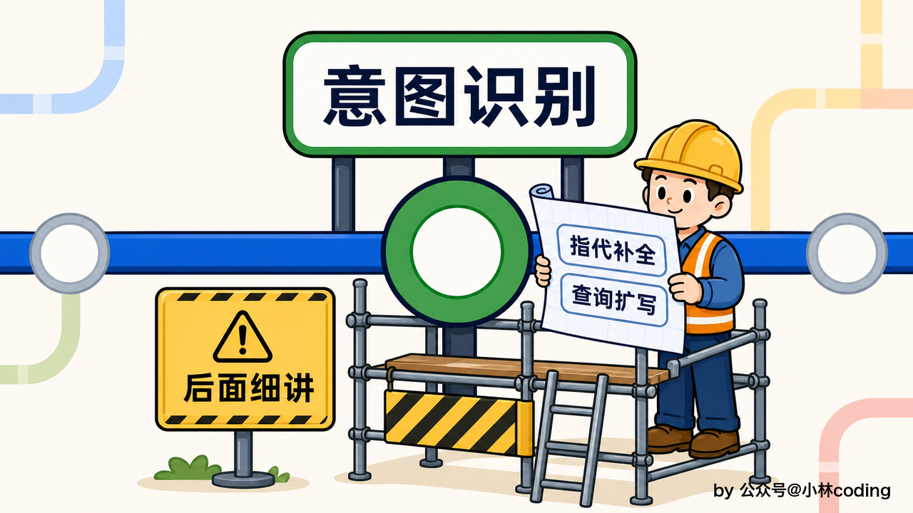

先看一个真实场景。用户在对话框里冒出一句「这个能退吗」，系统这时候要同时把两件事想明白。「这个」指的是哪件商品？这句话到底想干嘛，是想问退货政策，还是已经铁了心要退货，甚至是在投诉商品有问题？前一个问题判断错了，检索环节就找错了知识库条目；后一个问题判断错了，流程走岔了道，答非所问的概率直线上升。

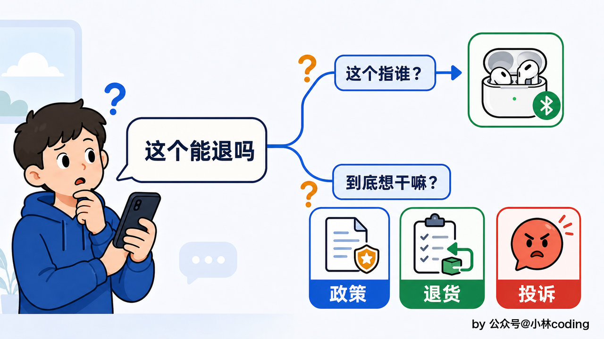

## 指代消解：先把「这个」补全成一句完整的话

一句「这个能退吗」，单独拿去检索或者判断意图，系统根本就是一头雾水。「这个」是什么，藏在上一轮对话里，比如用户前一句刚问过「蓝牙耳机什么时候到货」，「这个」大概率指的就是这只耳机。


多轮对话里，「它」「那个」「这一款」这类指代词天天出现。把它们原样丢给后面的环节，后面的环节全会摸不着头脑。


「指代消解」要干的事，是把这种依赖上下文才能看懂的话，改写成一句就算脱离对话历史、单独拿出来也能看懂的完整问题。做法是拿这一轮的新消息，连同最近几轮对话历史，一起交给 LLM，让它输出一句语义完整、不含糊指代的问题：「这个能退吗」结合上文变成「蓝牙耳机还能申请退货吗」，往后不管是拿去检索知识库，还是拿去判断意图，用的都是这句改写过的话，不再是原始的半截话而导致看不出意思。


这里有个容易被忽略的边界：用户问题本身已经说清楚了，就不该强行改写。有人一上来就问「蓝牙耳机的保修期是多久」，句子完整、指代明确，指代消解这一步什么也不用做，原样传下去就好。硬要凑一句改写，反而可能引入对话历史里不存在的信息，越改越偏。

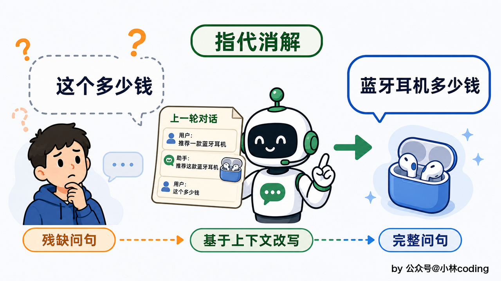

## 接上 RAG 进阶那一章：Query 改写与扩写

刚才那句「蓝牙耳机还能申请退货吗」，指代消解算是做完了，可要是直接拿它去检索，还不一定查得全。


指代消解，往大了说也是 Query 改写的一种。改写求的是准，把口语化、含糊的问法归一成一句更贴近知识库表达的标准问法，指代消解只是改写手法里专门对付「它」「这个」这类指代的一种。


改写之外还有一件事没做完，就是 Query 扩写。扩写求的是全，同一句问题换几种说法一起去检索，防止用户的措辞和知识库里的原文对不上号。用户问「这个还能退吗」，改写成「蓝牙耳机还能申请退货吗」只是第一步。检索时如果只拿这一句去查，知识库里写的如果是「无理由退换货规则」，字面对不太上，照样有漏检的风险。这时候让模型把这句话再泛化出几条说法，比如「蓝牙耳机退货政策」「蓝牙耳机无理由退换货条件」，几条一起去检索，再把结果去重合并，命中的概率明显更高。


落到扩写 prompt 上，大致是这么写的：

```plain&#x20;text
## 角色
你是电商客服的查询优化助手，把用户问题泛化成多条检索友好的中文查询，用于知识库检索。

## 改写规则
1. 出现产品名、型号、平台这类关键实体时，改写要保持一致。
2. 不要引入原问题里没有的型号、参数、数值。
3. 每条查询尽量短、含关键词，彼此侧重点不同。

## 输入信息
用户问题：{query}

## 输出要求
严格 3 条，必须使用以下 JSON 格式返回，不得包含任何其他文本：
{"queries": ["蓝牙耳机退货政策", "蓝牙耳机无理由退换货条件", "耳机退货时间限制"]}
```

输出的这三条查询，正是刚才「还能退吗」扩出来的说法，各自侧重点不同，一起送进检索环节，再把结果去重合并。

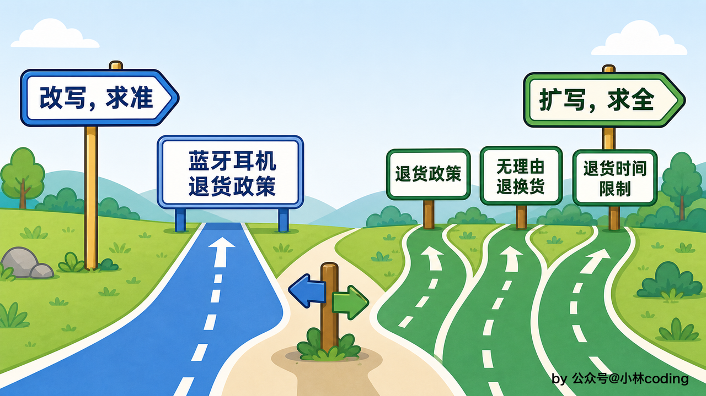

扩写不是白拿的。查询条数翻几倍，检索和精排的耗时跟着翻几倍，通常只对核心业务场景才做，比如退款退货、售后这类高频容错低又容易措辞不一的问题；像「客服电话是多少」这种简单 FAQ，原始问题直接查就够了，没必要多此一举。

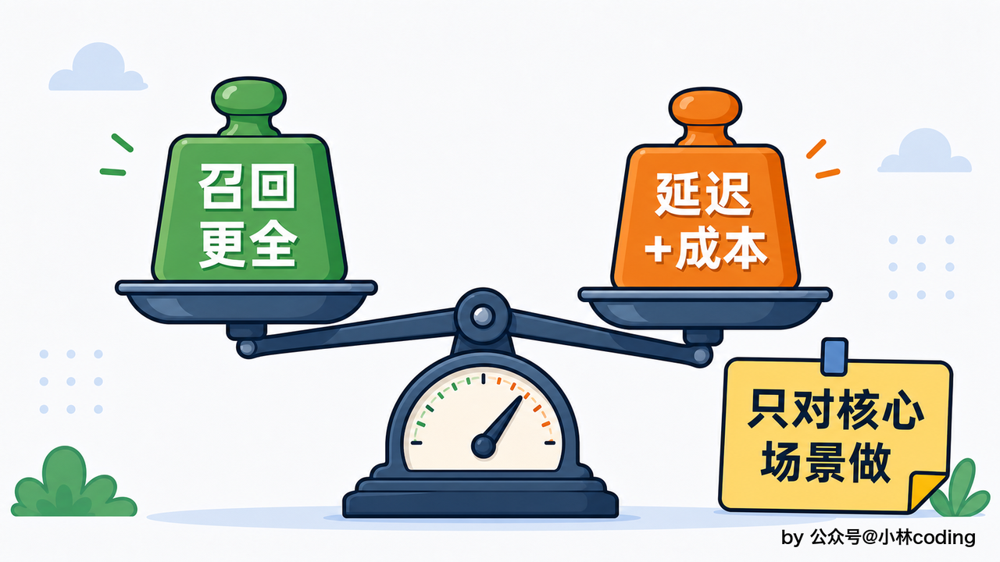

这里正好把前面 RAG 进阶那一章留的坑填上。那一章提过，扩召回这件事不能放在入库那一侧做：如果把一条知识预先泛化成好几种问法，每种问法配一份答案分别存进知识库，一个用户问题进来，这几份内容几乎一样的向量会同时冲进 Top-K，占掉本该留给其他知识的名额。扩写要放在检索这一侧现查现用，库里的知识只留一份，查询的时候才临时生成几条变体，用完即扔，不占用其他知识的名额。

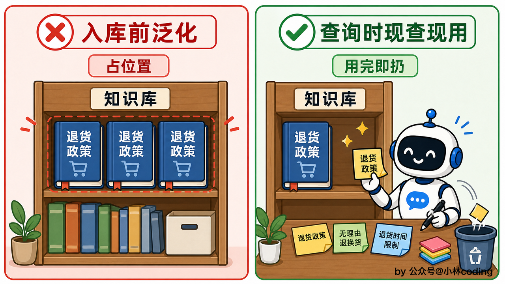

## 意图体系不是一次画出来的

指代消解做完，问题已经变成一句完整的话，接下来要判断的是这句话到底想干嘛。这一步是「意图识别」。


这份类目表能不能一开始就画对？很少见。刚上线的客服系统，往往只分得出「产品咨询」和「闲聊」两类，能应付大部分场景。可上线一段时间，翻看真实对话才发现，用户还会主动提建议、报故障，这两类问题不但内容不一样，处理逻辑也完全不同：故障要记录等级往上报，建议要落库定期复盘，混进「产品咨询」里一把梭，后续没法跟进。类目表这才被撑大，多出新的分支。


放到电商客服场景，这套演进逻辑同样适用。物流、订单、商品咨询这几类需求上线第一天就看得出来，可退款退货和普通的售后维修，一开始很容易被归成一类，直到发现两者处理路径完全不同，退款退货要走审核流程，普通售后可能就是答一句保修条款，才被拆成两个独立的意图。

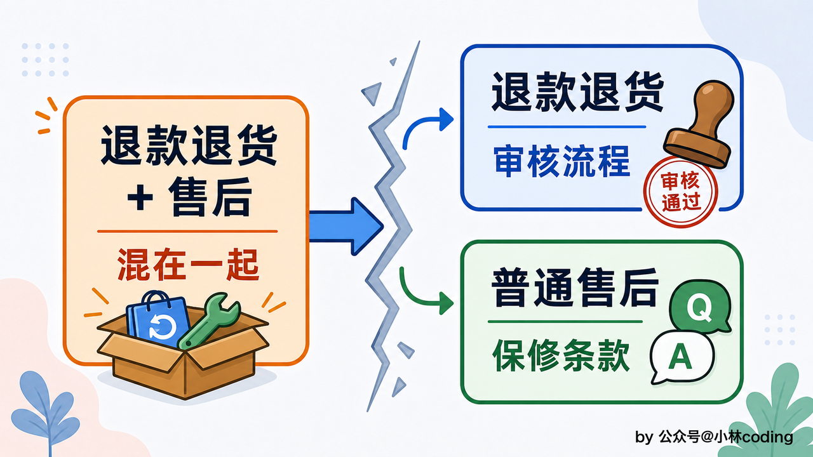

意图体系跟着真实流量走，是这一章要传达的第一个态度：看数据说话，而不是先验地画一张完美类目表。

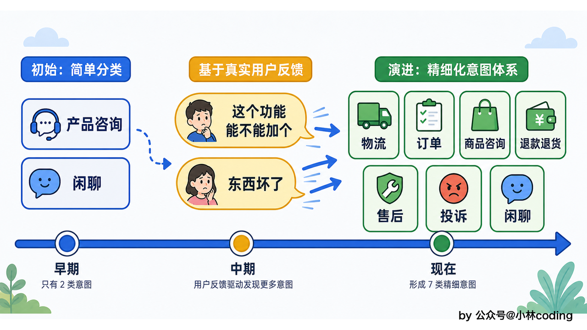

## 三条路怎么选：从关键词匹配，到用大模型读懂上下文

意图类目定下来之后，接下来要靠什么去判断一句话属于哪一类。


最直接的办法是关键词匹配：给每个意图列一张关键词清单，命中哪个类目的词就归到哪一类。这条路实现起来最快，问题也最明显，用户换个说法就失灵。「多久能到」和「什么时候发货」明明问的是同一件事，关键词清单如果没把两种说法都列进去，就会漏判，而且最重要是用户的表达花样穷举不完。


第二条路是训练一个分类器，常见做法是拿标注好的数据微调一个 BERT。这条路准头和速度都不错，单句判断又快又省，部署成本也低。


听起来BERT非常不错，但是标注成本这一层，靠时间和预算能堆出来。真正卡住 BERT 这条路的，是电商客服里意图会漂移这件事：用户一开始问物流，聊两句突然又问起退款，说了两句退款细节，又绕回去问物流有没有到，判断当前这一步该归到哪个意图，得读懂整段对话往前推进的脉络，孤立看一句话下不了结论。BERT 那种单句分类的活法，面对这种跳来跳去的多轮上下文，其实是没办法的，除非把整段历史都塞进分类器重新设计输入，但这样工作量早就超出微调能兜住的范畴。


这条路最终交给 LLM Prompt 来接手。「零样本」就能用，不用等标注数据攒够；更关键的是它能把整段对话历史一起读进去，用户从物流跳到退款又跳回物流，模型能把这条轨迹看在眼里，再判断当前这一步的意图，这正是电商客服真实场景需要的能力。


往深一层说，这已经不只是「挑一个类别」这么简单，业内更准的叫法是「对话状态追踪」：每一轮对话过后，这通对话当前处于什么状态，用户上一句提的诉求解决没有，这一句又把状态往哪个方向推了一步，都要跟着更新。意图识别只是这层状态追踪露出来的一个切面，先把这层关系摆清楚，这一章标题里「对话管理」四个字指的正是这个意思。

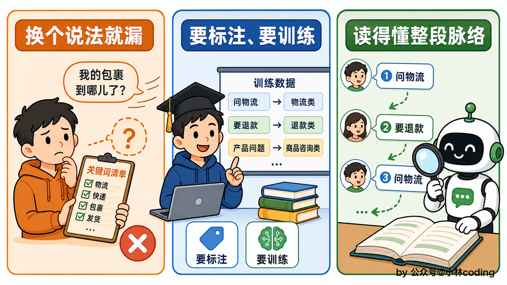

## 模型怎么配：先求准，再求省

选定 LLM 这条路，接下来要定的是配一个什么样的模型去判断。


意图识别放在这门课的电商客服里，本就是个多轮场景，用户绕几个弯子、意图中途还会漂移，判断当前这一步得把整段对话的来龙去脉读进去。这种任务最省心的做法，就是直接配一个能力够格的大模型来判，不必为了省钱先挑小模型。

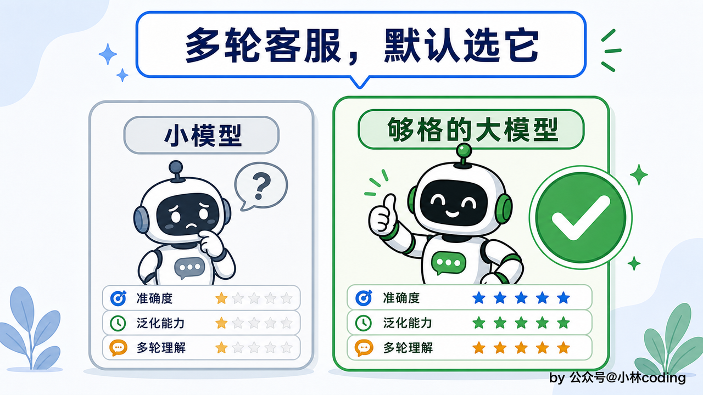

要是大模型全量判断的成本觉得吃紧，还有一条降级路可以走：先让小模型给出一个判断和置信度，置信度够高就直接采用，只有置信度低、模型自己也拿不准的那部分问题，才升级交给大模型重新判断一次。把大模型的调用量压在真正需要它的那一小撮问题上，多数简单请求仍然走小模型，成本就能降下来了。

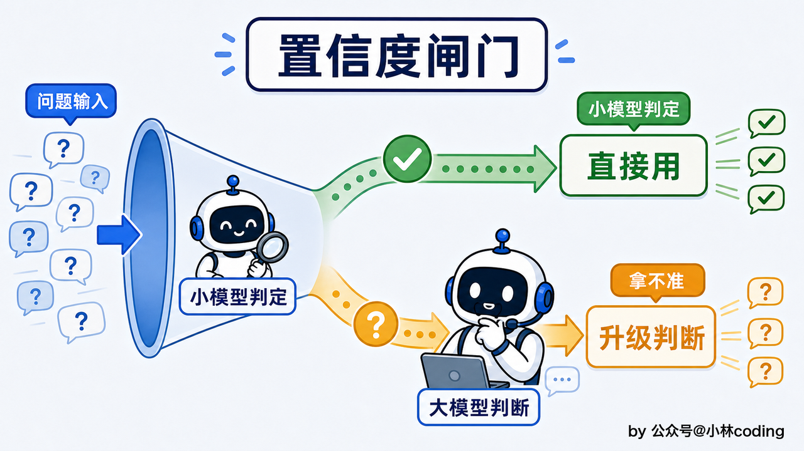

模型选型也不是上线那一刻定终身。项目初期图的是快速验证，直接上参数量大的模型，把准确率先做好；等系统跑稳了、准确率的基线也摸清楚了，再在不降准确率的前提下，逐步把日常流量换成 Qwen-plus、GLM 免费 Flash 档这类更便宜的模型，把成本降下来。先求准、再求省。

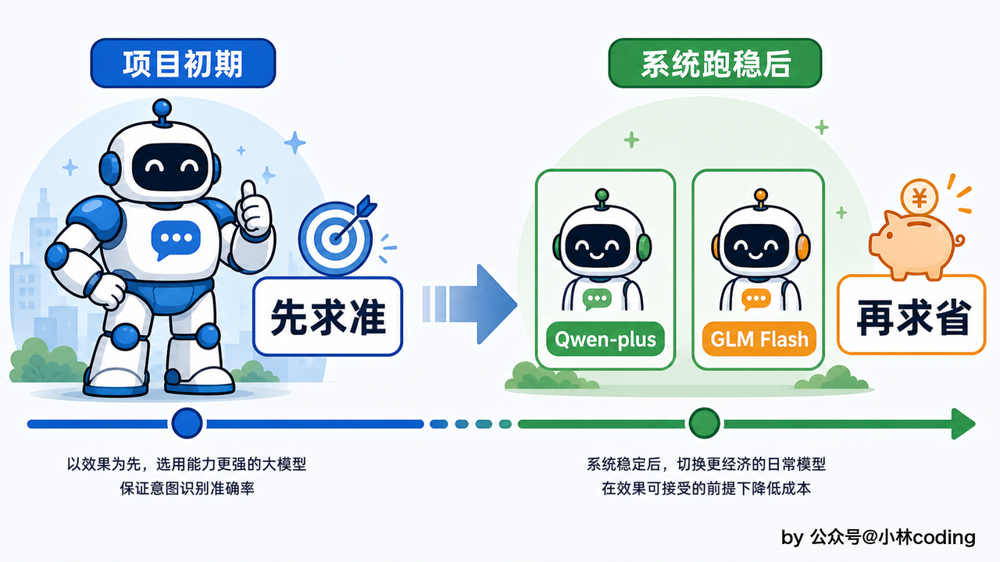

## 光有模型不够，还得让它稳定吐结果

模型选好了，能不能判准，还有一半功夫在 Prompt 怎么写上。这一层跟模型能力是并列关系，谁也替代不了谁：复杂场景模型本身能力不够，光靠抠 Prompt 措辞压不住；模型能力够格的前提下，Prompt 边界定义得清不清楚，直接决定输出稳不稳。


写意图识别 Prompt，有四件事得注意。


第一件，把候选意图明明白白列成一张表，让模型做选择题，而不是开放回答。开放式提问，模型爱自由发挥，今天答「用户想问退货」，明天换个说法答「这是一个关于退货政策的咨询」，下游代码没法稳定解析这种飘忽的措辞。


第二件，强制模型只输出结构化的 JSON，不许夹带任何解释性文字，拿到统一格式，才谈得上用代码稳定解析。

```plain&#x20;text
## 角色
你是电商客服的意图识别器，判断用户这句话属于哪个意图。

## 判断标准
1. 物流：查快递到哪了、发货没有
2. 订单：查订单状态、订单明细
3. 商品咨询：商品参数、退换货政策、通用 FAQ 这类「查规则、查说明」的问题
4. 退款退货：要对某个已购订单退货或退款，得先查这一单
5. 售后：维修、保修、换新这类售后处理
6. 投诉：对产品或服务不满、要追责
7. 人工：明确要求建工单、转人工、找客服专员跟进
8. 闲聊：寒暄、玩笑、跟产品无关的话
9. 其他：拿不准、又不该硬塞进上面某类时选它

## 输入信息
用户问题：{query}

## 输出要求
必须使用以下 JSON 格式返回，不得包含任何其他文本：
{"intent": "...", "confidence": 0.0-1.0}
```

这段 prompt 就把前两件事摆出来了：「判断标准」把九个意图连同各自的归类边界一条条列清，逼模型在固定选项里做选择题；「输出要求」把格式定死成 JSON，杜绝多余的解释文字。候选里除了八个业务类目，末尾多加一个「其他」，专门收模型自己也判断不了的问题。其中「人工」这一类容易跟「投诉」混，边界是看诉求：用户只是发泄不满、要个说法，归投诉；只要明确说了要建工单、要转人工，哪怕问题本身还没讲清楚，也归人工。「输入信息」那行也点了题：喂进来的已经是指代消解后的完整问题，模型只管判意图、不必再改写一遍。

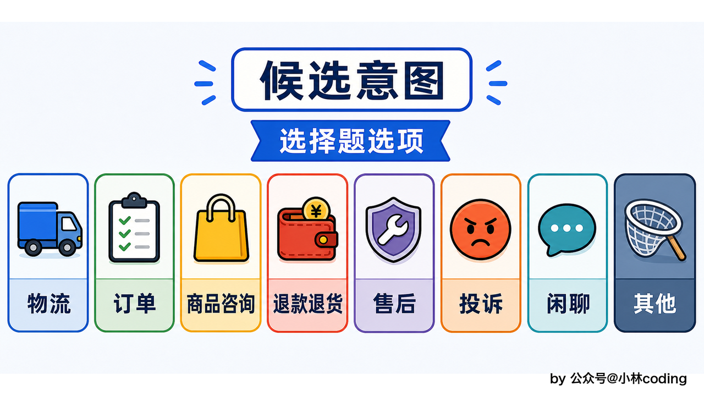

除了这两件，模型对边界案例的把握还得靠「few-shot」撑一把。光讲规则，模型照样会在拿不准的地方猜，补一两个真实的问题和对应意图的范例，比如告诉模型「用户说『这个还能退吗』，意图是退款退货，不是商品咨询」，这种边界样例比大段文字描述管用得多。


最后别忘了兜底：候选表里的「其他」，专门收那些一时判断不了、又不该硬塞进某个业务意图的问题。宁可归到「兜底类」，也别为了凑一个明确答案硬贴标签。


枚举做选择题、强制 JSON、few-shot 举例、留兜底类，说到底都在干同一件事：把一个开放式的判断题，改造成一道选项有限、格式固定、有参照样例可依的选择题，模型才不容易自由发挥出岔子。


除了 Prompt 本身写得清不清楚，候选意图的边界定义清不清楚，同样是决定输出稳不稳的一道杠杆。把每个类目「什么情况该归进来、什么情况不该」写明白，跟模型能力一样重要，替代不了模型能力，但模型能力够格的时候，边界定义清楚能明显把准确率往上推一截。

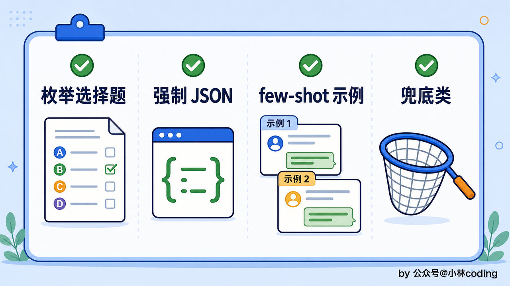

## 意图一多，Prompt 就塞不下了

意图数量如果少，写进一段 Prompt 毫无压力，模型选起来也不费劲。但换到意图量特别大的场景，比如大型客服系统动辄三五百个细分意图，问题就变了样：全部塞进一段 Prompt，又长又贵不说，选项一多，模型也容易挑花眼。


这件事不在本课电商客服的范围内，因为我们的意图不多，属于面试延伸，某些大规模场景才会撞上这道坎，但业界已经有两套成熟解法，这里顺带说一下。


第一套是「两级分类」。先粗分成少数几个大类，比如先判断是「物流类」还是「售后类」还是「其他」，每一级选项都不多，模型判断起来又快又准；命中大类之后，再进大类内部细分具体子意图。代价是要维护一棵两层的意图树，多一层结构，换来的是每一级都简短的判断范围。


第二套是「检索式意图识别」，思路挪用的其实是这门课前面 RAG 两章刚讲过的检索能力，以及渐进式披露的思想。把每个意图的描述当成一篇文档，建一个专门的向量库，用户问题进来，先做一次向量检索，召回最相关的十来个候选意图，再让模型只在这十来个候选里挑一个，不用从几百个选项里硬选。意图再多，真正塞进 Prompt 的候选数量始终固定，不会跟着意图总量一起膨胀。

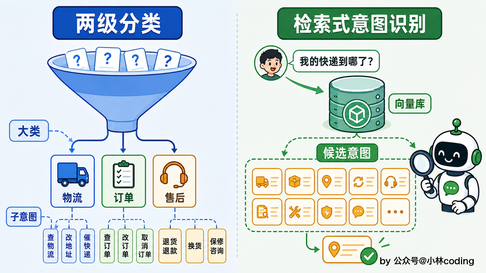

## 缺的信息谁来问

意图判断出来之后，很自然会想到下一个问题：要是信息不够，比如退款要用到的订单号、退款原因这些，该在哪一步问用户？答案是都不在意图识别这一站，这是判完意图、走到执行阶段才补齐的事。


拿退款退货举例，订单号交给主力 Agent：它要判断「这一单还在不在七天内、能不能退」，就得先定位到具体是哪一单，缺了订单号，就在执行循环里让前端弹出一个订单选择器，用户从自己的订单里点一单，选完把订单号回填进来再往下走。退款原因也不靠开口问，用户走到提交退款申请那一步，系统给一个固定的类目下拉框让他自己选。

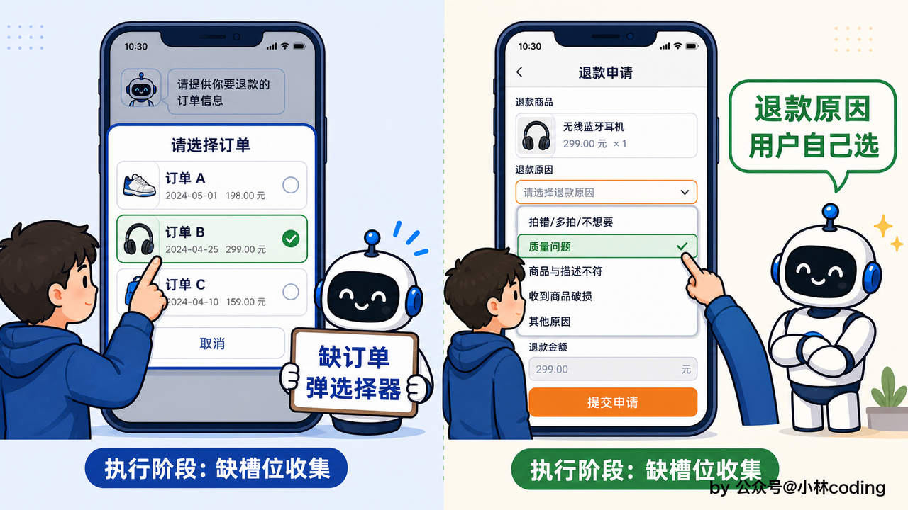

这里有条硬性的规矩：系统缺信息的时候不能靠瞎猜，也不能编答案糊弄，要如实告诉用户当前答不上来，该问就问。


至于为什么这件事不归意图识别管，答案落在职责的边界上。意图识别这一站，只需要回答「用户想干嘛」这一个问题，判完这一步，剩下的事就不归它管。追问缺的槽位，是执行阶段才会碰到的事，得等到真正跑起来查订单、查退款条件的时候，才知道具体缺了哪一项。


要是把追问的逻辑也塞进意图识别这一站，这一站要处理的事情立刻变重，判意图和要信息两件不相干的事混在一起，谁的职责都说不清楚。分流器只管分流，判完意图这一站的事就干完了。

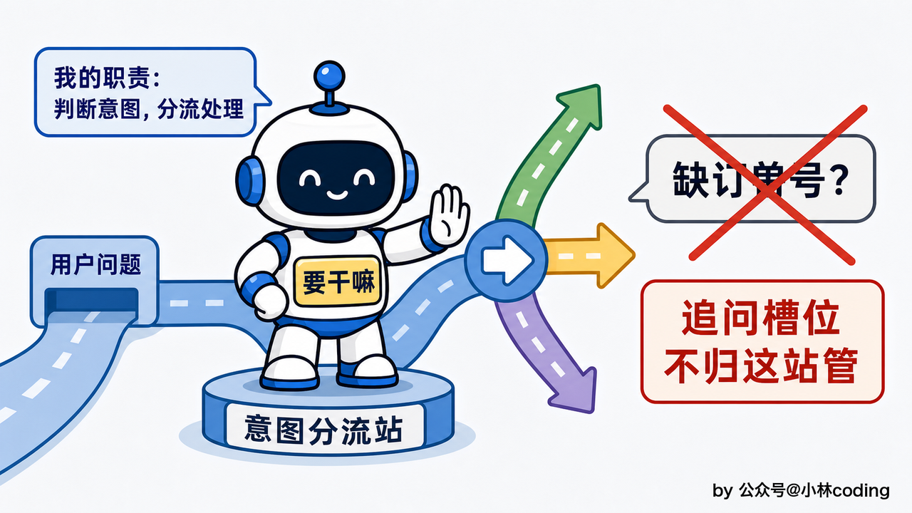

## 意图识别之后：分流去哪里

意图判完，指代也消解完了，这句话该往哪条路送，上一章画骨架的时候已经交代过一次，这一步要做的是把它和这一章判出来的具体意图标签对上号，也是上一章地铁图第三站「分流预处理」真正落地的地方。


这里的商品咨询是个统称，商品参数、退换货政策、通用 FAQ 这些「查规则、查说明」的纯知识问题都属于这个。判定成商品咨询这类知识型问题后，路由结果强制走一趟检索，把资料先捞出来，连同这句问题一起交给主力 Agent。


判定成物流、订单这类要查业务数据、但不牵扯退款审核的问题，直接交给主力 Agent，让它自己调工具去查。


退款退货、售后虽然也常要用到退换货政策、保修条款这类知识，但「这单还在不在七天内」，不先拿到这一单的数据根本无从谈起。所以判成这两类，走的是一条确定性的 workflow 子流程：先把订单数据、政策条款该拿的拿齐，再判、再答。


走一遍这条子流程。缺订单，就照前面说的，让前端弹订单选择器、用户点选回填。订单到手，执行流程里同样写死一趟强制检索，把对应政策捞出来当依据，跟知识类预查一个道理，都不让模型凭记忆瞎答能不能退；前面讲的 Query 扩写也是到这步才有料可扩，手里有了订单状态，扩出来的查询远比光凭一句「我这单能退吗」要准。


订单和政策都齐了，才轮到主力 Agent 做那一件真正要它临场判断的事：这一单到底能不能退。判完分两个出口，能退，前端弹一个「提交退款工单」的按钮让用户确认；不能退，就把原因说清楚，再告诉用户更详细的情况可以联系人工客服。


这条子流程从头到尾，除了「能不能退」这一步交给主力 Agent，其余都是上一章那套 workflow 编排：每一步都是写死在图上的确定性节点，该走哪条边、出什么结果都是定的，流程里就能一步步核验，稳定性和可信度都能保证。


单纯的闲聊反而不进主力 Agent 那一圈循环。这门课要做的是电商客服，不是一个通用聊天机器人，用户跟它扯天气、聊八卦，交给 Agent 自由发挥只会浪费一次模型调用，还可能答出跟客服身份不搭的话。判定成闲聊，直接返回一句写死的兜底话术，比如「我暂时还不会回答这个，请告诉我你对我们产品的任何咨询」，把话题拉回产品咨询上，全程不进 Agent。


要是判定出投诉，还是上一章定下的做法：先回一句安抚的话，再把「转人工」「建工单」两个选项亮出来交用户自己点，找真人还是留工单都由他选择。

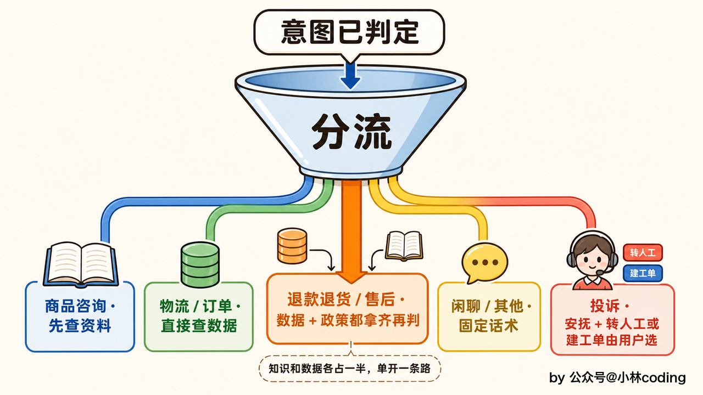

落到代码里，这条路由逻辑就是上一章 LangGraph 图上那条条件边具体该怎么判断：

```python
def route_by_intent(state: ConversationState) -> str:
    intent = state["intent"]
    if intent == "投诉":
        return "escalate"
    if intent in ("闲聊", "其他"):
        return "fallback_script"
    if intent == "商品咨询":
        return "knowledge"
    if intent in ("退款退货", "售后"):
        return "refund_flow"      # 确定性子流程：取单、检索政策、只判能不能退
    return "business"             # 物流、订单：直接交主力 Agent
```

投诉走 `escalate` 转人工；闲聊、或模型拿不准归进「其他」的，走 `fallback_script`，接一个直接返回固定文案的节点，不进主力 Agent；商品咨询走 `knowledge`，先做一趟检索；退款退货、售后走 `refund_flow`；物流、订单落到 `business`，直接交 Agent。

整理成一张表，九类意图走哪条路、每条路守什么规矩，一眼看完：

| 出口                | 走什么路                     | 哪些意图进来   | 守的规矩                 |
| ----------------- | ------------------------ | -------- | -------------------- |
| `knowledge`       | 强制检索 → 置信度闸 → Agent 作答   | 商品咨询     | 必须先检索，证据不够不让答        |
| `refund_flow`     | 取订单 → 检索政策 → Agent 判能不能退 | 退款退货、售后  | 取证一步不能省，只把最后一个判断交给模型 |
| `business`        | 主力 Agent 自己调工具           | 物流、订单、人工 | Agent 自己决定调哪个接口      |
| `fallback_script` | 固定话术，不过模型                | 闲聊、其他    | 不进 Agent，零成本         |
| `escalate`        | 安抚 + 转人工                 | 投诉       | 不让模型接手               |

识别要细、处理要合——标签分九类是给日志统计和按意图算成本用的，处理归五条路是因为走法确实只有五种。代码里这张映射表只有一份，分流和日志都读它，不会两处对不上。


前面讲意图体系跟着真实流量长，分流的边也一样，是跟着处理路径的分化一条条长出来的。`fallback_script` 这个兜底节点可以按意图分文案，闲聊把话题引回产品咨询，「其他」请用户把问题说得更具体些。意图识别这一站产出的判断结果，从这里正式喂进了整条 Workflow。


把这一章补上的东西和上一章的骨架拼到一起，整张图现在长这样：指代消解、意图识别在最前面串成一条，`route_by_intent` 往下叉出五条出口，退款退货、售后那条 `refund_flow` 单独挂着一段确定性子流程，缺订单号就靠 `interrupt` 停下来等前端点选。

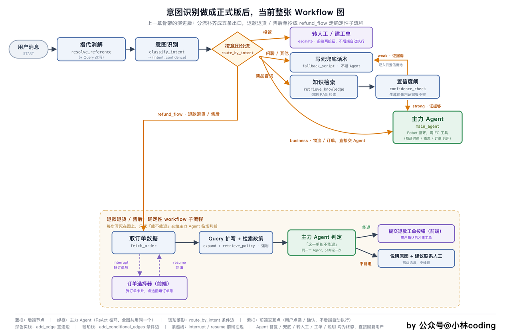

## 本章小结

这一章从「这个能退吗」这句话讲起，先把指代消解和 Query 扩写讲完；接着看意图体系怎么从两三类长成八类，三条技术路线又怎么一路被 LLM Prompt 接过去；模型该配多大、Prompt 该怎么写才能让输出稳下来，也都摆清楚了。分流器要做的，就是把每句话准确地送上正确的轨道。


上一章地铁图上那个原本挂着施工警示牌的站点，这一章总算装上了正式路牌。车还要往前开，接下来这一站要解决的，是这些消息在一通对话里该怎么攒、怎么存、什么时候该忘掉一部分，下一章会话上下文管理会接着讲。

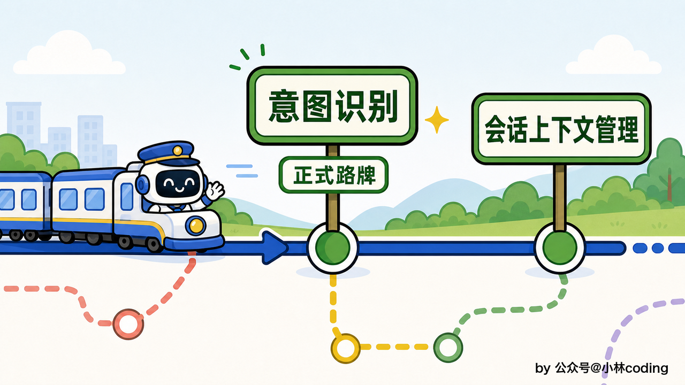
