上一章那趟车总算把「意图识别」这一站的正式路牌装好了。可你有没有留意，从用户开口那一刻起，一直有个东西跟着车厢往下走：指代消解要翻它才知道「这个」指哪件商品，意图识别要读它才判得出用户从物流聊到了退款，主力 Agent 的 ReAct 循环每走一步又往里塞一段新的思考和工具结果。


这个被全程翻看、被一路塞东西的家伙，就是本章的主角「会话上下文」，它是对话从头攒下来的那串历史消息。


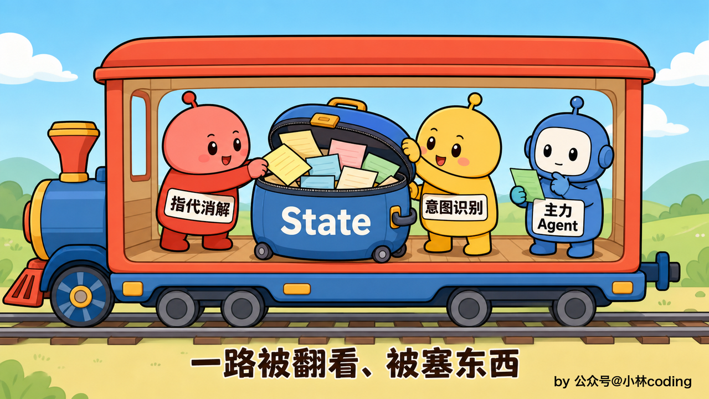


这一章注重的是客服在同一通对话里记得住前面聊过什么。换一通会话就另起炉灶，上一通聊过什么不会带过来，也不攒成这个用户的长期画像。我们的智能客服其实完全不需要那个。


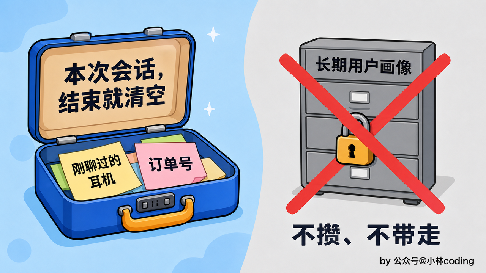


还记得课程刚开始讲多轮对话时，其实已经先垫了个最简版：每次请求把历史消息按原顺序拼进 `messages`，再用两招防止它无限长，就是按轮数留最近几轮和按 token 预算裁掉最老的。不过那一版当时就说好了是「够用先跑」，短板也挑明了，用户要是聊回二十轮之前那个订单，被裁掉就真忘了。这一章要做的，就是把那个留的坑填上。


## 第 1 章那版滑窗，到底漏在哪


先把那个短板用一段真实的电商客服对话看看它怎么翻车。


用户上来问「蓝牙耳机 A 什么时候能到货」，客服答了。接着这人一路聊开了，比了比 B 款和 C 款的音质，问了有没有别的颜色，中间下了单、报过订单号 202603150088，又问了满 300 减 50 的活动能不能叠加运费险，来来回回聊了十几轮。末了他冷不丁来一句「我之前问的那个耳机，下单之后还能改收货地址吗」。


麻烦就在这句话上。「那个耳机」指的是最开头问的蓝牙耳机 A，可这时候滑动窗口只留了最近几轮，最开头那轮「蓝牙耳机 A 什么时候到货」早被挤出窗口扔掉了。指代消解这一步一翻历史，压根找不到「那个耳机」的着落，只能懵逼，要么追问用户「请问您说的是哪款商品」，要么干脆按最近聊的 C 款去查，答得驴唇不对马嘴。用户心里直犯嘀咕：我之前不是刚说过嘛，这客服怎么转头就忘。


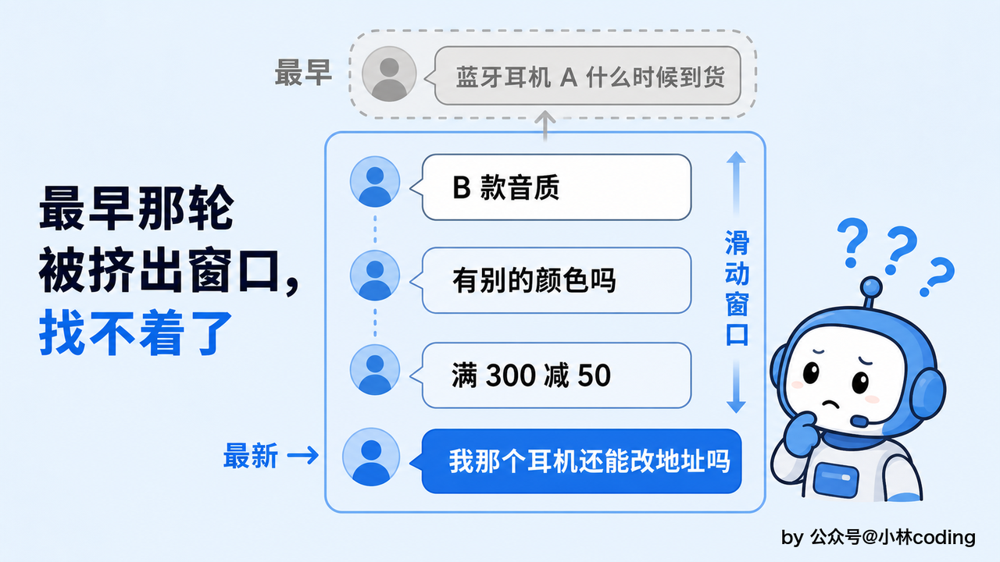


问题出在滑动窗口那个「最近的通常最相关」的假设上。这个假设大多数时候成立，聊天的话题总在往前走，越近的越贴当前。可它扛不住用户忽然回头，重新拎起一个很早以前的话题。窗口只认位置、不认内容，早期那轮不管多关键，只要位置够老，一律照扔不误。


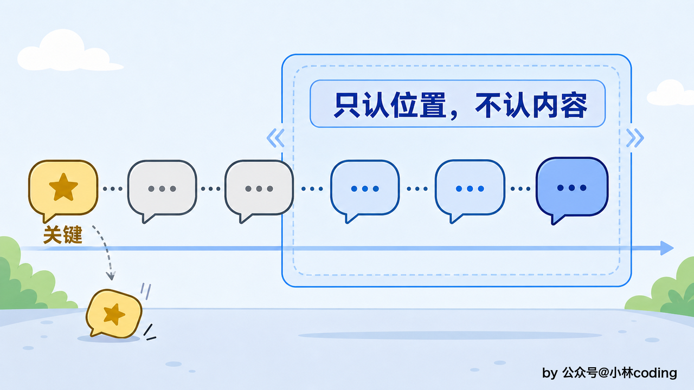


所以光靠滑窗这一招是不行的。要解决「聊回很早那个订单」这种情况，得再想办法，让系统在裁历史的时候，不只看这轮离现在多近，还得看它跟当前问题相不相关、重不重要。这就引出了挑历史该带哪几段的另外两种思路。


## 该带哪些历史：三种选法


每一轮要生成回复，都不能把从头到尾的全部历史一股脑塞给模型。token 有硬上限装不下是一层，更要命的是塞太多陈年旧账，当前这个问题反而容易被无关内容搅浑，模型的注意力被稀释掉。所以每轮都得挑：这么多历史，到底该带哪几段进去。这里有三种方法。


第一种就是前面那个「滑动窗口」，取最近 N 轮。它最简单也最稳，实现起来不过是从历史末尾切一段，靠的是「最近的通常最相关」。快、省、好实现是它的长处，短板刚才已经领教过了，用户一回头翻旧话题，窗口里没有那段，就没辙了。


第二种是按「语义检索」相关历史。既然位置靠不住，那就换个维度，看内容。做法是把历史里每一轮也向量化存起来，当前这句问题进来，拿它当钥匙去历史里做一次相似度检索，哪几轮跟当前问题意思最贴，就把哪几轮捞回来，哪怕它埋在二十轮之前。


回到刚才那个例子，用户问「那个耳机下单后能改地址吗」，拿这句去历史里一检索，最开头「蓝牙耳机 A 什么时候到货」那轮语义上对得最上，就被捞了回来，「那个耳机」的着落这就找回来了。代价是要为对话历史单独建一套向量索引、多算一遍嵌入，而且偶尔会捞回「主题看着像、其实语境不搭」的旧内容。


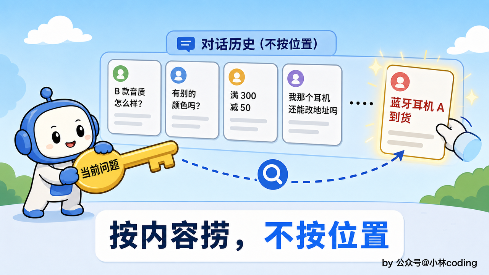


第三种盯的是「主题重要度」。有些信息一旦说出口，整通对话都得记着，位置再老也不能裁。用户开头交代一句「我这单是买来送人的，麻烦开一张增值税发票」，这是贯穿全程的关键前提，后面查订单、聊物流、办售后，全都绕不开它。这类「关键事实」得单独标出来、单独留底，不跟着普通历史一起被窗口挤掉，也不必等语义检索碰运气捞。代价是得有一步预处理，把对话里哪些是关键事实、哪些只是随口闲聊，先判出来、打上标记。


三种选法不是要你三选一。为什么不干脆全押在语义检索上、把滑窗省了？因为近处那几句最要命的短话，像「就这个吧」「那款呢」，实词少、语义信号弱，拿去做相似度检索未必捞得准，可它们又紧贴当前、一句都不能漏，这种时序上的连贯，靠位置固定带最稳妥。所以真实系统里这三招往往合着用，各补一个窟窿：固定带最近几轮保住时效，语义检索把远处相关的捞回来，关键事实单独留底免得被裁没了。


拿刚才那通耳机对话套一遍就清楚了。滑动窗口保证「就这个吧、那款呢」这种紧贴当前的话一句不落。用户突然回头问「我之前那个耳机」，靠语义检索把开头那轮捞回来。而「买来送人、要开发票」这句关键前提，从一开始就被标成关键事实单独留底，聊到第几十轮都不会被裁掉。


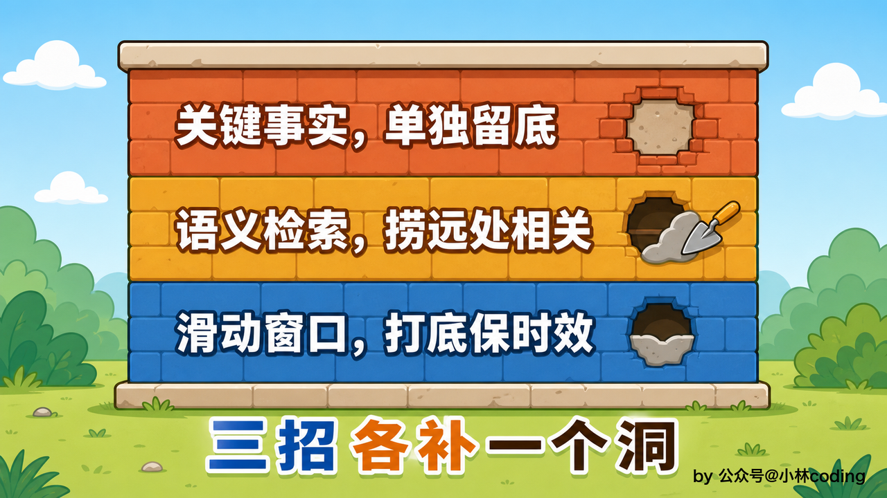


本课电商客服的量级，先把滑窗这一种打底做扎实，另外两种按需要往上加就行，不必一上来全铺开，因为始终要注意系统设计是权衡的艺术，我们真的需要的时候再上，目前我们的成本和收益来说，不需要其他两种。


## 早期对话：是砍掉，还是压缩


挑好了该带哪几段，还剩一个绕不开的问题。历史全留原文迟早顶到 token 上限，所以滑动窗口只留最近几轮，更早的都被推出了窗口。可这些被推出去的早期对话不见得是废话，里头常埋着订单号、用户一早提过的诉求，不能说扔就扔。它们到底该怎么处置？


一条路是「截断」，简单粗暴，按先进先出，把最老的几轮直接砍掉不要了。说白了这就是滑动窗口的默认行为，推出窗口和砍掉在效果上是一回事。第 1 章那一版走的就是这条路，超了预算就从最老的一问一答成对掐掉。它的好处是零成本，不用额外调模型，几行代码就搞定。坏处也直白，老对话里那些还有用的信息跟着一起没了，切掉就再也找不回来。


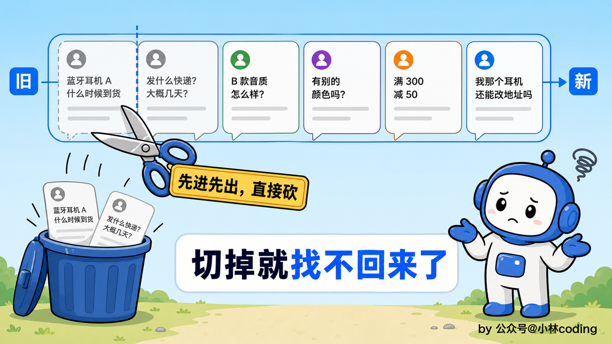


另一条路是「摘要压缩」。早期对话不直接扔，先请模型把它们读一遍，压成一小段梗概，再拿这段梗概替换掉原来那一大串原文。比方说，把最开头那七八轮压成一句「用户咨询过蓝牙耳机 A 的到货时间和可选颜色，比过 B、C 两款音质，已下单，订单号 202603150088」。原来那一大串对话，压完只剩这么一小句，省下的空间相当可观，关键信息还都留着。它的代价是多一次模型调用，压缩这一下本身要花钱花时间，压得不好还可能把重要细节给漏掉。


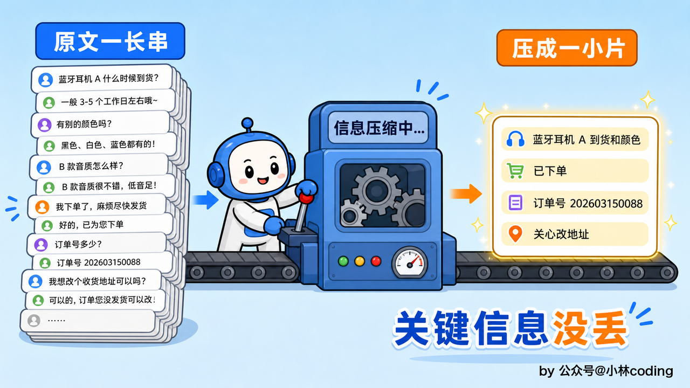


这么一对照，两条路的取舍其实很清楚。截断省 token 但丢信息，摘要保信息但多一次模型调用。要是对话里早期内容基本是废话，截了也不心疼，那截断够用。可像客服这种早期常常埋着订单号、关键诉求的场景，一刀切掉的风险太大，摘要那点额外开销就花得值。真正的生产做法，是把这两条路摆在一起用，互补。


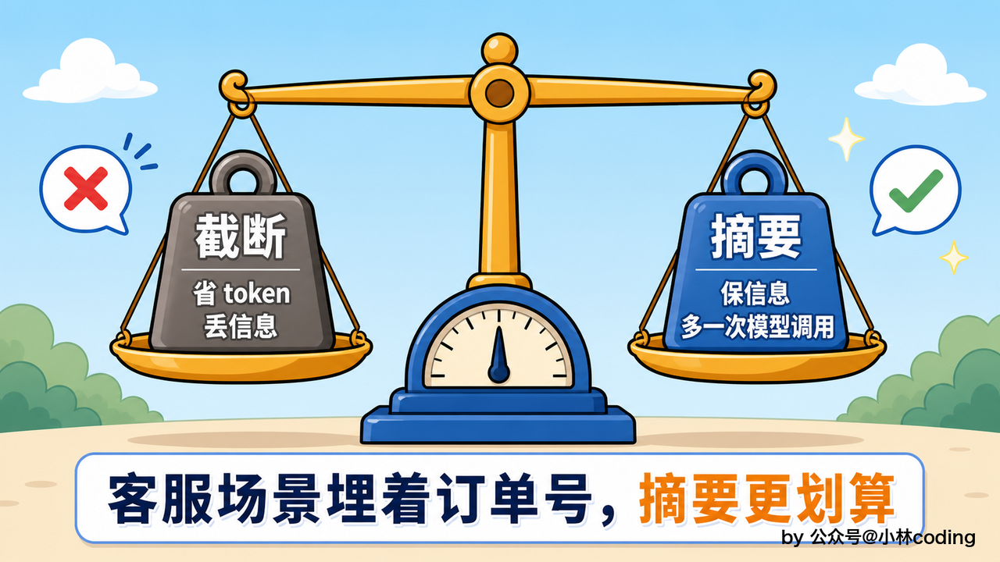


## 分层落地：越近越完整，越远压得越狠


把「该带哪些历史」和「早期怎么处置」这两件事的结论合到一起，落地方案就浮出来了：一套会话内的「分层上下文」。离当前这一轮越近的留得越完整，越往前压得越狠。


最近这一层管保真。最近的几轮对话，原封不动留着原文，一个字都不压。为什么近处不能压？因为当前这一轮的指代消解、意图判断，靠的全是最近这几句的精确措辞，「那它呢」「就这个吧」这种话，稍微压一压语气和指代就变味，判断立刻跟着出错。近处的对话要的就是保真，滑动窗口取最近这一段，原样递进去。


中间那层是个过渡。真拿一段跑过的会话量一量就会发现，用户说的话只占一小截，客服的答复和工具查回来的数据占了九成还多。那这一层就好切了：用户的原话一个字不动，客服的答复只留开头几十个字，头一句通常就是结论。工具结果里小的原样留着，大块的换成一行标识。压掉的是我们自己说过的话，留下的是「那双跑鞋」「订单 1001」这些指代要用的线索。


为什么不从原文直接跳到摘要？因为压摘要得调一次模型，中间这层靠规则截一截就成，不花钱也不占时间。轻的手段能扛住，就先别动用贵的。


最远那层才压成摘要。已经降到中间那层、又被挤到更前面的那批，才压成一小段梗概。这里有个讲究：梗概是一段一段攒起来的，压完一批就定死，往后再压新的一批也不回头动它。


为什么不把旧梗概拿出来、跟新滑出的对话一起重压一遍？那样第五版摘要就是最早那批内容被有损压缩了五次的结果。订单号哪一次被模型判成不重要给丢了，事后谁也查不出来。一段段攒着，一个事实只经历一次压缩。


一段段攒还有个附带的好处。已经压好的那几段往后不再进模型，压过一次的订单号就定死在那里，不会被第二次压缩磨掉。

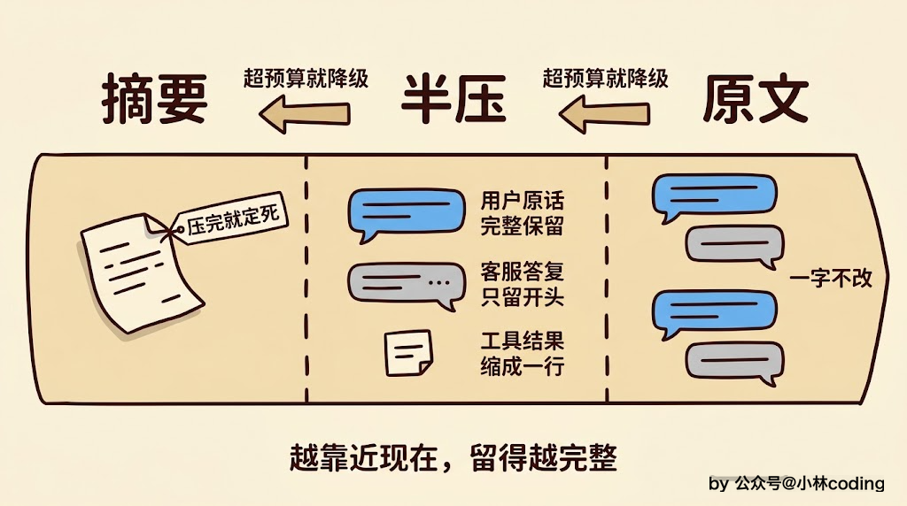


这层摘要怎么生成，有个讲究，得走异步。要是每轮回复前都同步现压一次摘要，用户就得干等着模型先压缩、再回答，体验会很差。


稳妥的做法是把压缩挪到后台去做：定一个触发条件，中间那层攒到超预算了，就在后台悄悄起一次摘要任务，把这一批压成新的一段，存进业务库，单开一张会话摘要表来放它，而不是塞进逐条消息里。等下一轮用户再来，直接从库里取最近几段拼上去，压缩的耗时全程不会阻塞用户。


触发条件为什么看用量、不数条数？因为一轮的长短根本不固定。用户说声「好的」是一轮，贴来一整段物流单也是一轮。更麻烦的是工具结果压根不落消息表，数条数看不见它涨，可它恰恰是历史里最占地方的一块。工具调用越密集的会话，条数看着慢悠悠，实际早就撑爆了。


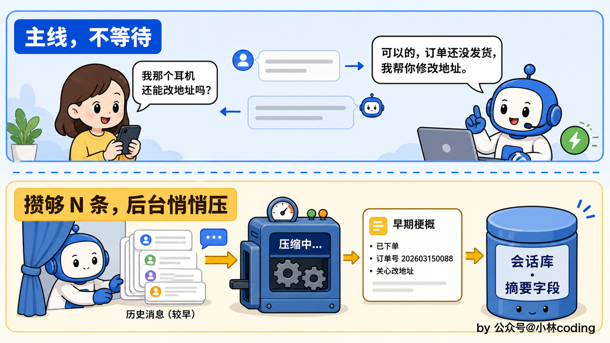


摘要压得好不好，全看那次压缩的提示词怎么写，落成提示词大概长这样：

```plain&#x20;text
## 角色
你是电商客服对话的摘要助手，把下面这段较早的对话压成一条「历史摘要」，留给后续的指代消解和意图识别当线索。

## 规则
1. 只提炼事实与诉求：问过哪款商品、已报上来的订单号或手机号、明确的诉求、还没解决的问题
2. 绝不添油加醋，对话里没出现过的内容一个字都不许补
3. 寒暄、语气词、跟业务无关的闲聊一概不留
4. 控制在几十到一两百字，压得比原文还长就算失败

## 对话片段
{history}

## 输出要求
只返回如下 JSON，不要输出任何多余文字：
{"summary": "string"}
```

这几条里，「绝不添油加醋」最不能松。摘要里但凡掺进一句对话没说过的，就等于往上下文里掺假，后面的判断全跟着错。说到底，这段梗概能让下游从里头读出聊过哪款耳机、订单号多少、卡在哪一步，就算合格。


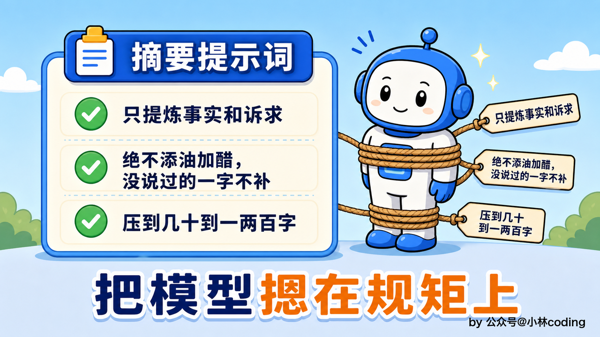


还有一点，攒下来的梗概不必全量带。一段梗概就顶一整批原文，真要往上下文里塞，带最近的三两段就够覆盖相当长的一段对话历史了，再老的梗概对当前问题基本没用，不用一股脑全拼进去。老段落照旧留在库里，事后要复盘随时查得到，只是不再往上下文里放。攒出新的一段时，注入的这几段会跟着往后滑，所以它和检索证据一样属于每轮可能变的内容。


那真到了生成回复的时候，喂给模型的上下文长什么样？把几块按顺序码齐就是了。打头是 system，人设、红线和工具定义都在里头，这一段每轮一模一样。接着是中间那层截短过的对话，再接最近几轮的原文，然后是用户当前这句话。压轴的是这一轮才有的材料，早期梗概和检索回来的证据合成一条，挂在用户那句后面。模型一口气读下来，远处的事有梗概兜着、近处的话有原文撑着，既不至于爆 token，又不会把之前那个订单忘个精光。


拿贯穿本章的耳机对话举个例，拼出来大概长这样：

```python
messages = [
    # ① system：人设、红线、工具定义，每轮都一样，前缀缓存全靠它
    {"role": "system", "content": "你是电商客服助手，……（人设与红线，从略）"},
    # ② 中间那层：截短过的老对话，客服答复只留开头几十个字
    {"role": "user", "content": "有别的颜色吗？"},
    {"role": "assistant", "content": "这款目前有黑白两色，黑色现货，白色…（略）"},
    # ③ 最近几轮原文：一字不压
    {"role": "user", "content": "满 300 减 50 能叠运费险吗？"},
    {"role": "assistant", "content": "可以叠加，运费险另算……"},
    # ④ 用户当前这句话
    {"role": "user", "content": "我之前那个耳机，下单后还能改收货地址吗？"},
    # ⑤ 本轮材料：梗概和证据合成一条，挂在用户这句之后
    {"role": "user", "content": "【历史摘要】用户问过蓝牙耳机 A 的到货时间和颜色，已下单，订单号 202603150088
【检索证据】……"},
]
```

有一处得专门说。梗概和检索证据都挂在用户那句之后，没有并进最前面那条 system，梗概也没有自己单占一条 system。原因跟省钱有关：模型服务商的缓存按前缀命中，最前面那段每次都一样才能复用，而证据每轮都不同，梗概每个会话各不相同、还会跟着新压出来的段落往后滑。更要命的是，上游的模板会把消息列表里所有 system 上提、合并成一个头部块渲染，梗概单占一条 system 等于把它拼在人设后面，工具定义就被挤到可变内容之后去了，整段前缀当场作废。这一条是实测撞出来的：摘要一进 system，缓存命中直接归零。细账在源码解读那篇里。


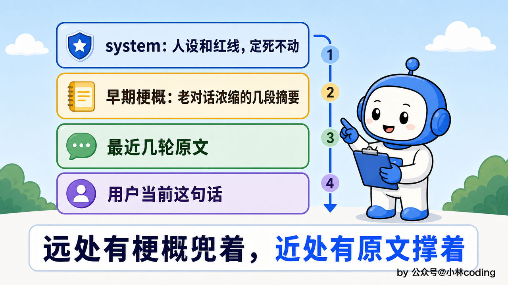


这里得再强调一遍边界：这套分层，从头到尾都在「当前这通会话内」打转。摘要存进业务库，是为了这通会话下一轮还能取来用、以及事后复盘查账，不是拿去当这个用户的长期档案。会话一结束，这些上下文就完成使命了，下一通对话另起炉灶，不继承、也不叠加成用户画像。


## 每层给多少：从模型窗口倒推


分好了层，还剩一件事没交代：每层到底给多大额度。


这几个数没有统一的定数。有的轮就一句「好的」，有的轮用户贴来一整段物流单，长短差着数量级，只数轮数根本兜不住。所以别写死成常量，从模型窗口倒推出来才站得住。


先把窗口当成一张有限的工作台。系统提示和工具定义每轮都在占位，检索回来的证据、要注入的那几段梗概也各占一块，还得给模型接下来要写的答复留出地方。这些扣完，剩下的才轮到历史。


倒推的时候给单轮加两条硬约束：用户单轮输入不超过 X，模型单轮输出不超过 Y。这样一轮的账就按 X + Y 记，N 轮就是 N × (X + Y)。有了这个记账口径，「这个预算能装几轮」就成了算出来的数，不用再拿平均值估。用户连着贴几段长文的时候，按平均值估的阈值会误伤，按上限留的预算不会。


走工具调用的那一轮要另算一笔。模型来回走的那几步、每步查回来的数据，都要同时挂在消息列表里喂给下一步，那个瞬时占用比一轮沉淀进历史的量大得多。所以「这一轮跑不跑得起来」和「历史能留住几轮」得分开记两个数，合成一个必有一边错。


历史预算最终取两个数里小的那个。一个是 N × (X + Y)，照你想留住的轮数倒推。另一个是窗口减掉上面那些固定开销，是窗口实际匀得出来的。窗口大的时候前者生效，不多占。换成窗口小的模型，后者自动收紧，也不至于撞墙。这么一来换模型只改一个「窗口多大」的配置，整张预算表跟着重算。


算出来的这份历史预算再往两层里分。层 1 拿七成，层 2 拿三成。为什么偏向层 1？因为原文是最贵也最有用的那部分，指代消解和意图判断全指着它。层 2 只是个中转站，攒到超了自己那三成就该往摘要里去了。这两个比例不用纠结，改一个配置就能调。


分完这两个数，前面那两道闸门的阈值就都有了：层 1 超了七成那份就降级一批到层 2，层 2 超了三成那份就在后台压成一段梗概。


顺手还能加一道启动自检：要是算出来连一轮都跑不起来，启动时就报警，别等跑到第四步撞了墙才知道。

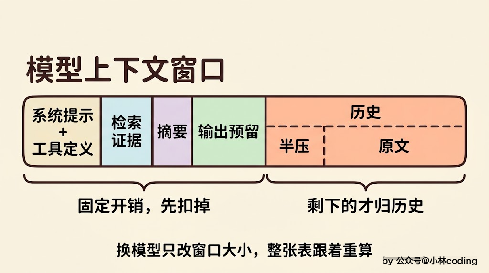


还有个中文场景特有的坑。常见的 token 估算函数默认按四个字符折一个 token，那是照英文定的，中文一个字往往就是一个 token，照默认口径算会差出好几倍。裁剪的闸门要是用了这个口径，看着卡在三千，实际放进去一万二。


这个口径得和预算一起校准。只校准口径不动预算，算出来的用量一下子涨好几倍，闸门提前关，本来装得下的历史被白白裁掉。只调大预算不校准口径，闸门看着松了，实际发出去的还是超。两边动一边，都是往反方向走。


还有一处更隐蔽：同一个校准值，有的地方拿它当除数、有的地方拿它当乘数，两条路能差一倍多。定下来是「几个字折一个 token」就一路当除数用，凡是拿字数换 token 的地方都走同一个入口。


## 落到 LangGraph State：上下文随图一路走


前面讲的选历史、压摘要，都是策略层面。落到代码里，这些上下文到底存在哪、怎么跟着整条客服流程走，就得回到那张 LangGraph 图上了。


LangGraph 有一份共享的 State 顺着图走完全程，每个节点都能读它、改它，会话上下文就存在那里。State 里有个 `messages` 字段，存的就是这一路攒下来的历史消息。


指代消解节点从这里读最近几句去补全「那个耳机」，主力 Agent 的 ReAct 循环每走一步，新的思考和工具结果又追加回这里。上下文管理说到底就是这份历史消息该怎么进、怎么裁、怎么压。


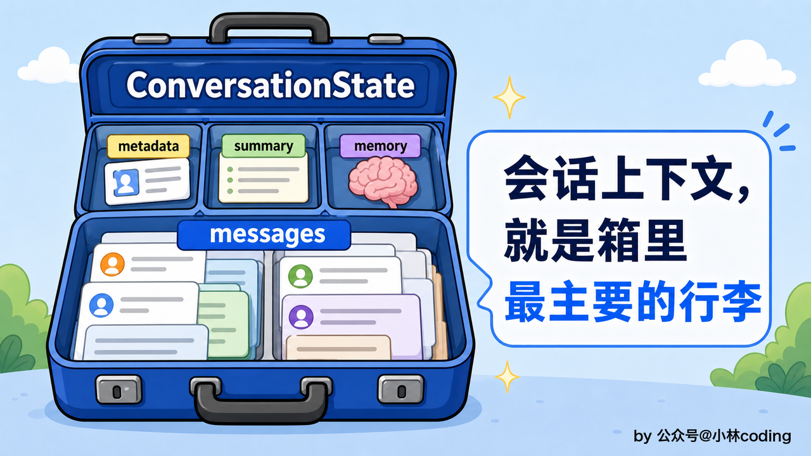


LangGraph 管消息追加有个现成的机制。给 `messages` 字段挂一个叫 `add_messages` 的「reducer」，各个节点只管往外吐新消息，框架会自动把它们按顺序并进历史里，不用每个节点自己操心怎么拼接。


这里要立一条边界：**State 里那份历史只进不出**。它是事实源，靠第 5 章提过的 checkpoint 落盘存着，中途断了能接着跑，事后要复盘也翻得到。分层从头到尾没碰过它，动的是每轮调模型前另外现拼的那一份精简版。两份各走各的，互不打架。


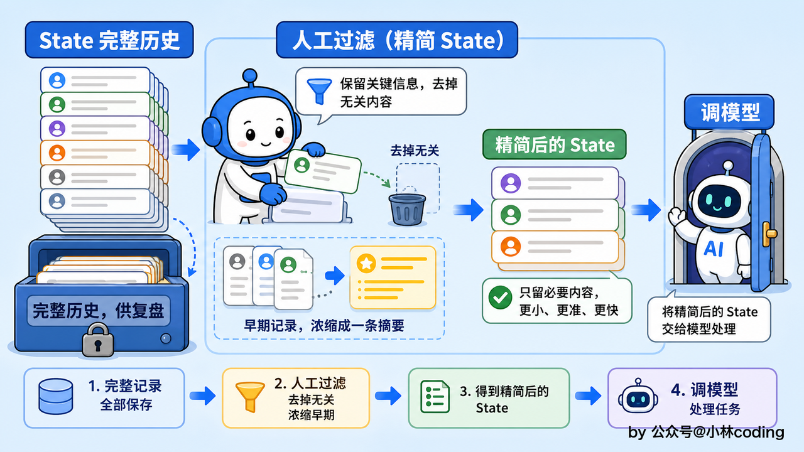


那三层在这份精简版里怎么体现？靠两个整数。用户消息落库时拿到的自增 id 一路带进 State，摘要覆盖到哪条记一个 id，层 1 从哪条起再记一个 id。这两个数把历史切成三段：id 小于等于摘要边界的那批已经进了梗概，压根不出现在窗口里。夹在两个 id 中间的是层 2，渲染成半压形态。剩下的是层 1，原样递进去。


降级也就是把后面那个 id 往后挪一格，**一条消息都不用搬**。而且同一批消息渲染多少次结果都一样，这一点很重要：边界稳住，发给模型的前缀才逐字节稳定，缓存才保得住。


三层各有各的零件。层 1 那道 token 兜底，LangGraph 生态里有现成的 `trim_messages`，告诉它留多少 token、按什么策略留，超出的那截调模型前就裁掉。层 3 走的是前面说的后台那条线，中间那层攒到超预算，就在图外悄悄起一次异步的摘要任务，压好写进业务库，下一轮取来拼上去。


夹在中间的层 2 反倒得自己写。`trim_messages` 只会整条整条地丢消息，做不到「把这条客服答复截成开头几十个字、把那条工具结果换成一行标识」这种改内容的活。这一层的规则简单，几十行就够，但没有现成零件可用。


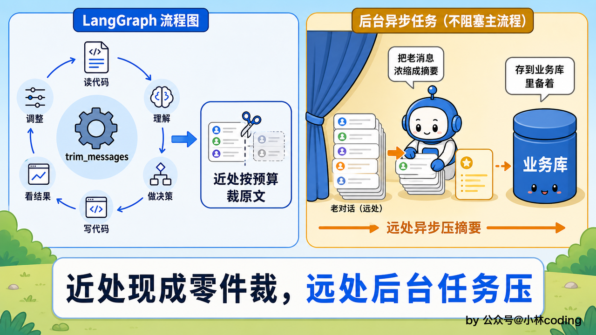


还有个时序上的小坑值得一提。摘要是后台异步压的，压的这段时间用户完全可能已经问下一句了。这一轮读到的还是旧锚点，也就是说层 2 那批还原样待在上下文里，等压完了下一轮才收进梗概。这样是对的，宁可多带一轮原文，也不能让用户干等着摘要跑完。


## 本章小结


回头盘一盘这一章走过的路。先看清第 1 章那版纯滑窗漏在哪，用户一回头翻旧订单，窗口里没有那段就答不上来。顺着这个坑，摆开了挑历史该带哪几段的三种选法，滑动窗口打底、语义检索捞远处相关、主题重要度留关键事实，这三招合着用最稳。本课只把滑窗这一种做扎实，另外两种按需要再往上加。


早期对话怎么处置，在截断和摘要之间做了取舍，一个省 token 却丢信息，一个保信息却多花一次模型调用。落地方案是会话内的分层：近处留原文保真，中间那层靠规则截短客服的答复和工具结果、把用户原话完整留着，最远的才异步压成一段梗概，而且梗概一段段攒、压完不回头重写。


每层给多大额度也不靠拍脑袋，从模型窗口往回倒推：扣掉系统提示、检索证据、要注入的那几段梗概、输出预留这些固定开销，再扣掉本轮跑起来的瞬时占用，剩下的才归历史，层 1 拿七成、层 2 拿三成。换模型只改一个配置，整张预算表跟着重算。


最后这一切都归到 LangGraph 的 State 上。State 里那份历史只进不出，分层动的是每轮现拼的精简版，边界靠两个 id 表达，挪的是数字不是数据。层 1 的兜底和层 3 的摘要都有现成零件，夹在中间那层反倒得自己写。从头到尾守住一条边界：只管当前这一通会话，不跨会话、不攒画像。


然后我们回头看看主力 Agent 手里那几件工具，还都是老样子。第 2 章写死在代码里的那五个工具，查订单、查物流、查商品这些，真到了生产环境远远不够用，还得接物流系统的接口、接仓储系统、接第三方查询，每接一个都得改代码、重启服务。下一站工具系统要解决的，就是怎么把这堆写死的工具，换成一套注册一下就能用、不动核心代码的即插即用工具生态。


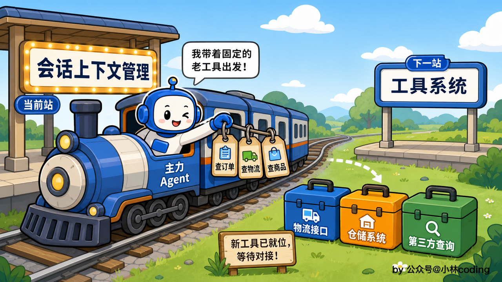
