到这一章，主力 Agent 的能力总算搭齐了，可它跑起来到底什么样，我们一直没真正看清过——每一步想了啥、调了哪个工具、花了多少 token，全埋在一次次调用里，线上就是个黑盒。

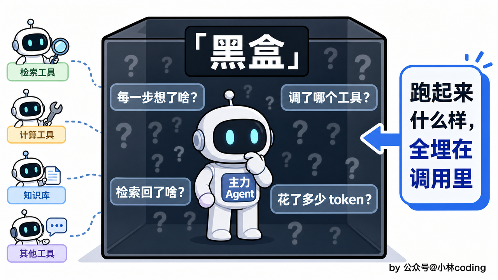

上线跑了一周，老板端着两个问题找过来。头一个：昨天有个用户收到条离谱回答，到底哪一步出的岔子？另一个：这个月 token 花超了，钱到底花到哪里去了？你张了张嘴，答不上来。这两个问题的答案都埋在那个黑盒里，想查也没处查。

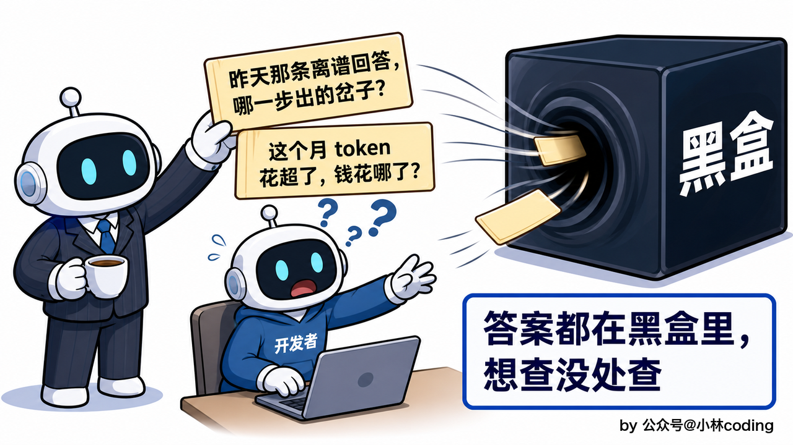

想看清黑盒里每一步在干嘛，这就是这一章前半要装的「可观测性」。再往下想一层，那个收到离谱回答的用户，他问的问题没答好，兜底一句糊弄过去，问题就这么散了；下回换个人问同样的事，照样答不上来。这些答不上来的问题要是能补回知识库，智能客服才会越用越准，这就是后半要装的「数据飞轮」。

## 线上是个黑盒，先看清到底看不见什么

先把老板那两个问题拆开看，就知道黑盒黑在哪里了。

用户发一句话进来，主力 Agent 在 ReAct 循环里走了好几步才收敛出回答。每一步它先想一句现在该干嘛，照着调一个工具，拿回结果再想下一步。收到离谱回答，可能是某一步检索回了错的资料，也可能是模型看着对的资料却想歪了，还可能是某个工具超时返回了空值它硬着头皮往下答。你光看最后那句回答，根本分不出到底是哪里出问题。

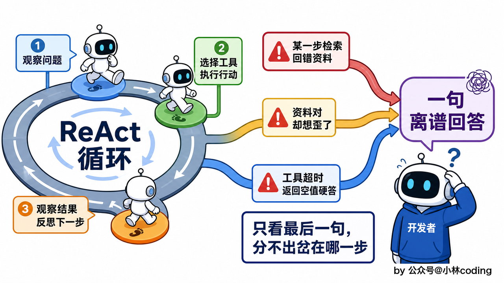

token 这里也一样。一次请求在 ReAct 循环里每走一步，都把新结果追进对话历史再喂给模型，步数越多、历史越长，烧的 token 越多。一个月下来有成千上万的请求，哪类问题最费、费在哪一步都不知道，你只看得到花超了，看不到花哪了。

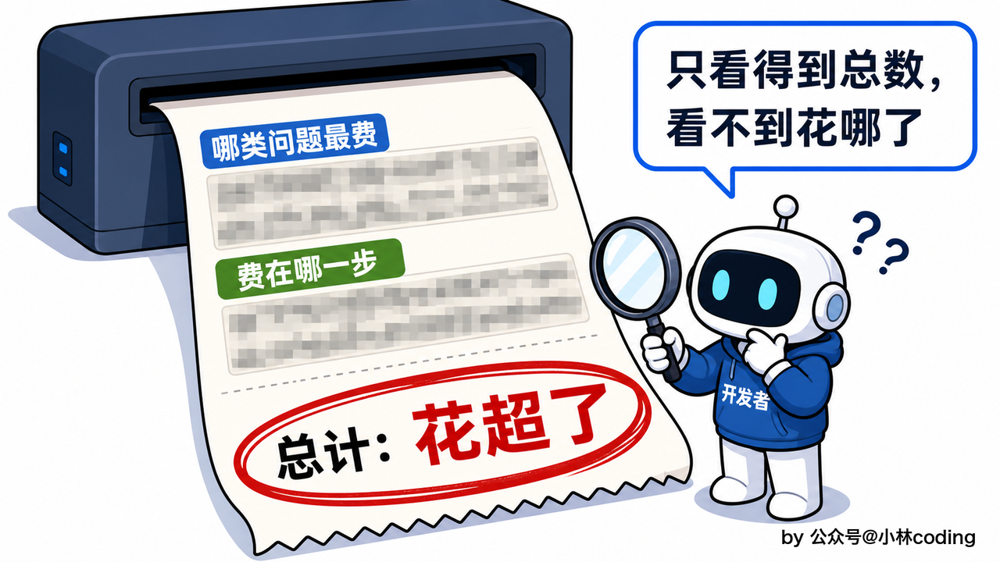

这两个问题背后其实是同一件事没做：每一步模型想了什么、调了什么工具带了什么参数、检索回了哪几条、花了多少 token、哪一步慢，这些过程信息在请求跑完那一刻就丢了，没留痕。把这些过程记下来、还原成看得见的东西，就是可观测性要干的事。前面架构那一章，「记录日志」当时只作为可观测性的地基提了一句，这一章就来把它落地。

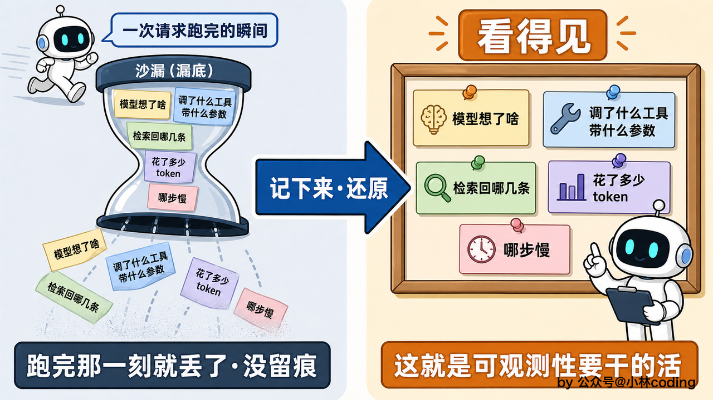

## 把一次请求还原出来：调用链路

那具体要记成什么样？答案是记成一棵调用树。

一次请求就是一棵树的根。主力 Agent 每走一步是树上的一个节点，这一步里它调的那次模型、调的那个工具、发的那次检索，都作为子节点挂在这一步下面；工具内部要是又调了别的，就再往下长一层。整条请求从进来到收敛，谁调了谁、先后什么顺序、各自花了多久，顺着这棵树从上往下看得清清楚楚。业内把这样一棵树叫一条「trace」，树上每个节点叫一个「span」。

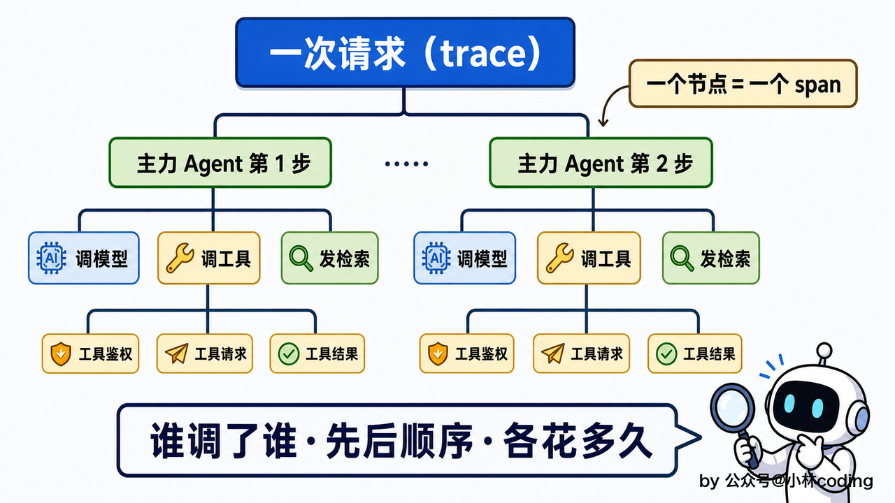

这棵树的形状，其实跟前面架构那一章那张 LangGraph 图有异曲同工之妙。图上有指代消解节点、意图识别节点、检索节点、主力 Agent 节点，一次请求流过这几个节点，trace 树上就长出对应的几段。当时讲编排层为什么选 LangGraph，留过一句伏笔，说往后配可观测会顺着这张图对齐每个节点，指的就是这里。

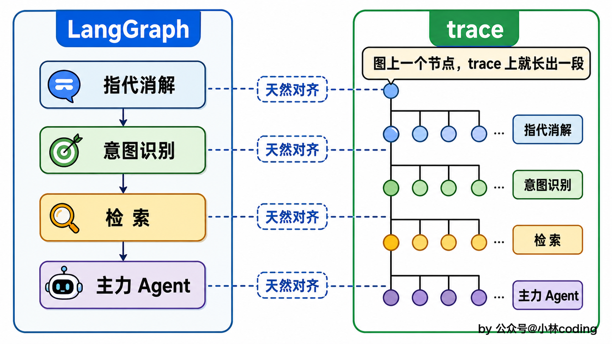

有了这棵树，老板那两个问题就有地方查了。离谱回答那条，把对应的 trace 翻出来，一层层点开，是检索节点回错了资料、还是主力 Agent 拿着对的资料想歪了，一眼就定位到出岔子的那个节点。token 超支那条，把每条 trace 上各个节点的 token 加起来，再按天、按意图汇总，钱花在哪类请求、哪一步上，也就亮在明面上了。

## 接 Langfuse：数据不出门，接入也就多挂一行

调用树的道理讲通了，接下来是拿什么把它记下来。总不能自己在每个节点手写一堆埋点代码，那既累又容易漏。

本系统选 Langfuse。它开源，能装在自家服务器上。前面整套选型立场就是数据不出境、能自部署就自部署，从嵌入模型到向量库都是自己搭起来的。不过这只是企业级实际落地时的情况，我们学习和课程演示用云端的就行，避免本地部署太重。观测层顺着同一条线走，Langfuse 正合适，它接入也很方便：设三个环境变量，再在图编译时挂一次回调。

先是环境变量：

再在图编译时把它的回调挂上去：

就这么点。回调只在编译那一下挂上去，挂完之后跑图时每次调模型、每次调工具、每次检索，Langfuse 自动采集、拼成前面说的那棵 trace 树，节点里的业务代码一行都不用改。

LangGraph 跑图的时候会把每个节点的输入输出往外发信号，Langfuse 顺着这些信号就能还原出整棵树，包括每个节点的 prompt、返回、token 消耗和耗时。开发时你在它的界面上点开任意一条请求，就能对整条链路铺开来看，比对着一堆纯文本日志一行行翻舒服很多。

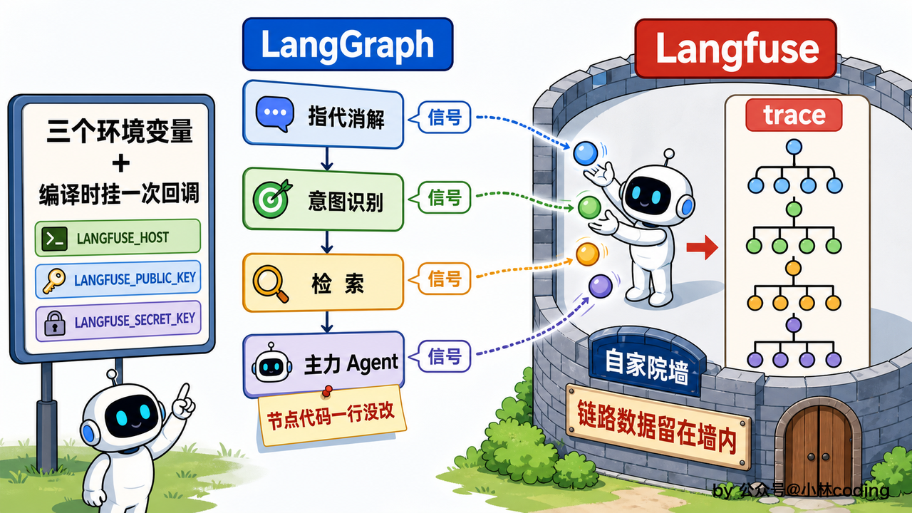

还有一条路是 LangSmith，LangChain 官方生态集成的，跟 LangGraph 同源，比 Langfuse 还省一步，连回调都不用挂，设 `LANGSMITH_TRACING` 和 `LANGSMITH_API_KEY` 两个环境变量就接上了。

代价是它是托管服务，链路数据要上报到它的云端，而且也得花钱。要是团队不介意数据出境、或者只想快速搭个原型先看到效果，走 LangSmith 更省事。

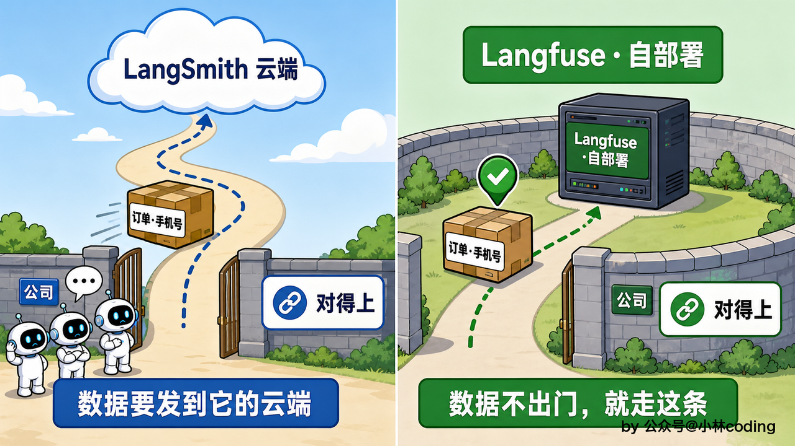

## 光看单条不够，还得防它悄悄退化：自动化评估流水线

trace 让你能把某一条具体请求翻出来查，可它一次只照见一棵树。系统整体在不在悄悄变差，单看一条条 trace 是看不出来的。

这事在客服系统里特别容易发生。你改了个 prompt、给知识库补了一批新知识、把某个意图的模型从大换小，改的时候盯着几个例子觉得没问题就上了。可这一改，说不定把另一类问题的准确率悄悄带下去了一截，昨天还答得好好的，今天就开始出问题。这种整体性的滑坡，靠人肉一条条抽查根本发现不了，等用户投诉多了才察觉，早晚了。

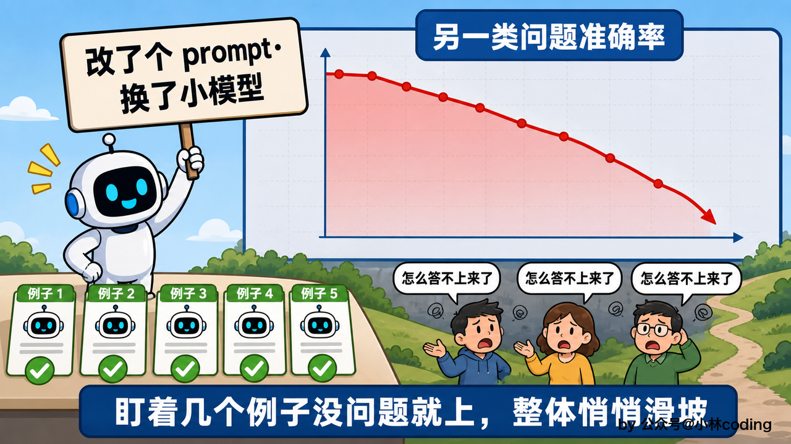

治它要靠一条「自动化评估流水线」。好在有现成的评估，RAG 进阶那一章造过一份评估集，还立了检索段看 Recall@k、MRR，生成段看 Faithfulness、LLM-as-Judge 这几把量尺。那几个指标怎么定义、评估集怎么标注，那一章讲了，这里不重复。当时那套评估是上线前用来选策略、调参数的，现在把同一套评估集搬到上线之后，定期自动跑一遍，比如每天一跑、或者每次改动后跑一次，把每次跑出来的分数记下来，连成一条趋势线。

重点全在这条趋势线上。它盯的是分数有没有在往下掉，不是某一次考了多少分。哪天某个指标的曲线突然拐头向下，就说明系统悄悄退化了，报警拉起来，你再回头借着可观测性那棵 trace 树，定位是哪次改动、哪类问题拖垮了它。这套定期回归加趋势监控合起来，把「系统会不会越改越差」从一个没人说得清的担忧，变成一条看得见涨跌的曲线。具体每个指标的数值和波动范围，得等系统跑起来拿真实评估集实测。

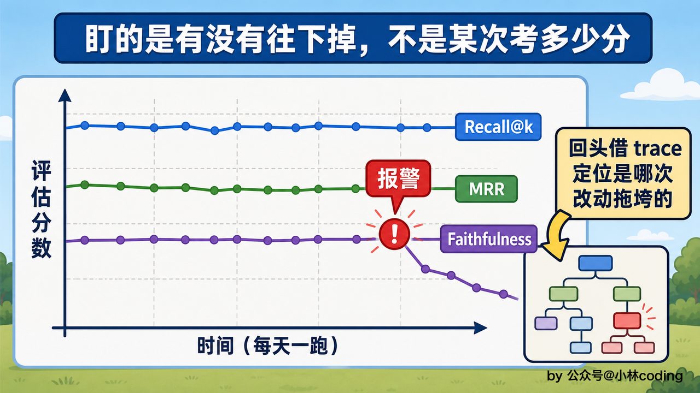

## token 这笔账，按意图算：Cost Control

老板第二个问题，钱花哪了，可观测性已经能回答了。但光回答一次不够，成本得持续按住，这就轮到「Cost Control」。

trace 树已经把每一步的 token 记下了，缺的只是换个维度汇总。按意图把 token 分堆一算，哪类意图最烧钱立马现形。烧得最凶的是商品咨询、退款退货、售后这几类：商品咨询要把检索回来的一堆资料塞进上下文才能作答，退款退货、售后则是子流程步骤多，订单数据、政策条款都得一样样取回来喂进去，一次请求的 token 比查个物流状态高出一大截；而物流、订单这种简单意图，查一次数据就能收敛作答，又便宜又高频。

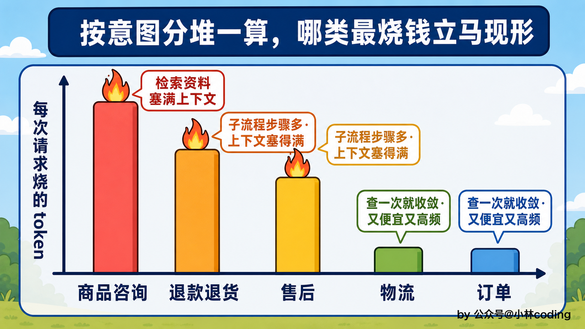

这张按意图算出来的账，正好接上意图识别那一章「先求准再求省」的思路。那一章说的是意图识别用什么模型：项目初期直接上大模型，把准确率做扎实，等系统跑稳了，再在不掉准确率的前提下换成更便宜的。这一章把同一个道理往前挪一步，落到主力 Agent 按意图配模型上，可换哪些意图、能省多少，光凭道理没办法确定，当时没有数据支撑，只能拍脑袋。

现在有了按意图统计的 token 账，该换哪些心里就有数了。物流、订单这类高频又简单的意图，主力 Agent 基本就是调个接口把数据取回来念一遍，换成小模型、甚至干脆不走模型直接返回接口结果，省下的量最大，边界又清晰、不容易换出错。

商品咨询、退款退货、售后这几类就不能这么省。商品咨询要靠模型把检索回来的资料融成一句靠谱回答，退款退货、售后是拿订单对着政策条款判能不能退、在不在保，答错了要么误导用户、要么惹出真金白银的纠纷，这几类都得大模型，稳住准确率比省那点钱重要。真要在它们身上抠成本，可以在大模型里挑个更便宜的试试，现在很多大模型也不贵了。

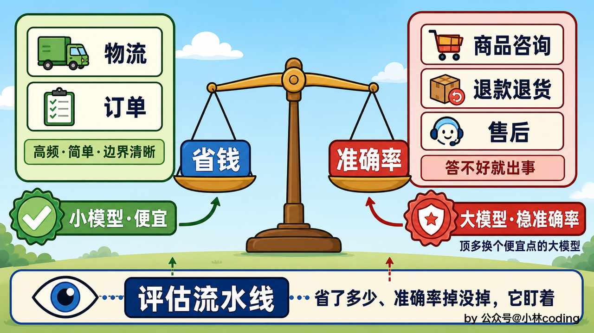

## 答不上来的问题不能就这么散了：数据飞轮

前半章把黑盒照亮了，你能看清系统在干嘛、花了多少钱。可看得再清楚，系统还是那个系统，知识库缺的那块永远缺。智能客服答不上来一个问题，兜底一句转人工，这条问题就散了；下次同样的问题再来，还是答不上来。想让它越用越准，得把这些答不上来的问题记录下来，再去审阅下需不需要补回知识库。这个从用户交互里收集问题、处理后反哺系统的闭环，就是数据飞轮。

先认清一件事，知识库一开始就不可能完备。RAG 基础那一章说过，人工整理和历史对话挖掘两条知识来源缺一不可，单靠哪一条都补不齐全部覆盖面。何况用户的问法千奇百怪，总有覆盖不到的角落，允许它一开始缺，靠飞轮在跑的过程里一点点补齐。飞轮转起来，答不上来的问题被记录、沉淀、补进库，下次能答了，知识库越转越全，智能客服也跟着越答越准。

## 飞轮从哪里进：证据置信度、useful 和用户反馈

问题靠什么进飞轮？飞轮要接住的，是那些暴露出知识缺口、证据不足、用户没被解决的问题。落到这套系统里，有三个入口。

头一个入口是「证据置信度」。知识类问题走 RAG 检索后，系统会拿检索和精排结果算一个 `evidence_confidence`，量化的是「这批证据到底符不符合用户问题」。这个分数从检索链路里来，比如精排后第一条的相关性分、命中的有效证据数量、第一名和第二名的差距、有没有命中关键条款。想做得更轻，直接看召回的 score，这个分一般就是向量那路的余弦相似度，取值大致落在 0 到 1 之间，低于 0.5 就把问题推进飞轮；我们这套里有 BM25、向量、RRF 和 reranker 好几路分数，尺度不一样，阈值不能拍脑袋照搬，得拿评估集校准。这里先记住原则：证据置信度低，说明知识库可能缺这一块，别硬答，把问题推进飞轮。

第二个入口在 RAG 进阶那一章有了。那一章讲生成阶段那道 `useful` 判断：检索回知识后，先让模型判一下这些资料够不够回答用户，不够就把 `useful` 标成 false，拒答加兜底，那条记录直接落进问题池，也就是这一章说的「低置信度问题池」。

`evidence_confidence` 看的是检索证据的强弱，`useful` 看的是这些证据能不能支撑最终回答，两者不重复，一个偏检索，一个偏生成。

第三个入口来自用户和人工反馈。前两道闸挡的是系统自己知道没把握的情况，可还有一类更隐蔽：系统觉得能答，用户看完还是点了「没解决」、继续追问同一个问题，或者人工客服接手后改写了答案。这说明最终回答没有真正解决问题，也该进飞轮。

这三个入口最后都汇进同一个低置信度问题池：证据弱、资料撑不起、用户反馈没解决。进池不等于入库，只是说明这条问题值得被运营看见，等着往下处理。

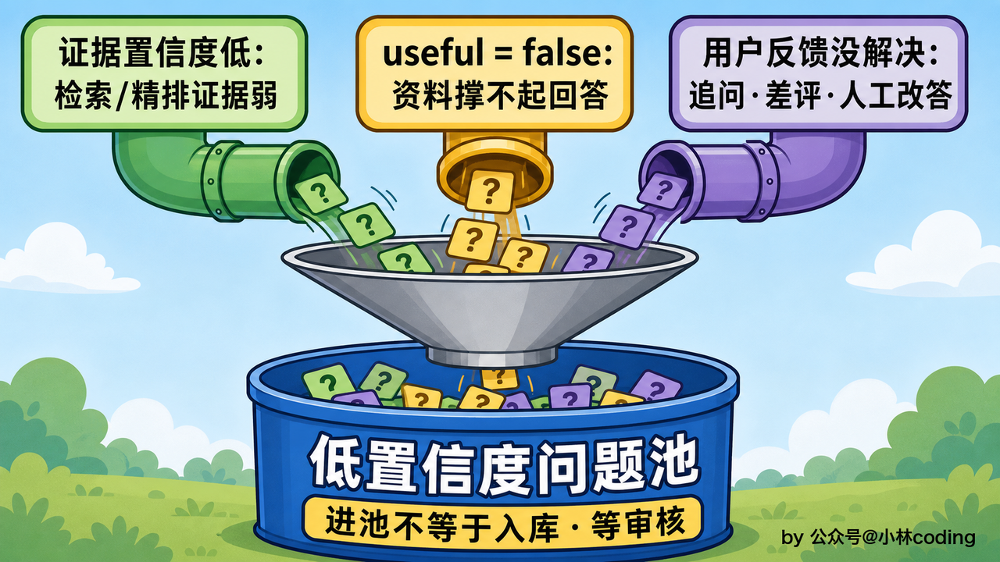

## 从口语原话到能入库的知识：问题标准化与查重

问题进了池子，不能原样往知识库塞。用户的原话是这样的：「我上周买的那双鞋跑了两次就开胶了这也太坑了吧能不能给我退了啊」，带情绪、带口语、还夹着一堆无关碎片。这种话直接入库当 FAQ，既难检索也没法复用。

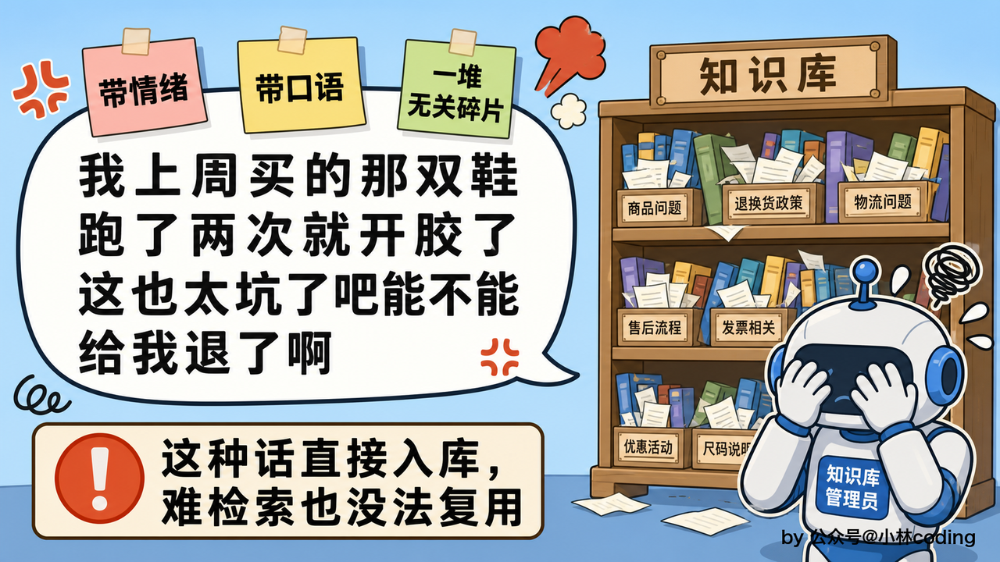

所以飞轮第一步是「问题标准化」，也有人管这叫「Question Canonicalization」。让模型把原话去噪，剥掉情绪和口语，只留核心诉求，改写成一句 FAQ 式的标准问题，顺带生成一个示例答案备查。上面那句原话，标准化之后就成了「商品出现质量问题（如开胶）能否退货」，干净、稳定、拿去检索也对得上库里的表达。

标准化紧跟着一步查重。为什么要查重？同一个知识缺口，一百个用户能有一百种问法，全都当成新问题塞进待审队列，人工审到崩溃，审的还全是同一件事。做法是标准化的时候顺手做掉：给模型喂一批候选问题，也就是之前标准化过、在待审队列里排着的那些标准问题，让它判断当前这条跟哪个候选是同一个意图。判定是同一个，就返回那条候选的 `matched_question_id`，把这次出现合并过去、累加一次出现次数；判定没有同类，`matched_question_id` 就返回 null，这条作为新问题入池。

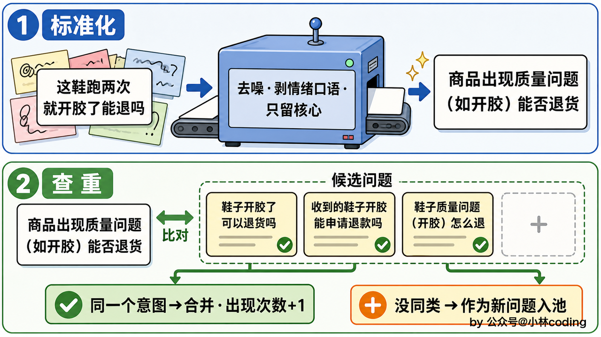

标准化和查重可以让模型一次输出，结果大致长这样：

这里有个细节，查重不只是去重省事，累加出来的出现次数还是个宝贵信号：一个缺口被越多用户反复问到，说明它越该优先补。飞轮从来不缺问题，缺的是先补哪个的依据，靠频次就能把这些缺口排出先后。

## 进库前的三道闸：不是所有问题都值得沉淀

标准化查重做完，问题进了待审队列，接下来就轮到人工审核。机器判定的低置信度里混着不少不该入库的东西，光凭分数拦不干净，这一步就是靠人把它们筛掉。

审核时注意几个点。第一是垃圾过滤：无意义的乱输入、测试性的胡打、不当言论，直接丢掉，这些压根不是业务问题。第二看时效：强时效的问题会自然过期，比如「双十一满减活动今晚几点结束」，今天补进库、过两天活动结束就成了误导用户的过期知识，这类不沉淀，直接让模型说不知道，让用户询问人工客服。最后评频次：低频的、一次性的冷门问题，就算是正经业务问题也不值得占知识库的位置、耗人工的精力去补。

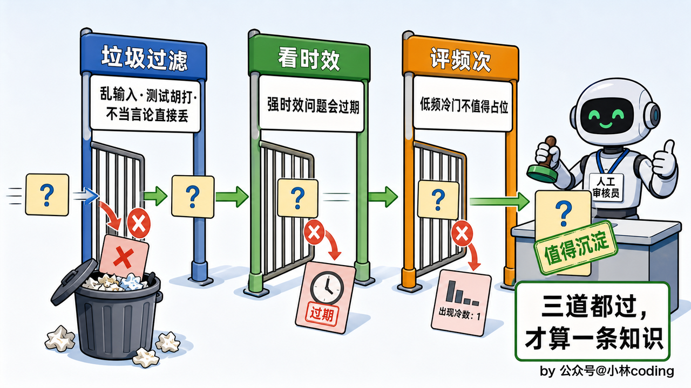

过了审核的问题，补上核准的答案，走 RAG 基础那一章讲过的那套落库流程，向量化后写进知识库。到这闭环就合上了：下次再有语义相近的问题进来，检索直接命中这条新补的知识，智能客服就能答了。一条原本答不上来的问题，经飞轮转一圈，变成了库里的一条常驻知识，飞轮就是这么把智能客服一点点喂准的。

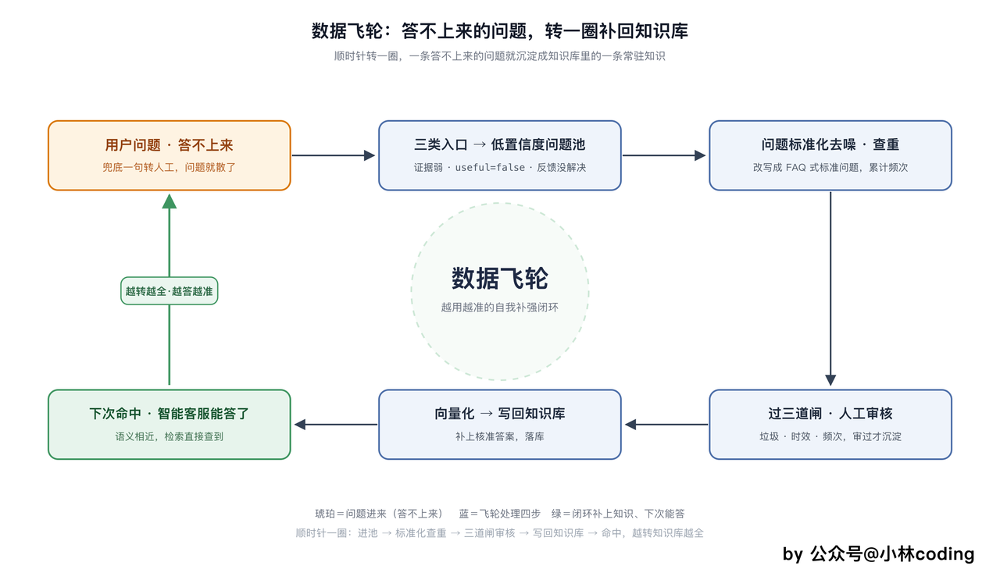

## 攒多了得分堆：按主题归类，交给微调分类器

飞轮运行了一段时间，低置信度问题池里攒下几千上万条问题。这时候会冒出一个更宏观的问题：用户到底最常卡在哪一类上，是物流、退换货、尺码、还是开发票？搞清楚这个，才好定先补哪块知识的优先级，把人工审核的力气用在刀刃上。

要回答它，得把这几万条问题按固定的主题类目批量归个类，看哪个类目下堆的问题最多、最缺知识。量小的时候，让 LLM 一条条读、一条条打主题标签也能凑合。可几万条一条条调大模型，又贵又慢，主流问法还好，碰上方言、错别字、一句话夹好几个诉求，大模型逐条打标也容易偏离。这种海量、类目固定、要便宜要快的归类任务，用一个微调过的小分类器批量跑，比 LLM 逐条打标又快又省。

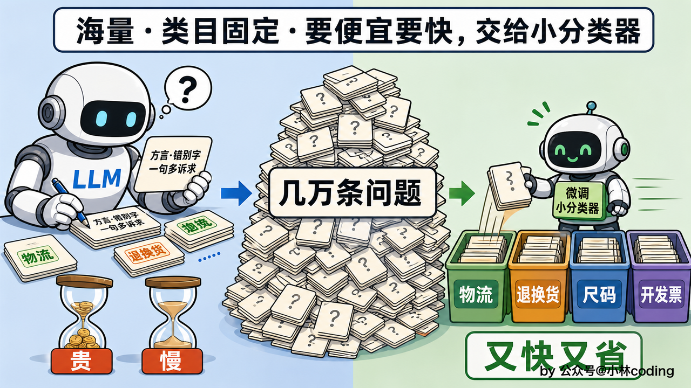

这个微调的小分类器怎么训出来，正是下一章的正题，本章点到为止，你只要记住飞轮攒下的问题要分堆归类，正是它派得上用场的一环。

## 全流程图 · 本章两块拼图在哪

到这一章，整套系统主链路的模块就全齐了。把本章这两样放回全局看：主链路末端那个「记录日志 · 可观测」就是前半装的 Langfuse；右下那条大箭头「低置信度问题 · 标准化查重 · 人工审核后写回知识库」，就是后半装的数据飞轮。下面这张全流程图，一眼就能看清它俩嵌在整条链路的什么位置。

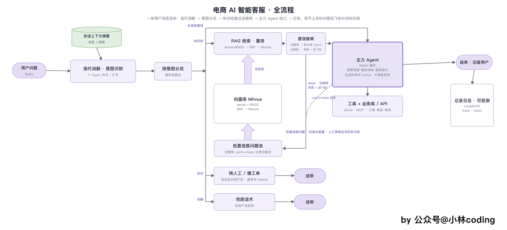

## 本章小结

这一章给系统办了两件事。

前半装可观测性，把线上那个黑盒照亮：先看清老板追问的离谱回答和 token 超支，答案都埋在没留痕的过程信息里；于是把每次请求还原成一棵记着 prompt、工具调用、检索结果、token 的调用树，靠 Langfuse 设几个环境变量、编译时挂一次回调就零侵入接上，链路数据全留在自家墙内不外发，不介意上云的也可换 LangChain 同源的 LangSmith；再拿 RAG 进阶那章的评估集做定期回归、盯趋势线防悄悄退化，按意图统计 token、接上意图识别那章的降本路径把成本按住。

后半装数据飞轮，把答不上来的问题接住：证据置信度低、生成阶段 useful=false、用户反馈没解决这三类入口汇进低置信度问题池，问题标准化去噪成 FAQ 式标准问题、靠 `matched_question_id` 查重合并累计频次，过垃圾、时效、频次三道闸的人工审核，向量化写回知识库，下次就能答，飞轮越转智能客服越准。

飞轮转到最后那一环，我们把一件还没解决的事留给了下一章：攒下的几千上万条低置信度问题，要按主题批量分堆，类目固定、量又大、还要便宜要快，提示词逐条打标压不住这个规模。这种任务，正是该请微调出场的时候了。下一章，模型微调，我们就来把那个批量归类的小分类器亲手训出来。

