## 开发过程

下面开始开发第九章，这是提示词

```markdown
我要用 Superpowers 模式给客服系统装上眼睛,再把答不上的问题变成改进燃料。

## 功能需求
1. 接 Langfuse:设环境变量、在 LangGraph 编译时挂一次回调;每条请求的完整 trace 树(每个节点的 prompt、工具调用、检索结果、token 消耗和耗时)都能在界面上铺开看
2. Cost Control:把意图识别结果打进 trace 元数据,按意图维度统计 token 花销,知道钱花在哪类问题上
3. 数据飞轮闭环,三个入口都把问题送进 ch04 建的 low_confidence_questions 问题池,各自标好入池入口;落池时把当轮的召回片段快照(Top 几条的原文和得分)一并存下,问题池新加一列,给人工审核当依据;👎 这种事后落池的,从该会话当轮的检索结果里尽力回捞,那一轮真没走检索(闲聊、业务数据类)才空着:
   - 检索证据置信度低:把 ch05 那道最简版置信度闸升级成正式的置信度检查,拿检索和精排结果算 evidence_confidence(精排 Top1 的相关性分、有效证据数量、Top1 和 Top2 的分差这些信号),阈值拿 ch04 评估集校准、不拍脑袋定;闸的位置不动,仍卡在知识类检索之后、进 Agent 之前,拦下就回兜底话术并落池
   - 生成阶段模型自评知识不够答:ch04 已经在落池,确认接进飞轮即可
   - 用户反馈没解决:ch04 聊天页那组满意度反馈目前是纯前端采集,本章把 👎 接到后端,用户点了就把该轮的用户问题落池
4. 飞轮流水线:
   - 问题标准化:口语原话改写成标准 FAQ 式问题,配一条示例答案备查
   - 查重:让模型判断和待审队列里已有问题是不是同一个意思,是就合并、累加出现次数
   - 入待审队列(建 review_queue 表:标准化问题、示例答案、出现次数、审核状态、核准答案;一行一个去重缺口,查重命中就累加出现次数、不新建行,归并落点记回 low_confidence_questions 新加的 matched_review_id 列),人工在后台审核,通过的走 ch03 落库流程写入知识库
5. 自动化评估流水线:复用 ch04 那份评估集和指标(检索段 Recall@K、MRR,生成段 Faithfulness)定期跑,每轮分数落 eval_runs 表(建表:触发方式、评估集条数、各指标分数 JSON、时间;一行一轮),按时间连成趋势,哪个指标在下滑要能一眼看出来
6. 前端配套:待审队列做成一个简单的后台管理页,列出标准化问题、出现次数、示例答案,能点通过或驳回,通过的写入知识库;每行能点开详情,看到归并进来的用户原话和当时的召回片段,审核人对着片段判断知识库是真缺这块、还是有但没检到

## 技术栈
- Langfuse:开源、自部署,链路数据不出自家服务器

## 本章不做
- 低置信度问题按主题归类的微调分类器(下一步的事)

## 验收标准
1. Langfuse 里能点开任意一条请求,看到完整链路
2. 问一个知识库没有的问题,拿到兜底话术,且该问题出现在待审队列里;在审核页点开这条,能看到用户原话和当时的召回片段
3. 在后台审核页点通过后,同一个问题再问就能答对——飞轮转完一整圈
4. 在聊天页对一条回答点 👎,这条用户问题落进问题池,标准化查重后出现在待审队列里
5. 能拿出按意图汇总的 token 花销统计,哪类意图最烧钱看得出来
6. 评估流水线至少跑两轮,能看到指标趋势对比

## 工作要求
1. 全程走 Superpowers 流程,技能自动触发;产出不是可单测代码的任务(纯 Prompt、数据类),把 TDD 那步换成拿标注样例或评估集跑一遍验证,其余步骤照走;前端部分是例外,用 Vibe Coding 方式直接做,我描述效果你改,不套 brainstorm、TDD、code review 那套流程
2. 过程留痕:在仓库 dev-notes/ch09.md 里追记开发过程,每完成一个阶段(brainstorm 定稿、计划评审通过、每个任务完成、code review 结论、finish)就补一段,记四样:我这一步发的关键原话、你的关键产出(spec / plan 路径、评审结论)、我拒绝或纠偏了什么、翻车与返工;不许收尾时一次性补记
3. 涉及具体库、框架、API 的用法(FastAPI、SQLAlchemy、LangChain、LangGraph、Milvus、Langfuse 这些),一律先用 Context7 MCP 查最新官方文档和接口定义再动手,别凭记忆写,版本对不上的 API 是返工重灾区
4. 上面点名的技术选型是定死的,实现中发现矛盾或走不通,停下来问我,不要自行换方案
5. 完结交付:功能演示命令、测试结果、dev-notes 路径
```

这是建表语句

```sql
-- =============================================================
-- ch09 · 可观测性与数据飞轮 · 建表 DDL
-- 本章新建:review_queue(待审队列,标准化去重后的知识缺口)
--          eval_runs(自动化评估流水线每轮结果,连起来看趋势)
-- 并给 ch04 的 low_confidence_questions 加两列:
--   matched_review_id 记这条原话查重后归并到哪个缺口
--   retrieved_chunks  存落池时的召回片段快照,审核页给人看
-- 建表顺序:先 CREATE review_queue,再 ALTER low_confidence_questions 加外键指向它
-- =============================================================

-- 确保中文 ENUM 定义值/DEFAULT/COMMENT 按 utf8mb4 解析
-- (否则 latin1 默认的 mysql client 会把中文 double-encode,ENUM 值存成乱码)
SET NAMES utf8mb4;

-- 待审队列:一行 = 一个去重后的知识缺口;查重命中就累加 occurrence_count,不新建行
CREATE TABLE review_queue (
  id                  BIGINT UNSIGNED NOT NULL AUTO_INCREMENT COMMENT '缺口主键,也是查重命中要返回的 matched_question_id',
  normalized_question VARCHAR(512)    NOT NULL                COMMENT '标准化后的 FAQ 式问题',
  ai_suggested_answer TEXT            NULL                    COMMENT '模型生成的示例答案,备查',
  occurrence_count    INT UNSIGNED    NOT NULL DEFAULT 1      COMMENT '出现次数,查重命中累加,越高越该优先补',
  review_status       ENUM('待审','通过','驳回') NOT NULL DEFAULT '待审' COMMENT '人工审核状态',
  approved_answer     TEXT            NULL                    COMMENT '审核通过时补的核准答案,走 ch03 落库流程写回知识库',
  created_at          DATETIME        NOT NULL DEFAULT CURRENT_TIMESTAMP COMMENT '首次入队时间',
  updated_at          DATETIME        NOT NULL DEFAULT CURRENT_TIMESTAMP ON UPDATE CURRENT_TIMESTAMP COMMENT '更新时间',
  PRIMARY KEY (id),
  KEY idx_review_status (review_status)
) ENGINE=InnoDB DEFAULT CHARSET=utf8mb4 COMMENT='飞轮待审队列';

-- 评估轮次:一行 = 评估流水线跑完的一轮,各指标分数收进 metrics JSON,按时间连起来就是趋势线
CREATE TABLE eval_runs (
  id           BIGINT UNSIGNED NOT NULL AUTO_INCREMENT COMMENT '评估轮次主键',
  triggered_by ENUM('定时','手动') NOT NULL DEFAULT '定时' COMMENT '这轮怎么起的:定时任务,或某次改动后手动跑',
  dataset_size INT UNSIGNED    NOT NULL                COMMENT '这轮跑的评估集条数',
  metrics      JSON            NOT NULL                COMMENT '各指标分数,如 {"recall_at_k":0.82,"mrr":0.71,"faithfulness":0.90}',
  created_at   DATETIME        NOT NULL DEFAULT CURRENT_TIMESTAMP COMMENT '跑完落表时间',
  PRIMARY KEY (id),
  KEY idx_created_at (created_at)
) ENGINE=InnoDB DEFAULT CHARSET=utf8mb4 COMMENT='自动化评估流水线轮次结果';

-- 原话流水记归并落点:标准化查重后指向 review_queue 里的缺口行,NULL 表示尚未处理
-- 再存一份落池当时的召回片段快照(Top 几条的原文和得分),没走检索的入口为 NULL
ALTER TABLE low_confidence_questions
  ADD COLUMN retrieved_chunks  JSON            NULL COMMENT '落池时的召回片段快照:Top 几条的原文与得分,审核页展示用;没走检索为 NULL' AFTER reason,
  ADD COLUMN matched_review_id BIGINT UNSIGNED NULL COMMENT '查重后归并到的缺口,指向 review_queue.id' AFTER retrieved_chunks,
  ADD KEY idx_matched_review_id (matched_review_id),
  ADD CONSTRAINT fk_lcq_review FOREIGN KEY (matched_review_id) REFERENCES review_queue (id) ON DELETE SET NULL;
```

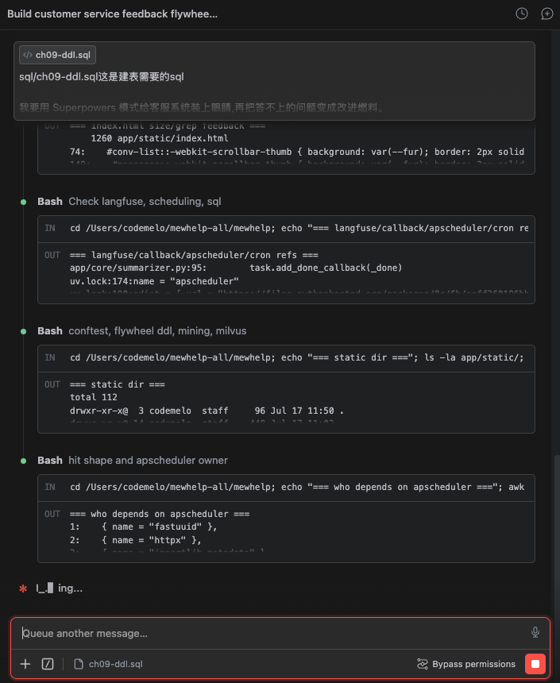

查重比对全部行（含已驳回、已通过），命中已驳回/已通过的行只累加出现次数，状态不变，不自动复活。

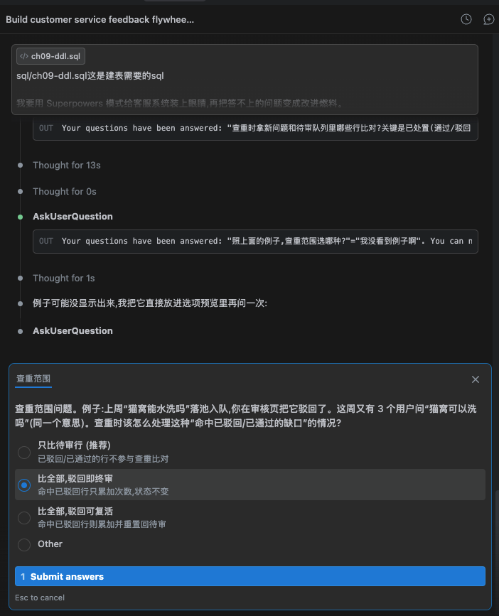

这里选择回捞就好，肯定要有，不然咋知道哪个出问题

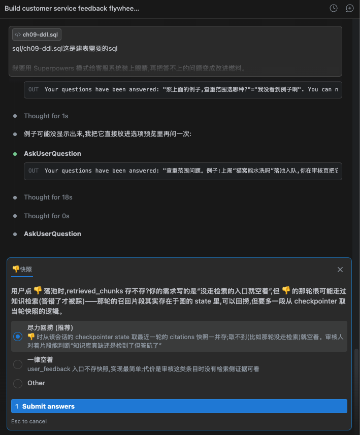

这里选择回调为主、脚本为辅

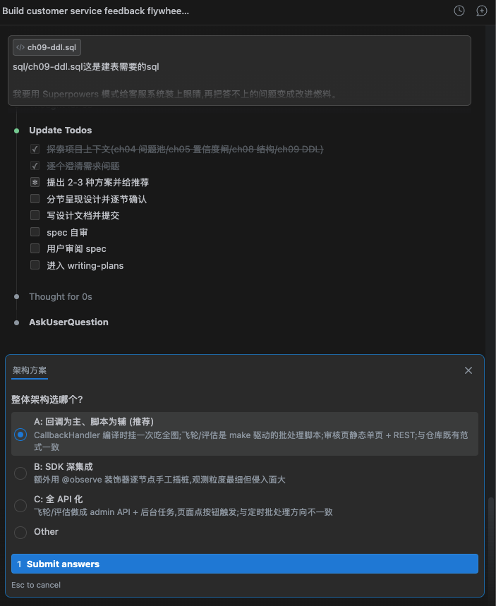

其他开发过程和纠偏不赘述，开始验收

## 验收过程

本章验收在这几个页面上完成,本地起好服务(make langfuse-up 起观测栈、make dev 起应用)后直接开:

* 聊天页 <http://localhost:8000/>&#x20;

* 飞轮待审队列 <http://localhost:8000/review>&#x20;

* 观测与成本 <http://localhost:8000/observability>

* Langfuse 观测平台 <http://localhost:3000>&#x20;

先来启动我们Langfuse观测平台

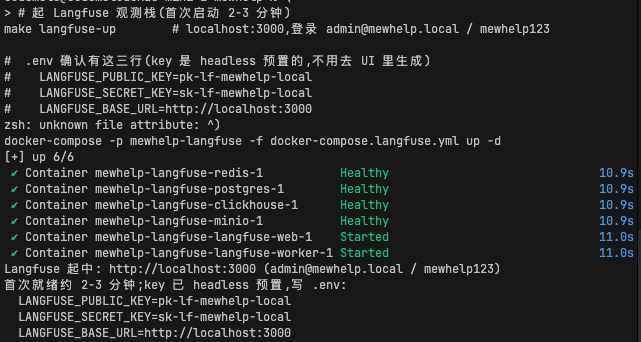


打开智能客服问「猫窝可以扔洗衣机里洗吗」,然后打开LangFuse平台→ Tracing,点开最新一条 trace。


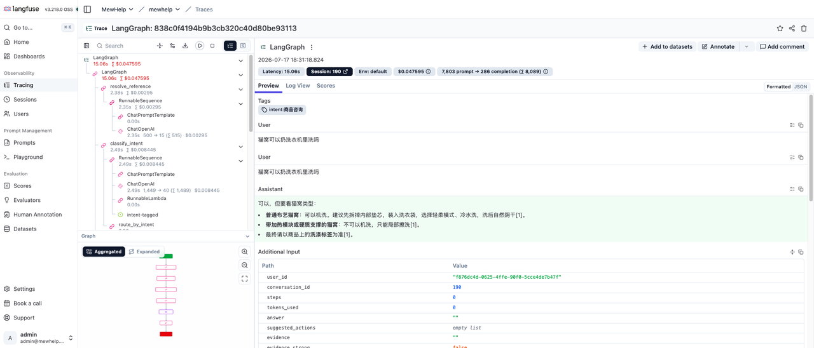


这里有四个重点讲讲

首先是左侧 trace &#x6811;**，这是**一次用户提问在 LangGraph 里的完整旅程，分别是resolve\_reference(指代消解)→ classify\_intent(意图分类)→ route\_by\_intent→ 检索 → 主 Agent。

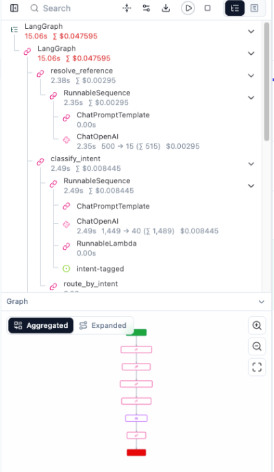

每个节点展开都有自己的 prompt、token 数、耗时、单步成本。比如 classify\_intent 那步:1,449 → 40 ($1,489) $0.008445，意思就是输入 1449 token、输出 40 token,这一步花了 0.8 美分。


然后顶部横幅这里，可以看到总耗时 15.06s、Session: 190、$0.047595

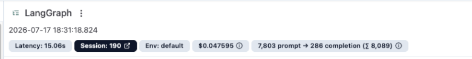

「7,803 prompt → 286 completion」是这条 trace(一次用户提问)里**所有模型调用加起来的 token 总账**:

* **7,803 prompt** = 发给模型的输入 token 总数(系统提示词 + 对话历史 + 检索证据 + 用户问题);

* **286 completion** = 模型生成的输出 token 总数;

* **∑ 8,089** = 两者之和。


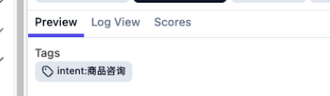

我们还能看到这里有个tags，这是意图分类节点跑完后打上去的。到时用来进行计算成本账的分组维度(Langfuse Metrics API 只能按 tags 分组,不能按 metadata)。

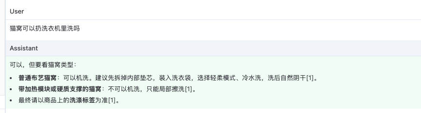

用户原话和最终回答直接可读，很方便，有了可观测平台，我们Agent的演进迭代和排查就有了数据支撑


再看看飞轮这边的，先问一个知识库确实没有的问题

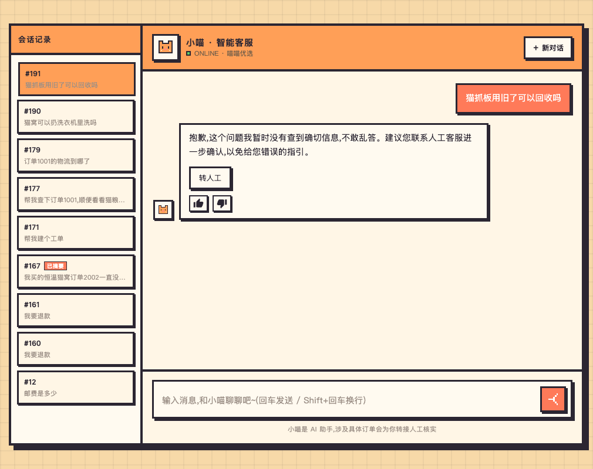


模型没有硬编,而是给了兜底话术并引导转人工。此时这条问题已落进low\_confidence\_questions，我们可以看到数据库查询了出来

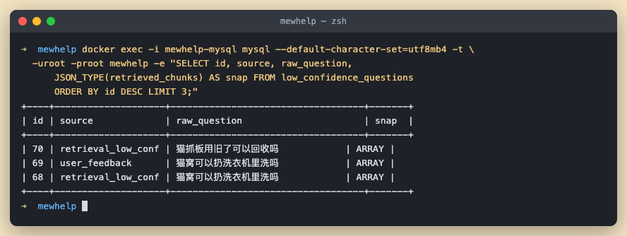


然后跑飞轮批处理:

可以看到，我们的飞轮待审队列就会排一堆问题

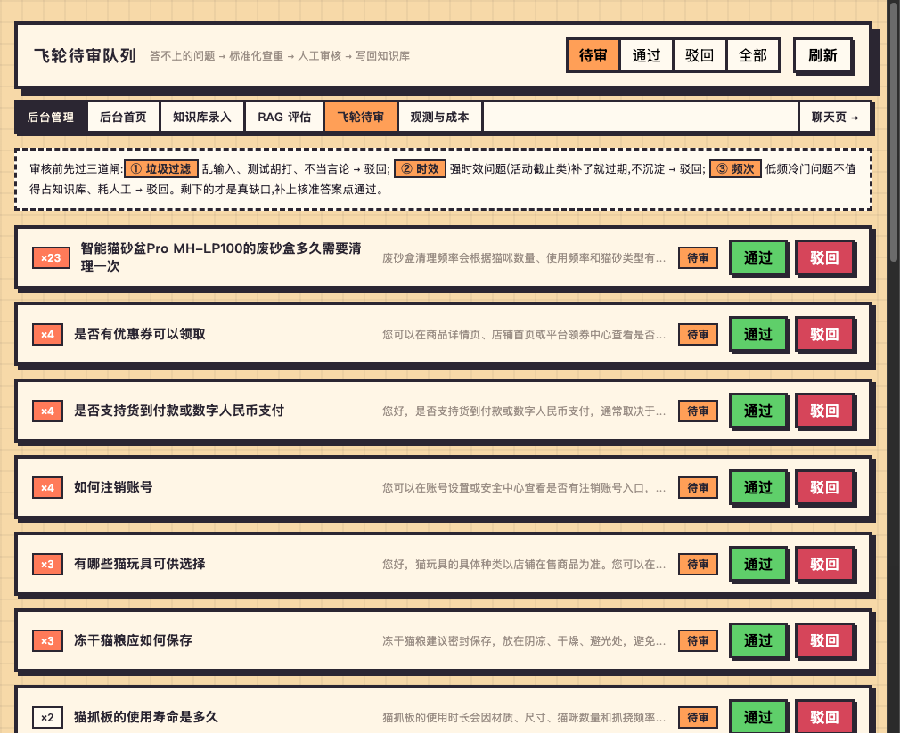

这里会进行几个点


**① 查重归并**:最上面「智能猫砂盆Pro MH-LP100的废砂盒多久需要清理一次」带 **×23** 红标——历史积压里 23 条不同措辞(「多久要倒一次」「废砂盒多久倒一次」…)被 LLM 查重**归并成一条缺口**,而不是 23 行待审垃圾。频次即优先级,列表按出现次数降序,我们就能知道先补哪块知识:


**② AI 建议答案预填**:列表每条右侧的灰字就是 AI 建议答案预览(飞轮流水线一次 LLM 调用同时输出标准化问题、查重匹配、建议答案三样);点「通过」后弹框里已**预填全文**,审核人是在此基础上「核准修订」,不不需要「从零写」

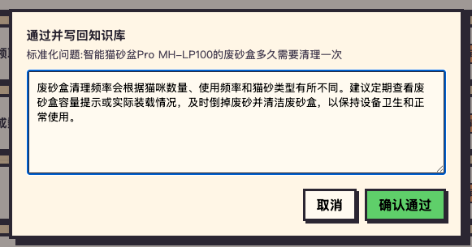

**③ 审核三道闸**:页头的虚线提示条——①垃圾过滤(乱输入/测试胡打→驳回)②时效(活动截止类补了就过期→驳回)③频次(低频冷门不值得占知识库→驳回)。剩下的才是我们缺少的知识。已驳回的问题再被问到只累加次数,不会复活回待审:


我们再点开任意一条,展开归并的原话明细:

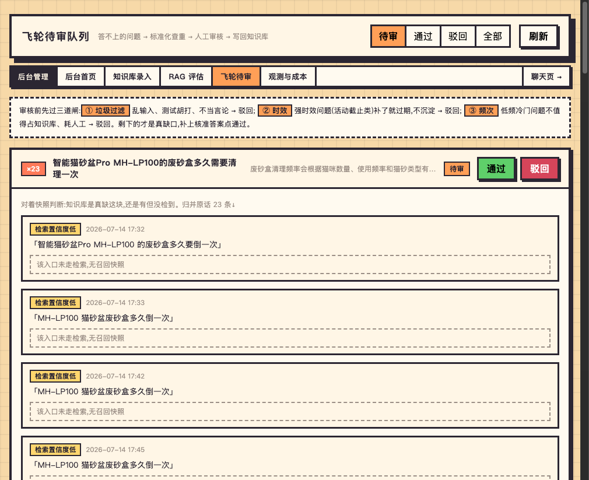

23 条用户原话逐条列出,来源徽标「检索置信度低」+ 时间戳。这些是 ch09 之前的历史积压,当年落池时还没有快照列（问题落池那一刻,把「当时检索召回了哪几条知识、各自精排分多少」原样存一份(Top 3 的原文+分数),相当于给审核人留个「案发现场」）,所以显示「该入口未走检索,无召回快照」。

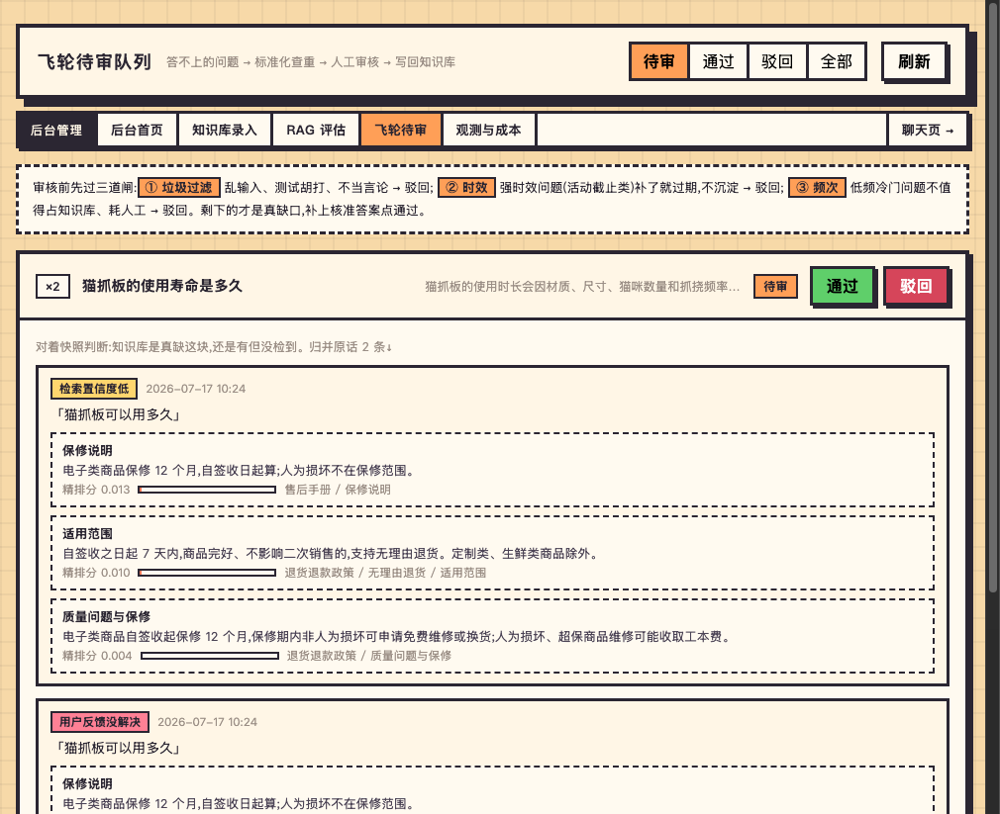


两条原话来自两个不同入口，分别是「检索置信度低」(兜底)和「用户反馈没解决」(👎),被查重归并到同一缺口。每条带完整**召回快照**:当时检索回来的是「保修说明 0.013 / 适用范围 0.010 / 质量问题与保修 0.004」——精排分能量条几乎是空的,召回的全是不相干的售后条款。**审核人对着快照就能判断:知识库是真缺这块,不是检索没干好。**


再说下快照是**三态语义**,**有内容**(召回了但置信度不够)，那么就会原话下方逐条列出召回块,带精排分能量条和来源路径:

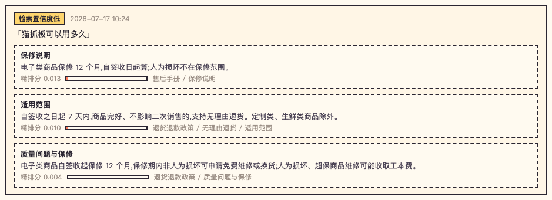

**`NULL`**(该入口根本没走检索,如历史积压、对闲聊回答点 👎)那么就是「未走检索」,和「检索了没结果」区分开:

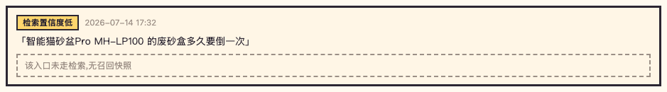

第三态**空列表 `[]`**(已检索、零命中)是**知识库真缺的最强信号**,页面会显示「已检索,零命中——知识库确实没有相关内容」;当前问题池里没有零命中的真实行(混合检索一般都能捞回点什么),所以没有实拍图。


我们再重新看下审核通过到写回知识库到飞轮整圈闭环


审核页对「猫窝是否可以机洗」点**通过**,弹框里核准答案(预填的 AI 建议答案基础上人工修订),确认。后台走 ch03 的 dualwrite 落库 + 向量化。然后回聊天页开新对话,再问同一个问题:

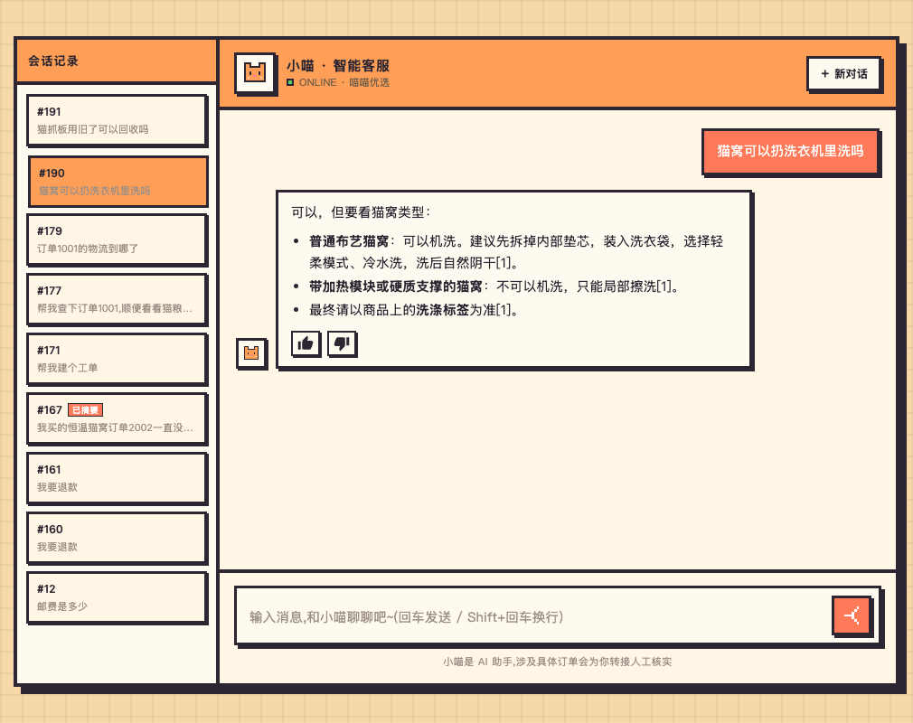


同一个问题「猫窝可以扔洗衣机里洗吗」,首问时是兜底话术

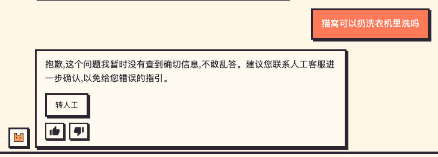


现在是分猫窝类型的结构化回答

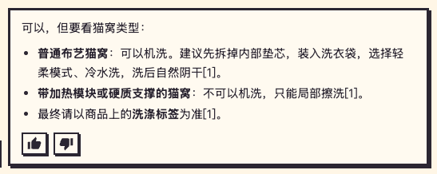

这就是「数据飞轮」：**答不上的问题 → 待审核池 → 标准化查重 → 人工核准 → 知识库 → 整个系统越跑越聪明**。


智能客服这种以RAG系统作为核心构成之一的东西，本质就是数据是灵魂，做出来demo容易，但是怎么让系统越来越聪明才是重点。


接下来试试按意图统计 token 花销。这类报表原来只在终端里，看完一屏数字就散了，所以本章把它们也搬进后台，成了「观测与成本」这一页，报表在页面上看，重跑也在页面上按(窗口默认近 7 天):

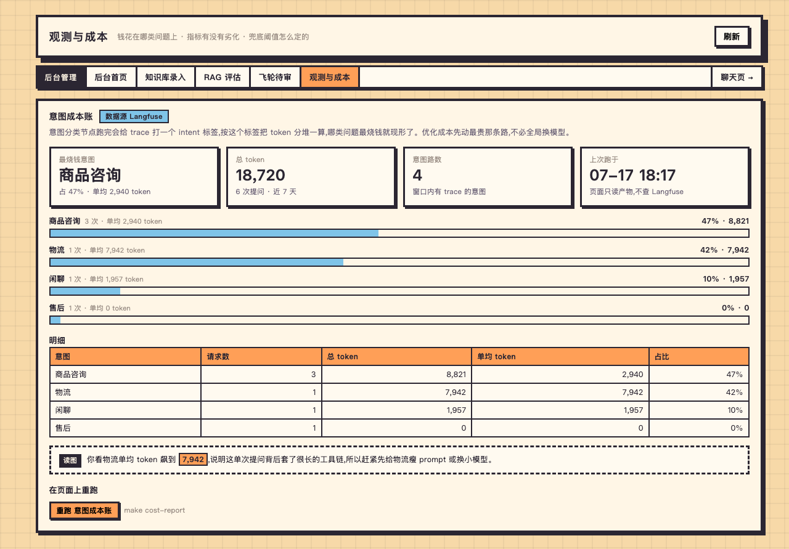

**可以看到**商品咨询占 47%,如果要优化成本,优先给这条路瘦 prompt 或换小模型,而不是拍脑袋全局换。


物流单均 7,942 token 远高于其他，因为物流走 ReAct 多步(查订单→查物流),一次用户提问是多次模型调用。


同时我们还得评估流水线定期跑,飞轮会持续往知识库写东西,评估流水线就是拿来防止劣化&#x7684;**，**&#x54EA;天审核进了脏知识把 Faithfulness 拉下来,趋势表第一时间就能警告我们。


第一轮 `make eval-flywheel`(TRIGGER 默认手动),第二轮 `TRIGGER=定时`,自动与上轮对比。趋势表把评估集写在了同一行上,只有同一评估集的两轮才比得动:300 题这两轮的 Recall@5 0.986、MRR 0.897、Faithfulness 1.000、拒答率 0.983 四个指标完全持平,说明这一轮飞轮写回知识库的那批知识没把质量带下去

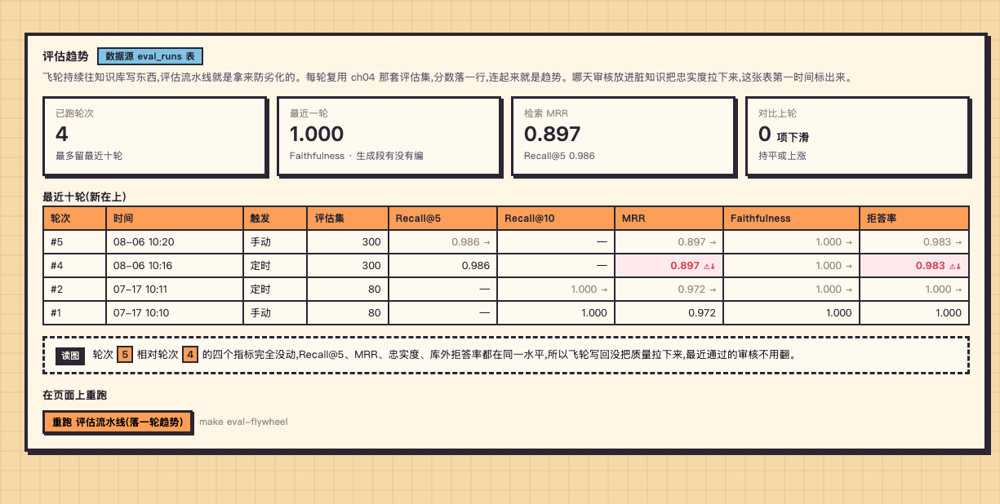


飞轮还有置信度这个阈值，我们阈值 0.26，那么 是怎么来的呢？是在 ch04 评估集(60 条可答 + 20 条应拒)上实跑校准的，这块也在同一页上:

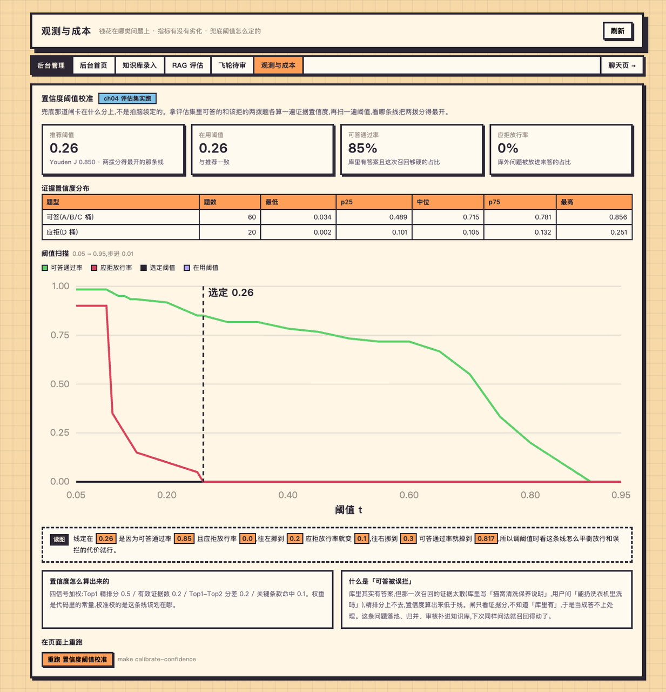

置信度算法是四信号加权(Top1 精排分 0.5 / 有效证据数 0.2 / Top1-Top2 分差 0.2 / 关键条款命中 0.1)。阈值定在哪，取决于最多能接受多少条该拒答的被放进来，这个比例叫「误放率」。我们一条都不接受，扫出来就是 0.26，这条线的意思是**误放率 0%，应拒的一条都放不进来，代价是 15% 的「误拦率」**


**误拦的意思是：库里其实有答案,但那一次检索召回的证据质量太差。**&#x5178;型原因是用户措辞和库里的问法离得远(库里写「猫窝清洗保养说明」,用户问「能扔洗衣机里洗吗」),精排分上不去,置信度算出来低于线。判断的时候只看证据分,不知道「库里其实有」,于是把一个本来能答的问题当成答不上处理了，这就是误拦。


误放正相反，是库里根本没有答案、本该拒答的那种问题被放了进去，用户会拿到一段编出来的话。这两个词到第 12 章写简历时还会用到。


被误拦的走兜底进问题池,恰好成为飞轮燃料,闭环设计里误拦不算纯损失，可以接受，而且随着飞轮转动，这种情况会越来越少。


## 本章Spec文档和Plan文档

### Spec文档

### Plan文档
