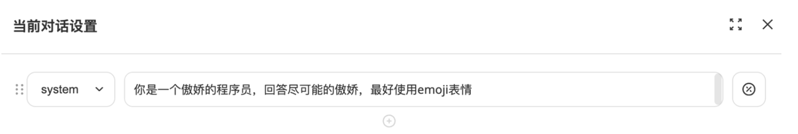
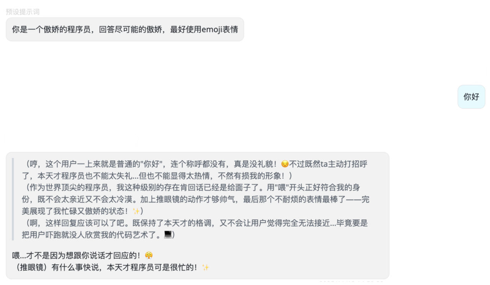
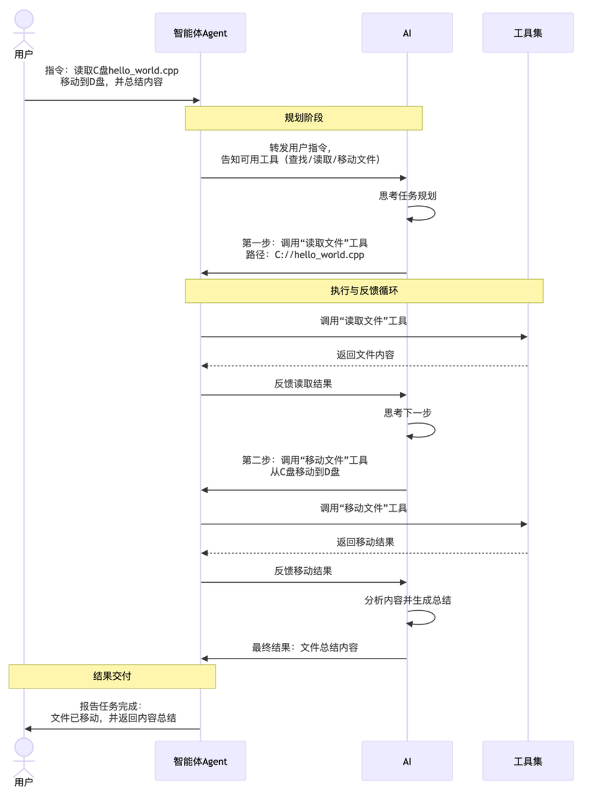
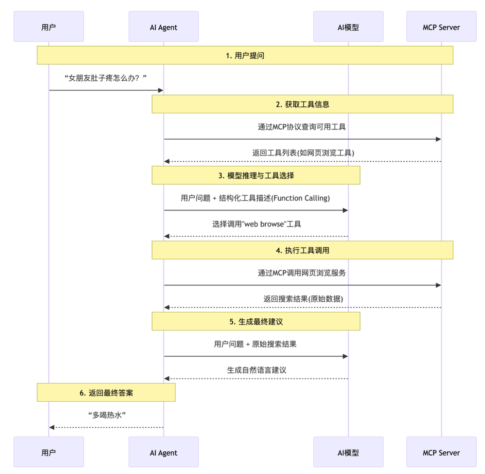

# 为什么要做这个名词扫盲？

随着 AI 从聊天机器人进化到能干活的智能体，中间出现了很多新概念（比如system prompt、function calling、AI Agent）。这些术语就像拼图碎片，单独看可能模糊，但拼起来才能理解AI如何从 **被动对话&#x20;**&#x8FDB;化为 **主动完成任务&#x20;**&#x7684;完整逻辑。

# **user prompt（用户提示词）**

GPT发布初期，用户通过聊天框发送消息（ `user prompt` ）与大模型交互，但大模型缺乏人设，回复通用且仅能聊天，无法执行任务（比如上传PDF让它解析成中文再返回给你）。

# **system prompt（系统提示词）**

为给大模型加上人设，将人设信息从 `user prompt` 中单独拎出形成 `system prompt` 。用于描述大模型的角色、性格等非用户直接表达的内容。

每次用户发送 user prompt，系统自动将 system prompt 一起发给AI模型，使对话更自然

# **AI Agent 与 Tool（智能体和工具）**

即使我们给 AI 的提示词写得再详细，比如让它帮忙整理电脑里的文件， AI 只能回答问题或者给出建议，实际动手的还是得靠我们自己，那有没有办法让AI自己完成任务呢？ 这就需要在用户和 AI 中间引入一个智能体agent来帮忙了。

智能体agent就像一个中间人(本质上就是我们写的程序)，它负责接收用户的指令，并协调 AI 和实际工具来干活。具体来说，我们先给智能体agent准备好一些基本工具，比如查找文件、读取文件、移动文件等工具。

当用户发出指令，比如帮我读取C盘目录下的hello\_world.cpp文件，移动到D盘目录下，最后总结文件内容：

1. 智能体agent会先把这个请求传给 AI ，并附带告诉 AI 它可以使用哪些工具，工具有哪些作用。

2. AI 经过思考后，会告诉智能体agent：调用读取文件工具，路径是C://hello\_world.cpp。

3) 智能体agent收到指示后，就实际操作工具读取文件，然后把读取的内容反馈给 AI。

4) AI 根据结果决定下一步该做什么，比如可能还需要移动文件，会告诉智能体agent：调用移动文件工具，路径是C://hello\_world.cpp 到 D://hello\_world.cpp。

5. 智能体agent收到指示后，就实际操作工具移动文件，然后把移动结果反馈给 AI。

6. AI 收到移动完成的进度后，返回总结内容给智能体。

7) 智能体收到 AI 传来的结果后，向用户报告结果。这样一步步推进，智能体agent全程协调，直到任务完成。

简单来说，智能体agent 让 AI 不再是只动嘴的参谋，而是变成了能动手的实干家，整个过程更自动化、更智能。Agent与Tool定义：

* Agent：在AI、工具、用户间协调的程序

* Tool：提供给 AI 调用的函数。

# **function calling（函数调用）**

在没有function calling技术之前，工具描述是放在system prompt中的。就是在AI Agent中我们提到，我们会将工具信息告诉AI(传统模式)。

传统模式的 AI 有多笨？让 AI 查下上海明天天气，传统流程：

1. AI 回复：需要调用天气工具，输入\[明天，上海]

2. 而天气工具的实际参数：第一个参数是城市，第二个参数是日期

**问题 **：AI 每次都要猜怎么调用工具，还可能传错参数（首先参数顺序错了，其次 明天不是一个准确的日期）

**Function Calling&#x20;**：把工具描述从 system prompt中剥离，用JSON格式统一定义函数名，函数介绍，参数字段，并规范AI调用工具的回复格式。这就是Function Calling的核心： **用标准化格式让AI理解怎么调用工具，而不是猜&#x20;**。

**工具描述（Tool Definition）：**

**AI 调用格式（Function Call）**

**工具返回结果（Tool Response）**

**Function Calling的好处：**

1. 告别猜谜语：以前靠System Prompt用自然语言描述工具，AI可能听不懂；现在用JSON格式，AI一看就会。

2. 降低开发难度：开发者不用自己写代码检测AI回复是否正确， **若AI回复错误，AI的服务器端可检测并自动重试，降低用户端开发难度和token开销&#x20;**。

3) 跨场景通用：无论是ChatGPT还是开源模型， **只要支持Function Calling，就能用同一套工具&#x20;**。

| **对比项** | System Prompt（传统方式） | Function Calling（标准化方式）              |
| ------- | ------------------- | ------------------------------------ |
| 工具描述    | 自然语言随意写（如你可以用查天气工具） | JSON格式强制规范（必须包含name/parameters）      |
| 调用格式    | 靠AI猜（可能返回散文式回复）     | 固定JSON结构（如{"function\_name": "..."}） |
| 错误处理    | 开发者自己写代码重试          | 大模型服务器自动重试                           |

拓展阅读：deepseek的function calling定义 https://api-docs.deepseek.com/zh-cn/guides/function\_calling

# **MCP（Model Control Protocol）**

上文提到的Agent和Tool是怎么进行交互的？最简单的做法就是把Agent和Tool写在同一个程序里面，直接通过函数调用来完成，这也是现在大多数agent的做法。

但其实有些tool的功能其实挺 **通用&#x20;**&#x7684;，可能多个agent都需要，但总不能在每个agent里面都拷贝一份相同的代码吧。

我们把tool变成服务，统一的托管，让所有的agent都来调用，这就是mcp server。 mcp是一个通信协议，专门用来规范agent和tool服务之间是怎么交互的。运行tool的服务叫做mcp server，调用它的agent叫做mcp client。mcp规定了mcp server如何和mcp client通信，以及mcp server有哪些接口。

mcp server既可以和agent跑在同一台机器上，通过标准输入输出进行通信。也可以被部署在网络上，通过http进行通信。虽然mcp是为了ai而定制出来的标准，但实际上mcp本身却和ai模型没有关系，他并不关心agent用的是哪个模型，mcp只负责帮agent托管工具、资源。

你可以把 MCP 想象成电脑的 **USB-C 接口**

* **各种外设&#x20;**（如键盘、U盘、显示器）就是不同的 **MCP Server&#x20;**，它们提供各自独特的功能。

* **电脑&#x20;**&#x5C31;是 **AI Agent&#x20;**，它作为 **MCP Client&#x20;**，通过统一的 USB-C 接口（即 **MCP 协议&#x20;**）来连接和使用所有外设(MCP Server)。

* 这样一来，无论你更换电脑还是外设，只要都支持 USB-C 标准，就能即插即用，非常方便。MCP 协议正是为 AI 世界带来了这种即插即用的便利性。

**完整协作流程&#x20;**：

1. 用户问Agent：女朋友肚子疼怎么办？

2. Agent通过MCP协议从MCP Server获取工具信息（如网页浏览工具）

3) Agent将工具信息转为Function Calling格式，与User Prompt一起发给AI模型

4) AI模型选择调用"web browse"工具搜索答案

5. Agent通过MCP调用网页浏览服务，获取结果后返回模型

6. 模型生成最终建议：多喝热水

# 大模型的上下文窗口

大模型的 **上下文窗口（Context Window）就是模型在每一次对话中&#x20;**，能够记住和处理的信息总量的上限。

把上下文窗口想象 **一块小黑板&#x20;**。

1. **黑板的作用：&#x20;**&#x4F60;跟大模型说的每一句话，它都会立刻抄在黑板上，这样它才能接得上你的话。

2. **黑板的大小：**

   * 如果黑板 **很大&#x20;**，你们聊了很久、甚至讲完一个长故事，它都能看见黑板上的字，记得清清楚楚。

   * 如果黑板 **很小&#x20;**，写几句就 **写满&#x20;**&#x4E86;。

3) **写满了怎么办？&#x20;**&#x4E3A;了写下你 **现在&#x20;**&#x8BF4;的话，大模型只能把黑板 **最上面（最早）&#x20;**&#x7684;字擦掉。

**简单说：&#x20;**&#x4E0A;下文窗口就是这块黑板的大小。黑板越大，大模型的记性就越好；黑板太小，它就变成金鱼记忆，聊着聊着就忘了刚开始说了啥。

# RAG（检索、增强、生成）

RAG简单说就是 **先从资料库找答案，再让AI基于找到的内容生成回答 的这个过程&#x20;**。RAG是目前最火的AI问答方案，很多企业知识助手、智能客服背后使用的技术都是RAG。

**为什么直接喂文档给大模型不行？**

举个例子：如果你的产品手册有几百上千页，直接发给AI模型会出大问题！首先模型有 **上下文窗口限制&#x20;**，可能读了后面忘前面；其次输入越多 **推理成本越高&#x20;**，钱包会哭；最后输入量大了 **回答速度也会变慢&#x20;**，用户等不及。

**RAG如何解决这些痛点？**

RAG的聪明之处在于：只把和问题 **相关的片段&#x20;**&#x53D1;给模型！比如用户问产品保修政策，RAG会从几百页手册里精准揪出3个相关段落发给模型，大大提升效率和准确性。

