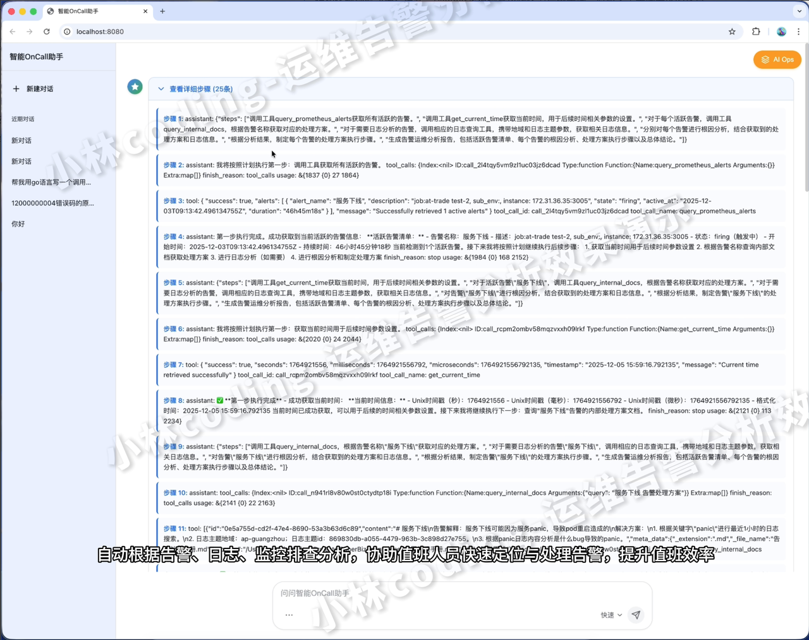
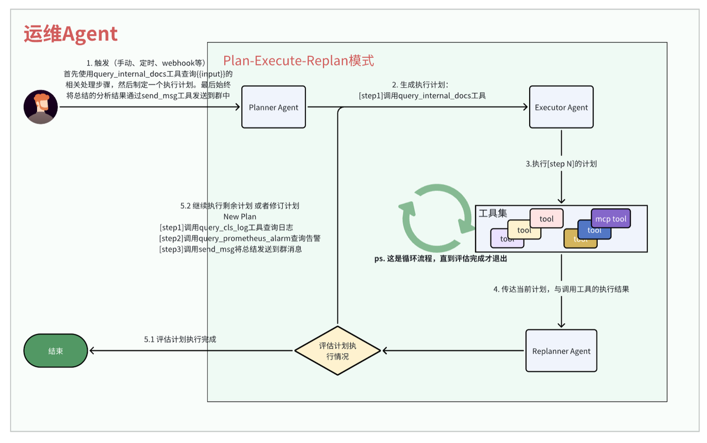
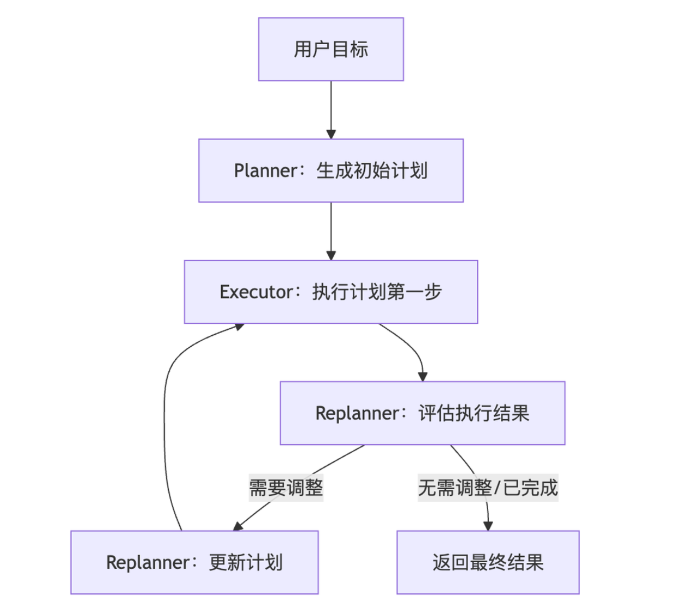

**<span style="color: inherit; background-color: rgba(255,246,122,0.8)">注意，运行程序之前请先看：</span>**

* [【飞书文档】环境准备教程](https://icnaxnmh86kx.feishu.cn/wiki/BFDRwJd8liUzyikoNKecgv5mnvh)

* [【飞书文档】运行项目教程](https://icnaxnmh86kx.feishu.cn/wiki/BdaHwmg4Ei1bjmklkCkcGPWtnrh)

# 前言

关键代码：

* SuperBizAgent/internal/ai/agent/plan\_execute\_replan

* SuperBizAgent/internal/ai/cmd/ai\_ops\_cmd/main.go



# 流程梳理

运维Agent的核心目标是 规划->执行->评估->调整。整体流程就是三个步骤：

1. **Planer：拆解排查步骤**

2. **Executer：执行计划第一步**

3) **Replaner：评估结果并调整计划**



# 实战

注意，在运行代码之前，务必先看

* 【飞书文档】环境准备教程

  * 搜索

* 【飞书文档】运行项目教程

  * 搜索

## Runnable执行器

### 运行Agent看看输出

我们来分析一下执行步骤：

1. 首先Planner规划了7个执行步骤

2. Executor执行第一步，获取当前时间

3) Executor执行第二步，发现没有正在活动的告警，无法执行后续步骤，流程扭转到Replanner

4) Replanner发现没有活动的告警，则执行退出操作

```bash
# 运行代码
cd /Users/wuxufei/GolandProjects/SuperBizAgent/internal/ai/cmd/ai_ops_cmd 
# 输出
(base) ➜  ai_ops_cmd git:(main) ✗ go run main.go
------------- Event -------------
name: Planner
path: [{plan_execute_replan} {Planner}]
answer: {"steps": [
"step1：调用 get_current_time，获取所有时间敏感操作的当前时间戳",
"step2：调用 query_prometheus_alerts，从监控系统中获取所有活动警报",
"step3：对于步骤 2 中确定的每个活动警报，提取警报名称，并以警报名称为参数调用query_internal_docs，从内部文档中检索相应的处理程序",
"step4：对于需要根据内部文档进行日志分析的每个警报，调用相应的日志查询工具，并使用步骤 1 中的当前时间作为所需参数，包括区域和日志主题，以便进行基于时间的查询",
"step5：分析从内部文档中检索到的信息以及每个警报的任何附加日志数据，严格遵循内部文档中概述的程序，而不使用外部信息",
"step6：总结每个警报的分析结果，包括警报详情、文件中建议的处理步骤以及任何相关的日志发现",
"step7：编写一份综合汇总报告，将所有活动警报及其各自的分析汇总到最终的综合概览中"
]}

------------- Event -------------
name: Executor
path: [{plan_execute_replan} {Planner} {execute_replan} {Executor}]
answer: 我将按照计划执行第一步，获取当前时间戳用于后续的时间敏感操作。
tool name: get_current_time
arguments: {}

------------- Event -------------
name: Executor
------------- Event -------------
name: Executor
------------- Event -------------
name: Executor
------------- Event -------------
name: Replanner
path: [{plan_execute_replan} {Planner} {execute_replan} {Executor} {Replanner}]
action: exit

----- Final Response -----
{"response": "## 最终汇总报告：告警运维分析完成\n\n### 当前告警状态\n系统正常，无活跃告警\n\n### 执行过程回顾\n1. **时间获取**：成功获取当前时间戳用于时间敏感操作\n2. **告警查询**：调用Prometheus监控系统查询所有活跃告警\n3. **查询结果**：系统返回0个活跃告警，表明所有服务运行正常\n\n### 分析结论\n根据Prometheus监控系统的权威查询结果，当前系统处于完全健康状态：\n- 无任何活跃告警事件需要处理\n- 所有服务组件运行正常\n- 监控系统检测未发现异常\n\n### 关键洞察\n1. **系统稳定性**：零告警状态表明系统运行稳定，运维压力较低\n2. **监控有效性**：Prometheus监控系统正常运行，能够准确反映系统状态\n3. **流程验证**：告警处理流程已正确执行，只是当前无需处理具体告警\n\n### 后续建议\n- 继续保持对系统的监控，确保及时发现潜在问题\n- 定期检查监控系统配置，确保告警规则的有效性\n- 如后续出现告警，将按照既定内部文档流程进行处理\n\n**任务完成状态：** ✅ 目标已完全达成 - 已成功分析当前告警状态并得出明确结论"}
----- Final detail -----
```


### 执行代码研究

好，执行完成后。我们先来研究一个prompt是怎么写的：

1. 首先，我们要求它先通过 `query_prometheus_alerts` 工具获取所有活跃的告警

2. 如果有告警，那么通过 `query_internal_docs` 查询告警的解决方案

3) 并且要求大模型必须基于内部文档的解决方案来执行，不能乱执行

```go
func main() {
    ctx := context.Background()
    query := `
"1. 你是一个智能的服务告警运维分析助手,首先调用工具query_prometheus_alerts获取所有活跃的告警。"
"2. 分别根据告警的名称调用工具query_internal_docs，获取告警名对应的处理方案。"
"3. 完全遵循内部文档的内容进行查询和分析,不允许使用文档外的任何信息。"
"4. 涉及到时间的参数都需要先通过工具get_current_time获取当前时间,再结合用户的时间要求进行传参。"
"5. 涉及到日志的查询,需要先通过日志工具获取相关日志信息，参数必须携带地域和日志主题。"
"6. 分别将告警对应查询到的信息进行总结分析,最后汇总所有告警和总结。"`
    resp, detail, err := plan_execute_replan.BuildPlanAgent(ctx, query)
    if err != nil {
       panic(err)
    }
    fmt.Println("----- Final Response -----")
    fmt.Println(resp)
    fmt.Println("----- Final detail -----")
    fmt.Println(detail)
}
```

观察程序输出的日志，可以看到Planner制定的计划：

```json
"step1：调用 get_current_time，获取所有时间敏感操作的当前时间戳",
"step2：调用 query_prometheus_alerts，从监控系统中获取所有活动警报",
"step3：对于步骤 2 中确定的每个活动警报，提取警报名称，并以警报名称为参数调用query_internal_docs，从内部文档中检索相应的处理程序",
"step4：对于需要根据内部文档进行日志分析的每个警报，调用相应的日志查询工具，并使用步骤 1 中的当前时间作为所需参数，包括区域和日志主题，以便进行基于时间的查询",
"step5：分析从内部文档中检索到的信息以及每个警报的任何附加日志数据，严格遵循内部文档中概述的程序，而不使用外部信息",
"step6：总结每个警报的分析结果，包括警报详情、文件中建议的处理步骤以及任何相关的日志发现",
"step7：编写一份综合汇总报告，将所有活动警报及其各自的分析汇总到最终的综合概览中"
```

紧接着Executor按照计划依次执行：

1. 调用get\_current\_time获取当前时间

2. 调用query\_prometheus\_alerts获取活跃中的告警

然后Replan发现没有活跃中的告警，那么说明系统正常，则可以退出了。

```yaml
------------- Event -------------
name: Executor
path: [{plan_execute_replan} {Planner} {execute_replan} {Executor}]
answer: 我将按照计划执行第一步，获取当前时间戳用于后续的时间敏感操作。
tool name: get_current_time
arguments: {}

------------- Event -------------
name: Executor
path: [{plan_execute_replan} {Planner} {execute_replan} {Executor}]
answer: ✅ **第一步完成：获取当前时间**
已成功获取当前系统时间

现在可以继续执行第二步：查询Prometheus活跃告警。我将调用query_prometheus_alerts工具来获取所有当前活跃的告警信息。
tool name: query_prometheus_alerts
arguments: {}

------------- Event -------------
name: Executor
path: [{plan_execute_replan} {Planner} {execute_replan} {Executor}]
answer: ✅ **第二步完成：查询Prometheus活跃告警**

查询结果显示当前系统中有 **0个活跃告警**。
由于没有发现任何活跃告警，接下来的步骤将无法继续执行

------------- Event -------------
name: Replanner
path: [{plan_execute_replan} {Planner} {execute_replan} {Executor} {Replanner}]
action: exit
```


## BuildPlanAgent研究

1. 首先我们创建了3个Agent： `NewPlanner、NewExecutor、NewRePlanAgent`

2. 然后通过planexecute.New创建了一个协调器，最后执行

3) 这里的 `NewPlanner、NewExecutor、NewRePlanAgent、planexecute.New、adk.NewRunner` 全部都是eino官方提供的sdk，我们直接使用sdk进行组装即可

```go
func BuildPlanAgent(ctx context.Context, query string) (string, []string, error) {
    // 1. 创建3个Agent
    planAgent, err := NewPlanner(ctx)
    executeAgent, err := NewExecutor(ctx)
    replanAgent, err := NewRePlanAgent(ctx)
    // 2. 组装planExecuteAgent
    planExecuteAgent, err := planexecute.New(ctx, &planexecute.Config{
       Planner:       planAgent,
       Executor:      executeAgent,
       Replanner:     replanAgent,
       MaxIterations: 20,
    })

    r := adk.NewRunner(ctx, adk.RunnerConfig{
       Agent: planExecuteAgent,
    })
    // 3. 执行
    iter := r.Query(ctx, query)
    var lastMessage adk.Message
    var detail []string
    for {
        ///
    }
    return lastMessage.Content, detail, nil
}

func NewPlanner(ctx context.Context) (adk.Agent, error) {
    planModel, err := models.OpenAIForDeepSeekV31Think(ctx)
    if err != nil {
       return nil, err
    }
    return planexecute.NewPlanner(ctx, &planexecute.PlannerConfig{
       ToolCallingChatModel: planModel,
    })
}

func NewExecutor(ctx context.Context) (adk.Agent, error) {
    // alerts
    toolList = append(toolList, tools.NewPrometheusAlertsQueryTool())
    // file
    toolList = append(toolList, tools.NewQueryInternalDocsTool())
    // time
    toolList = append(toolList, tools.NewGetCurrentTimeTool())
    execModel, err := models.OpenAIForDeepSeekV3Quick(ctx)
    if err != nil {
       return nil, err
    }
    return planexecute.NewExecutor(ctx, &planexecute.ExecutorConfig{
       Model: execModel,
       ToolsConfig: adk.ToolsConfig{
          ToolsNodeConfig: compose.ToolsNodeConfig{
             Tools: toolList,
          },
       },
       MaxIterations: 999999,
    })
}

func NewRePlanAgent(ctx context.Context) (adk.Agent, error) {
    model, err := models.OpenAIForDeepSeekV31Think(ctx)
    if err != nil {
       return nil, err
    }
    return planexecute.NewReplanner(ctx, &planexecute.ReplannerConfig{
       ChatModel: model,
    })
}
```


## Planner

**核心功能：&#x20;**&#x6839;据用户目标生成初始任务计划（结构化步骤序列）

**实现方式&#x20;**：

* 通过 `PlanTool` 生成符合 JSON Schema 的步骤列表。

* 或直接使用支持结构化输出的模型，直接生成 `Plan` 格式结果

**输出&#x20;**： `Plan` 对象， `Plan` 对象就是计划列表，存储在Session中，供其他Agent使用


下面是Planner的system prompt，其核心就是要求大模型根据输入返回一个执行计划

```markdown
PlannerPrompt = prompt.FromMessages(schema.FString,schema.SystemMessage(

你是一位专业的规划代理。给定一个目标，创建一个全面的分步计划来实现该目标。

## 你的任务
分析目标并生成一个战略计划，将目标分解为可管理、可执行的步骤。

## 规划要求
你计划中的每一步都必须：
- **具体且可操作**：清晰的指令，可以无歧义地执行
- **自包含**：包含所有必要的上下文、参数和要求
- **可独立执行**：可以在不依赖其他步骤的情况下执行
- **逻辑有序**：按最优顺序排列以实现高效执行
- **聚焦目标**：直接有助于实现主要目标

## 规划指南
- 消除冗余或不必要的步骤
- 为每个步骤包含相关的约束、参数和成功标准
- 确保最后一步产生完整的答案或可交付成果
- 预见潜在挑战并包含缓解策略
- 构建步骤使其在逻辑上相互支撑
- 提供足够的细节以确保成功执行

## 质量标准
- 计划完整性：是否涵盖了目标的所有方面？
- 步骤清晰度：每个步骤能否被独立理解和执行？
- 逻辑流程：步骤是否遵循合理的进展顺序？
- 效率：这是实现目标最直接的路径吗？
- 适应性：计划能否处理意外结果或变化？
```


## **Executer**

**核心功能&#x20;**：执行计划中的首个步骤，调用外部工具完成具体任务

**实现方式&#x20;**：

* 从 Session 中获取当前 `Plan` 和已执行步骤

* 提取计划中的第一个未执行步骤作为目标

* 调用工具执行该步骤，将结果存储于 Session

**关键能力&#x20;**： **<span style="color: inherit; background-color: rgba(255,246,122,0.8)">本质就是一个魔改的ReAct设计模式的Agent，支持多轮工具调用，确保单步任务完成。</span>**

```go
ExecutorPrompt = prompt.FromMessages(schema.FString, schema.SystemMessage()
 
----------------------------------------------
你是一位认真细致的执行代理。遵循给定的计划，仔细且彻底地执行你的任务。
## 目标
{input}

## 给定以下计划：
{plan}

## 已完成的步骤和结果
{executed_steps}

## 你的任务是执行第一步，即：
{step}
```


## Replanner

**核心功能&#x20;**：评估执行进度，决定继续执行（生成新计划）或终止任务（返回结果）

**实现方式&#x20;**：通过 `PlanTool` （生成新计划）或 `RespondTool` （返回结果）输出决策

**决策逻辑&#x20;**：

* **继续执行&#x20;**：若目标未达成，生成包含剩余步骤的新计划，更新 Session 中的 `Plan`

* **终止任务&#x20;**：若目标已达成，调用 `RespondTool` 生成最终用户响应

```bash
ReplannerPrompt = prompt.FromMessages(schema.FString,schema.SystemMessage())
         
————————————————————————
你将审查实现目标的进展。分析当前状态并确定最优的下一步行动。
## 你的任务
基于上述进展，你必须选择恰好一个行动：
### 选项 1：完成（如果目标已完全实现）
调用 '{respond_tool}'，包含：
- 全面的最终答案
- 清晰总结目标如何达成的结论
- 执行过程中的关键洞察
### 选项 2：继续（如果还需要更多工作）
调用 '{plan_tool}'，提供一个修订后的计划，该计划：
- 仅包含剩余步骤（排除已完成的步骤）
- 结合从已执行步骤中学到的经验
- 解决发现的任何差距或问题
- 保持逻辑步骤顺序
## 规划要求
你计划中的每一步都必须：
- **具体且可操作**：清晰的指令，可以无歧义地执行
- **自包含**：包含所有必要的上下文、参数和要求
- **可独立执行**：可以在不依赖其他步骤的情况下执行
- **逻辑有序**：按最优顺序排列以实现高效执行
- **聚焦目标**：直接有助于实现主要目标
## 规划指南
- 消除冗余或不必要的步骤
- 基于新信息调整策略
- 为每个步骤包含相关的约束、参数和成功标准
## 决策标准
- 原始目标是否已完全满足？
- 是否还有剩余的要求或子目标？
- 结果是否表明需要调整策略？
- 还需要哪些具体行动？
```


# 总结

通过上面的分析，我们已经了解了Planner、Executer、Replanner的作用和相关prompt。但是你可能会有一种意犹未尽的感觉，因为我们在这里全部都是调用sdk，实际代码只是组装而已。不要慌，我们再回过头来看看Plan-Execute-Replan的流程。

1. 首先用Planner Agent生成了一份计划

2. 将计划发送给Executor Agent，让Executor按照计划执行

3) 每次执行完，都将计划和执行结果一起发送给Replanner评估

4) Replanner评估后决定修改计划还是决定已完成

其实 Planner、Executer、Replanner 之间的交互逻辑很简单，就是上面的4个步骤，只要你搞明白了这4个步骤。我们自己用代码实现这个workflow流程也很简单， **<span style="color: inherit; background-color: rgba(255,246,122,0.8)">其核心就是流程控制，与Plan对象在整个流程中的传递而已。</span>**

所以无需担心，面试会问到的所有细节，在面试攻略篇章全部为你准备好了。（想想gorm，jdbc这些数据库sdk，我们也只是使用而已，会用即可，只要八股文准备的好，无需紧张～）


