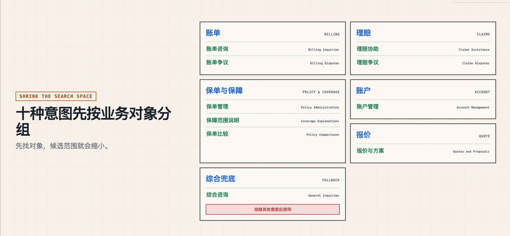
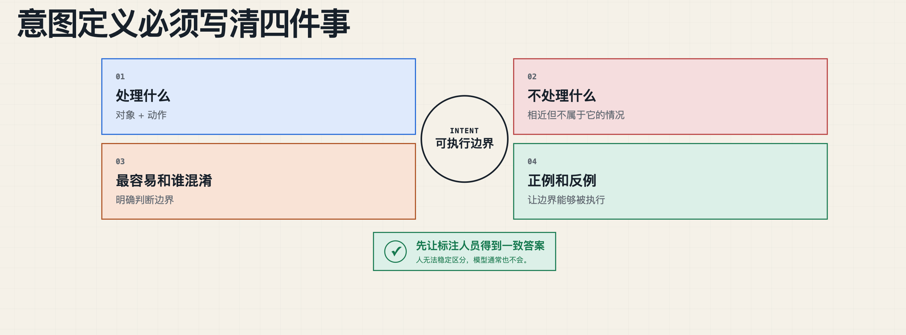
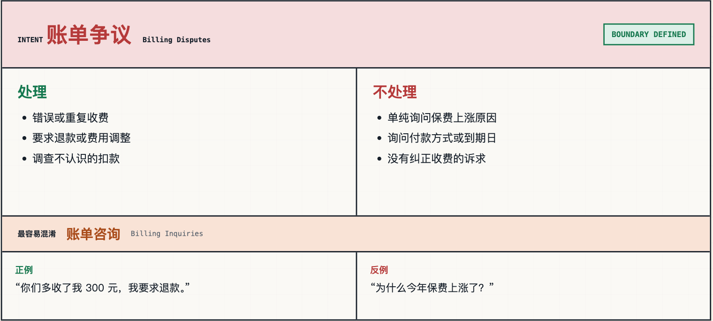

# 第一课：理解"意图识别"

> 来源：<https://my.feishu.cn/wiki/ODUWwcRCTiPsDGk3TmNcDLgJn1f> ｜ 文档 token `UUUOdN1LhoU6ohxuvPPcGJrNn1q` ｜ 抓取时修订号 702 ｜ 抓取日期 2026-10-15
> 系列：Agent 系统设计 第 1 课 ｜ 索引见 [README](README.md) ｜ 下一课 [第二课：单类指标评测](02-意图识别评测-单类指标.md)

## 分析

**这篇解决什么问题**：把"意图识别"从"抓关键词"拉回到"业务对象 + 用户要推动的动作"，并给出可落地的三件套——意图定义表、意图说明卡、四档递进的 Prompt 模板。

**核心结论**

1. **判断公式是"对象 + 动作 = 意图"**，不是关键词匹配。一句话可能含多个"对象—动作"组合，即多意图。
2. **每种意图先写一张说明卡**：处理什么 / 不处理什么 / 最容易和谁混淆 / 正例与反例。这张卡同时供模型、标注人员和评测人员使用——这是全篇最有迁移价值的一条，它让 Prompt、标注口径和评测标准同源。
3. **四档 Prompt 的准确率阶梯**：zero-shot ≈70% → few-shot ≈85% → 加 RAG 判例 ≈90% → 加"对象+动作"引导词 ≈95%。阶梯的每一级对应一个明确的工程动作，而不是换更强的模型。
4. **RAG 在这里的角色是"判例检索"而非"知识问答"**：把历史问题及其标签存进向量库，每来一个问题只召回最相关的几条。作者同时给出边界——相似度高只表示语义接近，不代表同类别（"我想知道理赔进度"与"我不接受理赔结果"都在讲理赔，动作不同）。
5. **多意图有两种处理策略**：只取主意图（必须预先定义优先级，不能让模型临时决定什么最重要）；拆成子问题（推荐，尤其对 Agent / RAG 系统）。

**这套方法论的隐含前提**：意图类别是**预先穷举**的封闭集合（10 类 + 综合兜底）。所有指标、说明卡、Prompt 约束都建立在"不允许创建新类别"之上。一旦业务允许开放类别，第 4.2 节的参数校验和第五节的策略都要重做。

**可以立刻搬走的东西**：意图说明卡的四栏结构；`<handles> / <excludes> / <confused_with>` 这组 XML 字段名（比自由文本更能逼出边界）；输出规则里"相同类别只输出一次""按原工单出现顺序输出"这类可评测约束。

**缺口与存疑**

- 70% / 85% / 90% / 95% 四个数字未给样本量、评测集与统计口径，属于经验值而非可复现结论；引用时应说明是量级参考。
- 文中示例的标签中英文混用（`Claims Disputes` 与"理赔争议"、`Billing Inquiries` 与"账单咨询"），实际落地需统一一套，否则下游路由会踩坑。
- 4.1.3 的 RAG 段落只讲原理，未给召回条数 k、相似度阈值、embedding 模型选择——这些恰恰是效果差异最大的地方。

## 正文

### 一、什么是意图识别

意图识别，就是判断用户这句话想解决什么问题、推动什么事情，并把它归入系统预先定义的类别。

用户的一句话里面可能会有一个或多个意图。

意图识别不是从句子里面抓一个关键词，而是需要先看用户谈的业务对象，再看他想推动什么动作。

```
（对象 + 动作 = 意图）
```

### 二、举个例子

举一个保险业务场景的例子。假设这个场景下定义了十种意图。

#### 2.1 保险场景下的意图定义



意图定义表（原文为内嵌表格 `jh9SPX`）：

| 业务大类 | 意图（英文标签） | 中文名称 | 典型问题 |
|---|---|---|---|
| 费用与账务 | Billing Inquiries | 账单咨询 | 保费金额、账单明细、付款方式、缴费日期 |
| 费用与账务 | Billing Disputes | 账单争议 | 错误收费、意外扣费、退款、保费调整、滞纳金 |
| 保单服务 | Policy Administration | 保单管理 | 修改、更新、取消、续保、复效、增减保障 |
| 保单服务 | Coverage Explanations | 保障范围说明 | 承保范围、责任限额、免责条款、免赔额、自付费用 |
| 保单服务 | Policy Comparisons | 保单比较 | 比较不同保单、保障档位或其他公司的产品 |
| 理赔服务 | Claims Assistance | 理赔协助 | 理赔流程、材料提交、理赔进度、赔款时间 |
| 理赔服务 | Claims Disputes | 理赔争议 | 拒赔、少赔、重新审核、理赔申诉 |
| 售前咨询 | Quotes and Proposals | 报价与投保方案 | 新保单报价、价格比较、折扣、组合购买、转保 |
| 账户服务 | Account Management | 账户管理 | 登录、重置密码、在线账户功能、个人资料更新 |
| 综合服务 | General Inquiries | 一般咨询 | 联系方式、营业时间、一般产品信息、无法归入其他类别的问题 |

具体定义几个意图取决于你们自己的业务场景下有几个需要被后续流程处理的意图，理论上来说定义的意图数量可以是无限多，一些不需要处理的意图都可以归类到综合兜底这个意图里面。

#### 2.2 看两个保险场景下的例子

使用"对象 + 动作"的判断方式。

##### 2.3.1 单意图

**用户问题**

> 我准备退休了，想重新调整寿险保障，使它更适合退休后的生活，应该怎么修改？

**答案**

```Plain Text
对象：现有寿险保单
动作：修改保障方案
意图：保单管理
```

##### 2.3.2 多意图

**用户问题**

> 我的车险续保账单多收了800元，请核实并退回多收的费用；同时帮我取消自动续保，并比较一下两个不同免赔额的方案哪个更适合我。

**答案**

```Plain Text
对象1：续保账单中多收的费用
动作1：质疑收费并要求退款
意图1：账单争议

对象2：车险自动续保设置
动作2：要求取消自动续保
意图2：保单管理

对象3：两个不同免赔额的保险方案
动作3：比较并请求选择建议
意图3：保单比较
```

### 三、如何做意图定义说明卡

**考虑 4 个事情**

```Plain Text
1. 处理什么
2. 不处理什么
3. 最容易和谁混淆
4. 正例和反例
```



**账单争议展示一张完整的意图说明卡**

先为每种意图写一张说明卡：处理什么、不处理什么、最容易和谁混淆，再补上正例和反例。

```Plain Text
意图：账单争议

处理：
- 错误或重复收费
- 要求退款或费用调整
- 调查不认识的扣款

不处理：
- 单纯询问保费上涨原因
- 询问付款方式或到期日
- 没有纠正收费的诉求

最容易混淆：账单咨询
正例："你们多收了我 300 元，我要求退款。"
反例："为什么今年保费上涨了？"
```

这样的说明卡可以同时提供给模型、标注人员和评测人员。



### 四、用 LLM 做意图识别

#### 4.1 LLM 意图识别提示词

##### 4.1.1 zero-shot 70%

```Python
def simple_classify(context):
    ticket = context["vars"]["text"]

    prompt = """
    你将对客户支持工单进行分类，归入以下类别之一:

    <categories>
        {categories}
    </categories>

    <ticket>
        {ticket}
    </ticket>

    仅回复类别标签
    """

    return prompt
```

其中：

- `<categories>` 放系统允许使用的类别；
- `<ticket>` 放用户工单；
- `{ticket}` 是程序运行时替换进去的变量；
- 最后一行规定模型应该怎样返回结果。

`{categories}`：

```XML
<category>
    <label>理赔协助</label>
    <content>
        询问理赔流程
        协助提交理赔资料
        查询理赔进度
    </content>
</category>
```

这个提示词做了三件事：

1. 取得需要分类的工单。`{ticket}`
2. 把类别定义和工单一起放进 Prompt。`{categories}`
3. 要求模型只返回类别名称。例如：仅回复类别标签

模型每次收到请求时，根据 Prompt 中的类别定义临时完成判断，这通常称为：Zero-shot Classification。

这里的"Zero-shot"表示没有给模型提供已经分类好的示例，但类别说明仍然是必要的。

##### 4.1.2 Few-shot 分类的 prompt 85%

`{categories}`

```XML
<category>
    <label>账单争议</label>

    <handles>
        错误或重复收费；
        要求退款或费用调整；
        调查不认识的扣款。
    </handles>

    <excludes>
        单纯询问保费上涨原因；
        询问付款方式或到期日；
        没有纠正收费诉求的账单问题。
    </excludes>

    <confused_with>账单咨询</confused_with>

    <positive_examples>
        <example>
            <query>你们多收了我 300 元，请退回来。</query>
            <label>账单争议</label>
        </example>
        <example>
            <query>信用卡上有一笔不认识的保险扣款，请帮我调查。</query>
            <label>账单争议</label>
        </example>
    </positive_examples>

    <negative_examples>
        <example>
            <query>为什么今年的保费比去年贵？</query>
            <label>账单咨询</label>
            <reason>用户只是询问上涨原因，没有要求纠正收费。</reason>
        </example>
    </negative_examples>
</category>
```

##### 4.1.3 带 RAG 例子的 prompt 90%

我们把用户的问题和对应的标签存进向量数据库。用户来查询的时候先去向量数据库里面查询出跟这个问题最相似的问题对应的标签是什么。用户问题查询向量数据库，再让模型参考这些判例完成分类。

**什么是向量数据库呢？**

Embedding 模型会把文本转换成一组数字：

```Plain Text
"理赔只赔了一半，我要申诉"
→ [0.12, -0.44, 0.08, ...]
```

这组数字叫作向量。

语义接近的句子，向量通常也更接近：

```Plain Text
理赔金额不足，我要重新审核
赔付结果太低，我想申请复核
```

即使两句话没有使用完全相同的词，Embedding 也可能识别它们表达了相似的意思。

项目使用向量点积计算相似度，并把结果从高到低排序。实际系统也经常使用余弦相似度。

需要注意：

> 相似度高只表示文本语义接近，不代表类别一定相同。

"我想知道理赔进度"和"我不接受理赔结果"都在讨论理赔，但动作不同，可能属于两个类别。

**为什么不把所有标准问法直接写进 Prompt**

少量标准问法当然可以直接放进 Prompt：

```XML
<example>
    <query>我的理赔资料已经提交，请问处理到哪一步了？</query>
    <label>Claims Assistance</label>
</example>
```

问题是，真实用户的表达方式无法列完。

同一个"少赔后要求复核"，可能被写成：

```Plain Text
为什么只赔了一半？
定损结果不合理，我要申诉。
维修费没有全报，请重新核查。
这个赔付决定我不接受。
赔款和实际损失差太多了。
```

如果把所有历史问法都放进固定 Prompt，会出现：

- Prompt 越来越长；
- 调用成本和延迟上升；
- 大量无关案例干扰当前判断；
- 新案例加入后需要不断修改 Prompt；
- 上下文长度最终会达到上限。

固定 few-shot 更像是"给所有问题发同一本案例册"；RAG 更像是"每来一个问题，只翻出最相关的几份判例"。

##### 4.1.4 加上引导词的 prompt 95%

我们可以引导 LLM 进行意图识别的时候按照"动作+对象"来进行意图识别

```Plain Text
在对用户问题进行意图分类之前，请按照以下步骤分析：

1. 识别用户正在讨论或处理的对象。
2. 识别用户针对该对象采取或要求采取的动作。
3. 综合"对象"和"动作"，判断用户的真实意图。
4. 如果问题中包含多个不同的"对象—动作"组合，需要分别识别每个组合对应的意图。

请按照以下格式输出：

对象1：……
动作1：……
意图1：……

对象2：……
动作2：……
意图2：……
```

完整的 prompt

```XML
你是一名保险客服工单意图分类专家。

你的任务是将客服工单分类到以下一个或多个类别。

分析时，应结合用户讨论的业务对象以及用户针对该对象采取或要求采取的动作判断意图。不要仅根据单个关键词进行分类。

<categories>
    <category>
        <label>账单咨询</label>
        <handles>
            询问账单明细、收费项目、保费金额、保费上涨原因、付款方式或缴费日期。
        </handles>
        <excludes>
            明确认定收费错误、重复或不合理，并要求退款、减免或调整费用。
        </excludes>
        <confused_with>账单争议</confused_with>
    </category>

    <category>
        <label>账单争议</label>
        <handles>
            质疑错误收费、重复收费、意外扣费、滞纳金或催收通知，并要求退款、减免或调整保费。
        </handles>
        <excludes>
            仅询问账单内容、收费原因、付款方式或缴费日期。
        </excludes>
        <confused_with>账单咨询</confused_with>
    </category>

    <category>
        <label>保单管理</label>
        <handles>
            要求修改、更新、取消、续保或恢复保单，以及增加或删除保障项目。
        </handles>
        <excludes>
            仅询问保障内容、比较不同保单，或者申请新保单报价。
        </excludes>
        <confused_with>
            保障范围说明、保单比较、报价与投保方案
        </confused_with>
    </category>

    <category>
        <label>保障范围说明</label>
        <handles>
            询问保单承保内容、责任限额、免责条款、免赔额或需要自行承担的费用。
        </handles>
        <excludes>
            要求修改保障项目，或者比较两个及以上保险方案。
        </excludes>
        <confused_with>保单管理、保单比较</confused_with>
    </category>

    <category>
        <label>理赔协助</label>
        <handles>
            询问报案流程、理赔资料提交、理赔处理进度，以及赔款到账时间。
        </handles>
        <excludes>
            对拒赔、少赔或既有理赔决定提出申诉、复核、重新核定或调整要求。
        </excludes>
        <confused_with>理赔争议</confused_with>
    </category>

    <category>
        <label>理赔争议</label>
        <handles>
            不认可拒赔、少赔或其他理赔决定，要求申诉、重新审核、重新核定或调整赔偿金额。
        </handles>
        <excludes>
            仅询问报案流程、资料提交、处理进度或赔款到账时间。
        </excludes>
        <confused_with>理赔协助</confused_with>
    </category>

    <category>
        <label>报价与投保方案</label>
        <handles>
            申请新保单报价、询问价格、折扣或组合购买方案，以及咨询从其他保险公司转保。
        </handles>
        <excludes>
            比较已经明确给出的多个保单方案，或者修改现有保单。
        </excludes>
        <confused_with>保单比较、保单管理</confused_with>
    </category>

    <category>
        <label>保单比较</label>
        <handles>
            比较两个及以上保单、保障档位、免赔额方案或不同保险公司的产品，并请求选择建议。
        </handles>
        <excludes>
            仅申请新保单报价，或者只询问某一个保单的保障内容。
        </excludes>
        <confused_with>
            报价与投保方案、保障范围说明
        </confused_with>
    </category>

    <category>
        <label>账户管理</label>
        <handles>
            处理账户登录、密码重置、在线账户功能，以及联系方式或个人资料更新。
        </handles>
        <excludes>
            修改保险合同、保障项目、受保对象或保单状态。
        </excludes>
        <confused_with>保单管理</confused_with>
    </category>

    <category>
        <label>一般咨询</label>
        <handles>
            询问公司联系方式、营业时间、一般产品或服务信息，以及无法归入其他类别的问题。
        </handles>
        <excludes>
            能够明确归入其他九个类别的问题。
        </excludes>
        <confused_with>其他所有类别</confused_with>
    </category>
</categories>
<rag_example>
        {{用户问题从RAG数据库中获取的例子}}
<rag_example>

请判断下面这条客服工单属于哪个类别：

<ticket>
    {{用户工单}}
</ticket>

<output_rules>
    1. 只能输出 <categories> 中定义的类别名称。
    2. 单意图工单只输出一个类别名称。
    3. 多意图工单每行输出一个类别名称。
    4. 多意图按照对应诉求在原工单中的出现顺序输出。
    5. 相同类别只输出一次。
    6. 不要输出对象、动作、分析过程、序号、项目符号、标点、XML标签或其他内容。
</output_rules>
```

zero-shot 大概只有 70% → Few-shot 85% → RAG 示例 90% → 带引导词 95%

#### 4.2 LLM 意图识别参数

##### 降低随机性

分类通常使用：

```Python
temperature = 0
top_k = 1   # 每生成一个 token，只保留当前概率最高的那一个
```

目的不是让模型绝对确定，而是尽量减少同一输入重复调用时的随机变化。

##### 限制输出长度

如果只需要标签或短 JSON，不需要给几千个输出 token：

```Python
max_tokens = 64
```

具体参数名称随模型 API 变化。

##### 明确允许值

Prompt 中写明：

```Plain Text
category 必须是下面 10 个类别之一，不允许创建新类别。
```

代码中还要再次校验：

```Python
if result["category"] not in ALLOWED_LABELS:
    raise ValueError("模型返回了无效类别")
```

### 五、多意图的处理策略

#### 策略一：只选择主意图

输出：

```JSON
{
  "category": "Claims Disputes"
}
```

适合：

- 下游系统只接受一个队列；
- 业务有明确优先级；
- 其他问题可以由主处理人员继续分流。

必须提前定义优先级，例如：

```Plain Text
安全和紧急问题
> 已发生的争议
> 需要执行的保单操作
> 普通咨询
```

不能让模型自己临时决定什么最重要。

#### 策略二：拆成多个子问题（推荐）

```JSON
{
  "subquestions": [
    {
      "id": "q1",
      "question": "理赔金额不足时如何申请重新审核？",
      "category": "Claims Disputes"
    },
    {
      "id": "q2",
      "question": "续保账单比去年上涨的原因是什么？",
      "category": "Billing Inquiries"
    }
  ]
}
```

适合：

- 每个问题需要独立检索；
- 每个问题可能由不同知识库处理；
- 需要分别记录回答状态；
- 最终再聚合成一条回复。

对于 Agent 和 RAG 系统，拆子问题通常最灵活。
