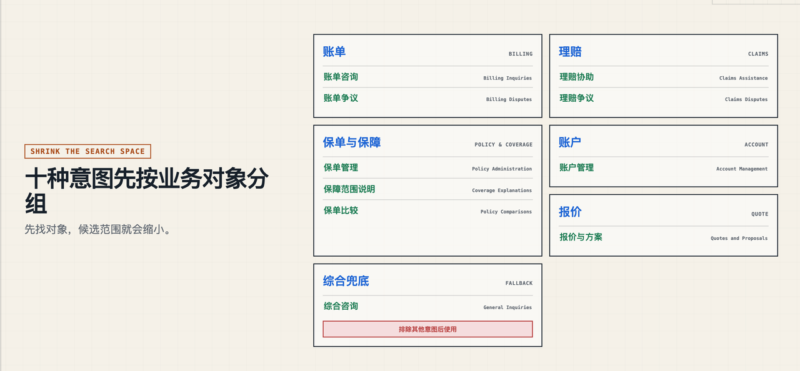

# 第二课：如何评测意图识别的效果 01（单个分类指标）

> 来源：<https://my.feishu.cn/wiki/VzIjw54P6itek0kV4uuc2sQ1nUg> ｜ 文档 token `BcnTdo3fNoVf0FxVTNbcVO0snjb` ｜ 抓取时修订号 240 ｜ 抓取日期 2026-10-15
> 系列：Agent 系统设计 第 2 课 ｜ 索引见 [README](README.md) ｜ 上一课 [第一课：意图识别](01-意图识别.md) ｜ 下一课 [第三课：多类指标](03-意图识别评测-多类指标.md)

## 分析

**这篇解决什么问题**：给定一个目标类别（例中为"理赔争议"），怎么用 TP/FP/FN/TN 四个格子推出 Accuracy、Precision、Recall、Fβ，以及为什么不能只看 F1 就上生产。

**核心结论**

1. **TP/FP/FN/TN 的记法要点是拆轴**：`Positive/Negative` 说的是**模型推测**是或不是，`True/False` 说的是**推测与真实相比**对不对。作者专门强调 "False 不是指实际情况"——这是初学者最常混的一处。
2. **评估单个类别时样本必须混入反例**。要算四个量，5 条问题里既要有目标类正例，也要有其他类别的反例；例中把其余九类统一视作"非理赔争议"。
3. **Precision 不看 TN，Accuracy 看 TN**。所以当非目标类别占多数时，Accuracy 会被大量 TN 抬高，看起来很好，但目标类别的判断可能完全不可靠——这是本篇最有价值的一条警示。
4. **Precision vs Recall 的取舍由业务成本决定**，用两个对照例子说明：内容推荐首页只有 5 个坑位，漏掉好内容代价小、推垃圾代价大 → 看 Precision（严格说是 `Precision@K`）；安全告警漏掉一次真实入侵可能就是数据外泄 → 先看 Recall，再用规则/聚合/二次模型压误报（否则告警疲劳会反噬）。
5. **F1 用调和平均而非算术平均的理由**：Precision=100%、Recall=10% 时算术平均 55% 看着及格，F1 只有 18.2%——调和平均会向低值靠拢，明确暴露偏科。
6. **正确的使用顺序不是"F1 最高就上线"**：先过业务硬性门槛（Precision 是否达最低要求 → 自动拒绝；Recall 是否达标 → 风险初筛），在满足门槛的模型里再用 F1 比较整体平衡，最后看具体错例。

**一句话总纲**：业务决策看 Precision 和 Recall，模型排序和方案比较可以辅助看 F1。

**与前后课的衔接**：本课把"一个问题对应一个分类"作为前置条件（多意图先拆成单意图再评），这正是第一课策略二的产物；第三课再把本课的单类指标推广到 Micro/Macro 两个聚合维度。

**缺口与存疑**

- 5 条样本的 60% / 66.7% 只用于演示算法，不能作为效果结论；实际评测集规模、抽样方式与置信区间本篇未涉及，第三课也没补。
- "TN 不参与 Precision"的推论只写了定性描述，没给类别极度不均衡时该用哪个指标的显式建议（业界常见答案是 PR-AUC / 各类别 Recall 加护栏）。

## 正文

### 一、单个分类指标的评估

我们评价一个 Agent 系统好不好，大家最先想到的就是看这个问题到底有没有被 Agent 正确回答。大家会通过人工分辨或者引入 LLM 进行评估。

但是业内像 LangChain、Anthropic 会有比较标准的评价指标。今天就跟大家分享一下。

上个视频，我们提到了意图理解。这个视频就跟大家讲一下如何评估意图识别得准不准。

**前置条件**

> 单标签多分类：以我们之前的意图识别分类器评估为例。这里假设每个用户问题只对应一个分类。如果原始问题同时包含多个意图，先把它拆成多个单意图问题，再按照"一个问题对应一个分类"来评测。

以我们第一节课提到的保险这个业务场景下有十个意图为例。



假设我们特别关注：Claims Disputes（理赔争议）这个意图分类。

#### 1.1 四种判断结果

四种判断结果（原文内嵌表格 `jm7lEH`）：

| 类型 | 实际情况 | 模型推测 | 中文理解 |
|---|---|---|---|
| TP | 实际是 | 推测也是 | 正确识别 |
| FP | 实际不是 | 却推测是 | 错误识别 |
| FN | 实际是 | 却推测不是 | 漏掉 |
| TN | 实际不是 | 推测也不是 | 正确排除 |

记住两个规则：

- `Positive / Negative`：模型推测"是"还是"不是"
- `True / False`：不是指的实际情况是还是不是。模型的推测和真实情况相比是"正确"还是"错误"。

##### 一个完整例子：用 5 个用户问题评估一个目标类别

评估一个类别，并不意味着 5 条问题都必须是"理赔争议"。要计算 TP、FP、FN 和 TN，样本中既要有目标类别的正例，也要有其他类别的反例。这里把其他九个意图统一视为"非理赔争议"，只评估模型识别"理赔争议"的效果。

下面用同一批 5 个用户问题，贯穿 Accuracy、Precision、Recall 和 F1 的计算（原文内嵌表格 `Jtn6qp`）：

| 编号 | 用户问题 | 人工标注 | 模型输出 | 结果 |
|---|---|---|---|---|
| 1 | 保险公司只赔了一半，我不同意这个结果，要求重新核定。 | 理赔争议 | 理赔争议 | TP |
| 2 | 我的住院理赔被拒了，我要申诉。 | 理赔争议 | 理赔争议 | TP |
| 3 | 这次定损金额明显太低，麻烦重新审核。 | 理赔争议 | 非理赔争议 | FN |
| 4 | 我的理赔申请三天了，为什么还没到账？ | 非理赔争议 | 理赔争议 | FP |
| 5 | 申请理赔需要准备哪些材料？ | 非理赔争议 | 非理赔争议 | TN |

统计结果：

```Plain Text
TP = 2
FP = 1
FN = 1
TN = 1
总样本数 = 5
```

这张表里，第 3 条是漏报：用户已经表达了明确异议，但模型没有识别出来。第 4 条是误报：用户只是在询问到账进度，模型却把它升级成了争议。

#### 1.2 最基本指标：Accuracy

计算公式：

```Plain Text
Accuracy = 分类正确数量 ÷ 总数
分类正确数量 = TP + TN
// TP 和 TN 都表示模型判断正确，因此都计入正确数量。
```

代入上面 5 条数据：

```Plain Text
分类正确 = TP + TN = 2 + 1 = 3
用户问题总数 = 5

Accuracy = 3 ÷ 5 = 60%
```

这里的 60% 表示：5 个用户问题中，有 3 个被正确分类。它把"正确识别争议"和"正确排除非争议"都算作答对。

> Accuracy 告诉我们整体答对多少，但不能说明某个重要类别表现如何。

#### 1.3 Precision：模型的判断有多可信

计算公式：

```Plain Text
Precision = 正确预测为争议的数量 ÷ 所有被模型预测为争议的数量
Precision = TP ÷ (TP + FP)
```

代入数据：

```Plain Text
Precision = 2 ÷ 3 ≈ 66.7%
```

含义：

> 模型每预测 3 条理赔争议，其中大约有 2 条是真的。

Precision 低，会产生很多误报，把普通咨询错误升级为争议。

Accuracy 会计算 TN，Precision 不看 TN。因此，当非目标类别很多时，Accuracy 可能看起来很高，但模型对目标类别的判断不一定可靠。

#### 1.4 Recall：真正的争议找回了多少

计算公式：

```Plain Text
Recall = 正确预测为争议的数量 ÷ 实际争议的总数量
Recall = TP ÷ (TP + FN)
```

代入数据：

```Plain Text
Recall = 2 ÷ 3 ≈ 66.7%
```

含义：

> 实际存在 3 条理赔争议，模型找到了其中 2 条。

Recall 低，会漏掉真正需要处理的争议。

##### Precision 和 Recall 的区别

> Precision：你抓出来的这些，抓得准不准？
>
> Recall：所有应该抓的，你抓全了没有？

不同业务对它们的要求不同：

**例子一：内容推荐为什么更关心 Precision**

假设首页只能推荐 5 篇文章。

方案 A 推荐的 5 篇文章中，用户喜欢 4 篇：

```Plain Text
Precision = 4 ÷ 5 = 80%
```

方案 B 推荐的 5 篇文章中，用户只喜欢 1 篇：

```Plain Text
Precision = 1 ÷ 5 = 20%
```

用户打开首页，只会看到这 5 篇。

因此推荐错误的直接后果是：

- 用户觉得内容不相关；
- 频繁跳过；
- 逐渐不愿意使用产品。

世界上可能还有 100 篇用户会喜欢的文章，但首页不可能全部展示。漏掉其中一些，通常没有推荐一堆垃圾内容那么糟糕。

所以推荐场景经常关注：

```Plain Text
给出的有限推荐是否足够准确
```

这更接近 Precision。

严格来说，推荐系统常使用 `Precision@K`：

```Plain Text
Precision@5
= 推荐的前 5 个内容中
  用户真正喜欢的比例
```

**例子二：安全告警为什么更关注 Recall**

假设公司一天发生 10 次真实入侵。

系统只报警 4 次：

```Plain Text
Recall = 4 ÷ 10 = 40%
```

虽然这 4 次报警都是真的，但另外 6 次入侵没有被发现。

攻击者可能已经：

- 窃取数据；
- 获取管理员权限；
- 在系统中植入后门。

因此安全系统经常需要尽量发现所有可疑行为。

不过，如果每天产生 10 万条误报，安全团队会陷入"告警疲劳"，最终可能忽略真正的攻击。

所以实际目标通常是：

```Plain Text
先保证关键攻击有较高 Recall
再通过规则、聚合和二次模型减少误报
```

#### 1.5 Fβ 调和平均数：综合 Precision 和 Recall

普通 F1 默认：

```Plain Text
Precision 和 Recall 同样重要
```

如果 Recall 更重要，可以使用 `F2`：

```Plain Text
F2 更重视 Recall
```

如果 Precision 更重要，可以使用 `F0.5`：

```Plain Text
F0.5 更重视 Precision
```

统称为 `Fβ`：

```Plain Text
Fβ = (1 + β²) × Precision × Recall
     -------------------------------
       β² × Precision + Recall
```

- `β = 1`：Precision 和 Recall 同等重要，也就是 F1；
- `β > 1`：更重视 Recall；
- `β < 1`：更重视 Precision。

F1 用于综合衡量两者：

```Plain Text
F1 = 2 × Precision × Recall
     ─────────────────────
       Precision + Recall
```

代入：

```Plain Text
Precision = 0.667
Recall = 0.667

F1 ≈ 0.667
```

也就是约 66.7%。

只有 Precision 和 Recall 都比较高，F1 才会高。例如（原文内嵌表格 `mrnlPW`）：

| Precision | Recall | F1 大致表现 |
|---|---|---|
| 95% | 20% | 低，漏报严重 |
| 30% | 95% | 低，误报严重 |
| 85% | 85% | 高，比较均衡 |

##### 为什么不用普通平均数

如果直接计算算术平均：

```Plain Text
(Precision + Recall) / 2
```

那么一个指标特别高，可能会掩盖另一个指标特别低。

例如：

```Plain Text
Precision = 100%
Recall = 10%
```

算术平均是：

```Plain Text
(1.0 + 0.1) / 2 = 55%
```

看起来还有 55 分。

但 F1 是：

```Plain Text
F1 = 2 × 1.0 × 0.1 / (1.0 + 0.1)
   ≈ 18.2%
```

F1 会更接近较低的 Recall，明确暴露模型严重偏科。

因此 F1 使用的是调和平均，它的特点是：

> 只有 Precision 和 Recall 都不错，F1 才会高。

### 二、正确使用方式

不要这样：

```Plain Text
模型F1最高
→ 直接上线
```

#### 评估流程

```Plain Text
第一步：检查业务硬性要求

自动拒绝：
Precision 是否达到最低要求？

风险初筛：
Recall 是否达到最低要求？

第二步：满足硬性要求的模型中
再用 F1 比较整体平衡。

第三步：
查看具体错例。
```

所以最终答案是：

> Precision 和 Recall 完全可以、也应该分别看；F1 只是把两者压缩成一个方便比较的数字。业务决策看 Precision 和 Recall，模型排序和方案比较可以辅助看 F1。
