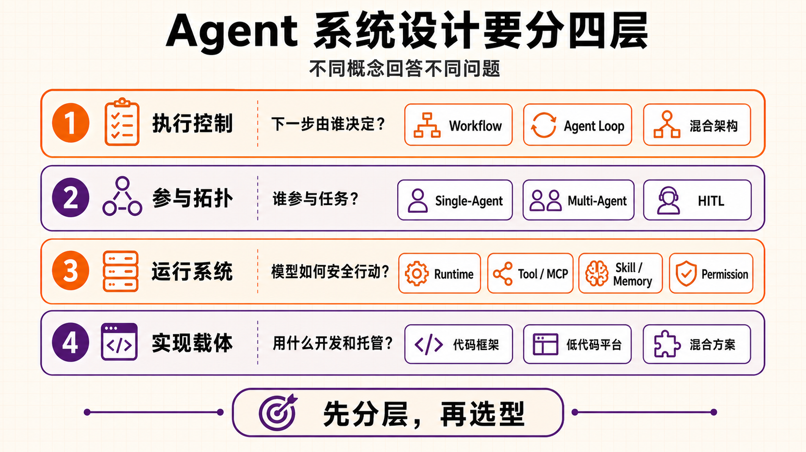
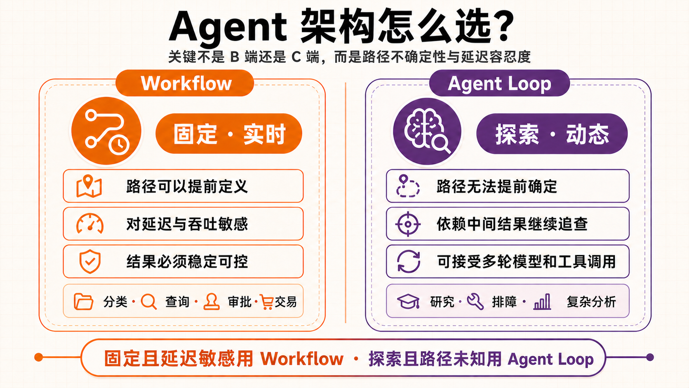
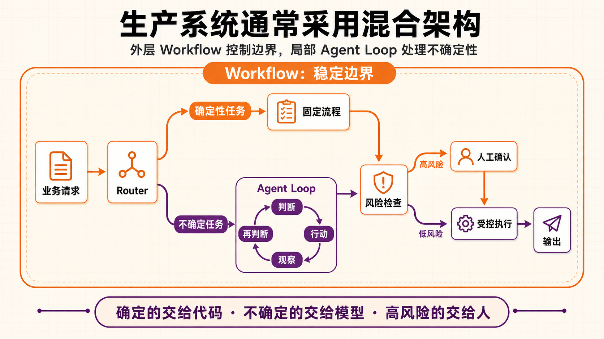
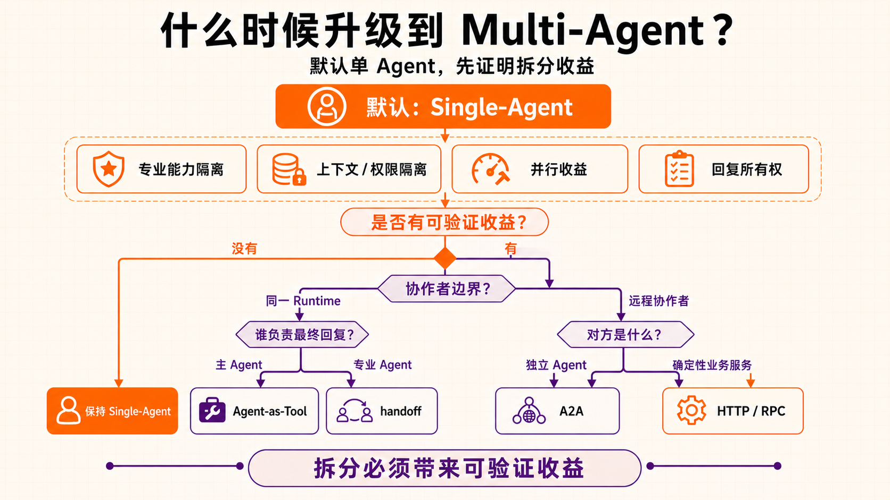
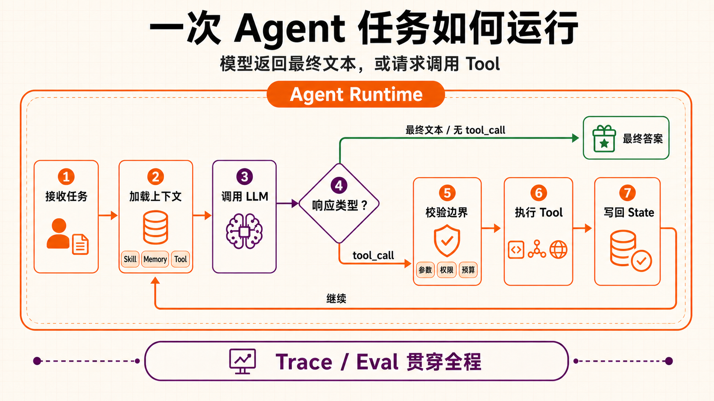
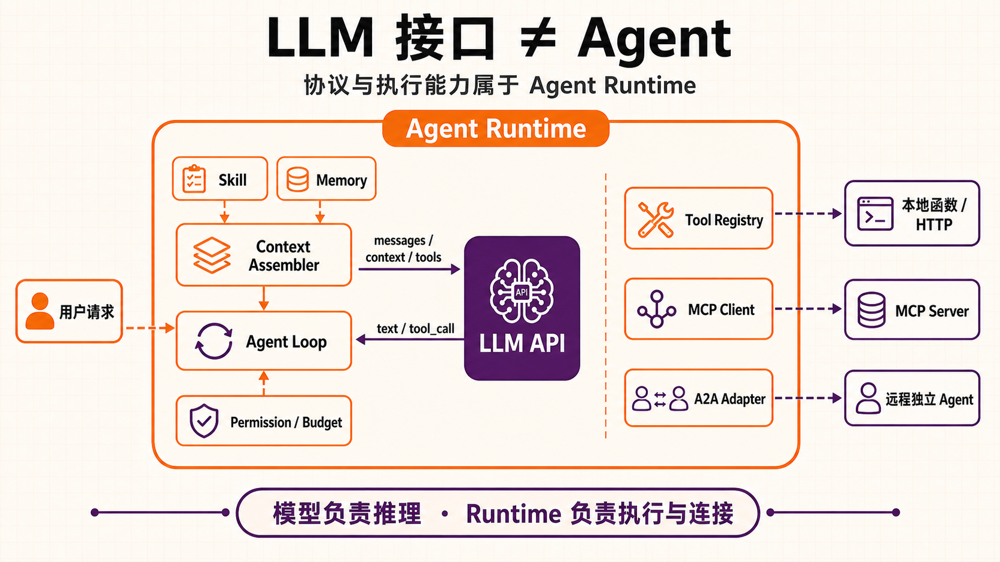
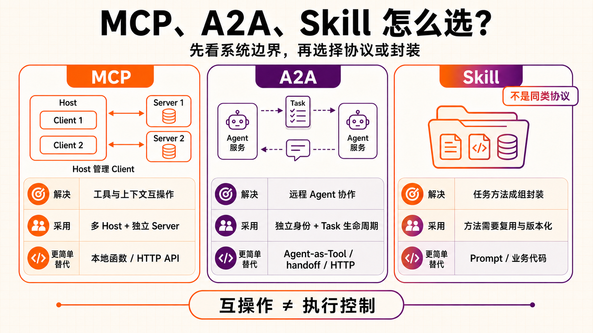
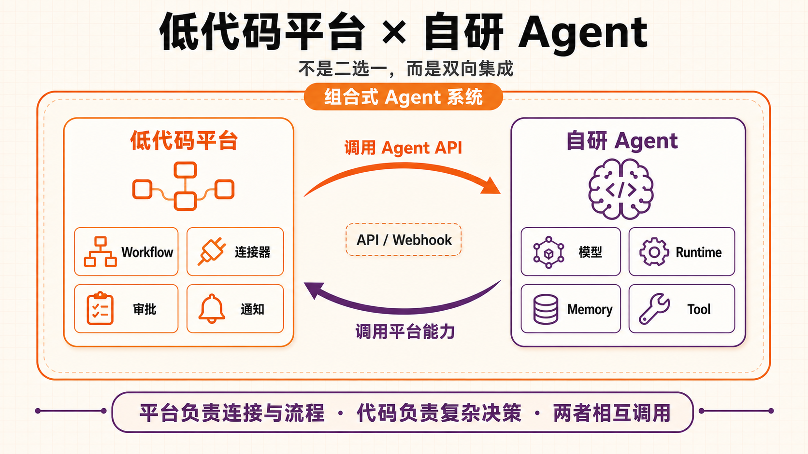

# 第四课：Agent 架构设计

> 来源：<https://my.feishu.cn/wiki/K3dAwR5qTiDNYikpQl9c2o01n5y> ｜ 文档 token `WX8BdBiETopPi3xOcCIcSAuQnKQ` ｜ 抓取时修订号 82 ｜ 抓取日期 2026-10-15
> 系列：Agent 系统设计 第 4 课 ｜ 索引见 [README](README.md) ｜ 上一课 [第三课：多类指标](03-意图识别评测-多类指标.md) ｜ 下一课 [第五课：Agent 评测 - Langfuse](05-Agent评测-Langfuse.md)

## 分析

**这篇解决什么问题**：给一个"我要自己做 Agent"的人一张检查清单——有哪四层是必须先想清楚的，每层的选择项、边界和代价是什么。作者的立场很明确：**先分层，再选型**。

**四层框架**

```
① 执行控制层  下一步由代码决定还是模型决定 → Workflow / Agent Loop / 混合架构
② 参与拓扑层  谁参与、谁拥有最终回复       → Single-Agent / Multi-Agent / HITL
③ 运行系统层  多步任务怎样安全可恢复地跑   → Agent Runtime / Harness + MCP/A2A/Skill 边界
④ 实现载体层  上面的能力用什么实现         → 代码框架 / 低代码平台 / 混合方案
```

**核心结论**

1. **①不是一组对立概念，可以正交组合**——一个 Multi-Agent 系统里每个 Agent 照样可以跑 Workflow 或 Agent Loop，HITL 也能加在任何组合上。这是全篇最容易读漏、也最能防止选型混乱的一点。
2. **判据不是"B 端还是 C 端"**，而是三条：路径能不能提前写出来、出错能不能撤销、能接受多少延迟和成本。反例给得很具体：研究任务若步骤固定照样能用 Workflow；内部故障排查要一路追日志/监控/变更记录，反而需要受限的 Agent Loop。
3. **混合架构是常态而非妥协**：外层 Workflow 管身份、预算、状态和写操作，里面只留一小段 Agent Loop 处理没法写死的判断；探索只给建议，写入回到 Workflow 或人工审批。
4. **默认从 Single-Agent 开始**，作者给了四条"确实该拆"的信号（规则冲突、不能共享数据/密钥/高风险工具、独立运行且实测净收益为正、需要接管对话所有权），并给了一条否证：**只是把一个长 Prompt 拆成几个角色，没有得到这些收益，就没必要拆**。
5. **Multi-Agent 的成本被明确列出**：路由/超时/重试/汇总增加延迟与 Token；多 Agent 写同一份状态要处理唯一写入者、幂等、并发合并；子 Agent 给错答案上游会放大，所以结果要保留来源和失败状态；**评测必须能定位是单个 Agent、路由、handoff 还是汇总出了问题**——这条直接连到第五课。
6. **Runtime 的职责清单是这篇最硬的部分**（上下文组装、模型调用、工具注册执行与终止判断、状态与 Checkpoint、暂停/继续/取消/重启恢复、上下文传递与权限限制、敏感操作审批、超时/重试/幂等/并发冲突/补偿/降级、步骤与 Token 与费用与时间限制、全链路可回放记录）。判据很实用：`ChatClient` / `ChatModel` 单独只是模型调用入口，**不是** Agent Runtime；有些框架把循环封装在内部所以业务代码看不到 `for`，但状态、权限、预算、恢复和观测的责任并没有消失。
7. **协议分层的解释力很强**：为什么 LLM 接口只实现 Tool Calling 而不实现 MCP / A2A / Skill？因为 Tool Calling 是**模型与 Runtime 之间的结构化决策接口**，而 MCP / A2A / Skill 是 **Runtime 用来连接外部能力、其他 Agent 和任务方法的机制**——后者涉及外部网络交换，Skill 甚至可能含代码、需要 Runtime 提供沙箱执行。
8. **落地判据给到了"什么时候不需要任何协议"**：方法只在单 JVM 内调用，直接注册成 Tool 就够；已有业务 API 外面加一层 MCP 适配即可，不用重写服务；远程端只是查询/计算/写入服务，HTTP / RPC 更直接；**交易规则、权限和幂等必须写在代码或受控 Workflow 里，不能只放在 Skill 中**。
9. **平台 vs 代码的分界**：有 API 只能说明业务系统可调用，不能说明内部执行方式一样——要看运行逻辑由平台托管还是自己代码控制。文末给了收敛判据：流程能画清楚、主要工作是连接系统、出错可人工处理、目标版本已过权限/成本/稳定性验证 → 低代码够用；Agent 直接处理核心业务状态、执行路径常变、需服务重启后继续、对性能测试发布有严格要求 → 代码框架。两边都有就组合。
10. **给后端团队的默认路径**：先从 Workflow + Single-Agent 开始；有一段路径没法提前写出来，再放进一个有限的 Agent Loop；状态、权限、恢复、预算和日志统一放在 Runtime；**代码还是平台最后再定**。

**可信度处理值得学**：框架候选表明确标注"资料核验于 2026-08""不做强弱排名""以采用时的具体版本为准"，并补一句"官方文档写了某项能力，只能说明框架提供了相应抽象或接口；业务状态、权限、异常恢复和数据一致性还要在自己的项目里验证"。这是选型材料应有的免责粒度。

**缺口与存疑**

- 四层框架是**决策检查清单**，不是参考架构：它没给跨层的冲突消解顺序（例如 Runtime 的预算限制与 Multi-Agent 的汇总延迟冲突时以哪层为准）。
- 框架表只覆盖 Java/Spring 视角（Spring AI 2.0.0、Google ADK / ADK Java、LangGraph），Python 主流栈（DeepAgents、OpenAI Agents SDK、Smolagents 等）未纳入；文中 LangGraph 被定位为"可接受独立 Python/TS 服务边界"的选项。
- 概念代码 `AgentRuntime` 自述"只说明各部分负责什么，不能直接当成某个框架的 API 使用"——注意它的 `guard.check()` 在工具执行前、`checkpoint()` 在每步末，真实实现还需要处理并行工具调用与流式输出。

## 正文

> Agent 系统设计 04：Agent 架构设计

主要是帮助大家在自己想做 Agent 的时候，有哪四个地方是你必须要考虑的点。



四层速查（原文内嵌表格 `fsvuSZ`）：

| 层级 | 核心问题 | 典型选择 |
|---|---|---|
| 执行控制层 | 下一步由代码还是模型决定 | Workflow、Agent Loop、混合架构 |
| 参与拓扑层 | 谁参与，谁拥有最终回复 | Single-Agent、Multi-Agent、HITL |
| 运行系统层 | 多步任务怎样安全、持续、可恢复地运行 | Agent Runtime / Harness |
| 实现载体层 | 上面的能力用什么实现 | 代码框架、低代码平台、混合方案 |

### 一、执行控制层：Workflow、Agent Loop 与混合架构

执行控制层先看一个问题：上一步执行完以后，下一步由代码决定，还是由模型决定？

#### Workflow 和 Agent Loop

Workflow 的步骤、分支和结束条件都提前写在代码里。模型可以负责分类、抽取或生成内容，但不能临时换一条流程。

Agent Loop 只固定"调用模型 → 执行工具 → 把结果再交给模型"这个循环。模型根据中间结果选择下一步，Runtime 负责执行工具并限制最大步数、超时和预算。



这几个名称说的是任务怎么处理（原文内嵌表格 `Fskgmi`）：

| 模式 | 简单理解 |
|---|---|
| ReAct | 模型边判断边行动：选择一个工具，看到执行结果后，再决定下一步 |
| Plan-and-Execute | 先生成计划，再逐步执行；执行中也可以检查计划是否需要调整 |
| Reflection | 模型回看已经生成的结果，找出问题，再做一次修正 |
| Evaluator-Optimizer | 先生成结果，再按一组标准评价，根据评价继续修改，直到达到要求或触发结束条件 |

这些模式既可以放进 Workflow，也可以放进 Agent Loop。区别仍然要看下一步由代码固定，还是由模型根据结果决定。

#### 怎么选

（原文内嵌表格 `B2vZM0`）

| 选择 | 下一步由谁决定 | 适合什么任务 | 需要注意 | 写操作怎么处理 |
|---|---|---|---|---|
| Workflow | 代码提前写好步骤和分支 | 固定 RAG、分类路由、审批、交易等路径明确的任务 | 新场景通常要改流程，但延迟、成本、测试和审计更容易控制 | 做好鉴权、幂等和审计后，由受控节点执行 |
| Agent Loop | 模型看完中间结果后再选 | 调研、故障诊断、代码分析等目标明确但路径未知的任务 | 限制工具、最大步数、Token / 费用、超时和重试；结果与延迟更难预测 | 不让模型直接执行付款、删除、发布等不可逆动作 |
| 混合架构 | 代码管外层流程，局部让模型探索 | 既有固定业务流程，又有少量无法提前写死的判断 | 写清 Loop 的入口、出口、状态和失败处理 | 探索只给建议，写入回到 Workflow 或人工审批 |

B 端还是 C 端不是重点。先看路径能不能提前写出来，再看出错能不能撤销，以及能接受多少延迟和成本。比如，研究任务如果步骤固定，照样可以用 Workflow；企业内部的故障排查如果要一路追日志、监控和变更记录，就可能需要一个受限的 Agent Loop。

实际项目里经常把两种方式放在一起：外层 Workflow 管身份、预算、状态和写操作，里面只留一小段 Agent Loop 处理没法提前写死的判断。



### 二、参与拓扑层：Single-Agent、Multi-Agent 与 HITL

Multi-Agent 说的是有几个 Agent 参加、它们怎么分工。它和 Workflow、Agent Loop 不是一组概念。一个 Multi-Agent 系统里，每个 Agent 照样可以跑 Workflow、Agent Loop 或者两者的组合。Human-in-the-Loop（HITL）也可以加在这些组合上。

#### 默认从 Single-Agent 开始

只要一组上下文、工具权限和输出要求能完成任务，就先用 Single-Agent。下面几种情况反复出现时，再考虑拆成 Multi-Agent：

- 不同步骤需要独立的工具、输出格式或评测集，放在一个 Agent 里经常发生规则冲突。
- 参与者不能共享数据、密钥或高风险工具。
- 子任务可以在输入固定后独立运行，而且实测节省的时间大于分发、汇总、重试和冲突处理的开销。
- 某个专业 Agent 必须接管后续对话，而不是只给主 Agent 返回一个结果。

如果只是把一个长 Prompt 拆成几个角色，没有得到上面的收益，就没有必要拆。



#### Agent 之间怎么调用

（原文内嵌表格 `INixca`）

| 形态 | 控制与回复边界 | 何时使用 |
|---|---|---|
| 同一 Runtime：Agent-as-Tool | 主 Agent 调用专业 Agent，保留上下文编排和最终回复 | 需要专业子结果，但主 Agent 仍负责综合 |
| 同一 Runtime：handoff | 当前分支交给专业 Agent，后者拥有后续回复 | 确实需要转交对话所有权 |
| 远程独立 Agent | 独立部署、身份或组织边界，拥有自己的 Runtime 和任务生命周期 | 需要发现、消息、状态和产物交换时评估 A2A |
| 普通 HTTP / RPC 服务 | 接口执行确定性业务能力，不拥有 Agent 任务语义 | 远程端只是查询、计算或写入服务时优先采用 |

HITL 表示人在哪一步参与：执行前审批、异常时接管，或者结果出来后复核。人工确认不能替代程序鉴权，高风险动作还要有最小权限、参数校验、幂等和审计。

Multi-Agent 会多出不少成本。路由、超时、重试和结果汇总都会增加延迟与 Token；多个 Agent 写同一份状态时，还要处理唯一写入者、幂等和并发合并。子 Agent 给错答案，上游也可能继续放大，所以结果要保留来源和失败状态。评测不能只看最后答案，还要能定位是单个 Agent、路由、handoff 还是汇总出了问题。收益盖不过这些成本时，继续用 Single-Agent 或普通 Workflow。

### 三、运行系统层：Agent Runtime / Harness 与协议边界

#### Agent Runtime 到底是什么

Agent Runtime 就是实际运行 Agent 的程序。模型给出判断以后，Runtime 还要把上下文、工具、状态、权限和结束条件串起来。一个能上线的 Runtime 至少要处理这些事情：

- 组装上下文、调用模型、注册和执行工具，并判断任务什么时候结束；
- 保存任务状态和 Checkpoint，支持暂停、继续、取消和服务重启后的恢复；
- 传递上下文，限制工具和数据权限，对敏感操作请求审批；
- 处理超时、重试、幂等、并发冲突、补偿和失败降级；
- 限制步骤、Token、费用和运行时间，避免循环失控；
- 记录模型调用、工具调用、状态变化、耗时、成本和错误，后面可以回放和评测。

一次任务大致这样运行：接收任务并组装上下文，调用模型，识别模型返回的文本或工具意图，校验并执行工具，把结果和状态写回，然后继续、暂停、恢复或者结束。



Runtime 和 Harness 没有统一叫法。狭义的 Runtime 偏执行引擎；Harness 往往还包括 CLI / UI、文件系统、沙箱、审批和完整的任务生命周期。按广义理解，Harness 就是一套更完整的 Runtime。判断一个产品时，看它具体负责什么就行。

这些能力可以来自框架、低代码平台、应用代码，也可以组合使用。团队不用从零写一套，但业务授权、数据一致性和上线验收仍然要由自己的应用负责。

#### 模型接口只负责什么

模型接口负责推理。模型协议目前绝大部分只支持 Tool Calling，只让模型返回结构化的调用意图，例如工具名和参数。



模型没有原生 Tool Calling 时，也可以让它输出约定的 JSON，再由程序解析。不过这种方式要增加严格校验、修复和重试，可靠性通常会差一些。

长期任务状态、执行恢复、MCP 调用、远程 Agent 任务交换，以及付款和发布这类业务操作，都不在模型接口里。这些事情由 Runtime、平台和业务系统处理。

为什么 LLM 接口只用 Tool Calling，没有给大家实现 MCP、SKILL、A2A 协议？

> Tool Calling 是模型与 Runtime 之间的结构化决策接口；MCP、A2A 和 Skill 是 Runtime 用来连接外部能力、其他 Agent 和任务方法的机制。像 MCP、A2A 都涉及到外部的网络交换。Skill 更像一个任务方法包，里面甚至可能有代码，需要 Agent Runtime 提供的沙箱环境执行。

#### MCP、A2A 与 Skill 的边界

（原文内嵌表格 `2DB5eF`）

| 能力 | 解决什么问题 | 关键边界 |
|---|---|---|
| MCP | AI 应用与外部工具、资源和提示模板互操作 | Host 是协调一个或多个 MCP Client 的 AI 应用；每个 Client 与一个对应 Server 保持连接；Server 原语不只有 tools，还包括 resources、prompts |
| A2A | 远程独立 Agent 之间发现能力并交换消息、任务状态与产物 | 用于拥有独立 Runtime、身份或部署边界的 Agent；不等同于同一 Runtime 内的 Agent-as-Tool 或 handoff |
| Skill | 把一类任务的方法、说明、示例、脚本和资源成组封装 | 它不是与 MCP、A2A 同类的互操作协议；加载格式、权限和可移植性取决于具体 Runtime / Harness |



什么时候需要这些东西？一个方法只在单 JVM 内调用，直接注册成 Tool 就够了。已有业务 API 可以在外面加一层 MCP 适配，不用重写服务。远程端如果只是查询、计算或写入服务，用 HTTP / RPC 更直接。交易规则、权限和幂等必须写在代码或受控 Workflow 里，不能只放在 Skill 中。

#### 在 Java / Spring 项目里是什么

在 Java 项目里，Agent Runtime 最后就是一组 Java 代码，但它通常不是某一个类或 Jar 包。一个具体的 Runtime 往往由 Spring Boot、Spring AI 或 ADK Java，再加上业务代码共同组成。

其中：

- Controller、消息消费者或定时任务负责接收请求和建立任务身份。
- AgentService 负责 Workflow / Loop、终止条件、预算和失败策略。
- Spring AI 的 `ChatClient` / `ChatModel` 或 ADK 的模型抽象负责模型调用。
- Tool Adapter 连接领域服务、本地函数、HTTP API 或 MCP Client。
- 数据库、缓存和队列承接任务状态、Checkpoint、并发控制与恢复。
- Spring Security、业务权限和审计组件负责限制最终写操作并记录审计日志。

用一段概念代码表示，大致是这样。它只说明各部分负责什么，不能直接当成某个框架的 API 使用。

```Java
final class AgentRuntime {
    private static final int MAX_STEPS = 8;

    private final ModelClient model;
    private final ToolExecutor tools;
    private final PermissionGuard guard;
    private final ContextBuilder context;

    AgentResult run(AgentState state) {
        for (int step = 0; step < MAX_STEPS; step++) {
            ModelReply reply = model.call(context.from(state));
            state.append(reply);

            if (reply.toolCalls().isEmpty()) {
                return AgentResult.completed(reply.text(), state.trace());
            }

            for (ToolCall call : reply.toolCalls()) {
                guard.check(state.actor(), call);
                ToolResult result = tools.execute(call);
                state.appendToolResult(call, result);
            }

            state.checkpoint();
        }
        throw new StepLimitExceeded(MAX_STEPS);
    }
}
```

这段代码主要看这个过程：模型调用 → 检测 `tool_call` → 权限校验 → 执行 → 结果写回 → 再次判断。`MAX_STEPS` 用来防止无限循环，真实项目还要处理超时、重试、取消、幂等、并发冲突和人工审批。

`ChatClient` 或 `ChatModel` 单独只是模型调用入口，不是 Agent Runtime。有些框架把循环封装在内部，因此业务代码看不到 `for`；但状态、权限、预算、恢复和观测责任并没有消失。

### 四、实现载体层：代码框架、低代码平台与混合方案

前三层确定以后，再看这些能力用代码实现，还是交给平台。

#### 先看运行逻辑放在哪里

（原文内嵌表格 `GR3gzB`）

| 载体 | 更适合什么 | 选择边界 |
|---|---|---|
| 代码框架 | Agent 直接进入核心业务，需要复杂状态、恢复、性能控制、自动化测试和深度集成 | 团队承担服务、状态存储、依赖升级与运维 |
| 低代码平台 | 快速验证、标准 Workflow、知识库问答、跨 SaaS 触发与通知 | 所选版本已满足权限、并发、恢复、评测和数据边界 |
| 混合方案 | 平台连接业务系统，代码负责 Agent 核心逻辑和高风险操作 | 明确状态所有者、接口契约、重试幂等和端到端 Trace |

#### 代码框架候选

如果团队以 Java / Spring Boot 为主，可以先按这张表排除不合适的选择。资料核验于 **2026-08**，这里只写适用方向和需要验证的地方，不做强弱排名。框架能力、Java 支持和部署方案都要以采用时的具体版本为准。

（原文内嵌表格 `P2hbhu`）

| 候选 | 适合什么 | 落地前验证 |
|---|---|---|
| Spring AI 2.0.0 | Spring Boot 团队在现有应用内接入模型、RAG、Tool Calling、MCP、Memory 与观测 | 目标版本的状态持久化、Checkpoint、暂停 / 恢复、HITL、评测与部署方式；不要把 Chat Memory 当成长任务恢复 |
| Google ADK / ADK Java | 明确需要 Workflow、Multi-Agent、可恢复运行或 A2A，并希望使用 ADK 的运行抽象 | Java 发布版是否覆盖目标文档能力，状态后端、HITL、评测、API 稳定性、部署与运维成本 |
| LangGraph | 需要持久化、可恢复的图执行，并可接受独立 Python / TypeScript 服务边界 | Checkpoint 与恢复语义、HITL、评测、部署观测，以及与 Java 系统的服务契约 |

官方文档写了某项能力，只能说明框架提供了相应抽象或接口。业务状态、权限、异常恢复和数据一致性，还要在自己的项目里验证。

#### 低代码 / 可视化平台候选

低代码平台适合先把流程跑起来。具体能力会随版本、地区、云服务或私有化部署方式变化，最后还是要在目标环境中测试。

（原文内嵌表格 `4SW2yQ`）

| 候选 | 适合什么 | 落地前验证 |
|---|---|---|
| n8n | 系统连接、触发、审批、通知和标准自动化 | 目标版本的 AI Agent / HITL / 评测能力，并发、幂等、暂停恢复、权限和数据保留 |
| Dify | 知识库问答、Chatflow / Workflow 和内部 AI 应用快速验证 | Cloud 与自托管差异，恢复语义、扩展点、评测、版本回滚、权限与数据边界 |
| Langflow | 可视化的 Python Agent 原型、组件实验和 API 暴露 | 持久状态、Checkpoint、HITL、鉴权、版本管理、横向扩展和生产运维 |
| Coze | 在已确认地区和渠道内快速验证轻量 Agent 体验 | 实际账号与地区可用的模型、插件、工作流、发布渠道，以及审计、迁移、SLA 和数据合规 |

#### 平台有 API，为什么还需要代码框架

有 API 只能说明业务系统可以调用它，不能说明内部执行方式一样。这里要看运行逻辑由平台托管，还是由自己的代码控制。

（原文内嵌表格 `8ZKUuZ`）

| 维度 | 平台托管运行逻辑 | 自有代码控制运行逻辑 |
|---|---|---|
| 流程表达 | 节点、配置、子流程和平台扩展点 | 应用代码与框架抽象 |
| 状态与恢复 | 受所选版本的会话、运行记录和恢复语义约束 | 自己设计数据库、Checkpoint、幂等与补偿 |
| 业务一致性 | 通过连接器、HTTP 或插件连接业务系统 | 可直接复用领域服务、事务和权限模型 |
| 安全边界 | 核验平台账号、密钥、租户、节点权限和审计 | 接入现有鉴权，同时自行实现 Tool 级授权和审计 |
| 测试与发布 | 核验导出、Diff、评审、自动化测试和回滚能力 | 接入 Git、CI/CD、单元与集成测试；效果仍需 Agent Eval |
| 性能与运维 | 受平台并发、队列、配额和部署形态约束 | 自己控制连接池、缓存、路由、流式、降级和资源成本 |

如果流程能清楚画出来，主要工作是连接系统，出错后可以人工处理，而且目标版本已经通过权限、成本和稳定性验证，低代码平台通常就够了。如果 Agent 要直接处理核心业务状态，执行路径经常变化，任务还要在服务重启后继续，或者对性能、测试和发布有严格要求，就需要代码框架。两边的需求都有，可以组合使用。



大多数后端项目可以先从 Workflow 和 Single-Agent 开始。有一段路径没法提前写出来，再放进一个有限的 Agent Loop。状态、权限、恢复、预算和日志统一放在 Runtime，代码还是平台最后再定。

### 参考资料

- [Anthropic：Building Effective Agents](https://www.anthropic.com/engineering/building-effective-agents)
- [OpenAI：Agents SDK](https://developers.openai.com/api/docs/guides/agents)
- [OpenAI：Orchestration and Handoffs](https://developers.openai.com/api/docs/guides/agents/orchestration)
- [Model Context Protocol：Architecture Overview](https://modelcontextprotocol.io/docs/2026-07-28/learn/architecture)
- [Agent2Agent Protocol：What is A2A?](https://a2a-protocol.org/latest/topics/what-is-a2a/)
- [Spring AI 2.0.0：Reference](https://docs.spring.io/spring-ai/reference/)
- [Google ADK：Documentation](https://adk.dev/)
- [Google ADK：Agent Runtime](https://adk.dev/runtime/)
- [Google ADK：A2A](https://adk.dev/a2a/)
- [Google ADK Java：Repository](https://github.com/google/adk-java)
- [LangGraph：Overview](https://docs.langchain.com/oss/python/langgraph/overview)
- [n8n：Documentation](https://docs.n8n.io/)
- [Dify：Documentation](https://docs.dify.ai/)
- [Langflow：About Langflow](https://docs.langflow.org/about-langflow)
- [Coze：Open Docs](https://www.coze.com/open/docs)
