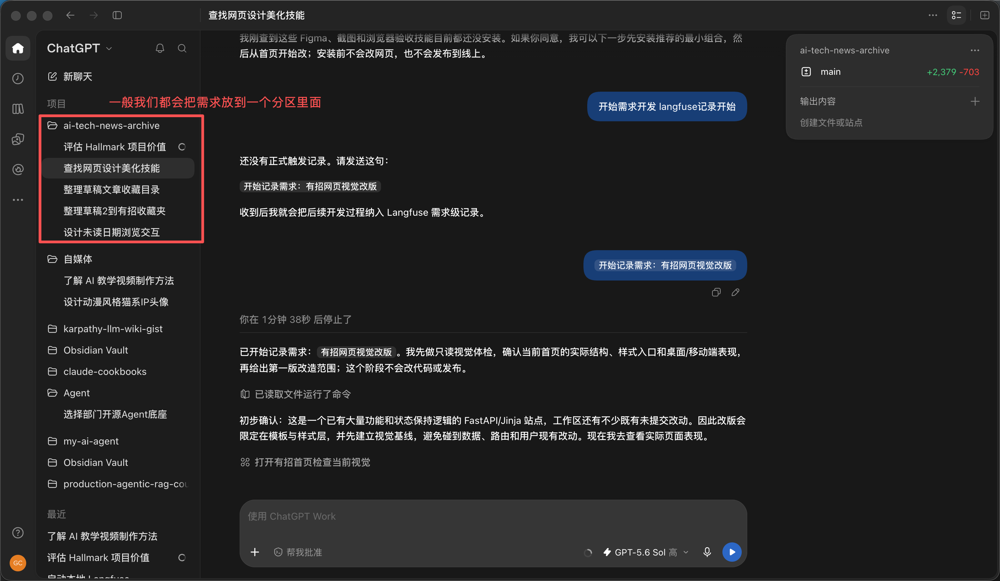
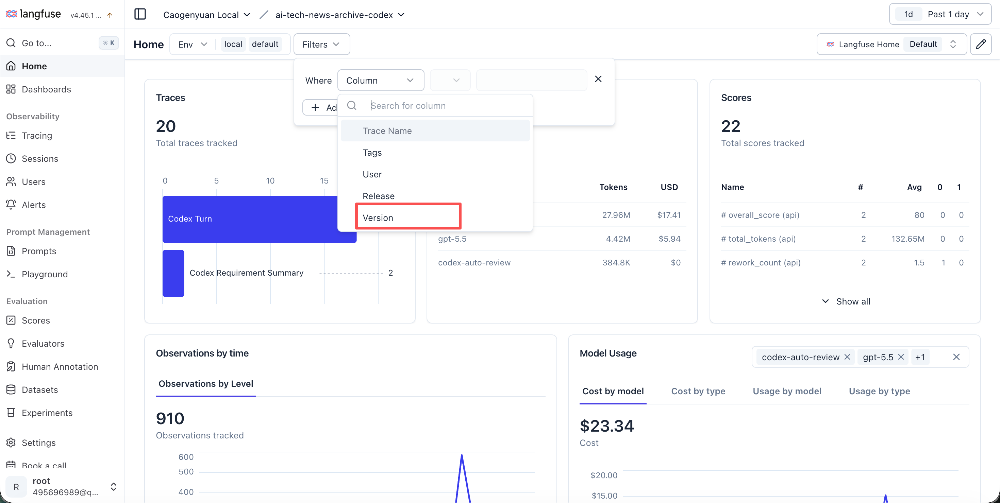

# 第五课：Agent 评测 - Langfuse

> 来源：<https://my.feishu.cn/wiki/Ba9mwre86iflkCkXHlec9klHn4b> ｜ 文档 token `DN8sdAmAToTA51xaTckcd57Snbh` ｜ 抓取时修订号 568 ｜ 抓取日期 2026-10-15
> 系列：Agent 系统设计 第 5 课 ｜ 索引见 [README](README.md) ｜ 上一课 [第四课：Agent 架构设计](04-Agent架构设计.md)

## 分析

**这篇解决什么问题**：把"我的 AI Coding 方式最牛、提效很明显"这种体感争论，变成有过程记录、可版本对比、可归因的评测闭环。落点是 Langfuse 这套工具怎么接、评分表怎么定、程序/LLM/人工怎么分工。

**核心结论**

1. **评测维度是"需求"，不是"会话"**。这是本篇最关键的设计选择：Langfuse 原生层级是 Session（整本聊天）→ Trace（一次问答）→ Observation（页内小动作），而 Codex 这类编程 Agent 把 `Thread_id` 当 Session、一次用户提问当 Trace。但一个需求常常跨多个 Thread，所以要用 **`req_id`** 做聚合键——让 Codex 实现一个 Hook，在"需求 xx 启动"时自动生成 `Req_id` 元数据，聚合时按需求 ID 筛出所有 Session 与 Trace。
2. **版本 = 所有会影响 AI Coding 效果的变量**。不只是模型：Codex 自身版本号、主力编程 Skill（如 SDD Skill）、新接入的 MCP 或知识库、Prompt、验证框架（ArchUnit、单元测试、curl）。识别到这些变化就把 Version 自增 +1，否则两次评测不可比。
3. **三方分工的判据是"这件事需不需要理解"**：程序评硬事实（测试是否通过、页面是否 200、数据量是否一致、有无备份回滚、部署是否成功、成本/Token/耗时、用户是否明说验收通过）；LLM 评需要理解的内容（用户是要返工还是只是询问、需求清单是否全覆盖、证据是否真支持结论、有无遗漏关键场景、文案与交付说明是否清晰）；人工评最终业务判断（页面是否真好看、品牌感觉是否正确、是否愿意正式上线、数据迁移能否签字、程序与 LLM 冲突时怎么裁）。
4. **LLM 不能只返回一个数字**，至少返回 `verdict / score / reason / evidence / confidence`；低置信度或证据不足时返回 `unknown` 进人工复核，**不能硬判**。
5. **人工不做逐条审查**，只重点看五类：高风险需求、LLM 低置信度结果、程序与 LLM 冲突结果、随机抽样、用户拒绝验收的需求。
6. **"完成"有两个状态，不能合并**：自动检查通过 → `candidate_complete`（可以交给用户看了）；用户说"验收通过" → `accepted`（真正完成）。这条区分是很多团队把"AI 做完了"当成"业务做完了"的病根。
7. **硬门槛不可被高分补偿**：核心测试必须通过、旧功能不能被破坏、生产环境必须可访问、用户必须明确验收；硬门槛失败时其他项得分再高也不能判合格。
8. **成本要按顺序问四个问题**：先看做对没有（没做对，再快再便宜也不划算）→ 再看用了多久（与预计时间比）→ 再看花了多少钱（**只和相同类型、相近难度的合格作业比较**）→ 最后看需要帮几次（真正的返工和人工接管才算；发布、提问、查看统计不算返工）。
9. **五个核心指标各自回答一个问题**：`success_rate` / `cost_per_accepted_task` / `time_to_acceptance` / `first_pass_acceptance_rate` / `human_touch_minutes`。注意它们全部以"被验收"为分母，而不是以 Token 成本为分母——这是与"AI 用了多少 token"式统计的根本差别。
10. **评分本身不告诉你下一步改什么**。业内真正用的是闭环：评分 → 找差距 → 按场景切片 → 看失败案例 → 找根因 → 做实验 → 重新评测，并按 KPI 方法拆成主指标、驱动指标、护栏指标。角色分配：程序负责事实，独立 LLM 负责规模化复盘，人工负责标准答案和争议裁决，对照实验负责证明根因，Langfuse 负责把整个闭环连接起来。

**与前四课的关系**：第二、三课给的是**分类器**的指标（Precision/Recall/F1/Micro/Macro），本课给的是**Agent 任务**的指标（成功率、验收成本、首次通过率、人工介入）。第四课那句"评测不能只看最后答案，还要能定位是单个 Agent、路由、handoff 还是汇总出了问题"，在本课由 Trace / Observation 层级和 req_id 聚合来兑现。

**缺口与存疑**

- 六、改进计划一节在原文只写到"按 KPI 方法拆成主指标、驱动指标、护栏指标"就结束，**没有给出这三类指标的对应表**，属于未完成章节。
- 评分表权重（功能正确性 25% / 回归安全性 25% / 需求覆盖度 20% / 视觉与易用性 20% / 线上稳定性 5% / 证据完整性 5%）未说明来源与校准方式；权重之和为 100%，但"硬门槛失败即不合格"意味着这实际是"门槛 + 加权分"两层结构，正文没有把这层关系写成规则。
- "让 Codex 自己识别变化并上报 Version 自增"依赖 Agent 的判断稳定性，缺一个兜底（例如把 Skill/MCP/Prompt 的内容哈希作为版本输入）。
- 文中提到的 LLM 评测代码接入方式只有一句"自己写 Evaluator"，具体实现见被引用的另一篇 wiki（见文末），未在本篇展开。

## 正文

### 一、背景

我们平时在日常工作中每个团队都会有一套自己的 AI Coding 的方式。大家都会说自己的 AI Coding 方式是最牛逼的。

AI 提效的效果也基本上处于每个人自己说自己感觉提效了多少。根本没有过程的记录和评测。

今天就跟大家分享一下我是怎么用 langfuse 来做评测。

### 二、评测维度

首先我们评测的维度是需求维度。



所以我们会有一个 `req_id` 来代表这个需求本身。

在 langfuse 里面，把 Langfuse 想成一本故事书：

- 📚 **Session**：整本书，也就是整个聊天。
- 📄 **Trace**：书里的一页，也就是你问一次、Codex 回一次。
- 🧩 **Observation**：这一页里的小动作，例如模型思考、读取文件、使用工具、运行测试。

```Plain Text
Session 整本书
├── Trace 第1页
│   ├── Observation：思考
│   ├── Observation：使用工具
│   └── Observation：回答
└── Trace 第2页
    ├── Observation：读取文件
    ├── Observation：修改内容
    └── Observation：检查结果
```

但是一般你接入 langfuse 去监控 Codex 这样的编程 Agent，它是把 `Thread_id` 作为 Session，把一次用户发起的问题作为一次 Trace。

但是我们做需求的情况一般都是一个分区里面可能会有多个 Thread。也就是多个 Session。

所以这个时候，我们需要做的就是让 Codex 实现一个 Hook 钩子函数。当你说需求 xx 启动的时候，它自动生成一个 MetaData 属性，就叫 `Req_id`。然后在聚合的时候就可以筛选出来同一个需求 ID 的所有 Session 和 Trace 了。

### 三、版本管理



会影响到你的 AI Coding 效果的，都算是影响 Version 中的变量的一环。

比如说你的 Codex 本身的版本号。你的主力编程 Skill 例如 SDD Skill，或者用了某个新的 MCP，或者接入新的知识库，或者你的 Prompt。包括你用的一些验证框架（ArchUnit、单元测试、Curl 命令等）。

如果会很大程度的影响到你的 AI Coding 的效果的，你就让 Codex 识别到变化，上报埋点到 Langfuse 的时候把 Version 自增 +1。

### 四、如何评测

#### 4.1 评测分工

##### 程序评"硬事实"

例如：

- 测试是否通过；
- 页面是否返回 200；
- 数据数量是否一致；
- 是否有备份和回滚；
- 是否部署成功；
- 花费、Token 和耗时；
- 用户是否明确说了"验收通过"。

##### LLM 评"需要理解的内容"

例如：

- 用户是在要求返工，还是询问、发布、统计；
- 需求清单是否全部覆盖；
- 验证证据是否真的支持结论；
- 有没有遗漏关键场景；
- 页面文案是否符合要求；
- 交付说明是否清晰。

LLM 不能只返回一个数字，至少应该返回：

```Plain Text
{
  "verdict": "pass",
  "score": 86,
  "reason": "需求清单基本覆盖",
  "evidence": ["测试结果", "用户原话"],
  "confidence": 0.82
}
```

低置信度或证据不足时返回 `unknown`，进入人工复核，不能硬判。

##### 人工评"最终业务判断"

例如：

- 这个页面是否真的好看；
- 品牌感觉是否正确；
- 是否愿意正式上线；
- 数据迁移是否可以签字；
- 程序和 LLM 结论冲突时如何处理。

人工不需要逐条查看，重点审核：

- 高风险需求；
- LLM 低置信度结果；
- 程序和 LLM 冲突的结果；
- 随机抽样；
- 用户拒绝验收的需求。

#### 4.2 评测流程

> **固定评测框架，按需求类型选择并锁定不同版本的评分表。**

##### 有没有做完？

> **自动评测负责拦住明显不合格的作业，人工只负责最后的业务判断。**

（原文内嵌表格 `Univ5k`）

| 检查内容 | 谁来评 |
|---|---|
| 测试是否通过、页面是否能打开、有没有报错 | 程序自动评测 |
| 是否完成需求清单、证据是否齐全 | 程序或 LLM 自动评测 |
| 页面是否好看、是否符合真实业务预期 | LLM 初评，人工终审 |
| 用户是否接受结果 | 只能由用户确认 |

```Plain Text
AI 完成开发
    ↓
自动检查通过
    ↓
candidate_complete（可以交给用户看了）
    ↓
用户说"验收通过"
    ↓
accepted（真正完成）
```

##### 作业质量好吗？

（原文内嵌表格 `nPzkEM`）

| 质量维度 | 权重 | 谁来评 | 主要证据 |
|---|---|---|---|
| 功能正确性 | 25% | 程序 | 自动化测试、页面操作 |
| 回归安全性 | 25% | 程序 | 原有筛选、收藏、历史记录等测试 |
| 需求覆盖度 | 20% | LLM＋人工抽检 | 原始需求、最终改动、验收记录 |
| 视觉与易用性 | 20% | 人工主评 | 桌面端、移动端实际体验 |
| 线上稳定性 | 5% | 程序 | 公网页面、服务、定时任务 |
| 证据完整性 | 5% | 程序＋LLM | 测试、截图、部署和验证记录 |

硬指标不能跳过去：如果硬门槛失败，即使其他项目得分很高，也不能判定质量合格。

```Plain Text
核心测试必须通过
旧功能不能被破坏
生产环境必须可以访问
用户必须明确验收
```

##### 做作业花得划算吗？

> **完成一个合格作业，平均花多少钱、多久、多少人工帮助。**

**先看做对没有**——没做对，再快、再便宜也不划算。

**再看用了多久**——实际时间和预计时间比较。

**再看花了多少钱**——只和相同类型、相近难度的合格作业比较。

**最后看需要帮几次**——真正的返工和人工接管才算；发布、提问、查看统计不算返工。

```Plain Text
程序：
耗时3小时49分
成本36.43美元
测试通过
线上正常

LLM：
真正返工可能为0～1次
发布和统计不属于返工
需求覆盖完整度待评分

人工：
视觉效果满意
验收通过
这个结果是否值得36.43美元
```

业内的一些其他指标，作为参考（原文内嵌表格 `Jpaz2G`）：

| 指标 | 计算方式 | 说明 |
|---|---|---|
| 任务成功率 | 成功任务数 ÷ 总任务数 | 最基础指标，失败任务不能算"便宜" |
| 验收通过率 | 验收通过数 ÷ 已交付数 | 衡量交付结果是否真正被接受 |
| 单个成功任务成本 | 总成本 ÷ 成功任务数 | 最核心成本指标 |
| 单个验收任务成本 | 总成本 ÷ 验收通过数 | 比单纯 Token 成本更有意义 |
| 验收用时 | 需求开始到最终验收的时间 | 衡量多久才能得到真正可用的结果 |
| 首次通过率 | 第一次交付通过数 ÷ 总交付数 | 判断 Agent 能否一次做对 |
| 有效返工率 | 真返工任务数 ÷ 总任务数 | 只统计质量问题，发布和提问不算 |
| 平均返工次数 | 有效返工总次数 ÷ 成功任务数 | 反映完成合格任务需要修改几轮 |
| 人工介入率 | 需要人工接管的任务数 ÷ 总任务数 | 判断自动化程度 |
| 人工操作时间 | 人工检查、纠正和接管的时间 | AI 便宜但人工审查很久，也不一定划算 |
| 工具失败率 | 失败工具调用数 ÷ 总工具调用数 | 发现无效搜索、命令失败和重复尝试 |
| 重复工作率 | 重复执行次数 ÷ 总执行次数 | 发现无意义重跑和上下文丢失 |
| 预算偏差 | (实际成本－预算) ÷ 预算 | 判断是否超出预期 |
| 时间偏差 | (实际时间－预计时间) ÷ 预计时间 | 判断是否延期 |
| 任务吞吐量 | 单位时间内完成的合格任务数 | 适合团队和批量任务 |
| 上线后缺陷率 | 上线后发现问题的任务数 ÷ 已上线任务数 | 防止为了速度留下隐患 |

建议关注的五个核心指标（原文内嵌表格 `qN1AGb`）：

| 核心指标 | 回答的问题 |
|---|---|
| success_rate | 有多少任务真正做成功了？ |
| cost_per_accepted_task | 完成一个被验收的任务花多少钱？ |
| time_to_acceptance | 多久才能拿到可验收结果？ |
| first_pass_acceptance_rate | 有多少任务第一次就做对？ |
| human_touch_minutes | 每个任务还需要人花多少时间？ |

### 五、其他

耗时管理

- 🕰️ **总钟**：从开始到结束，中间休息也算。
- 🤖 **AI 工作钟**：只算 Codex 真正干活的时间。
- 🙋 **人类等待钟**：AI 回答后，等待用户再次输入的时间。

LLM 的评测代码怎么接入到 Langfuse 里面：自己写 Evaluator。

团队的其他人怎么快速接入：

> 原文引用另一篇 wiki：《团队成员怎么快速接入 Langfuse 评测自己的编程助手效果》
> <https://my.feishu.cn/wiki/OOcFw29Xyi1QKYkFTrVcV4ahn7b>

各部分放在哪里（原文内嵌表格 `pN6rsE`）：

| 内容 | 放在哪里 |
|---|---|
| 评判任务完成度的 Prompt | Langfuse Prompt |
| 分析 Skill、MCP、知识库根因的 Prompt | Langfuse Prompt |
| 输出改进建议的 Prompt | Langfuse Prompt |
| Prompt 版本、staging/production 标签 | Langfuse Prompt |
| JSON 输出格式校验 | 评测代码 |
| 测试是否通过、耗时、成本等硬指标 | 评测代码 |
| 合格线、指标权重 | 代码或配置文件 |
| 标准案例和历史需求 | Langfuse Dataset |
| 最终评分 | Langfuse Scores |
| 人工复核 | Langfuse Annotation Queue |

### 六、改进计划

评分本身不会自动告诉你下一步改什么。业内真正使用的是：

> **评分 → 找差距 → 按场景切片 → 看失败案例 → 找根因 → 做实验 → 重新评测。**

我按 KPI 方法把它拆成"主指标、驱动指标、护栏指标"。

程序负责事实，独立 LLM 负责规模化复盘，人工负责标准答案和争议裁决，对照实验负责证明根因，Langfuse 负责把整个闭环连接起来。

- **LLM-as-a-Judge**：让另一个 LLM 评分。
- **Agent Trajectory Evaluation**：评估 Agent 的执行轨迹。
- **Error Analysis / Root Cause Analysis**：失败分类和根因分析。
